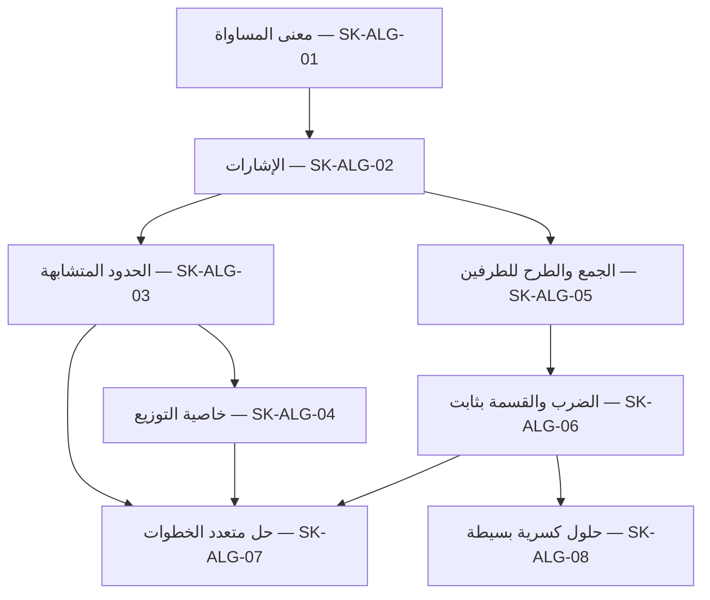

# خُطوة AI — مواصفة المنهج وخريطة المهارات التعليمية

> **اسم الملف:** `05-CURRICULUM.md`  
> **المشروع:** خُطوة AI — منصة عربية الأصل للتعلم التشخيصي والتكيفي  
> **الإصدار:** `1.1`  
> **تاريخ الإعداد:** 03 نوفمبر 2026  
> **الحالة:** **خطة منهج تنفيذية مقترحة، بانتظار اعتماد مختص رياضيات ومالك المنتج**  
> **النطاق:** الجبر المدرسي الأساسي، **معادلات خطية بمتغير واحد «س»** لنسخة الهاكثون  
> **الجمهور:** مسؤولو المحتوى والمناهج، المعلمون، مهندسو التحقق الرياضي، المطورون، مسؤولو الجودة، ووكلاء AI  
> **المراجع الملزمة:** `00-PROJECT-VISION.md` (1.0)، `01-PRD.md` (1.0)، `02-MVP-SCOPE.md` (1.0)، `04-ARABIC-NOTATION.md` (1.0)

---

## 0. الهدف وحدود سلطة الوثيقة

تعرف هذه الوثيقة **ماذا يتعلم الطالب، وبأي ترتيب، وكيف تُلاحظ المهارة من عمله، وكيف نختار تمرينًا علاجيًا ومسألة تحقق جديدة**. كما تحدد تنظيم بنك المسائل ومراجعته وتسمياته. وهي لا تحدد تفاصيل API أو تنفيذ محرك الرياضيات أو خوارزمية إتقان إحصائية.

- **`05-CURRICULUM.md` يملك:** خريطة المفاهيم والمتطلبات السابقة، أهداف التعلم، نطاق أمثلة المنهج، معايير اختيار المسألة والمحتوى، مراجعة المتخصص.
- **`04-ARABIC-NOTATION.md` يملك:** رموز الإدخال، الأرقام، الفواصل، اتجاه المعادلات، التطبيع، والتعبيرات المسموحة/غير المسموحة. لا تتجاوز هذه الوثيقة قراراته.
- **`02-MVP-SCOPE.md` يملك:** سقف P0/P1/P2، والعدد التخطيطي للمسائل والبوابات. هذه الوثيقة **لا توسع P0**.
- **`06-MISCONCEPTIONS.md` يملك:** الوصف الدقيق لكل نمط خطأ، وأدلة تصنيفه، وأسئلة التأكيد، وحالات التشخيص غير المحسوم.
- **`07-TUTORING-POLICY.md` يملك:** خطوات التلميح وآلية تقديم الحل، وشروط الانتقال بين مسارات العلاج.
- **`10-MATH-ENGINE.md` يملك:** كيفية التحقق رياضيًا من الانتقال ومعالجة المجال والحلول غير المألوفة.
- **`14-GOLDEN-DATASET.md` و`15-TEST-AND-ACCEPTANCE.md` يملكان:** مجموعة التقييم المرجعية المستقلة، والعتبات الرقمية، وأدلة الجودة.

**قاعدة ملزمة:** «خُطوة» لا يعاقب الطالب بسبب صياغة سليمة خارج إمكانيات المحلل، ولا يحوّل خطأً في الإدخال إلى ضعف مفاهيمي. لا يعد نجاح سؤال منفرد إثباتًا لإتقان دائم.

### 0.1 تصنيف الأولويات

- **P0:** منهج ومواد وقرارات أساسية داخل تجربة الهاكثون.
- **P1:** تحسين تربوي مشروط بانتهاء P0 واختباره.
- **P2:** توسع منتج مستقبلي، غير مدعوم في نموذج الجبر الحالي.
- **مقترح للمراجعة:** قيمة أو اصطلاح أو عدد لا يصبح معتمدًا لمجرد ظهوره هنا؛ يلزم تأكيد المالك المتخصص.

---

## 1. الإطار الدراسي الذي نعتمده مبدئيًا

| البند | اقتراح النسخة الأولى | ضابط التنفيذ |
|---|---|---|
| المرحلة | طلاب الثانوي أو طلبة يحتاجون تأسيسًا في الجبر | **ليست مطابقة مثبتة لمنهج وطني بعينه** |
| المستوى | تأسيس/علاج في حل المعادلات الخطية | لا ندّعي استيعاب منهج سنة دراسية كاملة |
| المرجع الاصطلاحي | عربي مدرسي مشرقي؛ الأرقام `٠–٩` والمتغير `س` | تُراجع الألفاظ والرموز مع مختص وفق `04-ARABIC-NOTATION.md` |
| لغة الشرح والتمرين | العربية أصلًا | لا نفرض `x` أو تسميات دوال لاتينية على الطالب |
| موضوع P0 | حل معادلات خطية بمتغير واحد، مع الأقواس والتوزيع والإشارات | لا دوال أو أسس متغيرات أو نظم معادلات |
| مجموعة الأعداد | أعداد صحيحة، ونتائج كسرية بسيطة حيث يسمح المحرك | لا كسور جبرية بمقامات متغيرة، ولا أعداد عشرية في P0 |
| نوع التعلم | حل خطوة بخطوة، تفسير، علاج، ومسألة جديدة | حكم التحقق الرياضي منفصل عن فرضية التشخيص |
| مصدر الأسئلة الأول | مسائل أصلية ينشئها الفريق ويعتمدها مختص | لا نسخ غير مرخص من كتب أو منصات |

**قرار مفتوح `CUR-DEC-01`:** لا نذكر اسم دولة أو وزارة أو صف رسمي على واجهة المنتج حتى يحدد مالك المنتج ومعلم مختص المنهج المرجعي والصف ويثبتان تطابق المحتوى معه. إلى ذلك الحين يُعرض «الجبر الأساسي — معادلات خطية» فقط.

---

## 2. نتائج التعلم المستهدفة (Learning Outcomes)

يُتوقع من الطالب بعد ممارسة المهارات المدعومة أن يستطيع — ضمن أنواع المسائل المشمولة فقط — ما يلي:

| المعرّف | نتيجة يمكن ملاحظتها | دليل الأداء المقبول | خارج الاستنتاج |
|---|---|---|---|
| `LO-01` | يقرأ المعادلة المكتوبة بالعربية ويحدد المتغير والطرفين | يختار/يستخدم `س` ويكتب مساواة صحيحة | لا نحكم على مهارته من خطأ مطبعي منفرد |
| `LO-02` | يميز التحويل المكافئ من تغيير الحل | يطبّق العملية المناسبة على طرفي المعادلة | لا نشترط طريقة وحيدة للحل |
| `LO-03` | يجمع الحدود المتشابهة ويتعامل مع إشارات الأعداد | يبسّط التعبيرات دون تغيير مجموعة الحل | النتيجة الخطأ لا تثبت وحدها سببًا مفاهيميًا |
| `LO-04` | يطبق خاصية التوزيع على جميع الحدود داخل القوس | يفك `٢(س + ٣)` بصورة صحيحة | لا نجزم بضعف المفهوم إلا بعد قرينة كافية |
| `LO-05` | يعزل المتغير بالجمع والطرح | يحافظ على تكافؤ المعادلة | يُقبل تجاوز خطوة صحيحة إذا كان مدعومًا |
| `LO-06` | يعزل المتغير بالضرب/القسمة على **ثابت غير صفري** | يصل إلى قيمة صحيحة ويتحقق منها | لا قسمة على `س` أو تعبير متغير |
| `LO-07` | ينسق عدة تحولات للوصول إلى الحل | يقدم مسارًا صحيحًا ولو بترتيب مختلف | السرعة ليست معيار إتقان افتراضيًا |
| `LO-08` | ينقل المهارة لمسألة جديدة بعد توجيه أو علاج | ينجز مهمة مغايرة في البنية السطحية ويسجل مقدار المساعدة | لا يسمى ذلك إتقانًا نهائيًا أو طويل الأمد |

نتائج `LO-01` إلى `LO-07` مرتبطة بمهارات رياضية أو مسار حل، بينما `LO-08` مؤشر تربوي على انتقال فهم محدود، لا «درجة قدرة» مستقلة. لا تُنشأ نسبة إتقان من هذه الأهداف وحدها.

---

## 3. الحدود الرياضية والمحتوى المسموح في P0

### 3.1 ندعم داخل مسائل التعلم

1. الأعداد الصحيحة (الموجبة والصفر والسالبة) كما يحدد ملف الاصطلاح.
2. معادلة واحدة في السطر تضم **علامة مساواة واحدة**، بالمتغير `س` فقط.
3. الجمع والطرح والضرب الصريح أو الضمني في الأنماط المعتمدة، مثل `٢س` و`٢(س + ٣)`.
4. أقواس بسيطة ومعاملات موجبة وسالبة، مع مراعاة أولوية العمليات.
5. القسمة على **ثابت عددي غير صفري**، ونتائج كسرية عددية بسيطة؛ لا نفعّلها في الواجهة إلا بعد اختبار اتجاه الكسر وسلامة تفسيره.
6. معادلات خطية ذات **حل وحيد معلوم** في بنك مسائل P0 المنشور. تقبل طرق حل متنوعة ما دامت صحيحة ومثبتة ضمن قدرة المحرك.

### 3.2 خارج مسائل التعلم المنشورة حاليًا

- المعادلات التربيعية، أسس المتغيرات، الجذور، القيم المطلقة، والمتباينات.
- الدوال المثلثية `جا` و`جتا` و`ظا`؛ **معروفة في الرؤية لكنها غير مفعلة في MVP**.
- معادلات خطية متعددة المتغيرات، الأنظمة، التفاضل والتكامل والإحصاء والهندسة.
- القسمة على متغير أو على تعبير قد يساوي الصفر، والكسور الجبرية المركبة.
- الأعداد العشرية والفاصلة العشرية، والكتابة اليدوية/الصور أو الصوت.
- مسائل بلا حل أو بعدد لا نهائي من الحلول **كبنك تعليمي معتمد** حتى يثبت محرك التحقق تعاملًا صحيحًا معها؛ تستخدم كحالات حراسة/امتناع في الاختبارات عند الحاجة.

**لا يعد استقبال صيغة خارج النطاق دعمًا لتدريسها.** يعيد النظام `unsupported` أو `inconclusive` بحسب السبب، ولا ينسب فشل التحقق إلى الطالب.

---

## 4. خريطة المهارات والاعتماديات

المعرّفات `SK-ALG-*` ثابتة لربط المحتوى والمحاولات والتقارير، **وليست أسماء API أو جداول قاعدة بيانات**.

| مهارة | الاسم المدرسي | المتطلبات السابقة | الأولوية | ناتج التعلم |
|---|---|---|---|---|
| `SK-ALG-01` | معنى المساواة وطرفا المعادلة | قراءة أعداد وعمليات أساسية | P0 تأسيسي | `LO-01`, `LO-02` |
| `SK-ALG-02` | الأعداد الصحيحة والإشارات في التحويلات | `SK-ALG-01` في سياق المعادلات | P0 تأسيسي | `LO-03` |
| `SK-ALG-03` | جمع الحدود المتشابهة والتبسيط | `SK-ALG-02` | P0 | `LO-03` |
| `SK-ALG-04` | خاصية التوزيع ومعامل القوس | `SK-ALG-02`, `SK-ALG-03` | P0 | `LO-04` |
| `SK-ALG-05` | التحويل المتكافئ بالجمع والطرح | `SK-ALG-01`, `SK-ALG-02` | P0 | `LO-02`, `LO-05` |
| `SK-ALG-06` | التحويل المتكافئ بالضرب والقسمة على ثابت | `SK-ALG-01`, `SK-ALG-02`, `SK-ALG-05` | P0 | `LO-02`, `LO-06` |
| `SK-ALG-07` | حل معادلة متعددة الخطوات والتحقق من الحل | `SK-ALG-03`, `SK-ALG-04`, `SK-ALG-05`, `SK-ALG-06` بحسب نوع السؤال | P0 | `LO-07`, `LO-08` |
| `SK-ALG-08` | تمثيل قيمة كسرية بسيطة للحل | `SK-ALG-06` | P0 مشروط باجتياز اختبار الكسور | `LO-06`, `LO-07` |

> «P0 تأسيسي» يعني أن هذه المهارة تُستخدم في تقديم العلاج وقراءة الأداء، لا أنها تتطلب وحدة دراسية موسعة أو اختبارًا عالي المخاطر. وإذا لم يجتز عرض الكسور العربي الفحص، يجري **طلب تغيير نطاق موثّق** بدل نسبة أخطاء العرض إلى الطالب.

### 4.1 تمثيل العلاقات (للشرح، لا لفرض طريق حل)



هذه الخريطة توضح **ترتيب التدريس المعتاد** وتوجيه العلاج؛ لا تُلزم الطالب بإظهار كل خطوة وسيطة إذا قدم طريقًا صحيحًا مختصرًا.

### 4.2 التفريق بين «مهارة» و«نمط خطأ»

- **المهارة:** شيء نريد أن يستطيع الطالب إنجازه، مثل استخدام خاصية التوزيع.
- **نمط الخطأ:** سلوك ملحوظ في خطوة، مثل عدم ضرب الحد الثاني.
- **فرضية سبب الخطأ:** استنتاج تربوي يحتاج قرائن أو سؤال تأكيدي، وقد لا يكون صحيحًا رغم ثبوت خطأ الخطوة.
- **المسألة:** قد تختبر أكثر من مهارة؛ تسجّل المهارات الأساسية والثانوية مسبقًا ولا يُستنتج كل ضعف من خطأ واحد.

---

## 5. بطاقات المهارات التنفيذية (الحد الأدنى P0)

### `SK-ALG-01` — معنى المساواة

- **المطلوب:** تحديد طرفي المعادلة، والتمييز بين تغيير الشكل مع بقاء الحل وبين تبديل علاقة المساواة.
- **مثال سؤال:** `س + ٣ = ٨`.
- **دليل سليم:** الانتقال إلى `س = ٥` مع بقاء الحل؛ أو شرح أن طرح ٣ من الطرفين يحافظ على المساواة.
- **مؤشر تعثر:** تغيير طرف واحد فقط أو تغيير عدد بلا إجراء مكافئ.
- **علاج مبدئي:** مقارنة طرفي ميزان عددي ثم سؤال: «ماذا يحدث لو طرحنا ٣ من طرف واحد فقط؟».
- **مسألة نقل:** `س + ٤ = ٩`، مع تبديل المعطيات لا مجرد إعادة نشر السؤال السابق.
- **مراجعة:** يراجع مختص المادة صياغة التلميح وعدم إيحاء المثال بأن كتابة جميع الخطوات إلزامية.

### `SK-ALG-02` — الأعداد السالبة والإشارات

- **المطلوب:** إجراء عمليات صحيحة على الأعداد الموجبة والسالبة في سياق المعادلات.
- **مثال سؤال:** `س − ٥ = −٢`؛ الحل `س = ٣`.
- **دليل سليم:** `س = −٢ + ٥` ثم `س = ٣`.
- **مؤشر تعثر:** قلب إشارة العدد دون عملية مبررة أو حساب `−٢ + ٥` خطأً.
- **علاج مبدئي:** سؤال عددي صغير عن السالب قبل العودة إلى حل المعادلة.
- **مسألة نقل:** `س − ٧ = −٣`؛ الحل `س = ٤`.
- **مراجعة:** لا يسمى كل خطأ في الإشارة «سوء فهم للسالب» تلقائيًا؛ قد يكون سهوًا.

### `SK-ALG-03` — جمع الحدود المتشابهة

- **المطلوب:** دمج حدود من النوع نفسه دون تغيير العلاقة.
- **مثال سؤال:** `٢س + ٣س = ١٥`؛ خطوة سليمة `٥س = ١٥`، ثم `س = ٣`.
- **مؤشر تعثر:** جمع معاملات المتغير مع حد ثابت أو إغفال إحدى الإشارات.
- **علاج مبدئي:** تمييز «الحد الذي يحتوي س» من العدد الثابت، ثم تطبيق الجمع على مثال عددي/جبري أبسط.
- **مسألة نقل:** `٤س − س = ٩`؛ الحل `س = ٣`.
- **ملاحظة:** عبارة `٢س + ٣س = ١٥` نفسها معادلة خطية ضمن القدرة المدعومة؛ لا نفترض أن المحرك يدعم ضرب متغيرين.

### `SK-ALG-04` — خاصية التوزيع

- **المطلوب:** ضرب معامل القوس في **جميع** الحدود، بما فيها حالة المعامل السالب.
- **مثال سؤال:** `٢(س + ٣) = ١٠`؛ خطوة صحيحة `٢س + ٦ = ١٠`؛ الحل `س = ٢`.
- **مؤشر تعثر:** `٢(س + ٣)` ← `٢س + ٣`؛ هذا انتقال غير مكافئ، لكن سبب الخطأ يحتاج قرينة.
- **علاج مبدئي:** سؤال «هل العدد خارج القوس يضرب الحدين؟» ثم تمرين مضروب في مجموع بسيط.
- **مسألة نقل:** `٣(س + ٢) = ١٨`؛ الحل `س = ٤`.
- **نسخة تتضمن سالبًا:** `−٢(س − ٣) = ١٠`؛ التوزيع الصحيح `−٢س + ٦ = ١٠`؛ الحل `س = −٢`.

### `SK-ALG-05` — الجمع والطرح المكافئان

- **المطلوب:** إضافة/طرح المقدار نفسه من الطرفين للوصول إلى معادلة مكافئة.
- **مثال سؤال:** `٣س + ٥ = ١٤`؛ خطوة `٣س = ٩`؛ الحل `س = ٣`.
- **مؤشر تعثر:** طرح ٥ من طرف واحد دون الآخر، أو اختيار العملية غير المناسبة مع تغير الحل.
- **علاج مبدئي:** عرض تحويلين مختلفين، واحد يحافظ على الحل والثاني لا يحافظ عليه، وسؤال الطالب عن السبب.
- **مسألة نقل:** `٤س − ٣ = ١٣`؛ الحل `س = ٤`.

### `SK-ALG-06` — الضرب والقسمة بثابت غير صفري

- **المطلوب:** عزل `س` بقسمة/ضرب طرفي المعادلة في ثابت غير صفري.
- **مثال سؤال:** `٤س = ١٢`؛ الحل `س = ٣`.
- **مؤشر تعثر:** ضرب الطرفين بدل قسمتهما أو القسمة على عدد آخر دون سبب.
- **علاج مبدئي:** تدريب عدد بسيط في العلاقة بين الضرب والقسمة مع معاينة الحل بالتعويض.
- **مسألة نقل:** `س/٢ = ٤`؛ الحل `س = ٨`، إذا اجتاز تمثيل `س/٢` عقد المحرك.
- **تحذير رياضي:** **لا نعلّم قسمة الطرفين على `س`** ضمن هذه المهارة، لأن ذلك قد يحذف حل `س = ٠`.

### `SK-ALG-07` — تسلسل الحل والتحقق منه

- **المطلوب:** ترتيب التحويلات اللازمة، وقبول طريق مختصر صحيح عند التحقق منه.
- **مثال سؤال:** `٢(س − ٤) + ٦ = ١٠`؛ مثال لمسار: `٢س − ٨ + ٦ = ١٠` ← `٢س − ٢ = ١٠` ← `٢س = ١٢` ← `س = ٦`.
- **دليل سليم:** تعويض `س = ٦` يعطي الطرف الأيسر `٢(٦−٤)+٦=١٠`.
- **مؤشر تعثر:** قفز غير مكافئ أو خطأ تتبع في واحدة من العمليات.
- **علاج مبدئي:** العودة إلى أقرب مهارة ثبتت فيها المشكلة؛ لا تعيد جميع الدروس من البداية.
- **مسألة نقل:** `٣(س − ٢) + ١ = ١٠`؛ الحل `س = ٥`.

### `SK-ALG-08` — نتيجة كسرية عددية بسيطة

- **المطلوب:** كتابة حل كسري عندما يؤدي حل المعادلة الخطية إليه، مع مقام ثابت غير صفري.
- **مثال سؤال:** `٣س + ١ = ٨`؛ `٣س = ٧`؛ الحل `س = ٧/٣`.
- **مؤشر تعثر:** عكس البسط والمقام أو رفض الحل لكونه غير صحيح.
- **علاج مبدئي:** مراجعة معنى القسمة على ٣ وتمثيل الكسر كتعبير عددي صحيح، لا قسمة على متغير.
- **مسألة نقل:** `٤س + ١ = ٨`؛ الحل `س = ٧/٤`.
- **قيد إطلاق:** يجب أن تنجح اختبارات البسط/المقام في محرر المعادلات والعرض العربي قبل إدخال هذه المسائل إلى البنك المنشور.

---

## 6. ربط أنماط الخطأ الستة المرشحة بالمهارات

هذه **معرّفات ربط أولية** (`ERR-ALG-*`) تُثبت لاحقًا في `06-MISCONCEPTIONS.md`؛ لا تعتبر قواعد كشف جاهزة، ولا تسمح بتشخيص جازم عند توفر انتقال خاطئ فقط.

| معرّف الربط | السلوك الذي يمكن ملاحظته | المهارة الأقرب | دليل أولي / احتياط تربوي |
|---|---|---|---|
| `ERR-ALG-01` | ترك أحد حدود القوس دون توزيع | `SK-ALG-04` | تحقق من عدم التكافؤ + سؤال تأكيدي |
| `ERR-ALG-02` | تغيير إشارة عدد دون تحويل مكافئ | `SK-ALG-02`, `SK-ALG-05` | افصل خطأ الإشارة عن اختيار العملية |
| `ERR-ALG-03` | إجراء العملية على طرف واحد دون الآخر | `SK-ALG-01`, `SK-ALG-05` | لا نستنتج النية من تمثيل مختصر وحده |
| `ERR-ALG-04` | الخلط بين العملية وعكسها عند عزل المتغير | `SK-ALG-05`, `SK-ALG-06` | يحتاج حالات تفرق بين السهو والمفهوم |
| `ERR-ALG-05` | خطأ حسابي في عدد صحيح أثناء تحويل صحيح الأساس | `SK-ALG-02`, `SK-ALG-03` | قد يكون حسابيًا عارضًا؛ لا وسم دائم |
| `ERR-ALG-06` | خطأ توزيع معامل سالب على قوس | `SK-ALG-02`, `SK-ALG-04` | حالة خاصة تحتاج تدقيق إشارات |

**منع التكرار:** قد تطابق الخطوة الواحدة أكثر من نمط. يختار التشخيص فرضية مدعومة، أو يعرض سؤالًا يميز بين الاحتمالات، أو يسجل `غير محسوم`. لا يجمع النظام أوصافًا متناقضة على الطالب.

**شرط تفعيل كل نمط:** حالة صحيحة مقابلة، وحالة خطأ مثبتة، وسؤال تأكيدي حين يلزم، وتلميحات معتمدة، ومسألة علاجية ومسألة نقل جديدة، وحالات اختبار تمنع الإنذار الخاطئ.

---

## 7. تصميم الجلسة التعليمية (MVP)

### 7.1 جلسة حل واحدة

1. **اختيار الموضوع:** يعرف الطالب أنه في «حل معادلات خطية بمتغير س» لا «كل الرياضيات».
2. **عرض المسألة:** تعرض بصياغة عربية واتجاه صحيح، مع توضيح المطلوب.
3. **كتابة الخطوات:** يضيف الطالب معادلات واحدة تلو الأخرى؛ تُحفظ كما كتبها مع نسختها الدلالية.
4. **فحص الانتقال:** تصنف النتيجة رياضيًا إلى `verified_valid`, `verified_invalid`, `syntax_error`, `unsupported`, `inconclusive`, `service_error`.
5. **تدخل مناسب:** عند خطأ مثبت يقدم سؤالًا أو تلميحًا، وقد يتطلب التمييز بين تفسيرات الخطأ.
6. **علاج مرتبط بالمهارة:** سؤال صغير أو مثال مراجَع؛ يسجل مقدار المساعدة.
7. **إعادة اختبار في مسألة أخرى:** لا تنسخ قيم المثال السابق فقط؛ يتغير نمط أو وضع علامات أو ترتيب العمليات بصورة مراجعة.
8. **ملخص للمحاولة:** «ما الذي ظهر من الأداء؟» و«ما الذي يحتاج مراجعة؟» و«ما الذي لم يُختبر؟».

### 7.2 قاعدة تربوية مهمة

- يمكن للطالب تقديم **طريق صحيح مختلف**؛ لا يعاقب لأنه خالف خطوات الحل النموذجية.
- يجوز للطالب تخطي خطوة وسيطة إن تحقق محرك الرياضيات من التكافؤ المطلوب.
- لا يعتبر `syntax_error` أو `unsupported` أو `inconclusive` دليل ضعف مهاري.
- لا تظهر نصيحة جازمة عن «سبب الخطأ» بلا دليل كافٍ أو مراجعة إضافية.
- لا يمنح النظام صفة «أتقنت نهائيًا» بناء على نجاح سؤال واحد.
- لا تتغير صحة التحويل بسبب نص يولده LLM؛ حقيقة التحقق مستقلة.

---

## 8. مخطط تشخيصي قبلي وتقييم انتقالي

**في P0 لا يوجد اختبار قبلي متعدد المسائل إلزامي** (`FR-009` مصنف P1). التشخيص يحصل أثناء حل المسألة، ثم سؤال تأكيدي وعلاج ومسألة نقل فهم.

| نقطة قياس | P0 / P1 | ماذا نلاحظ؟ | ما لا يجوز استنتاجه؟ |
|---|---|---|---|
| أثناء الخطوات | P0 | أول انتقال خاطئ أو غير محسوم | لا يحكم وحده على سبب الخطأ أو إتقان المادة |
| سؤال تأكيد | P0 عند الحاجة | دليل إضافي يفرق بين فرضيات | لا يعد امتحانًا شاملًا |
| تمرين علاجي | P0 | الاستجابة لتدخل محدد | النجاح مع تلميح ليس مساويًا للنجاح المستقل |
| مسألة نقل جديدة | P0 | تطبيق المهارة في حالة مختلفة | لا يثبت التذكر طويل الأمد |
| اختبار قبلي قصير متعدد المهارات | P1 | خط أساس بمسائل مناسبة | لا يستخدم قبل اعتماد بنائه |
| مراجعة متأخرة بعد مدة | P1 | مؤشر على الاحتفاظ | يحتاج هوية واستمرارية وموافقة بيانات |

### 8.1 تصميم نسخة النقل

يجب أن تختلف مسألة النقل عن العلاج في **بعد واحد على الأقل ذي معنى**، مثل معامل سالب، أو انتقال من `س + عدد` إلى `س − عدد`، أو تغيير ترتيب الأطراف؛ لا يكفي إعادة تغيير الأرقام بلا هدف. يجب أن يكون الاختلاف مناسبًا للمهارة، ومراجَعًا، ولا يضيف مفهومًا جديدًا خارج P0.

---

## 9. مخطط بنك المسائل الأولي (١٢–٢٠ مسألة)

**توزيع تخطيطي غير معتمد:** البداية المقترحة **١٨ مسألة أصلية مراجعة** موزعة كما يلي؛ قد تختبر المسألة أكثر من مهارة، ولكن لكل مسألة هدف أساسي مصرح به.

| مجموعة المحتوى | عدد مقترح | مثال نوع المسألة | الهدف الأساسي |
|---|---:|---|---|
| مساواة وجمع/طرح مباشر | ٣ | `س + ٣ = ٨` | `SK-ALG-01`, `SK-ALG-05` |
| أعداد سالبة/إشارات | ٣ | `س − ٥ = −٢` | `SK-ALG-02` |
| حدود متشابهة | ٢ | `٢س + ٣س = ١٥` | `SK-ALG-03` |
| توزيع موجب | ٣ | `٢(س + ٣) = ١٠` | `SK-ALG-04` |
| توزيع سالب | ٢ | `−٢(س − ٣) = ١٠` | `SK-ALG-04`, `SK-ALG-02` |
| عزل بضرب/قسمة | ٢ | `٤س = ١٢` | `SK-ALG-06` |
| حل متعدد الخطوات | ٢ | `٢(س − ٤) + ٦ = ١٠` | `SK-ALG-07` |
| نتيجة كسرية بسيطة | ١ | `٣س + ١ = ٨` | `SK-ALG-08` |
| **الإجمالي** | **١٨** | — | لا يعد عددًا منشورًا قبل المراجعة |

**لا تقتصر التجربة على ١٨ نصًا ثابتًا بالضرورة:** يمكن إنشاء تنويعات مضبوطة أو إعادة استعمال القوالب، لكن جميع المسائل التي تظهر للطالب يجب أن تجتاز تحقق المعنى والنتيجة والمراجعة وفق سياسة المحتوى؛ ولا نزعم دعم «توليد لا نهائي».

### 9.1 الفصل بين أنواع المحتوى

- **سؤال منشور (Learning item):** ما يراه الطالب للتعلم.
- **مثال شرح (Worked example):** يُظهر خاصية أو خطوة، وقد يكشف جزءًا من الحل.
- **سؤال تأكيدي:** هدفه تمييز فرضية تشخيصية، لا إصدار حكم نهائي.
- **تمرين علاجي:** أصغر وموجه لمهارة محددة.
- **مسألة نقل:** جديدة ومغايرة في سمة ذات معنى؛ لا تعرض مسبقًا في التلميح.
- **حالة اختبار مرجعية (Gold case):** تبقى في مجموعة مستقلة، ولا تُستخدم لتلقين النظام إجابات التقييم.

### 9.2 منع تسرّب أمثلة التقييم

- يُمنع استخدام نصوص مجموعة التقييم المخفية في أمثلة الشرح أو قوالب LLM.
- يُفصل **التطوير** عن **التقييم المستقل**؛ يعيد القائمون على الجودة اختبار النظام على أمثلة لم تُستخدم في ضبط التلميحات.
- إذا اكتشف الفريق تكرارًا بين مجموعتي التدريب والتقييم، يُسجل ذلك وتُستبدل عينة التقييم وفق سياسة واضحة؛ لا تُخفى النتيجة.

---

## 10. عقد المحتوى التربوي لكل مسألة

هذه **حقول دلالية مطلوبة** بغض النظر عن أسماء الجداول أو JSON النهائي؛ تعتمد الأسماء النهائية في `11-DATA-MODEL.md` و`12-API-CONTRACT.yaml`.

| الحقل المفاهيمي | المطلوب | ملاحظات تحقق |
|---|---|---|
| معرّف ثابت + إصدار | تعقب التحديثات دون تبديل نتيجة محاولات قديمة | لا تعدل مسألة منشورة بصمت |
| العنوان والموضوع | صياغة عربية ووسم `SK-ALG-*` | يراجع مختص المادة |
| نص السؤال الأصلي | كما يراه الطالب، بالاصطلاح المعتمد | تحافظ الواجهة على المصدر الخام |
| التعبير الدلالي المرجعي | بنية معادلة محددة ومجال متغيرها | مسؤولية المحرك الرياضي |
| نوع الحل | حل وحيد في بنك P0 المنشور | تُراجع شروط المسألة |
| الحل المرجعي | قيمة `س` المثبتة، وقد تكون كسرية بسيطة | يقبل مسارات حل متنوعة |
| مستوى الصعوبة | من سلم واضح ومراجع | لا يحدد من طول النص فقط |
| مهارة رئيسية/ثانوية | ربط بأهداف التعلم | تجنب استنتاج خاطئ عن جميع المهارات |
| المتطلبات السابقة | روابط بخريطة المهارات | لتوجيه العلاج لا لإجبار ترتيب الحل |
| حلول صحيحة محتملة | أكثر من مسار عندما يفيد | لا تشترط مطابقة نصية |
| أخطاء متوقعة | روابط `ERR-ALG-*` بعد اعتمادها | فرضيات، لا تعليمات حكم رياضي |
| سؤال تأكيد | إذا كان تفسير الخطأ غير محسوم | نص مراجَع غير موجّه للإجابة |
| تلميحات وعلاج | ٢–٣ مستويات نموذجية وفق سياسة `07` | لا تكشف الحل كاملًا مباشرة |
| مسألة نقل مرتبطة | تختلف عن الشرح في سمة ذات معنى | تحجب حتى مرحلة إعادة الاختبار |
| مصدر المحتوى/الرخصة | كتابة أصلية أو مصدر مرخص | لا نسخ غير مصرّح |
| حالة المراجعة | مسودة / مراجعة / معتمدة / معطلة | اسم أو رمز المراجع وتاريخ الإصدار |

### 10.1 نموذج عملي موجز غير ملزم بتنسيق التخزين

```yaml
item_id: ALG-LIN-0001
version: 1
status: draft_pending_teacher_review
notation_profile: ar-mashriq-school-v1
subject: الجبر الأساسي
topic: خاصية التوزيع
primary_skill: SK-ALG-04
secondary_skills: [SK-ALG-05, SK-ALG-06]
problem_ar: "٢(س + ٣) = ١٠"
math_domain: real_numbers
reference_solution_ar: "س = ٢"
correct_transition_example_ar: "٢س + ٦ = ١٠"
invalid_transition_example_ar: "٢س + ٣ = ١٠"
expected_error_candidates: [ERR-ALG-01]
requires_teacher_review: true
requires_symbolic_verification: true
transfer_item_id: ALG-LIN-0002
```

**تنبيه:** هذا نموذج مواصفات محتوى فقط، وليس عقد API أو شكل قاعدة بيانات. استخدام حقل `status: draft_pending_teacher_review` مقصود حتى لا يبدو المثال مصدقًا مسبقًا.

---

## 11. سلم الصعوبة وتوزيع المساعدة

### 11.1 مستويات الصعوبة المقترحة

| المستوى | معيار عملي | مثال |
|---|---|---|
| `D1` — تمهيدي | عملية عزل واحدة، أعداد صغيرة صحيحة، بلا أقواس | `س + ٣ = ٨` |
| `D2` — متوسط | عمليتان، أو إشارات سالبة، أو توزيع واحد | `٢(س + ٣) = ١٠` |
| `D3` — مركب داخل P0 | عدة عمليات مدعومة، أو طرفان يحتويان س، أو نتيجة كسرية بسيطة | `٢(س − ٤) + ٦ = ١٠` |

هذا سلم **تخطيطي**؛ يجب مراجعته تربويًا وعدم الاعتماد على عدد الرموز وحده. لا ننشئ مستويات `D4+` بلا دعم في المحرك والمنهج.

### 11.2 قواعد اختيار التمرين التالي

1. إذا ثبت انتقال خاطئ مرتبط بمهارة: ابحث عن مثال علاجي يزيل تعقيدًا غير ضروري.
2. إذا لم يكن سبب الخطأ معلومًا: اختر سؤالًا تشخيصيًا واحدًا يميز الاحتمالات قبل التدريب.
3. إذا كان الانتقال `unsupported` أو `inconclusive`: قدم مساعدة بشأن حدود الإدخال أو ارفع للمراجعة، لا تعالج «ضعفًا» بلا دليل.
4. بعد العلاج: اختر مسألة نقل بنفس المهارة، **لكن ليست نسخة مطابقة**.
5. سجل هل تمت المحاولة بلا مساعدة، أم بعد تلميحات، أم بعد كشف حل جزئي.
6. إذا أخفق الطالب في النقل: يعود لمسار أبسط مرتبط بمتطلب سابق، ولا يتكرر نفس السؤال إلى ما لا نهاية.

لا يحق للمولد إنشاء سؤال علاجي تلقائيًا ثم نشره دون تحقق ومراجعة معتمدة بالمستوى المطلوب.

---

## 12. الدليل على التقدم ومستويات التعبير عنه

**لا نقرر هنا معادلة إتقان رياضية، ولا نسبة احتمالية غير مؤسسة**؛ ذلك يحتاج بيانات معايرة واختبارات في `07-TUTORING-POLICY.md` و`15-TEST-AND-ACCEPTANCE.md`.

| حالة تعرض للطالب | متى يمكن استخدامها؟ | ما لا تعنيه |
|---|---|---|
| **لم تُختبر بعد** | لا توجد محاولة مناسبة للمهارة | لا تعني ضعفًا أو درجة صفر |
| **تحتاج مراجعة** | توجد صعوبة مرصودة في مهمة مدعومة مع دليل | لا تعني ضعف قدرة ثابتًا |
| **تقدّم ملحوظ في هذه المحاولة** | ظهر تحسن في أداء جديد مقارنة بمهمة سابقة تحت شروط معلومة | لا تثبت تحسنًا طويل المدى |
| **ظهرت المهارة في مسألة جديدة** | نجاح مسألة نقل مستقلة مع توثيق مستوى المساعدة | لا تعني إتقانًا نهائيًا |
| **لا يمكن تحديد الحالة حاليًا** | الإدخال غير مدعوم/غير محسوم أو الأدلة متعارضة | لا يُحسب إخفاقًا على الطالب |

يُظهر سجل الطالب **المهمة، والمهارة، ونوع الدليل، ووقت حدوثه، والمساعدة المقدمة، وحدود الاستنتاج**. وتعرض لوحة المعلم عينات مدعومة فقط، ولا تقارن الطلاب بترتيب تجاري أو «ذكاء» عام.

---

## 13. أمثلة الانتقالات والتحقق: ما الذي يُقبل وما الذي لا نحكم عليه

| رقم | من → إلى | التصنيف المتوقع | المغزى التعليمي |
|---|---|---|---|
| `CUR-CASE-01` | `٢(س + ٣) = ١٠` → `٢س + ٦ = ١٠` | `verified_valid` | توزيع صحيح |
| `CUR-CASE-02` | `٢(س + ٣) = ١٠` → `٢س + ٣ = ١٠` | `verified_invalid` | قرينة على إغفال توزيع |
| `CUR-CASE-03` | `٢(س + ٣) = ١٠` → `س + ٣ = ٥` | `verified_valid` | مسار بديل صحيح |
| `CUR-CASE-04` | `٢س + ٦ = ١٠` → `٢س = ٤` | `verified_valid` | طرح من الطرفين |
| `CUR-CASE-05` | `٢س + ٦ = ١٠` → `٢س = ١٦` | `verified_invalid` | خطأ في اتجاه عملية/عدد |
| `CUR-CASE-06` | `−٢(س − ٣) = ١٠` → `−٢س + ٦ = ١٠` | `verified_valid` | توزيع سالب صحيح |
| `CUR-CASE-07` | `−٢(س − ٣) = ١٠` → `−٢س − ٦ = ١٠` | `verified_invalid` | قرينة على خطأ إشارات |
| `CUR-CASE-08` | `٣س = ٧` → `س = ٧/٣` | `verified_valid` بعد اعتماد الكسور | حل كسري بسيط |
| `CUR-CASE-09` | `٣س = ٧` → `س = ٣/٧` | `verified_invalid` بعد اعتماد الكسور | قلب الكسر |
| `CUR-CASE-10` | `جا(٣٠°) = ١/٢` | `unsupported` | دوال مثلثية خارج P0 |
| `CUR-CASE-11` | `٢س + ٣ =` | `syntax_error` | إدخال ناقص، لا ضعف رياضي مثبت |
| `CUR-CASE-12` | `١/٢س = ١` | `syntax_error` أو «ملتبس» وفق اصطلاح `04` | طلب أقواس، لا تخمين |
| `CUR-CASE-13` | `س² = س` → `س = ١` بالقسمة على س | `unsupported` أو `inconclusive` ضمن P0؛ لا مكافأة صحة الخطوة | لا نحذف حالة س=٠ |
| `CUR-CASE-14` | انتقال صحيح رياضيًا لكن عجز المحرك عن إثباته ضمن حدود العمل | `inconclusive` | لا نحول قصور المحرك إلى خطأ طالب |

**ملاحظة:** هذه حالات تصميم مرجعية؛ لا نعدها نتائج تنفيذ ناجحة حتى تُشغّل فعليًا. الحكم الدقيق في الاختبارات على الأخطاء البنيوية والالتباس يُثبّت في `04` و`10`، ويعاد ربطه بعقد API لاحقًا. جميع حالات `verified_*` مشروطة باجتياز محرك التحقق اختبارات معناها ومجالها.

---

## 14. حوكمة المحتوى وتدقيقه

### 14.1 دورة اعتماد المسألة

1. يكتب محرر المحتوى سؤالًا **أصليًا** مع الهدف والمهارة والإجابة المرجعية والقيود.
2. يراجعه مختص رياضيات للتأكد من صحة الحل، وصياغة العربية، وملاءمة المستوى.
3. يمرر السؤال إلى محرك التحقق ويُجرى اختبار مسار صحيح وخاطئ وبديل صحيح إذا أمكن.
4. يراجع مختص التربية التلميحات وسؤال التأكيد، بما في ذلك أثر كشف الحل مبكرًا.
5. تتحقق الجودة من عرض الرموز والكسور على الهاتف والحاسوب والنسخ/اللصق.
6. يعتمد المسؤول السؤال وينشر إصدارًا غير قابل للتعديل بصمت.

### 14.2 حالات المحتوى

`draft` → `in_review` → `approved` → `published`، أو `rejected` / `retired` مع بيان السبب. تحديث السؤال المنشور ينشئ **إصدارًا جديدًا**، وتبقى نتائج المحاولات السابقة مرتبطة بالإصدار الذي شاهده الطالب.

### 14.3 سياسة استخدام التوليد الآلي

- يحق لـAI اقتراح صياغة أو تلميح أو تنويع، **ولا يحق له اعتماد صحة الحل أو نشر السؤال منفردًا**.
- يُتحقق من الحل عبر المحرك ضمن النطاق، وتراجع الصياغة والهدف تربويًا.
- يُحفظ إصدار السؤال والتلميح والسياسة المستعملة عند عرض المساعدة.
- إذا فشل مزود AI، تبقى الأسئلة والتلميحات المراجعة متاحة لتكملة التجربة قدر الإمكان.

### 14.4 الحقوق والملكية

- الأولوية لمسائل أصلية يكتبها الفريق.
- لا نسخ لتمارين كتب أو منصات محمية بلا ترخيص مناسب.
- توثّق المصادر والتراخيص لأي سؤال أو تعريف مقتبس، ويزال المحتوى عند تعذر إثبات حق استخدامه.

---

## 15. ربط المنهج بتجربة الطالب ولوحة المعلم

| المستخدم | العنصر المرئي | ما يعرض | ما يجب تجنبه |
|---|---|---|---|
| الطالب | صفحة اختيار الموضوع | «معادلات خطية»، ووصف مختصر للمهارات | الإيحاء بدعم جميع الرياضيات |
| الطالب | شاشة الحل | السؤال العربي، وإضافة خطوات، وبيان صحة الانتقال | فرض أسلوب حل واحد |
| الطالب | صفحة التشخيص | أول انتقال يحتاج مراجعة، أو حد الثقة | وصف الطالب بأنه «لا يفهم» من محاولة واحدة |
| الطالب | صفحة العلاج | تلميح ومهمة أصغر ثم سؤال جديد | كشف الحل النموذجي كاملًا منذ البداية |
| الطالب | ملخص التقدم | دليل ونتيجة ومقدار المساعدة | نسبة إتقان مختلقة |
| المعلم | لوحة مختصرة | تجميعات على مستوى المهارة ونوع الملاحظة وعينة واضحة | كشف هويات أو بيانات غير مصرح بها |
| المعلم | مراجعة مثال | خطوة الطالب ونطاقها وسبب التنبيه | اعتبار عدم دعم الإدخال فشلًا تربويًا |

لوحة المعلم في P0 تعتمد **بيانات اصطناعية فقط موسومة صراحة** دون جلسات طلاب حقيقية؛ لا تُنشأ فصول دراسية أو صلاحيات مؤسسات حقيقية داخل الهاكثون افتراضيًا.

---

## 16. معايير قبول المنهج (Curriculum Acceptance)

هذه المعايير **اختبارات وجود وصحة**. أما النسب الرقمية ودقة الكشف النهائية فتحددها `15-TEST-AND-ACCEPTANCE.md` بعد إعداد البيانات الفعلية.

| المعرّف | شرط القبول | دليل الاعتماد |
|---|---|---|
| `CUR-ACC-01` | اعتمد معلم مختص الصف أو وصف المستوى والمرجع الاصطلاحي | توقيع قرار `CUR-DEC-01` |
| `CUR-ACC-02` | جميع مهارات بنك P0 تتبع `SK-ALG-*` ونتائج `LO-*` | قائمة المحتوى والمراجعة |
| `CUR-ACC-03` | كل سؤال منشور له حل واحد مثبت ومجال موثق | سجل مراجعة ومحرك فحص |
| `CUR-ACC-04` | لكل خطأ مستهدف مثال صالح ومثال خطأ ومهمة علاج ونقل | مراجعة `06`, `07` وبنك الأسئلة |
| `CUR-ACC-05` | لا تتطلب مسألة P0 رمزًا أو عملية غير مدعومة في `04` و`02` | تشغيل حالات حد النطاق |
| `CUR-ACC-06` | يقبل المحرك مسارًا بديلًا صحيحًا داخل نطاقه | حالة مرجعية تفاعلية |
| `CUR-ACC-07` | يعرض الإدخال العربي والكسور المعتمدة دون قلب معناها | فحص RTL وحاسوب وهاتف |
| `CUR-ACC-08` | لا يُحسب `syntax_error` أو `unsupported` أو `inconclusive` رسوبًا | مراجعة واجهة وتقرير |
| `CUR-ACC-09` | تسجل المساعدة ويُفصل أثرها عن النجاح المستقل | سجل المحاولة |
| `CUR-ACC-10` | توجد مسألة جديدة غير مطابقة لعلاج كل نمط معتمد | مراجعة بنك النقل |
| `CUR-ACC-11` | تحدد الأسئلة الأصلية ومصادر أي اقتباس وتراخيصها | سجل الحقوق |
| `CUR-ACC-12` | لا تعرض لوحة المعلم في P0 إلا بيانات اصطناعية موسومة فقط | اختبار الصلاحيات والعرض |
| `CUR-ACC-13` | يخضع التعديل لإصدار جديد ويحفظ ارتباط المحاولات القديمة | اختبار إدارة إصدارات المحتوى |
| `CUR-ACC-14` | تنشر قائمة حدود الدعم للطالب والمعلم دون وعود مواد مستقبلية | مراجعة نسخة العرض |

**حاجز إطلاق:** إذا وُجد سؤال منشور غير صحيح الحل، أو قُلب معنى رمز/كسر بالعرض، أو عُد الإدخال غير المدعوم ضعفًا لدى الطالب، فهذه مشكلة تمنع الاعتماد إلى حين إصلاحها أو إزالة السؤال المعني بإجراء موثق.

---

## 17. التنفيذ على مدى عشرة أيام وتوزيع العمل

يتبع الجدول ترتيب `02-MVP-SCOPE.md` ويصف **اعتماد المحتوى** بالتوازي مع البناء، لا وعدًا بأن كل خطوة ستكتمل في يوم بعينه.

| الفترة | عمل المنهج والمحتوى | التبعية/نقطة التسليم |
|---|---|---|
| اليومان ١–٢ | اعتماد المستوى والمهارات والاصطلاحات، كتابة مسائل P0 الأولى | `GATE-0`؛ مراجعة مختص رياضيات |
| اليومان ٣–٤ | مراجعة الحالات الأساسية والحلول والبدائل وسؤال التشخيص | يستهلكها المحرك في `GATE-1` |
| اليومان ٥–٦ | إكمال أمثلة الأنماط، والتمارين العلاجية ومسائل النقل | ربط `06-MISCONCEPTIONS.md` و`07-TUTORING-POLICY.md` |
| اليومان ٧–٨ | مراجعة بنك الأسئلة ولوحة المعلم وحدود الاستنتاج | `GATE-2` و`GATE-3` |
| اليوم ٩ | مراجعة الجودة مع حالات مستقلة وتصحيح المحتوى | `14` و`15`؛ حفظ نتائج فعلية |
| اليوم ١٠ | تجميد نسخة المحتوى وتسليم سيناريو عرض حقيقي | `GATE-4` |

**مسؤوليات عملية:**

- **مالك المنتج:** اعتماد المستوى والنطاق والقرارات التي تؤثر في الوعد للمستخدم.
- **مختص الرياضيات/المنهج:** صحة المسائل والأهداف والاصطلاحات والتصنيفات المعتمدة.
- **مختص التربية/AI:** جودة الأسئلة التوجيهية والعلاج، وحالات الامتناع عن التشخيص.
- **مهندس المحرك:** صحة المعنى والتحويلات، وعدم اعتبار الأمثلة حدًا وحيدًا للحل.
- **مسؤول الجودة:** مجموعة تقييم مستقلة وأدلة الاختبارات وعدم تسرب الإجابات.
- **وكلاء البرمجة:** تنفيذ العقود المعتمدة فقط، وتقديم تغييرات قابلة للمراجعة.

---

## 18. تعليمات ملزمة لوكلاء AI المنفذين

1. لا تختار بلدًا/صفًا أو تنسب المنهج رسميًا لوزارة دون قرار `CUR-DEC-01` موثق.
2. لا تضف مهارات خارج `SK-ALG-01` إلى `SK-ALG-08` كميزات معلنة P0 دون طلب تغيير معتمد.
3. لا تجعل مثال حل واحد هو القاعدة الوحيدة المقبولة؛ صحة الرياضيات تُحسم بمحرك التحقق ضمن المجال.
4. لا تعرّب الشيفرة البرمجية مستقبلًا؛ ولا تدخل رموز `جا/جتا` إلى MVP بذريعة وجودها في وثائق الرؤية.
5. احفظ التمييز بين نتيجة **التحقق الرياضي** وفرضية **الخطأ التربوي** ومستوى **المساعدة**.
6. استخدم رموز وأرقام `04-ARABIC-NOTATION.md`، واختبرها على الهاتف والحاسوب.
7. لا تفسر `unsupported` أو `inconclusive` على أنها ضعف تعلم، ولا تمنح الطالب نسبة إتقان افتراضية.
8. لا تختلق مصدر سؤال أو نسبة نجاح أو مراجعة معلم؛ سجل `draft` حتى الاعتماد الفعلي.
9. لا تضع أمثلة تقييم سرية داخل المطالبات الموجهة للنموذج؛ افصل بيانات الاختبار.
10. عند أي تعارض، أوقف الجزء المتأثر، وارفع قرارًا إلى مالك الوثيقة المعنية، ثم حدّث الروابط والاختبارات.
11. في تقرير التسليم، اذكر: المسائل التي أضيفت، ونسخها، ومن راجعها، وما الذي فُحص فعليًا، وما بقي غير محسوم.

---

## 19. القرارات المفتوحة واعتمادات المحتوى

| الرمز | القرار | المقترح المبدئي | صاحب الاعتماد | الحالة |
|---|---|---|---|---|
| `CUR-DEC-01` | الدولة/الصف/مرجع منهج رسمي إن وجد | جبر تأسيسي لطلاب ثانوي، بلا نسبة رسمية | مالك المنتج + معلم رياضيات | مفتوح |
| `CUR-DEC-02` | مراجعة أهداف التعلم `LO-*` ومستويات المهارات | اعتماد الثماني مهارات ضمن P0 | مختص المادة | مفتوح |
| `CUR-DEC-03` | العدد النهائي للأسئلة المنشورة | ١٨ مبدئيًا ضمن نطاق ١٢–٢٠ | المحتوى + المنتج | مفتوح |
| `CUR-DEC-04` | قائمة الأنماط الستة وأدلة تشخيصها | المرشحون من `02-MVP-SCOPE.md` | مختص الرياضيات + مختص التربية | مفتوح؛ يثبته `06` |
| `CUR-DEC-05` | سياسة مراجعة/إجازة التلميحات | تلميح تدريجي وسؤال نقل مستقل | مختص التربية | مفتوح؛ يثبته `07` |
| `CUR-DEC-06` | تفعيل مسائل النتائج الكسرية في النسخة المنشورة | مشروط بنجاح عرض وقراءة الكسور | قائد المحرك + الواجهة + مختص المادة | مفتوح |
| `CUR-DEC-07` | سياسة مسائل لا حل/حلول غير منتهية | اختبار امتناع فقط، لا بنك منشور | المحرك + مختص المادة | مفتوح |
| `CUR-DEC-08` | بيانات المعلم وسلامة الخصوصية | بيانات اصطناعية معلّمة فقط في P0؛ لا جلسات طلاب حقيقية | المنتج + مسؤول الخصوصية | سياسة المالك موثقة؛ مراجعة الخصوصية والتنفيذ معلقان |
| `CUR-DEC-09` | عتبات قبول دقة المحتوى والتشخيص | بعد بناء مجموعة مراجَعة | مسؤول الجودة + مختص الرياضيات | مفتوح؛ يثبته `15` |

### محضر اعتماد نسخة المنهج

- **المراجع التربوي:** [لم يعيّن بعد]
- **مراجع الرياضيات:** [لم يعيّن بعد]
- **مالك المنتج:** [لم يعيّن بعد]
- **المنهج/الصف إن اعتُمد:** [لم يحدد بعد]
- **ملف الاصطلاح المستخدم:** `ar-mashriq-school-v1` — مبدئي بانتظار الاعتماد
- **عدد المسائل المجازة فعليًا:** [لم يُقَس بعد]
- **عدد أنماط الخطأ المجازة فعليًا:** [لم يُقَس بعد]
- **تاريخ التجميد:** [لم يحدد بعد]

---

## 20. المراجع والتبعيات والتغيير

### 20.1 وثائق المشروع المرتبطة

- `00-PROJECT-VISION.md`: المشكلة والرسالة والتميّز والحدود.
- `01-PRD.md`: متطلبات الوظائف، ورحلات الطالب والمعلم، ونماذج التقدم.
- `02-MVP-SCOPE.md`: أولويات P0/P1/P2، وبوابات الاعتماد وخطة الزمن.
- `04-ARABIC-NOTATION.md`: الاصطلاحات، والترميز، والعرض والقراءة الرياضية.
- `06-MISCONCEPTIONS.md`: التصنيف النهائي للأخطاء والأدلة وأسئلة التأكيد.
- `07-TUTORING-POLICY.md`: سياسة التلميحات والتدرج والعلاج والإتقان.
- `10-MATH-ENGINE.md`: تحليل التعبيرات والتحقق من تكافؤ المعادلات.
- `14-GOLDEN-DATASET.md`: أمثلة التقييم المستقلة بعد اعتماد المراجع الرياضي.
- `15-TEST-AND-ACCEPTANCE.md`: اختبارات القبول والعتبات وأدلتها.

### 20.2 قاعدة تغيير المنهج

أي تعديل لمهارة أو مسألة أو شرط سابق أو اصطلاح أو مجموعة تقييم يجب أن يسجل:

1. **ما تغير؟** معرّف المهارة/المسألة ونسختها.
2. **لماذا؟** سبب تعليمي أو رياضي ودليل الحاجة.
3. **ما أثره؟** على `02`، و`04`، و`06`، و`07`، و`10`، و`14`، و`15` حسب الموضع.
4. **من اعتمده؟** معلم المادة ومالك المنتج عند تأثير التغيير في النطاق.
5. **كيف تحققنا؟** اختبارات فعلية، وقبول محتوى، ومراجعة عرض العربية.

لا تحذف إصدارات المحتوى القديمة التي ترتبط بمحاولات قائمة، ولا تعاد كتابة بيانات تقييم سابقة لتبدو صحيحة وفق منهج محدث.

### 20.3 سجل الإصدارات

| الإصدار | التاريخ | التغيير | الحالة |
|---|---|---|---|
| `1.0` | 2026-11-03 | وضع خريطة ٨ مهارات ومخرجات تعلم، وربط ٦ أنماط أخطاء مقترحة، وتوزيع بنك المسائل والعلاج والنقل وضوابط المحتوى والقبول | **مسودة للاعتماد** |

**خلاصة تنفيذية:** نجاح هذه الوثيقة لا يعني إنتاج «منهج جبر كامل». يعني أن كل مسألة في نسخة الهاكثون مرتبطة بمهارة وهدف واضحين، وأن الخطأ يُفحص أولًا رياضيًا، ثم يعالج تربويًا بأدلة ومهمة جديدة — باستخدام كتابة رياضية عربية سليمة، ودون ادعاء دعم ما لم يُنفذ.


## ملحق تصحيح PH-00 — 2026-11-04

توحيد وثائقي بتكليف المالك لاستكمال PH-00 فقط؛ لا اعتماد أمني/تربوي أو اجتياز بوابة. سجل التغيير والأدلة في [تقرير التصحيح](../qa-reports/ph00-correction-report.md).

## امتداد تطوير لاحق — 2026-11-07

طلب المالك تنفيذ حزمة تطوير ما بعد الهاكثون كاملة في المحادثة الحالية، مع تأجيل تشغيل البيئة والاختبارات الثقيلة. تسري مواصفة [امتداد التطوير](19-POST-HACKATHON-DEVELOPMENT.md) والعقد العام بإصدار `1.1.0-development` على إضافات DEV-01…07 فقط؛ تبقى نتائج P0 وسجلات مراجعته تاريخية دون تغيير أو ادعاء اعتماد. تشمل الإضافات حسابات OTP واستوديو محتوى بإصدارات، وويب متجاوب، وإعداد Beta مغلق، ومتحقق حركة خطية داخلي مستقل، ومحول Python معزول. تفاصيل الجداول والملكية والمراجعة والاحتفاظ والحدود في وثيقة الامتداد والعقود والترحيلات القابلة للمراجعة؛ لم تطبق الترحيلات أو تجر اختبارات قبول تشغيلية بهذه الإضافة. المحتوى الجديد draft، والكسور غير المقبولة باقية خارج النشر، وGemini والبريد وRunner لا تتفعل تلقائيًا. التفويض الحالي لتطوير المصدر لا يساوي إذن تشغيل بيانات متعلمين حقيقيين أو نشر.
