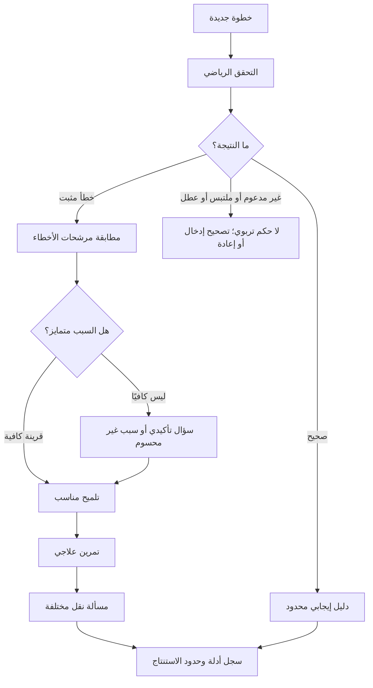

# خُطوة AI — مواصفة محرك الأخطاء المفاهيمية والتشخيص التربوي

> **اسم الملف:** `06-MISCONCEPTIONS.md`  
> **المشروع:** خُطوة AI — منصة عربية الأصل للتعلّم التشخيصي والتكيّفي  
> **الإصدار:** `1.1`  
> **تاريخ الإعداد:** 03 نوفمبر 2026  
> **الحالة:** مواصفة تنفيذية **مقترحة للاعتماد**؛ بطاقات الأخطاء والأسئلة العلاجية لا تُنشر دون مراجعة مختص رياضيات وتربية  
> **النطاق:** هاكثون شِراع — الجبر المدرسي الأساسي، معادلات خطية بمتغير عربي واحد `س`  
> **الجمهور:** مالك المنتج، المعلم المراجع، مصمم التعلم، مهندس المحرك الرياضي، مهندس الذكاء الاصطناعي، مطورو الواجهة والخلفية، مختبرو الجودة، ووكلاء البرمجة  
> **المراجع الأعلى:** `00-PROJECT-VISION.md`، `01-PRD.md`، `02-MVP-SCOPE.md`، `04-ARABIC-NOTATION.md`، `05-CURRICULUM.md`

---

## 0. وظيفة هذه الوثيقة وحدود سلطتها

هذه الوثيقة تحدد **كيف ينتقل خُطوة من خطأ رياضي مثبت إلى مساعدة تعليمية حذرة ومناسبة**؛ لا تحدد خوارزميات إثبات التكافؤ نفسها، ولا مخطط قاعدة البيانات النهائي، ولا عقود API النهائية.

- **`10-MATH-ENGINE.md`**: يملك تفسير التعبيرات، وتحقق المعادلات ومجموعات الحل وشروط المجال، وإخراج أدلة الحكم الرياضي.
- **هذا الملف `06-MISCONCEPTIONS.md`**: يملك تصنيف أنماط الأخطاء، وربطها بالمهارات، وقواعد فرضيات التشخيص، وأمثلة الأسئلة التي تميز الأسباب.
- **`07-TUTORING-POLICY.md`**: يملك السياسة النهائية لتتابع التلميحات، والكشف عن الحل، وتقدير تقدم المتعلم عبر الزمن.
- **`05-CURRICULUM.md`**: يملك تسلسل المهارات وصلاحية المسائل والمستوى الدراسي.
- **`04-ARABIC-NOTATION.md`**: يملك الاصطلاحات والرموز العربية وقواعد عرضها وإدخالها.
- **`11-DATA-MODEL.md` و`12-API-CONTRACT.yaml`**: يملكان مخطط البيانات وأسماء الحقول النهائية؛ أمثلة الحمولة هنا **توضيحية** وليست عقدًا نهائيًا.
- **`14-GOLDEN-DATASET.md` و`15-TEST-AND-ACCEPTANCE.md`**: يملكان مجموعة الحالات المرجعية ومعايير القبول والعتبات التجريبية.

**قاعدة مرجعية:** عند التعارض لا يُعدّل أي وكيل محتوى منهجيًا أو تفسيرًا رياضيًا بصمت؛ يُرفع تعارض موثق إلى مالك القرار وتُحدّث الوثيقة المختصة ثم الاختبارات المرتبطة.

### 0.1 معنى الأولويات

| التصنيف | المعنى |
|---|---|
| `P0` | شرط لإكمال نموذج الهاكثون ما لم يُعتمد تغيير نطاق رسمي |
| `P1` | تحسين اختياري لا يبدأ قبل استقرار جميع بوابات P0 |
| `P2` | توسع لاحق لا يجوز تقديمه بوصفه منفذًا أو مدعومًا الآن |

### 0.2 التعريف المختصر للنجاح

عندما يقدم الطالب انتقالًا بين خطوتين جبريتين، يتحقق النظام من صحته **أولًا**. إن ثبت خطؤه، يحدد سلوكًا ملحوظًا قد يرتبط بإحدى المهارات الست المستهدفة، ويتحفظ عند التباس السبب، ويختار سؤالًا تأكيديًا أو تلميحًا مراجَعًا، ثم تدريبًا علاجيًا ومسألة نقل جديدة. يحتفظ النظام بحدود ما عرفه فعلًا دون إطلاق وصف دائم على الطالب.

---

## 1. المبادئ غير القابلة للتفاوض

1. **الحكم الرياضي مستقل عن AI:** لا يجوز أن يحوّل النص الذي يولده نموذج لغوي حالة `verified_invalid` إلى `verified_valid` أو العكس.
2. **الخطأ لا يساوي المفهوم الخاطئ:** سلوك مثل `٢(س + ٣) → ٢س + ٣` قرينة على مشكلة في التوزيع؛ قد يكون سهوًا أو كتابة ناقصة أو سوء فهم فعليًا.
3. **لا تشخيص عند عدم التحقق:** `syntax_error` و`unsupported` و`inconclusive` و`service_error` ليست أدلة على ضعف الطالب.
4. **نبدأ بأول انتقال غير صالح أو غير محسوم:** لا تنسب الأخطاء اللاحقة إلى الطالب حتى تُراجع خطوة سابقة قد أفسدت سياق الحل.
5. **نقبل الحل الصحيح البديل:** الانتقال المكافئ الذي يتجاوز خطوات نموذجية يُقبل ضمن حدود قدرة المحرك، حتى لو لم يشبه نمط الإجابة المخزنة.
6. **ليس كل خطأ تصنيفًا من الستة:** يمكن للنظام تسجيل «خطوة غير صحيحة، والسبب غير محدد» دون إلصاق نمط مفاهيمي.
7. **لا تخمين اصطلاحي:** لا نترجم `x` إلى `س` بصمت، ولا نحلل `جا` ضمن النسخة الأولى، ولا نتجاوز مدخلًا ملتبسًا مثل `١/٢س`.
8. **لا نعد بإتقان دائم:** النجاح في سؤال تأكيدي أو مسألة نقل يقدّم دليلًا محدودًا؛ لا يثبت قدرة مستقرة عبر الزمن.
9. **لا وصف شخصي مهين:** تقول المنصة «هذه الخطوة تحتاج مراجعة»، لا «أنت لا تفهم الجبر».
10. **المعلم والطالب قابلان للمراجعة:** يستطيع المراجع رؤية الخطوة، ونتيجة التحقق، وقرائن التصنيف، وحدود الاستنتاج.
11. **لا تُسرّب إجابات التقييم:** يظل سؤال النقل مختلفًا عن مثال الشرح وسؤال التأكيد، ولا يرسل النموذج اللغوي محتوى مجموعة التقييم المخفية.
12. **محتوى عربي علمي:** كل النصوص والأعداد والمتغيرات المعروضة وفق ملف الاصطلاح، مع الاحتفاظ بالمعرّفات التقنية بالإنجليزية داخل السجلات البرمجية فقط.

---

## 2. حدود الرياضيات المعتمدة في P0

| جانب | المدعوم أو المستهدف | مرفوض/غير مدعوم حاليًا |
|---|---|---|
| المتغير | `س` فقط | `ص`، `ع`، `x` والمتغيرات المتعددة |
| المعادلات | خطية بمتغير واحد، حل وحيد في بنك الأسئلة المنشور | تربيعية، لا حل/حلول غير منتهية كبنك تعلم اعتيادي، أنظمة معادلات |
| الأعداد | صحيحة موجبة وسالبة وصفر | أعداد عشرية مفعلة افتراضيًا |
| العمليات | `+`، `−`، `×`، ضرب ضمني معتمد، أقواس، قسمة على ثابت عددي غير صفري | قسمة على متغير أو تعبير قد ينعدم، قوى المتغير، جذور ولوغاريتمات |
| الكسور | نتائج كسرية عددية بسيطة **بعد اجتياز بوابة عرض الكسور** | كسور جبرية متغيرة المقام والعبارات الملتبسة |
| الدوال | غير مفعلة في P0 | `جا` و`جتا` و`ظا` (موثقة للرؤية لا للتنفيذ الحالي) |
| الإدخال | معادلة واحدة في السطر مع إمكان تعديل الخطوة | صور كتابة اليد، إدخال صوتي، نص حر غير مقيد |

تُطبق الحدود الدقيقة من `02-MVP-SCOPE.md` و`04-ARABIC-NOTATION.md`. إذا أمكن معرفة أن الإدخال خارج النطاق نعيد `unsupported`، وإذا كانت الصياغة معيبة نعيد `syntax_error`، وإذا تعذر إثبات الحكم رغم فهم الإدخال نعيد `inconclusive`.

---

## 3. الفرق بين خمسة مفاهيم يجب عدم الخلط بينها

| المصطلح | المقصود | مثال | هل يكفي لتغيير ملف المهارات؟ |
|---|---|---|---|
| **خطأ رياضي مثبت** | انتقال تغير فيه معنى المعادلة أو مجموعة حلولها خلافًا للقواعد المدعومة | `٢س + ٦ = ١٠` إلى `٢س = ١٦` | يسجل ملاحظة فقط؛ لا يكفي وحده لتشخيص سبب |
| **سلوك خطأ ملحوظ** | وصف لما حدث دون تفسير النية | حد داخل قوس بقي دون ضرب | يرشح نمطًا ولا يثبت السبب |
| **فرضية تربوية** | تفسير ممكن للسلوك | ربما لم يوزع المعامل على كلا الحدين | تحتاج سؤالًا مميزًا أو دليلًا مستقلًا |
| **سهو/خطأ حسابي عابر** | فشل موضعي مع شواهد أخرى على فهم القاعدة | اختار الطرح الصحيح ثم أخطأ `١٢ − ٧` | يقدم تدريبًا مناسبًا دون وسم دائم |
| **دليل على تقدم ضمن المهمة** | نجاح جديد في حالة تختلف بصورة ذات معنى | انتقال صحيح بمسألة جديدة دون تلميح | دليل محدود قابل للمراجعة، لا شهادة إتقان |

**مثال حاسم:** إذا كتب الطالب `س + ٧ = ١٢` ← `س = ١٢ − ٧` ← `س = ٦`، فقد اختار إجراءً جبريًا صحيحًا في الخطوة الأولى، لكن الحساب العددي في الخطوة الثانية غير صحيح. لا يصح تلقائيًا وصفه بأنه «لا يعرف طرح العدد من الطرفين».

---

## 4. حالات الإدخال والحكم ومن يملكها

### 4.1 عقد المدخلات المنطقي (غير ملزم بشكل JSON النهائي)

يحتاج التشخيص إلى:

- معرّف الجلسة والمحاولة وتسلسل الخطوة وإصدارها.
- معرّف المسألة وإصدارها ومهاراتها وسياقها ومجال المعادلة.
- **النص العربي الأصلي** للخطوتين وطريقة عرض كل منهما، بالإضافة إلى **التمثيل الدلالي** الموثق.
- **حكم رياضي صادر من المحرك** مع إصدار المحرك والدليل المرتبط به.
- حالة جميع الخطوات السابقة؛ لا تحليل تشخيصي نهائي إذا كانت سلسلة الإثبات غير صالحة.
- سياق محتوى معتمد: قائمة الأنماط المفعلة وأسئلتها وتلميحاتها وتواريخ/إصدارات اعتمادها.
- سجل المساعدة المقدمة، والإجابات السابقة عن الأسئلة التأكيدية، إن وجدت.

### 4.2 نتيجة التحقق الرياضي

| حالة المحرك | فعل محرك التشخيص | رسالة الطالب النموذجية |
|---|---|---|
| `verified_valid` | لا ينشئ خطأ؛ يستطيع تسجيل دليل إيجابي محدود | «هذه الخطوة صحيحة ضمن المسألة الحالية.» |
| `verified_invalid` | يبحث عن أنماط مرشحة بعد فحص شروطها ويقدم دليلًا | «هذا الانتقال يحتاج مراجعة؛ لنفحص ما تغيّر.» |
| `syntax_error` | يوقف التشخيص ويحدد موضع إصلاح الإدخال | «أكمل صيغة المعادلة قبل التحقق.» |
| `unsupported` | يوقف التشخيص ويشرح حدود الدعم | «هذه الصيغة غير مدعومة في مسار الجبر الحالي.» |
| `inconclusive` | لا ينشئ خطأ ولا «نجاحًا»؛ يطلب توضيحًا أو يتيح مراجعة | «فهمت الصيغة، لكن لا أستطيع التحقق من هذا الانتقال بأمان.» |
| `service_error` | يحتفظ بالمحاولة ويتيح إعادة الطلب آمنًا | «تعذر التحقق تقنيًا الآن، وقد حُفظت خطوتك.» |

**قاعدة حراسة:** لا يجوز لمحرك التشخيص ابتكار دليل رياضي أو إعلانه بديلًا عن دليل المحرك. مجرد اختلاف الشكل أو ترتيب الأعضاء ليس إثباتًا لخطأ.

### 4.3 سلسلة حالات تشخيصية مقترحة

تُستخدم **حالات تربوية مستقلة** عن حالات المحرك:

- `no_issue` — لا توجد ملاحظة خطأ مثبتة.
- `candidate` — يوجد نمط مرشح مرتبط بانتقال غير صالح مع قرينة، دون استنتاج للسبب.
- `needs_disambiguation` — يوجد سببان أو أكثر محتملان؛ نعرض سؤالًا مميزًا.
- `supported_in_attempt` — ظهرت أدلة متسقة من خطأ وسؤال تأكيدي أو مهمة مستقلة، **ضمن المحاولة** فقط.
- `unresolved` — السبب غير معروف رغم ثبوت الخطأ.
- `not_assessable` — لا يجوز الحكم بسبب عجز/امتناع/عطل أو تغير سياق الخطوات.

لا يوجد في P0 تصنيف `permanent_misconception`، ولا «معدل ذكاء»، ولا «درجة ثقة 95%» بدون بيانات معايرة بحثية.

---

## 5. خط سير التشخيص التشغيلي

1. **حفظ الإدخال:** احتفظ بالنص الخام وتسلسل الخطوة وإصدار المحتوى.
2. **فحص التحليل/الاصطلاح:** تأكد من قبول الرموز، وبنية المعادلة، وشروط `04-ARABIC-NOTATION.md`.
3. **استدعاء التحقق الرياضي:** استقبل الحكم والدليل من `10-MATH-ENGINE.md`؛ لا تستبدله بإنشاء نص من LLM.
4. **تحديد أول انتقال يحتاج نظرًا:** لا تحلل لاحقًا أخطاء قد تكون أثرًا لخطوة سابقة مكسورة.
5. **توليد مرشحات محددة:** طابق النمط على البنية الرياضية **مع القرينة**، لا على نص خام وحده.
6. **تقييم التداخل:** إذا طابق أكثر من نمط، لا تصدر أسماء متناقضة؛ اختر سؤالًا يميز الاحتمالات أو `unresolved`.
7. **صياغة الملاحظة:** اعرض وصفًا ملموسًا لما تغير مع ثبوت الحكم الرياضي، ودرجة الحذر التربوي المناسبة.
8. **سؤال تأكيدي عند الحاجة:** اختر سؤالًا أصغر من المسألة الأصلية له إجابة/تفسير قادر على التمييز بين فرضيتين.
9. **اختيار علاج:** تمرين محدود يعالج المهارة ذات القرينة الأرجح؛ لا تكرر الجواب الأصلي.
10. **إعادة اختبار:** اسأل مسألة نقل معتمدة تتغير فيها سمة ذات معنى، وسجّل هل جرى الحل دون تلميحات.
11. **تحديث السجل:** خزّن «ما ظهر» و«ما لم يثبت» مع إصدار المحرك والمحتوى ومستوى المساعدة.

### 5.1 آلة حالات مقتضبة



### 5.2 عند تعدد الأخطاء في الحل

- المحرك يحدد **أول انتقال** غير صالح أو غير محسوم بحسب ترتيب المحاولة.
- إذا غيّر الطالب خطوة مبكرة، **تُبطل** الأحكام والمرشحات والتلميحات المشتقة من خطوته القديمة، ويعاد التحقق من التبعيات.
- يمكن الاحتفاظ بالسجل التاريخي داخليًا لأغراض المراجعة، لكن لا تظهر النتائج المبنية على سياق منسوخ كأنها حكم حالي.
- لا نعاقب الطالب مرتين على خطأ واحد توالدت منه نتائج لاحقة؛ ولا نعتمد نتيجة نهائية صحيحة بالمصادفة إذا كان المسار حوى انتقالًا غير صحيح.

---

## 6. فهرس الأنماط الستة المستهدفة

هذه هي الأنماط الستة المقترحة في `02-MVP-SCOPE.md` و`05-CURRICULUM.md`. تظل أسماء العمل والمعرّفات ثابتة حتى تثبت تفاصيل البطاقات بمراجعة متخصص.

| معرّف النمط | الوصف السلوكي المرصود | المهارات المرتبطة | موقع التداخل الأكثر احتمالًا |
|---|---|---|---|
| `ERR-ALG-01` | إغفال ضرب أحد حدود القوس عند التوزيع | `SK-ALG-04` | خطأ عدد صحيح `05` |
| `ERR-ALG-02` | تغيير إشارة عدد بصورة لا تبررها عملية مكافئة | `SK-ALG-02`, `SK-ALG-05` | عملية غير متكافئة `03` أو `04` |
| `ERR-ALG-03` | تطبيق عملية على طرف واحد دون الطرف الآخر | `SK-ALG-01`, `SK-ALG-05` | الخلط بين العملية وعكسها `04` |
| `ERR-ALG-04` | اختيار العملية غير المناسبة لعزل المتغير | `SK-ALG-05`, `SK-ALG-06` | خطأ إشارة `02` |
| `ERR-ALG-05` | خطأ في حساب عدد صحيح خلال خطوة جبرية صحيحة الأساس | `SK-ALG-02`, `SK-ALG-03` | أخطاء الإشارة `02` |
| `ERR-ALG-06` | خطأ خاص بتوزيع معامل سالب على قوس | `SK-ALG-02`, `SK-ALG-04` | التوزيع العام `01` وإشارات `02` |

### 6.1 شروط تفعيل أي نمط

لا يُفعَّل أي نمط بصفته «جاهزًا للتشخيص» إلا بعد وجود:

- انتقال خاطئ محكوم رياضيًا، ومثال صحيح مقابل من المهارة نفسها.
- معيار مطابقة بنيوي مع الاستثناءات والحالات التي يجب ألا يصنفها.
- سؤال تأكيدي له هدف واضح، واحتمالات أجوبة ذات دلالات مختلفة.
- تلميحين أو ثلاثة تدرجًا، وفق قواعد الكشف التي ستعتمد في `07-TUTORING-POLICY.md`.
- تمرين علاجي ومسألة نقل مختلفة ومعتمدة ضمن `05-CURRICULUM.md`.
- ربط بـ`SK-ALG-*`، ومعايير اختبار وحالات فشل مسماة في `14` و`15`.
- مراجعة مختص رياضيات/تربية لحالة النمط وإصدارها؛ إتاحة إيقاف النمط دون إيقاف كل المنصة.

---

## 7. بطاقات أنماط الخطأ التنفيذية

> **طريقة قراءة البطاقات:** «القرينة» توضح السلوك الملحوظ الذي يدعم ترشيح النمط، وليست برهانًا على نية الطالب. الأمثلة التالية **مقترحات محتوى** تنتظر مراجعة تربوية وحفظها بإصدار مستقل. تستخدم الرموز العربية في الجانب الموجه للطالب. جميع المسائل هنا خطية بمتغير `س`.

### `ERR-ALG-01` — إغفال التوزيع على أحد الحدود

**المهارة:** `SK-ALG-04`؛ **الأولوية:** `P0`.

**الانتقال المقترح:**

- قبل: `٢(س + ٣) = ١٠`
- بعد كتابة الطالب: `٢س + ٣ = ١٠`
- الخطوة الصحيحة الشائعة: `٢س + ٦ = ١٠`
- **الحكم الرياضي:** `verified_invalid` عندما يؤكد المحرك اختلاف مجموعتي الحل؛ الأولى حلها `س = ٢`، والثانية حلها `س = ٧/٢` (الكسر هنا **للتوثيق/التحقق**؛ لا يُعرض قبل جاهزية دعم الكسور).

**قرينة ترشيح:** وُزِّع المعامل على الحد الذي يحوي `س`، وبقي الحد الثابت بلا ضرب، مع ثبوت عدم التكافؤ. لا نعتمد على مجرد وجود القوس أو مطابقة السلسلة النصية حرفيًا.

**أسباب بديلة لا يجوز تجاهلها:** سهو في كتابة الحد `٦`؛ نسخ غير مكتمل؛ إسقاط رقم مصادفة؛ عدم معرفة الخاصية.

**سؤال تأكيدي مقترح:** «أي التعبيرين يساوي `٣(س + ٢)`؟» مع خيارين `٣س + ٦` و`٣س + ٢`، والسماح بالإجابة أو تفسير السبب. **الاختيار الصحيح وحده لا يثبت الإتقان؛** نستخدمه لتمييز نمط التفكير عند مقارنته بالخطوة الأصلية.

**تلميحات متدرجة:**
1. «انظر إلى الحدين داخل القوس: ماذا يحدث لكل منهما عندما نضرب القوس في ٢؟»
2. «اكتب `٢ × س` ثم `٢ × ٣` على نحو منفصل، وبعدها اجمعهما.»
3. عند الحاجة بعد المحاولة: «الصيغة المكافئة هي `٢س + ٦`؛ جرّب أنت متابعة الحل من هذه النقطة.»

**تمرين علاجي أصغر:** بسط `٣(س + ١)` بعد توضيح أن المطلوب **تعبير** تدريبي، وليس سطر حل معادلة؛ المحرر يعرض التعبير، ولا يعامله كخطوة معادلة مكتملة. وإن كانت واجهة P0 لا تدعم تمرين تعبير مستقل، يقدم `٣(س + ١) = ١٢` بدلًا منه.

**مسألة نقل:** `٣(س + ٢) = ١٨` مع حل مستقل `س = ٤`، على ألا تستخدم هي نفسها مسبقًا كسؤال تأكيدي/شرح في **جلسة المتعلم نفسها**؛ عند استخدامها للتشخيص تُختار مسألة نقل **أخرى** من بنك معتمد.

**لا تصنف خطأً عندما:** يصل الطالب إلى `س + ٣ = ٥` مباشرة؛ فهذه خطوة مكافئة صحيحة بالقسمة على ٢. ولا نصنف اختلاف ترتيب الحدود إذا بقيت المعادلة مكافئة.

**الحد الأدنى للتوثيق:** معرّف السطر، ودليل عدم التكافؤ، والجزء الذي بقي دون توزيع، وإجابة سؤال التأكيد إن طرح، ومستوى المساعدة.

### `ERR-ALG-02` — التباس الإشارة خلال التحويل

**المهارات:** `SK-ALG-02`, `SK-ALG-05`؛ **الأولوية:** `P0`.

**الانتقال المقترح:**

- قبل: `س − ٥ = −٢`
- بعد: `س = −٢ − ٥`
- الصحيح: `س = −٢ + ٥` ثم `س = ٣`.
- **الحكم:** `verified_invalid` بعد تحقق المحرك: المعادلة الأولى حلها `س = ٣`، والثانية `س = −٧`.

**قرينة ترشيح:** تغير إشارة المقدار أو اختيرت إشارة عملية غير مكافئة في سياق عزل عدد سالب/طرح ثابت.

**الأسباب البديلة:** اختيار العملية العكسية الخاطئة (`ERR-ALG-04`) بدل ضعف فهم الأعداد السالبة، أو خطأ نقل بصري.

**سؤال تأكيدي:** «ما العدد الذي نضيفه إلى `−٥` حتى يصبح `٠`؟» ثم «إذا أضفنا `٥` لطرف المعادلة، ماذا نفعل في الطرف الآخر؟» يبدأ بنقطة تمييز واحدة؛ لا نطلب سلسلة طويلة من الأسئلة تلقائيًا.

**تلميحات:**
1. «تريد إزالة `−٥` من طرف المعادلة؛ أي عملية تعكس الطرح؟»
2. «أضف `٥` إلى الطرفين، ثم احسب الطرف الذي يحتوي العدد `−٢`.»
3. «`−٢ + ٥ = ٣`؛ استخدم هذه النتيجة للتحقق من المعادلة الأصلية.»

**علاج:** معادلة قصيرة `س − ٤ = −١`، حلها `س = ٣`، يليها تمرين عددي على جمع موجب مع سالب إذا دل سؤال التأكيد على الحاجة.

**نقل:** `س − ٧ = −٣`، حلها `س = ٤`، مع تبديل الأعداد وقد يضاف سياق مختلف معتمد.

**لا تصنف:** كتابة الطالب `س + ٥ = ٨` ← `س = ٣`؛ فهي صحيحة وإن لم يكتب عملية الطرح صراحة. وإذا كان الخطأ العددي فقط بعد معادلة صحيحة معزولة، يراجع `ERR-ALG-05`.

### `ERR-ALG-03` — تغيير طرف واحد دون عملية مكافئة على الطرفين

**المهارات:** `SK-ALG-01`, `SK-ALG-05`؛ **الأولوية:** `P0`.

**الانتقال المقترح:**

- قبل: `س + ٣ = ٨`
- بعد: `س + ٣ = ٥`
- الصحيح عند طرح ٣ من الطرفين: `س = ٥`.
- **الحكم:** `verified_invalid`: الأولى حلها `س = ٥`، والثانية `س = ٢`.

**قرينة ترشيح:** تغير أحد طرفي المساواة مع بقاء الطرف الآخر كما هو بصورة أدت لتغير الحل، وللانتقال شكل عملية عددية على طرف واحد.

**أسباب بديلة:** نسخ غير مقصود للمعادلة، أو اعتقاد أن الطالب ينفذ خطوة فرعية غير معروضة (لذلك لا نعتمد النية من النص وحده).

**سؤال تأكيدي:** «إذا كانت `٥ + ٣ = ٨`، فهل تصبح المساواة صحيحة إذا غيّرنا الطرف الأيمن إلى `٥` فقط؟ ولماذا؟» ويمكن أيضًا سؤال «ماذا ينبغي أن يتغير في الطرف الأيسر إذا طرحنا `٣` من الطرف الأيمن؟» وفق محتوى المعلم.

**تلميحات:**
1. «راقب طرفي علامة المساواة؛ أي طرف تغيّر؟»
2. «عندما نطرح `٣` من أحد الطرفين، ماذا نطرح من الطرف الآخر؟»
3. «بعد طرح `٣` من الطرفين يصبح `س = ٥`.»

**علاج:** `س + ٢ = ٧`، يطلب كتابة العملية على الطرفين أو اختيار تحويل مكافئ.

**نقل:** `٢س + ٤ = ١٠`، حلها `س = ٣`؛ يختبر تطبيق العملية على الطرفين في سياق ذي معامل، ولا يحسب الفشل تلقائيًا على المهارة نفسها إذا كان بسبب ضرب/قسمة جديدين.

**لا تصنف:** `س + ٣ = ٨` ← `س = ٥`؛ حذف الحد من الطرف الأيسر مع تعديل الطرف الأيمن محافظ على الحل، رغم عدم كتابة `−٣` في الطرفين.

### `ERR-ALG-04` — الخلط بين العملية وعكسها عند عزل المتغير

**المهارات:** `SK-ALG-05`, `SK-ALG-06`؛ **الأولوية:** `P0`.

**الانتقال المقترح:**

- قبل: `٤س = ١٢`
- بعد: `س = ٤ × ١٢`
- الصحيح: `س = ١٢ ÷ ٤` أي `س = ٣`.
- **الحكم:** `verified_invalid`: الأولى حلها `س = ٣`، والثانية `س = ٤٨`.

**قرينة ترشيح:** جرى استخدام الضرب بدل القسمة لعكس الضرب في ثابت غير صفري، مع معنى رياضي واضح.

**بدائل:** خلل في ترتيب العملية كتابيًا، أو سهو؛ وقد يختلط تشخيص النمط مع `ERR-ALG-02` عند السالب.

**سؤال تأكيدي:** «إذا كان `٤ × عدد = ١٢`، فأي عملية تساعدك لمعرفة العدد: `١٢ ÷ ٤` أم `١٢ × ٤`؟» ثم سؤال آخر مختلف إن لم يميز هذا الأول السبب.

**تلميحات:**
1. «أي عملية تعكس الضرب؟»
2. «قسّم طرفي `٤س = ١٢` على الثابت غير الصفري `٤`.»
3. «ستحصل على `س = ٣`؛ تحقق بالتعويض.»

**علاج:** `٣س = ١٥` (الحل `س = ٥`) مع إظهار العلاقة بين الضرب والقسمة.

**نقل:** `س/٢ = ٥` (الحل `س = ١٠`) إن كانت صيغة القسمة على ثابت قد اجتازت بوابة المحرك والعرض؛ وإلا `٥س = ٢٠` (الحل `س = ٤`) مع تغيير السياق/ترتيب الطرفين في نسخة محتوى مراجعة.

**لا تصنف:** `٤س = ١٢` ← `س = ٣`؛ خطوة مختصرة صحيحة، ولا تشترط كتابة خط القسمة.

### `ERR-ALG-05` — خطأ حسابي في الأعداد الصحيحة داخل حل جبري

**المهارات:** `SK-ALG-02`, `SK-ALG-03`؛ **الأولوية:** `P0`.

**الانتقال المقترح:**

- قبل: `س + ٧ = ١٢`
- بعد ١: `س = ١٢ − ٧` **صحيحة**.
- بعد ٢: `س = ٦` **غير صحيحة**؛ لأن `١٢ − ٧ = ٥`.
- **الحكم:** الانتقال الأول `verified_valid` والثاني `verified_invalid`.

**قرينة ترشيح:** اختيار التحويل الجبري صحيح، لكن القيمة العددية في خطوة لاحقة محسوبة خطأ. لا يسند الخطأ إلى «عدم فهم نقل الحدود» ما لم تظهر قرائن أخرى.

**سؤال تأكيدي:** «احسب `١١ − ٦` دون حل معادلة؛ كم يساوي؟» ويمكن أن يكون التمرين أشد تحديدًا وفق عملية الحساب المرصودة.

**تلميحات:**
1. «فكرة طرح `٧` صحيحة؛ راجع ناتج العملية العددية فقط.»
2. «كم عددًا يتبقى عند طرح `٧` من `١٢`؟»
3. «النتيجة `٥`؛ عوّض بها في المعادلة للتأكد.»

**علاج:** طرح عددين صحيحين أو جمع سالب وموجب في تمرين قصير؛ ينتقل الطالب بعده إلى معادلة ذات خطوة مماثلة.

**نقل:** `س + ٩ = ١٤` (الحل `س = ٥`) أو حالة بموجب وسالب إذا كان ذلك مناسبًا لما ظهر من الخطأ.

**لا تصنف:** أي انتقال لا نستطيع فيه فصل اختيار الإجراء من الحساب؛ إذا لم تكن هذه القرينة متاحة يبقى النمط مرشحًا دون جزم. كما لا نعطي وسم «ضعف دائم بالحساب» من محاولة واحدة.

### `ERR-ALG-06` — خطأ في توزيع معامل سالب

**المهارات:** `SK-ALG-02`, `SK-ALG-04`؛ **الأولوية:** `P0`.

**الانتقال المقترح:**

- قبل: `−٢(س − ٣) = ١٠`
- بعد: `−٢س − ٦ = ١٠`
- الصحيح: `−٢س + ٦ = ١٠`؛ لأن سالب × سالب = موجب.
- **الحكم:** `verified_invalid`: المعادلة الأولى حلها `س = −٢`، والخاطئة حلها `س = −٨`.

**قرينة ترشيح:** ضرب الحد المحتوي على `س` بمعامل سالب صحيح، لكن أثر السالب في الحد الثاني غير صحيح.

**بدائل:** خطأ في قاعدة ضرب سالبين، أو سهو في رمز `+`، أو مشكلة في فهم التوزيع أصلًا.

**سؤال تأكيدي مميز:** «ما ناتج `−٢ × (−٣)`؟» ثم عند الحاجة «هل العامل خارج القوس يضرب كلا الحدين؟». يميز الأول إشكال الإشارة والثاني إشكال التوزيع العام.

**تلميحات:**
1. «ركز على إشارة حاصل ضرب `−٢` و`−٣` وحدها.»
2. «اضرب `−٢` في `س`، ثم اضربه في `−٣`، واكتب نتيجة كل حد.»
3. «تحصل على `−٢س + ٦`. جرّب أنت إكمال الحل.»

**علاج:** `−٣(س − ٢) = ٦` مع هدف توزيع المعامل السالب؛ الحل `س = ٠`، أو تدريب سالب × سالب إذا ظهر الاحتياج.

**نقل:** `−٤(س − ١) = ٨`، حله `س = −١`، ويجب ألا يكون هو نفسه سؤال التأكيد في الجلسة.

**لا تصنف:** `−٢(س − ٣) = ١٠` ← `س − ٣ = −٥`؛ انتقال صحيح بالقسمة على `−٢`. ولا تُلصق بطاقتا `01` و`06` معًا تلقائيًا لنفس الخطوة.

---

## 8. سياسة التداخل والمفاضلة بين المرشحات

قد تدعم الخطوة غير الصحيحة أكثر من تفسير. يجب التفريق بين **السلوك المرئي** و**السبب التربوي**.

### 8.1 مصفوفة تمييز سريعة

| الملاحظة | المرشحون الممكنون | السؤال الذي يميزهم |
|---|---|---|
| علامة جمع/طرح غير صحيحة أثناء عزل ثابت | `02` و`04` | هل يعرف عكس الطرح؟ وهل يجمع سالبًا وموجبًا بشكل صحيح؟ |
| معامل سالب مع حد داخل القوس لم يتغير كما ينبغي | `01` و`06` | هل يوزع المعامل الموجب جيدًا؟ وما ناتج ضرب سالبين؟ |
| عزل خطوة جبريًا صحيح ثم نتيجة عددية خاطئة | `05` أولًا، وربما `02` | سؤال حسابي مستقل دون معادلة |
| تغيير عدد في طرف واحد | `03`، وربما `04` | سؤال ميزان/تكافؤ يبين الفرق بين تغيير طرفين وطرف واحد |
| سطر خاطئ دون أثر يدل على نمط محدد | لا نمط معتمد | `unresolved`، مع تغذية راجعة على صحة الخطوة فقط |

### 8.2 سياسة الترشيح

- **قبل أي تصنيف:** يجب أن تكون نتيجة المحرك `verified_invalid` وأن يكون مسار الخطوات السابقة سليمًا بما يكفي للربط.
- **أفضل مرشح واحد عندما تتوفر قرينة فارقة:** يمكن عرضه بوصفه «سببًا محتملًا».
- **مرشحان غير قابلين للفصل:** يعرض سؤال تأكيد، لا قائمة «أخطاء لديك».
- **تعدد متعارض دون سؤال مفيد:** `unresolved`، ثم تلميح عام على الخطوة الصحيحة دون نسبة السبب.
- **بعد جواب تأكيدي متسق:** `supported_in_attempt`؛ توضح الواجهة أن هذا دليل في هذه المحاولة، لا حكم دائم.
- **سلوك سابق صحيح في نفس المهارة:** يؤثر في القرار التربوي (قد يكون سهوًا)، ولا يغير حكم الرياضيات على الخطوة الحالية.

### 8.3 لا أرقام ثقة مصطنعة

يسمح بنطاق وصفي مثل «قرينة أولية» و«يدعمه سؤال إضافي» و«السبب غير محسوم». لا تظهر نسبة دقة أو ثقة عددية إلا بعد بناء مجموعة بيانات مصنفة وتقدير معايرة موثق في `15-TEST-AND-ACCEPTANCE.md`.

---

## 9. أسئلة التأكيد: التصميم والتقييم

### 9.1 ما الذي يجعل السؤال التأكيدي جيدًا؟

1. يستهدف **فارقًا واحدًا محددًا** بين فرضيتين؛ لا يعيد المسألة الأصلية حرفيًا.
2. أقصر وأسهل من المسألة الأصلية قدر الإمكان، ما لم يقلل ذلك قدرة السؤال على التمييز.
3. يتجنب الإيحاء بالإجابة الصحيحة ضمن السؤال أو خيار ملون أو تلميح مباشر سابق.
4. يعرف المعلم **قبل النشر** ما الذي يعنيه كل جواب، وما الذي يبقى غير محسوم.
5. يحتفظ بأصالة الاصطلاح العربي: `س` والأرقام الشرقية، ويثبت المقصود بالعلامات.
6. يسمح بإجابة لا تندرج تحت الخيارات المتوقعة ويعرض حالة «لا يمكن الاستنتاج» عند الحاجة.
7. لا يكرر السؤال إلى ما لا نهاية؛ بعد تعثر محدود يختار شرحًا أو علاجًا معتمدًا وفق سياسة `07`.

### 9.2 مصفوفة جواب/استنتاج

| جواب الطالب على سؤال التأكيد | الاستجابة المناسبة | الاستنتاج غير المسموح |
|---|---|---|
| صحيح مع شرح سليم | قرينة ضد فرضية عدم الفهم، واحتمال السهو يظل واردًا | «أثبت الطالب إتقانًا دائمًا» |
| خاطئ ومتسق مع الخطأ الأول | تتقوى فرضية في **هذه المحاولة**، ويقدم علاج | «ثبتت صفة ضعف دائم» |
| صحيح دون تفسير | دليل جزئي؛ يمكن تجربة انتقال بسيط آخر إن لزم | سبب الخطأ الأول معلوم قطعًا |
| جواب خارج الخيارات/ملتبس | `unresolved` أو إعادة صياغة واحدة | الطالب أخطأ رياضيًا بالضرورة |
| لا إجابة/انقطاع | تحفظ الحالة دون تغيير سلبي على سجل المهارات | «الطالب لا يعرف» |

### 9.3 عدم تكرار المحتوى وتسرب الإجابات

لا يجوز أن تكون **مسألة النقل** هي نفسها سؤال التأكيد أو التمرين العلاجي الذي شاهد الطالب حله. إذا استخدم أحد الأمثلة الواردة في البطاقات لسؤال تأكيد، يختار المحتوى مسألة نقل بديلة من نفس المهارة، مع فرق ذي معنى وبمراجعة المعلم.

---

## 10. التلميحات والعلاج وإعادة الاختبار

### 10.1 نموذج درجات المساعدة المقترح

| الدرجة | الهدف | مثال في التوزيع |
|---|---|---|
| `H1` توجيه الانتباه | يلاحظ الطالب الجزء المتأثر | «كم حدًا داخل القوس؟» |
| `H2` قاعدة أو تقسيم | يختبر تطبيق القاعدة | «اكتب ضرب المعامل في كل حد على حدة.» |
| `H3` كشف جزئي مضبوط | يعيد الطالب متابعة الحل | «أول حد هو `٢س`؛ أكمل الحد التالي.» |
| `H4` حل مع تفسير عند الاستحقاق | بعد استنفاد السياسة المعتمدة، دون اعتباره تعلمًا مستقلاً | «نوزع ٢ على الحدين، فنحصل على `٢س + ٦`» |

**ملاحظة:** تدرّج الكشف النهائي وعدد المحاولات يملكه `07-TUTORING-POLICY.md`. هذا جدول مستويات للمحتوى وليس تصريحًا فوريًا بإظهار كل إجابة.

### 10.2 اختيار التدريب العلاجي

- اربط التمرين بمهارة واحدة أساسية، وأزل التعقيد غير الضروري.
- لا تفرض أسلوب حل واحد؛ اعرض معيار النجاح بمعنى رياضي لا مطابقة حرفية.
- لا تستخدم مسألة النقل المعتمدة بوصفها مثال شرح مشروحًا.
- اسمح بتبسيط المستوى إذا كانت المهارة السابقة غير متحققة من واقع دليل معقول.
- سجل كل تلميح استخدمه الطالب؛ النجاح بعد تلميح ليس مساويًا للنجاح دون تلميح.
- إذا تعطل AI، استخدم قالب تلميح عربي معتمد أو اكتفِ بتوضيح أن التلميح غير متاح، ولا تخترع مثالًا غير مثبت.

### 10.3 إعادة اختبار الفهم

- تستخدم مسألة جديدة لنفس المهارة مع اختلاف **ذي معنى**: معامل سالب، تغيير موقع المتغير، تغيير تركيب القوس، أو ترتيب خطوات مختلف ضمن P0.
- لا يضاف مفهوم جديد غير معتمد يخلط قياس المهارة المستهدفة بمهارة مجهولة.
- لا تتطلب مسألة النقل مقارنة حرفية بمسار مرجعي واحد؛ يكفي مسار صحيح يثبته المحرك.
- تعرض النتيجة: «ظهرت المهارة في مسألة جديدة»، أو «تحتاج مراجعة»، أو «لا يمكن الحكم»، مع توثيق مقدار المساعدة.
- لا يعد هذا إثباتًا لاحتفاظ طويل الأمد أو أثر تعليمي سببي؛ يلزم قياس منفصل لاحقًا (`P1`).

---

## 11. بيانات التشخيص وأثر القرار (Conceptual schema)

هذا مثال **توضيحي** للمخرجات المطلوبة دلاليًا، وليس عقدًا ملزمًا لأسماء الـAPI أو لغة البرمجة. الأسماء النهائية تُعتمد في `11-DATA-MODEL.md` و`12-API-CONTRACT.yaml`.

```json
{
  "attempt_id": "example-attempt",
  "problem_id": "ALG-LIN-0001",
  "problem_version": 1,
  "step_index": 1,
  "step_revision": 1,
  "verification": {
    "status": "verified_invalid",
    "math_engine_version": "to-be-defined",
    "evidence_ref": "math-evidence-example"
  },
  "diagnosis": {
    "status": "candidate",
    "pattern_id": "ERR-ALG-01",
    "skill_ids": ["SK-ALG-04"],
    "reason_code": "DISTRIBUTION_TERM_OMITTED",
    "evidence_refs": ["math-evidence-example"],
    "alternative_hypotheses": ["transcription_slip"],
    "confirmation_question_id": "confirm-dist-v1",
    "content_version": 1
  },
  "assistance": {
    "highest_hint_level_seen": 0,
    "hint_ids_seen": []
  }
}
```

### 11.1 الحقول الدلالية الإلزامية

| المجال | ما يجب حفظه ولماذا |
|---|---|
| مرجع الخطوة | `attempt_id`, `step_index`, `step_revision` — لعدم نسبة حكم قديم لخطوة معدلة |
| المحتوى | معرّف/إصدار المسألة، وملف الاصطلاح المعتمد |
| التحقق | الحالة، إصدار المحرك، مرجع دليل رياضي قابل للمراجعة |
| التشخيص | الحالة التربوية، النمط المرشح، المهارات، الأدلة، البدائل، الإصدار |
| التفاعل | سؤال التأكيد، إجابة الطالب، التلميحات، وترتيبها |
| التدريب | معرّف التمرين العلاجي ومسألة النقل وإصداراتهما |
| النتيجة | حكم محدود مدعوم، لا «وسم ثابت» للطالب |
| المراجعة | هل المحتوى/الحالة معتمد، ومتى، ومن راجعه وفق سياسة الخصوصية |

### 11.2 مبدأ الحد الأدنى من البيانات

- تجنب جمع الاسم والهاتف والبريد إذا كانت الجلسة التجريبية لا تحتاجها.
- لا ترسل إلى LLM سوى الصيغة/المعنى الرياضي والقرائن اللازمة لصياغة سؤال أو تلميح.
- لا ترسل معرّفات الجلسات الحقيقية أو معلومات شخصية إلى نموذج خارجي دون ضرورة وموافقة مناسبة.
- لوحة المعلم في P0 تعرض بيانات اصطناعية موسومة فقط، دون جلسات طلاب حقيقية.
- توثّق الإصدارات حتى يمكن إعادة تفسير النتيجة بعد تحديث القواعد أو النماذج.

---

## 12. استخدام AI وحدوده: القواعد والمحرك والمولد اللغوي

### 12.1 ترتيب السلطة عند الاختلاف

1. **قواعد الاصطلاح والمحلل** — هل الإدخال مفهوم ومدعوم؟
2. **محرك الرياضيات** — هل الانتقال صحيح ضمن المجال؟
3. **قواعد التشخيص المراجعة** — ما الأنماط التي قد تفسر السلوك؟
4. **المحتوى التربوي المعتمد** — ما السؤال/التلميح المناسب؟
5. **نموذج اللغة** — يصوغ بالعربية وفق قرائن مؤكدة وحدود معلنة، ولا يغير الأحكام السابقة.

### 12.2 ما يُسمح للنموذج اللغوي بفعله

- إعادة صياغة تلميح مراجَع إلى عربية واضحة دون تعديل المعنى الرياضي.
- اختيار قالب سؤال معتمد من قائمة محددة بناء على حالة التشخيص والمهارة.
- تلخيص الأدلة للمعلم بحذر، مع الإشارة إلى `candidate` أو `unresolved` بوضوح.
- اقتراح أسئلة جديدة **كمسودات** تُراجع رياضيًا وتربويًا قبل نشرها للطلاب.

### 12.3 ما لا يُسمح له بفعله

- تقرير صحة خطوة رياضية خلافًا للمحرك، أو إنشاء `verified_valid` دون تحقق.
- اختراع «شاهد رياضي» أو نسبة تشخيص موثوقة بلا قياس.
- إضافة مهارة/نمط خطأ خارج المعجم المعتمد وتسجيله في ملف الطالب تلقائيًا.
- ترجمة الرموز الجبرية المعتمدة إلى رموز لاتينية في واجهة الطالب.
- نشر سؤال مولّد مباشرة، أو تعديل دليل معتمد أو نتيجة التقييم لتعظيم نسبة النجاح.
- إظهار حل كامل من أول تلميح خلافًا لسياسة التعلم.

### 12.4 فشل AI أو تناقضه

- **إذا فشل AI:** تقدم تلميحات عربية ثابتة معتمدة من البنك؛ لا تتوقف وظيفة التحقق الرياضي.
- **إذا ناقض AI نتيجة المحرك:** يُرفض نصه وتُسجل حالة اختلاف تقنية دون عرض تفسير خاطئ للطالب.
- **إذا كان النص قد يحتوي رموزًا غير مدعومة:** يتحقق من الاصطلاح، ثم يستبدل بقالب معتمد أو يعاد توليده مرة محدودة.
- **إذا تعذر اختيار نمط:** يعرض سببًا غير محسوم بدل تشخيص مختلق.

---

## 13. مجموعات الاختبار المرجعية وحالات القبول

> هذه الحالات **توقعات تصميم** وليست اختبارات منفذة أو نتائج دقة. القبول النهائي، وحجم العينة، وتوزيع الفئات، والعتبات، يثبت في `14-GOLDEN-DATASET.md` و`15-TEST-AND-ACCEPTANCE.md`. كل حالة موثقة بمعرّف ثابت وتحتاج إدخالًا وحكمًا ومتوقعًا تربويًا. حالات الإخفاق والامتناع مهمة بقدر الحالات الصحيحة.

### 13.1 اختبارات حدّية أساسية (P0)

| الحالة | الإدخال / الانتقال | الحكم الرياضي المتوقع | المخرج التربوي المتوقع |
|---|---|---|---|
| `MIS-001` | `٢(س + ٣) = ١٠` ← `٢س + ٦ = ١٠` | `verified_valid` | لا `ERR-ALG-01` |
| `MIS-002` | `٢(س + ٣) = ١٠` ← `٢س + ٣ = ١٠` | `verified_invalid` | `ERR-ALG-01` مرشح لا يقين دائم |
| `MIS-003` | `٢(س + ٣) = ١٠` ← `س + ٣ = ٥` | `verified_valid` | مسار بديل صحيح بلا إنذار |
| `MIS-004` | `−٢(س − ٣) = ١٠` ← `−٢س + ٦ = ١٠` | `verified_valid` | لا `ERR-ALG-06` |
| `MIS-005` | `−٢(س − ٣) = ١٠` ← `−٢س − ٦ = ١٠` | `verified_invalid` | `ERR-ALG-06` مرشح، تمييز عن `01` |
| `MIS-006` | `−٢(س − ٣) = ١٠` ← `س − ٣ = −٥` | `verified_valid` | لا وسم توزيع سالب |
| `MIS-007` | `س − ٥ = −٢` ← `س = −٢ + ٥` | `verified_valid` | لا `ERR-ALG-02` |
| `MIS-008` | `س − ٥ = −٢` ← `س = −٢ − ٥` | `verified_invalid` | `02` أو `04`؛ سؤال تمييزي |
| `MIS-009` | `س + ٣ = ٨` ← `س = ٥` | `verified_valid` | لا `ERR-ALG-03` رغم حذف خطوة ظاهرة |
| `MIS-010` | `س + ٣ = ٨` ← `س + ٣ = ٥` | `verified_invalid` | `ERR-ALG-03` مرشح |
| `MIS-011` | `٤س = ١٢` ← `س = ٣` | `verified_valid` | لا `ERR-ALG-04` |
| `MIS-012` | `٤س = ١٢` ← `س = ٤ × ١٢` | `verified_invalid` | `ERR-ALG-04` مرشح |
| `MIS-013` | `س + ٧ = ١٢` ← `س = ١٢ − ٧` | `verified_valid` | لا `ERR-ALG-05` |
| `MIS-014` | `س = ١٢ − ٧` ← `س = ٦` | `verified_invalid` | `ERR-ALG-05` مرشح؛ خطأ عدد لا قاعدة نقل |
| `MIS-015` | `س = ١٢ − ٧` ← `س = ٥` | `verified_valid` | لا خطأ، رغم اختلاف شكل السطر |
| `MIS-016` | `٣س = ٧` ← `س = ٧/٣` | `verified_valid` **بعد بوابة الكسور** | لا إنذار؛ عدم تفعيل قبل قبول الكسور |
| `MIS-017` | `٣س = ٧` ← `س = ٣/٧` | `verified_invalid` **بعد بوابة الكسور** | لا يُدرج تلقائيًا ضمن الأنماط الستة إن لم تتوافر قاعدة معتمدة |
| `MIS-018` | `جا(٣٠°) = ١/٢` | `unsupported` | `not_assessable`؛ لا «جهل مثلثات» |
| `MIS-019` | `١/٢س = ١` | `syntax_error`/ملتبس وفق `04` | طلب أقواس دون تخمين أو تشخيص |
| `MIS-020` | `٢س + ٣ =` | `syntax_error` | عرض إصلاح إدخال، لا خطأ مفاهيمي |
| `MIS-021` | `س² = س` ثم القسمة على `س` | `unsupported` أو `inconclusive` ضمن P0 | لا اعتبار الخطوة آمنة دون مجال؛ اختبار حارس فقط |
| `MIS-022` | صيغة خطية مفهومة لكن التحقق لم يحسم النتيجة | `inconclusive` | `not_assessable`؛ لا تقييم سلبي |
| `MIS-023` | تعطل محرك أثناء تحليل خطوة | `service_error` | حفظ الأصل وإعادة آمنة دون إضافة تشخيص |
| `MIS-024` | ينتقل الطالب حلًا صحيحًا بالقسمة على ثابت دون كتابة كل الخطوات | `verified_valid` | لا معاقبة لمسار مختصر |

### 13.2 اختبارات سلوكية/حوارية للتشخيص

| الحالة | السيناريو | المقبول |
|---|---|---|
| `MIS-025` | خطأ `01` ثم إجابة صحيحة في سؤال تأكيدي | لا تشخيص دائم، ويُقبل احتمال السهو |
| `MIS-026` | خطأ `01` ثم إجابة خاطئة مشابهة في سؤال مختلف | `supported_in_attempt` عند اكتمال الأدلة، وعلاج مرتبط بالتوزيع |
| `MIS-027` | خطوة تطابق `02` و`04` | سؤال يفرق الاحتمالين أو `unresolved`، لا حكم مزدوج جازم |
| `MIS-028` | غياب جواب التأكيد | لا يُحسب خطأ جديدًا على المهارة |
| `MIS-029` | المستخدم يطلب تلميحًا أولًا | `H1` دون كشف جواب النقل |
| `MIS-030` | فشل AI في صياغة تلميح | استخدام قالب معتمد أو رسالة واضحة دون تلفيق |
| `MIS-031` | AI يولد جملة مخالفة لحكم المحرك | منع عرضها، وتسجيل حالة اختلاف تقنية |
| `MIS-032` | نجاح نقل بعد تلميحين | يسجل نجاحًا **بمساعدة**، لا إنجازًا مستقلًا |
| `MIS-033` | نجاح نقل بلا تلميح | «ظهرت المهارة في مسألة جديدة» ضمن هذه المهمة |
| `MIS-034` | إعادة صياغة السؤال مع قيم مختلفة فقط دون اختلاف ذي معنى | لا تُعتمد تلقائيًا على أنها نقل مناسب |
| `MIS-035` | تغيير خطوة مبكرة بعد إظهار تشخيص | إبطال التشخيصات التابعة وتحديثها بإصدار جديد |
| `MIS-036` | سؤال التأكيد مطابق لسؤال النقل المختار | استبعاد هذا النقل واختيار سؤال آخر مراجَع |
| `MIS-037` | معلم يفتح مثالًا غير محسوم | يرى سبب الامتناع ولا تظهر درجة ضعف زائفة |
| `MIS-038` | بيانات لوحة المعلم اصطناعية | توسم بأنها تجريبية في الشاشة والتقرير |
| `MIS-039` | طلب كشف معلومات طالب لا إذن بها | رفض الإتاحة وفق سياسة الخصوصية |
| `MIS-040` | اختلاف ترتيب صحيح لحدود المعادلة | لا تنبيه خطأ بسبب الشكل أو اتجاه العرض |

### 13.3 معايير تجميع مجموعة مرجعية

- **الهدف التخطيطي الأساسي:** ٦٠ حالة مراجعة على الأقل توزّع على الحالات الصحيحة والخاطئة والملتبسة والامتناع والتداخل والحلول البديلة، والمستهدف الأعلى ١٠٠ حسب الوقت؛ تحدد العتبات النهائية في `15`.
- لا تكفي أمثلة خاطئة وحدها؛ نحتاج **حالات سليمة مقابلة** لكل نمط حتى نقيس الإنذارات الخاطئة.
- يراجع مختص المادة **صحة الرياضيات**، ويراجع مختص تعليم **معنى السؤال التشخيصي**، ويفحص QA التوافق بينهما.
- نقسم الحالات إلى تطوير وتقييم مستقل، ونمنع النقل الحرفي لأسئلة التقييم إلى التلميحات أو عينات LLM.
- تحفظ النتيجة المتوقعة للحكم الرياضي **منفصلة** عن التشخيص التربوي؛ صحة واحد منهما لا تثبت الآخر.
- عند تعارض مراجعين، نسجل الخلاف والقرار النهائي؛ لا نجبر البيانات على «إجابة ذهبية» لا يوجد لها اتفاق تربوي.
- تُعرض في تقرير العرض أعداد الحالات الفعلية والنجاح والفشل والامتناع؛ لا تُعلن نسبة ٩٥٪ أو غيرها مسبقًا.

---

## 14. معايير قبول المحرك والتشخيص

**هذه معايير سلوكية قابلة للاختبار؛ أما الأرقام والحدود النهائية فتُعتمد في `15-TEST-AND-ACCEPTANCE.md`.**

| المعرّف | معيار القبول | وسيلة الإثبات |
|---|---|---|
| `MIS-AC-01` | لا يدخل التشخيص عند حالة غير `verified_invalid` | اختبارات حالات المحرك الست |
| `MIS-AC-02` | يميز الحكم الرياضي عن فرضية سبب الخطأ | حمولة/واجهة تفصل `verification` و`diagnosis` |
| `MIS-AC-03` | يرشح الأنماط الستة **فقط عند القرائن المؤهلة** | حالات موجبة وسالبة لكل نمط |
| `MIS-AC-04` | لا يعاقب حلًا بديلًا صحيحًا | مسارات تكافؤ متعددة |
| `MIS-AC-05` | لا ينسب سهوًا وحيدًا إلى فهم ثابت ضعيف | أمثلة خطأ حسابي مقابل تحقق قاعدة صحيحة |
| `MIS-AC-06` | يتعامل مع التداخل دون تشخيصين متناقضين جازمين | `MIS-027` ونظائرها |
| `MIS-AC-07` | يعمل سؤال التأكيد وتفسير إجابته دون تسريب مسألة النقل | مراجعة المحتوى + اختبارات جلسات |
| `MIS-AC-08` | التلميحات عربية صحيحة وترتبط بالمهارة | مراجعة لغوية/تربوية + صور واجهة |
| `MIS-AC-09` | لا يصدر حُكم إتقان نهائي بعد نجاح واحد | اختبارات سجل تقدم الطالب |
| `MIS-AC-10` | لا يسبب عطل AI تغيير حكم الرياضيات أو ضياع الخطوة | اختبارات فشل مزود AI |
| `MIS-AC-11` | يبطل التشخيص القديم عند تعديل خطوة أو سؤال | `MIS-035` وفحص إصدار الخطوة |
| `MIS-AC-12` | يظهر مستوى المساعدة ودليل مسألة النقل | مراجعة سجل التجربة ولوحة المعلم |
| `MIS-AC-13` | يعرض الامتناع عن الحكم بوضوح ولا يحسب إخفاقًا على الطالب | حالات `unsupported`/`inconclusive` |
| `MIS-AC-14` | يعمل على بيانات تجريبية أو مأذون بها فقط | اختبار صلاحيات ومراجعة الخصوصية |
| `MIS-AC-15` | يمكن إيقاف نمط واحد دون انهيار دورة تعلم بقية الأنماط | feature flag على مستوى النمط + اختبار رجوع |
| `MIS-AC-16` | تربط كل نتيجة بإصدار المحتوى والمحرك | معاينة أثر القرار في التقارير/السجلات |

### 14.1 متى يُمنع اعتماد نمط محدد؟

- إذا كان كاشفه يخطئ في مثال بديل صحيح معروف.
- إذا كان سؤال التأكيد يوحي بالجواب بدل تمييز السبب.
- إذا كان التلميح يحتوي خطأ عربيًا أو رياضيًا.
- إذا كان سؤال النقل نسخة مكشوفة من سؤال العلاج.
- إذا تعذر تفسير الأدلة التي استخدمت لإسناد النمط.
- إذا لم يراجع مختص مؤهل محتواه.

يمكن عندئذ تعطيل النمط مع استمرار التحقق الرياضي وتقديم توجيه عام: «هذه الخطوة غير مكافئة للسابقة؛ راجع الطرفين أو اطلب شرحًا.» لا تُختلق تسمية بديلة للخطأ.

---

## 15. ما الذي يحتاج الفريق والوكلاء إلى تسليمه؟

### 15.1 مالك المنتج ومختص المادة

- اعتماد المرحلة والمنهج/الاصطلاح دون ادعاء انتساب رسمي لمنهج محدد قبل المراجعة.
- مراجعة بطاقات الأخطاء الستة وأمثلتها وحلولها وحالات الاستثناء.
- اعتماد الأسئلة التأكيدية والتلميحات والعلاج والنقل، مع توثيق المصدر والإصدار.
- تصنيف الحالات الخلافية: سهو، خطأ مفاهيمي مرجح، غير محسوم؛ لا إفراط في اليقين.

### 15.2 وكيل المحرك الرياضي

- استهلاك ناتج المحلل الموثوق فقط؛ لا حساب مباشر من النص المولَّد.
- إعادة نتائج الحكم مع مرجع دليل يمكن تتبعه وإصدار المحرك.
- اختبارات مضادة للحلول البديلة وشروط المجال والتوزيع السالب.
- لا يضع بطاقة خطأ تربوية داخل محرك الإثبات؛ يوفّر أدلة بنيوية للفريق التربوي.

### 15.3 وكيل التشخيص/الذكاء الاصطناعي

- يبني **سجل أنماط قابلًا للإيقاف والإصدار** (`pattern registry`) مع قواعد مرشحة واختبارات مقابلة.
- يربط كل مرشح بـ`ERR-ALG-*`، ومهارة، ودليل، وسؤال تأكيد من محتوى معتمد.
- يفصل حالة المرشح عن حكم المحرك؛ يخرج `unresolved` عند العجز.
- يضبط المخرجات بأشكال منظمة ويمنع إضافة نص رياضي غير متحقق منه إلى التلميح.
- يوفر fallback عربيًا معتمدًا عند انقطاع AI.

### 15.4 وكيل الواجهة

- يعرض موضع الخطوة/الانتقال غير الصحيح بدقة من غير قلب المعادلة RTL.
- يبين بوضوح الفرق بين **«الخطوة غير صحيحة»** و**«ربما سببها كذا»**.
- يعرض السؤال التأكيدي والتلميحات بحسب السياسة، ويسجل الإجابات ومستوى المساعدة.
- لا يسمح بظهور نتائج قديمة بعد تعديل خطوة أو إعادة تحميلها.
- يعرض بيانات المعلم التجريبية بعلامة «بيانات تجريبية».

### 15.5 وكيل الخلفية/التكامل

- يحفظ الجلسات وإصدارات الخطوات والمحرك والمحتوى والأدلة والتلميحات بصورة متسقة.
- يمنع تسابق ردّين يؤديان إلى إلصاق تشخيص قديم بخطوة أحدث.
- يحمي حدود الصلاحيات والمشاركة، ويتجنب تسجيل بيانات شخصية لا داعي لها.
- يربط الصفحات والاختبارات بالعقود النهائية `11` و`12`.

### 15.6 وكيل الاختبارات والجودة

- يبني اختبارات وحدات/تكامل موجّهة للحالات `MIS-001`–`MIS-040` ويضيف حالات حافة مستقلة.
- يتحقق من صحة الرياضيات منفصلًا عن جودة التفسير التربوي.
- يراجع حالات الاختلاف مع مختص المادة ولا يغيّر التوقعات لإرضاء الشيفرة.
- يجهز تقرير حالة: منفذ، ناجح، فاشل، غير مختبر، معلّق لاعتماد قرار.
- يلتزم بسياسة المشروع بعدم تشغيل بيئة كاملة/اختبارات ثقيلة دون تكليف؛ مع عدم تجاوز الفحوص اللازمة لصحة المكون المعدل.

---

## 16. التبعيات، بوابات الإنجاز، وتغيير النطاق

### 16.1 الترتيب المطلوب

1. اعتماد الحد الأدنى من ملف الاصطلاح `04` والمنهج `05`، وتوثيق التناقضات المفتوحة.
2. اجتياز بوابة **`GATE-1`**: إدخال عربي وتحليل دلالي وتحقق صحيح من حالات أساسية وحالات امتناع.
3. اعتماد ست بطاقات الأخطاء مع أمثلة موجبة وسالبة ومعايير مراجعة.
4. تنفيذ سجل الأنماط والتشخيص الحذر (دون LLM إن لزم).
5. اعتماد سياسة التلميحات من `07`، ثم ربط السؤال/التلميح بالعلاج ومسألة النقل.
6. اجتياز **`GATE-2`**: دورة تعلم كاملة لمفهوم واحد أولًا، ثم تعميم الأنماط بعد نجاحها.
7. ربط سجل الدليل ولوحة المعلم والخصوصية (`GATE-3`).
8. إجراء تقييم مستقل موثق وتحضير عرض حقيقي (`GATE-4`).

### 16.2 إدارة التغيير

أي تعديل لمعرف `ERR-ALG-*`، أو قاعدة ترشيحه، أو ربطه بالمهارة، أو سؤاله التأكيدي، أو مدخلات المحرك:

- يتطلب سجل تغيير يوضح سبب التعديل وحالة الاختبار التي كشفته.
- يحدث `06-MISCONCEPTIONS.md` و`05-CURRICULUM.md` عند تغير المحتوى التربوي و`14`/`15` دائمًا إذا تغير الحكم المتوقع.
- يراجع `04` و`10` إذا مس التعديل تفسير الرمز أو استنتاجًا رياضيًا.
- يراجع `11` و`12` إذا تغير الحقل المخزن أو التعاقد النهائي.
- يعاد اختبار أمثلة النوع وأضداده وبوابة الامتناع، ولا يغلق تغيير دون موافقة مالك القرار.

---

## 17. القرارات المفتوحة للاعتماد

| المعرّف | القرار | الافتراض المؤقت | مالك الاعتماد |
|---|---|---|---|
| `MIS-DEC-01` | من يعتمد المعلم/المراجع التربوي؟ | شخص ذو خبرة فعلية في الجبر المدرسي وتصميم الأسئلة | مالك المنتج |
| `MIS-DEC-02` | عدد الأنماط التي يجمد إطلاقها | ستة، مع تعطيل أي نمط لا يحقق شروط الجودة | المنتج + الجودة |
| `MIS-DEC-03` | صياغة مستوى الدليل المسموح في الواجهة | «قرينة أولية»، «يدعمها سؤال»، «غير محسوم»؛ لا نسب | المعلم + المنتج |
| `MIS-DEC-04` | عدد أسئلة التأكيد وحدود تكرارها | سؤال مميز واحد في كل تدخل افتراضيًا؛ سياسة التوسع في `07` | تصميم التعلم |
| `MIS-DEC-05` | متى يظهر الحل الكامل؟ | لا يظهر تلقائيًا في أول تلميح؛ تحسمه `07` | المعلم + المنتج |
| `MIS-DEC-06` | ما المحتوى المعتمد لكل نمط؟ | نصوص البطاقات هنا **مسودات** حتى المراجعة | المعلم |
| `MIS-DEC-07` | كيفية عرض نتائج الطلبة في لوحة المعلم | أمثلة اصطناعية وبيانات اصطناعية موسومة فقط في P0 | الخصوصية + المنتج |
| `MIS-DEC-08` | عتبات التقييم ومعيار نجاح النمط | تحدد بعد تجهيز Dataset في `14` و`15` | الجودة + المعلم |
| `MIS-DEC-09` | مفردات الرسائل العلاجية بحسب المنهج الرسمي | عربية مدرسية مشرقية مبدئيًا مع مراجعة المنهج | `05` + مختص المادة |
| `MIS-DEC-10` | قرار إطلاق أنماط الكسور | متوقف على اعتماد بوابة الكسور في `04` و`10` | المحرك + الواجهة + الجودة |

**مهم:** لا يقفل الوكيل قرارًا مفتوحًا تلقائيًا، ولا يدّعي اعتمادًا من معلم لم تحدث مراجعته بالفعل.

---

## 18. سجل التتبع إلى وثائق المشروع

| موضوع هذه الوثيقة | مستنده الأعلى / اللاحق | المعرفات ذات الصلة |
|---|---|---|
| حدود الجبر العربي | `02-MVP-SCOPE.md`, `04-ARABIC-NOTATION.md` | `MVP-02`, `MVP-03`, `MVP-05`; `FR-011`–`FR-027` |
| خريطة المهارات الستة/الثمانية | `05-CURRICULUM.md` | `SK-ALG-01`–`SK-ALG-08` |
| الأنماط الستة | `05-CURRICULUM.md`, هذه الوثيقة | `ERR-ALG-01`–`ERR-ALG-06` |
| قواعد التشخيص التربوي | `01-PRD.md` | `FR-029`–`FR-032`; `MVP-07` |
| التلميحات والعلاج والنقل | `01-PRD.md`, `07-TUTORING-POLICY.md` | `FR-033`–`FR-038`; `MVP-08`, `MVP-09` |
| أدلة التقدم ولوحة المعلم | `01-PRD.md`, `11-DATA-MODEL.md` | `FR-041`–`FR-045`; `MVP-10`, `MVP-11` |
| حالات مرجعية واختبارات قبول | `14-GOLDEN-DATASET.md`, `15-TEST-AND-ACCEPTANCE.md` | `MVP-13`; `MIS-001`–`MIS-040`, `MIS-AC-01`–`16` |
| تعليمات وكلاء التنفيذ | `AGENTS.md`, `17-IMPLEMENTATION-PLAN.md` | بوابات `GATE-1`–`GATE-4` |

---

## 19. خطة جاهزية المحتوى والتسليم للهاكثون

| المرحلة | المطلوب إثباته | لا تبدأ إذا... |
|---|---|---|
| **الأساس** | اتفق الفريق على ستة أنماط وملف الاصطلاح العربي والمهارات | ما زال اختلاف في معنى الرموز أو نطاق المعادلات |
| **محرك الرياضيات** | أحكام صحيحة/خاطئة/امتناع مدعومة بدليل | الواجهة تعلن خطأ الطالب من نتيجة LLM فقط |
| **نمط أول متكامل** | توزيع موجب: حكم، سؤال، تلميح، علاج، نقل | لم يراجع أحد السؤال التأكيدي أو التلميحات |
| **بقية الأنماط** | لكل نمط كاشف واختبارات موجبة وسالبة | حالات الاختبارات الصحيحة تُصنف خطأً |
| **لوحة المعلم** | عرض الفرق بين الخطأ المثبت والسبب المحتمل والعينة | البيانات بلا مصدر أو صلاحية |
| **العرض والتقييم** | سيناريو حي من معادلة عربية إلى تدريب ومسألة جديدة | توجد أحكام ثابتة مُعدة مسبقًا أو نتائج جودة مختلقة |

### 19.1 تعريف اكتمال هذه الوثيقة (Document DoD)

- [ ] روابط المهارات في البطاقات متوافقة مع `05-CURRICULUM.md`.
- [ ] كل نمط من الستة لديه مثال صحيح ومثال خاطئ وسؤال تأكيدي وتلميحات وعلاج ونقل.
- [ ] لا يُنسب خطأ رياضي غير مثبت إلى الطالب.
- [ ] لا تتجاوز أي مسألة P0 دون وسم استثناء أو شرط إطلاق.
- [ ] راجع مختص رياضيات أمثلة الخطوات والحلول ومراجعة النصوص المعروضة للطالب.
- [ ] أدرجت الاختبارات المرجعية في `14-GOLDEN-DATASET.md` مع فصل مجموعة التطوير عن التقييم.
- [ ] اعتمدت عتبات الأداء في `15-TEST-AND-ACCEPTANCE.md`.
- [ ] راجع قائد المحرك واجهة الأدلة مع قائد تشخيص AI.
- [ ] اعتمد مالك المنتج القرارات المفتوحة ووثق التغييرات.

**لا تُعلَن الوثيقة «معتمدة تربويًا» قبل اكتمال المراجعات أعلاه، حتى لو اجتاز المحرك بعض الأمثلة حسابيًا.**

---

## 20. سجل الإصدارات والاعتماد

| النسخة | التاريخ | الوصف | حالة الاعتماد |
|---|---|---|---|
| `1.0` | 2026-11-03 | إنشاء بطاقات ستة أنماط أخطاء، وقواعد فصل التحقق عن التشخيص، والأسئلة والعلاج والنقل، واختبارات السلوك، وحوكمة الوكلاء | **مسودة تنفيذية للمراجعة** |

### محضر اعتماد (يُملأ من الفريق)

- **مراجع الرياضيات:** [يُحدد] — تاريخ المراجعة: [يُحدد]
- **مراجع التربية وتصميم التعلم:** [يُحدد] — تاريخ المراجعة: [يُحدد]
- **مسؤول المحرك الرياضي:** [يُحدد] — تاريخ: [يُحدد]
- **مسؤول الجودة:** [يُحدد] — تاريخ: [يُحدد]
- **مالك المنتج:** [يُحدد] — تاريخ الاعتماد: [يُحدد]
- **قرارات معلقة أُغلقت:** [توثّق بالمعرّفات]
- **حالات اختبار مضافة ومشغلة فعليًا:** [العدد الفعلي فقط]


## ملحق تصحيح PH-00 — 2026-11-04

توحيد وثائقي بتكليف المالك لاستكمال PH-00 فقط؛ لا اعتماد أمني/تربوي أو اجتياز بوابة. سجل التغيير والأدلة في [تقرير التصحيح](../qa-reports/ph00-correction-report.md).
