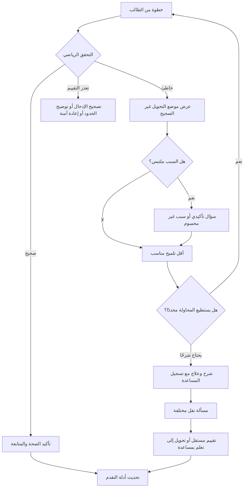

# خُطوة AI — سياسة التعليم والتلميحات التكيفية

> **اسم الوثيقة:** `07-TUTORING-POLICY.md`  
> **المشروع:** خُطوة AI — منصة عربية الأصل للتعلم التشخيصي والتكيفي  
> **الإصدار:** `1.1`  
> **تاريخ الإعداد:** 03 نوفمبر 2026  
> **الحالة:** **سياسة تنفيذية مقترحة لاعتماد الفريق والمراجع التربوي**؛ لا تمثل محتوى منشورًا أو نتائج تجربة منفذة  
> **النطاق:** نسخة هاكثون شِراع (P0): جبر مدرسي أساسي، معادلات خطية بمتغير `س`، دورة تعلّم واحدة قابلة للقياس  
> **الجمهور:** مالك المنتج، مختص الرياضيات، مصمم التعلم، مهندس المحرك الرياضي، مهندس الذكاء الاصطناعي، مطورو الواجهة والخلفية، مسؤول الجودة، ووكلاء البرمجة  
> **الوثائق السابقة:** `00-PROJECT-VISION.md`، `01-PRD.md`، `02-MVP-SCOPE.md`، `04-ARABIC-NOTATION.md`، `05-CURRICULUM.md`، `06-MISCONCEPTIONS.md`

---

## 0. غرض الوثيقة، سلطتها، وكيف تُعتمد

تحدد هذه الوثيقة **ماذا يفعل المعلم الذكي بعد وصول نتيجة التحقق والتشخيص**: متى يطرح سؤالًا تشخيصيًا، وكيف يقدم المساعدة تدريجيًا، ومتى ينتقل إلى تدريب علاجي، ومتى يعرض الحل الكامل، وكيف يعيد اختبار الفهم، وماذا يجوز أن يسجل عن تقدم الطالب. الهدف **تعليم الفكرة مع إبقاء حكم صحة الرياضيات منفصلًا عن أسلوب الشرح**.

### 0.1 حدود ملكية القرارات

| الوثيقة | تملك القرار المتعلق بـ |
|---|---|
| `00-PROJECT-VISION.md` | المبادئ التأسيسية والرؤية العربية والتربوية |
| `01-PRD.md` | ما يجب أن يقدمه المنتج وتجارب الاستخدام ومعايير قبول الوظائف |
| `02-MVP-SCOPE.md` | ما يُنفذ في الهاكثون وما يُستبعد، وبوابات التنفيذ |
| `04-ARABIC-NOTATION.md` | رموز الكتابة الرياضية العربية وتطبيعها وعرضها |
| `05-CURRICULUM.md` | أهداف التعلم، خريطة المهارات، صعوبة المسائل واعتماد المحتوى |
| `06-MISCONCEPTIONS.md` | أنماط الأخطاء، الأدلة التشخيصية، تمييز الفرضيات ومتى يمتنع التشخيص |
| **`07-TUTORING-POLICY.md`** | ترتيب التدخلات التربوية، مستويات التلميح، كشف الحل، النقل وتسجيل المساعدة |
| `10-MATH-ENGINE.md` | الدليل الرياضي، التكافؤ وشروط المجال والامتناع |
| `11-DATA-MODEL.md` و`12-API-CONTRACT.yaml` | أسماء حقول التخزين وعقود الواجهات النهائية |
| `13-AI-ENGINE.md` | تنفيذ التفاعل مع نموذج اللغة، مخرجاته وفحصها وإدارة أعطاله |
| `14-GOLDEN-DATASET.md` و`15-TEST-AND-ACCEPTANCE.md` | الحالات المرجعية وعتبات الجودة والتقييم المستقل |
| `16-SECURITY-PRIVACY.md` | هوية المستخدم، الاحتفاظ بالبيانات والصلاحيات والموافقات |

**قاعدة الحوكمة:** إذا تعارضت سياسة التعليم مع حكم المحرك الرياضي، يُعتمد حكم المحرك ضمن نطاقه؛ وإذا تعارضت مع حدود المنهج أو الاصطلاحات أو الخصوصية، يوقف تنفيذ الجزء المتعارض ويحال إلى الوثيقة المالكة للقرار. لا يحسم وكيل AI التعارض بصمت.

### 0.2 تصنيف المتطلبات

- **`P0`**: أساسي لإكمال دورة التعلم في الهاكثون: تحقق ← ملاحظة/سؤال ← مساعدة ← علاج ← مسألة نقل ← سجل أدلة.
- **`P1`**: تحسينات مشروطة باستقرار P0، مثل إعادة اختبار بعد فترة، وإتاحة صيغ تفاعل إضافية.
- **`P2`**: التوسع إلى مناهج ومواد أخرى، وتقدير إتقان إحصائي معاير طويل الأمد، وخطط تعلم متعددة الأسابيع.

### 0.3 قاعدة الفصل بين «القرار المقترح» و«المعتمد»

الأرقام التشغيلية المذكورة مثل عدد محاولات الطالب أو عدد أسئلة التأكيد **افتراضات تصميم أولية قابلة للتعديل بعد تجربة مستخدمين ومراجعة معلم**. يجوز تنفيذها مبدئيًا للتجربة، لكن لا يُعلن اعتمادها تربويًا حتى يُوثق قرار الفريق في القسم 20.

---

## 1. المبادئ التعليمية غير القابلة للتفاوض

1. **المتعلم يفكر أولًا:** لا يتحول خُطوة إلى آلة تعرض الحل من أول خطأ؛ يسعى إلى توجيه انتباه الطالب ومنحه فرصة حقيقية للتصحيح.
2. **الحكم الرياضي مستقل:** لا يقرر النموذج اللغوي صحة انتقال ولا يغير نتيجة `10-MATH-ENGINE.md`.
3. **الخطأ ليس تشخيصًا دائمًا:** `verified_invalid` يثبت خلل الانتقال، ولا يثبت وحده سببًا معرفيًا أو حكمًا على الطالب.
4. **الامتناع ليس ضعفًا:** حالات `syntax_error` و`unsupported` و`inconclusive` و`service_error` لا تُسجل كأخطاء تعليمية أو رسوب.
5. **احترام طرق الحل:** نقبل التحويل الصحيح المختصر أو المختلف عن الحل النموذجي متى أثبت المحرك صحته.
6. **التلميح لا يزوّر الدليل:** نسجل المساعدة التي رآها الطالب قبل إجابته؛ النجاح بعد كشف جزء من الحل ليس نجاحًا مستقلًا.
7. **إعادة الاختبار ليست إعادة حفظ:** مسألة النقل تختلف فعليًا عن الشرح والتأكيد، ولا تكون نسخة مرقمة فقط من المثال السابق داخل الجلسة.
8. **الوضوح والرحمة:** لا كلمات جارحة أو أحكام على الذكاء، ولا لغة تربوية توحي بيقين غير متاح.
9. **العربية العلمية أصلية:** الواجهة والمحتوى والرموز الجبرية بالعربية وفق `04-ARABIC-NOTATION.md`؛ المعرّفات البرمجية تبقى تقنية داخل النظام.
10. **محتوى قابل للمراجعة:** السؤال والتلميح والتدريب والحل المعروض يجب أن تكون له نسخ ومراجع وموافقات معروفة.
11. **حدود قدرة معلنة:** إذا لم يفهم خُطوة صيغة ما، يخبر الطالب بحدود الدعم بدل محاولة شرح غير موثوقة.
12. **خصوصية المتعلم:** لا تُرسل بيانات شخصية لا يحتاجها التقييم، ولا تظهر محاولات طالب لمعلم غير مخوّل.
13. **لا حلقة لا نهائية:** المحاولات والتلميحات وإعادة الأسئلة لها حد تشغيلي مع بديل إنساني أو إكمال مع شرح.
14. **لا ادعاء بإتقان دائم:** أداء جيد في مسألة جديدة دليل تقدّم محدود، لا شهادة دائمة أو أثر سببي مثبت.

---

## 2. جمهور السياسة وحدود الجبر في P0

**المتعلم الأساسي:** طالب ثانوي في مسار الجبر المدرسي. البلد/المنهج/الصف الدقيق يتطلب اعتمادًا من مختص مادة وفق `05-CURRICULUM.md`، ولا يختاره الوكيل تلقائيًا.

**المدعوم في نشاط P0:** المعادلات الخطية بحل وحيد في متغير عربي واحد `س`، معاملات صحيحة، أعداد سالبة وصفر، جمع وطرح وضرب وقسمة على ثابت عددي غير صفري، ضرب ضمني وأقواس بالحدود المحددة في `04` و`02`. نتيجة كسرية عددية بسيطة مشروطة باجتياز بوابة عرض/تفسير الكسور.

**ليس نشاطًا تعليميًا مدعومًا في P0:** التربيع والتفاضل، الجذور، المعادلات ذات المقام المتغير، أكثر من متغير، الدوال المثلثية `جا` و`جتا` و`ظا`، الفيزياء والكيمياء والبرمجة، قراءة الصور أو الصوت، والإنشاء الحر غير المراجَع لمسائل منشورة.

**قاعدة:** وجود رمز في رؤية المنتج أو ملف الاصطلاحات لا يعني أن المعلم الذكي يستطيع تدريسه أو تصحيحه الآن.

---

## 3. المدخلات التي تحتاجها سياسة التعليم

لا تبدأ سياسة التدخل بناء على النص المكتوب وحده. تستقبل **مخرجات موثقة** من الخدمات السابقة:

| المصدر | معلومات لازمة | أثرها على اختيار التدخل |
|---|---|---|
| المسألة | `problem_id` وإصدار المحتوى، المهارة الأساسية، المتطلبات السابقة، الصعوبة `D1–D3`، نوع النشاط | نختار تلميحًا وتمرينًا مناسبين دون إدخال مادة غير مدعومة |
| المحاولة | `attempt_id`، ترتيب الخطوات، `step_revision`، سجل التعديل | نمنع عرض تلميح بني على خطوة قديمة |
| الاصطلاحات | النص الخام، البنية الدلالية، ملف `ar-mashriq-school-v1` أو الملف المعتمد | نعرض تعبيرًا عربيًا صحيح المعنى والاتجاه |
| المحرك الرياضي | `verified_valid` أو `verified_invalid` أو إحدى حالات الامتناع، دليل الحكم وإصدار المحرك | يمنع نص AI من تقرير الصواب والخطأ |
| التشخيص | `no_issue` أو `candidate` أو `needs_disambiguation` أو `supported_in_attempt` أو `unresolved` أو `not_assessable`، مع `ERR-ALG-*` و`SK-ALG-*` | نختار سؤال تأكيد أو تلميحًا أو تدريبًا بلا جزم زائد |
| سياق المساعدة | ما ظهر سابقًا من `H1–H4`، وعدد المحاولات، وهل كشف الحل | نحدد ما يجوز إظهاره وكيف تُحسب الاستقلالية |
| بنك المحتوى | أسئلة التأكيد والعلاج والنقل المعتمدة وإصداراتها وحالة النشر | لا نقدم محتوى غير متحقق أو مكررًا بصورة تفسد القياس |
| وضع الجلسة | `learning` أو `confirmation` أو `remediation` أو `transfer_check` | نطبق حدود مساعدة مختلفة تبعًا لغرض النشاط |

**مهم:** أسماء الحقول السابقة **أمثلة دلالية** لا تعاقد API نهائي؛ `11` و`12` يحددان الشكل النهائي ويجب أن يحفظا هذه المعلومات أو ما يكافئها.

### 3.1 شروط صلاحية تدخل موجود بالفعل

يصبح أي تلميح/تفسير/تشخيص مبني على خطوة **قديمًا** عندما يتغير النص أو الإصدار أو المحاولة أو حكم التحقق أو السياسة/المحتوى الذي بُني عليه. يُمنع استعماله كحكم حالي، ويمكن إبقاؤه في سجل تاريخي عند السماح بذلك.

---

## 4. آلة قرار التوجيه: ماذا نفعل بعد كل نتيجة؟

### 4.1 مصفوفة استجابة إلزامية

| حالة التحقق | استجابة المعلم الذكي | هل تبدأ علاجًا؟ | هل يحدث سجل مهارات سلبي؟ |
|---|---|---|---|
| `verified_valid` | تأكيد صحة الخطوة باختصار، ثم دعوة المتعلم للمتابعة؛ قبول الحل المختصر الصحيح | لا، ما لم يطلب الطالب شرحًا | لا |
| `verified_invalid` + `candidate` | عرض الخلل المرصود، ثم سؤال تأكيدي أو تلميح أول مناسب | نعم عند وجود محتوى معتمد | تحفظ محدود؛ لا وسم دائم |
| `verified_invalid` + `needs_disambiguation` | سؤال واحد يميز فرضيتين أو الامتناع عن تحديد السبب | بعد السؤال أو تقديم دعم عام | لا قبل دليل إضافي |
| `verified_invalid` + `supported_in_attempt` | تلميح أو علاج للمهارة التي يدعمها الدليل مع توضيح أن النتيجة تخص المحاولة | نعم | دليل تعثر محدود مربوط بالسياق |
| `verified_invalid` + `unresolved` | «الانتقال غير صحيح، لكن السبب غير محدد» مع توجيه عام أو مراجعة بشرية | يمكن تقديم تدريب عام دون تشخيص مفاهيمي محدد | لا نسب سبب محدد |
| `syntax_error` | إظهار موضع نقص الكتابة والطلب بتصحيحها | لا | لا |
| `unsupported` | شرح حدود الدعم واقتراح مسألة مدعومة | لا | لا |
| `inconclusive` | إظهار عدم القدرة على التأكيد، وإتاحة توضيح أو مراجعة أو محاولة مختلفة | لا على أساس حكم غير محسوم | لا |
| `service_error` | حفظ العمل وإعادة المحاولة بشكل آمن أو بديل ثابت معتمد إن أمكن | لا يُحتسب التعذر ضد الطالب | لا |

### 4.2 ترتيب المحادثة القياسي P0

1. الاحتفاظ بنص الطالب والرجوع لآخر **انتقال حالي**؛ لا تعتمد نتيجة من نسخة قديمة.
2. التحقق من الصيغة والمجال والحكم الرياضي، ثم أول انتقال يحتاج المراجعة.
3. إذا كانت الخطوة صحيحة، أثبت ذلك دون اشتراط طريقة حل واحدة؛ وإذا انتهت المسألة وفق شروطها، انتقل للخطوة التالية في المسار.
4. إذا كانت خاطئة، اعرض **ما الذي تغير** دون الحكم على الطالب أو تحديد سبب نفسي مفترض.
5. عندما تلتبس الأسباب، اطرح سؤال تأكيد مميزًا واحدًا افتراضيًا، أو اختر `unresolved`.
6. اختر أقل تلميح معتمد مفيد، واترك مساحة فعلية لمحاولة جديدة من الطالب.
7. عند تكرار الخطأ أو طلب المساعدة، اصعد درجة تلميح واحدة؛ لا تقفز تلقائيًا إلى الحل النهائي.
8. عندما تُفهم المهارة أو تنتهي حدود المساعدة، قدم تدريبًا علاجيًا أصغر ثم مسألة نقل جديدة.
9. سجّل النتيجة وسياق التلميحات والإصدارات؛ لا تُحوّل نجاحًا بمساعدة إلى نجاح مستقل.
10. اعرض خلاصة قصيرة قابلة للفهم، مع إمكانية الرجوع للدليل والتصحيح.

### 4.3 نموذج حالات الرحلة

**منع الدوران:** لا يدخل النظام في حلقة مفتوحة بين `G` و`H`؛ تحدد السياسة حدود الأسئلة والمحاولات في القسمين 5 و6.

---

## 5. سياسة السؤال التأكيدي

### 5.1 الهدف

السؤال التأكيدي **ليس امتحانًا شاملًا** ولا طريقة لإجبار الطالب على الاعتراف بالخطأ؛ غرضه التمييز بين أسباب محتملة للانتقال غير الصحيح. إذا كان السؤال لا يميز شيئًا، فلا داعي لطرحه.

### 5.2 متى يُطرح؟

- عندما يكون `needs_disambiguation` أو يوجد مرشحان معقولان يغيران العلاج المختار.
- عندما نحتاج التمييز بين سهو حسابي وبين عدم فهم قاعدة، على أن توجد صيغة قصيرة متاحة ومراجعة.
- عندما يسمح سياق الجلسة بسؤال محدد مرتبط بالمهارة وليس إعادة نشر التمرين نفسه.

**لا يُطرح** عند `unsupported` أو `service_error` أو غموض كتابة لم يُحل، ولا يُطرح لمجرد زيادة التفاعل.

### 5.3 حدود P0 المقترحة

| القاعدة | الافتراض الأولي | سبب وضعها |
|---|---|---|
| عدد أسئلة التأكيد | سؤال مميز واحد لكل تدخل افتراضيًا؛ سؤال ثانٍ فقط بقرار واضح إذا لم يحسم الأول ووجد محتوى معتمد | تقليل الإرهاق وعدم تحويل التشخيص إلى استجواب |
| عدد إعادة الصياغة | إعادة صياغة واحدة عند عدم الفهم، دون تغيير المهارة | تفادي السؤال المتكرر بلا نهاية |
| عند استمرار الالتباس | `unresolved` ثم توجيه عام أو خيار سؤال المعلم | الامتناع أفضل من يقين مختلق |
| السؤال بعد كشف الحل | لا يعتمد دليلًا مستقلًا على المهارة نفسها | لأن محتوى التلميح قد لقّن القاعدة |

الأرقام هنا **إعدادات قابلة للضبط بعد مراجعة معلم وتجربة مستخدمين** وليست نتيجة دراسة تثبت حدًا مثاليًا.

### 5.4 قواعد كتابة السؤال

- عنصر فارق واحد بين فرضيتين، ومفردات عربية واضحة.
- لا يتضمن الإجابة في صياغة السؤال أو في تلميح سابق.
- يحفظ مصدره ومعرّفه وإصداره والإجابات المقبولة وتفسيرها.
- لا يفترض أن إجابة صحيحة واحدة تعني إتقانًا دائمًا.
- يمكن أن تكون الإجابة غير متوقعة أو ناقصة؛ يُقبل الامتناع عن الاستنتاج.
- لا يعاد السؤال نفسه في مسألة النقل لاحقًا.

### 5.5 مثال على التوزيع

- **الخطأ المرصود:** `٢(س + ٣) = ١٠` ← `٢س + ٣ = ١٠`.
- **السؤال المميز المقترح:** «إذا أردنا فك `٣(س + ١)`، هل نضرب `٣` في حد واحد أم في كلا الحدين؟ اكتب الناتج أو فسّر اختيارك.»
- **الهدف:** فصل سهو الكتابة عن تصور توزيع المعامل على أحد الحدود.
- **الأثر:** إذا كانت الإجابة صحيحة، قد يكون الخطأ الأول سهوًا؛ وإذا تكرر نفس السلوك، تقوى فرضية الحاجة إلى مراجعة التوزيع **ضمن هذه المحاولة**.
- **شرط المحتوى:** لا تستخدم `٣(س + ١)` بعد ذلك مسألة نقل للطالب نفسه في الجلسة.

---

## 6. سلم التلميحات التدريجية (Hint Ladder)

### 6.1 المستويات المعتمدة للسياسة

| الرمز | نوع المساعدة | المسموح | غير المسموح | مثال في `٢(س + ٣)` |
|---|---|---|---|---|
| `H0` | لا مساعدة | فرصة حل ذاتية وتغذية راجعة صحيحة/غير صحيحة عند الطلب | تسريب الحل أو تفسير غير مسند | «جرّب مراجعة الانتقال بنفسك.» |
| `H1` | توجيه الانتباه | الإشارة إلى جزء المشكلة | كتابة التحويل الكامل | «كم حدًا داخل القوس؟» |
| `H2` | تذكير بالقاعدة | تلميح إلى العملية وطريقة التفكير | إنجاز جميع العمليات عن الطالب | «المعامل خارج القوس يضرب كل حد داخله.» |
| `H3` | كشف جزئي مضبوط | توضيح خطوة أو حد واحد ليكمل الطالب الباقي | عرض جميع خطوات الحل واعتباره مستقلًا | «ناتج `٢ × س` هو `٢س`؛ ما ناتج `٢ × ٣`؟» |
| `H4` | حل مشروح بالكامل | عرض الحل عند طلبه وفق الشروط، مع تمييز أنه مساعدة كاملة | احتساب المسألة المعروضة دليل إتقان مستقل | «`٢(س + ٣) = ١٠` ← `٢س + ٦ = ١٠` ← `٢س = ٤` ← `س = ٢`» |

**المرجع:** `06-MISCONCEPTIONS.md` يحدد أمثلة التلميحات لكل نمط؛ هذه الوثيقة هي التي تقرر **متى** يظهر أي مستوى وكيف يُسجَّل أثره.

### 6.2 قاعدة التدرج P0 المقترحة

1. عند أول خطأ مثبت: ابدأ بوصف محايد للموضع، ثم `H1` عند الحاجة أو طلب المساعدة.
2. بعد محاولة مراجعة جديدة غير ناجحة، أو طلب صريح للمزيد: انتقل إلى `H2`.
3. بعد محاولة أخرى غير ناجحة، أو تعذر المتابعة: انتقل إلى `H3`، **شرط وجود محتوى معتمد لهذه الدرجة**.
4. `H4` لا يظهر تلقائيًا من أول خطأ؛ يخضع لسياسة كشف الحل في القسم 7.
5. لا تصعد فقط لأن زمنًا مر؛ لا افتراض بأن بطء الطالب يعني عدم الفهم.
6. لا تعرض تلميحًا أقل من مستوى سبق أن شاهده الطالب على أنه «محاولة بلا مساعدة».
7. عندما لا يتوفر مستوى معين من محتوى معتمد، لا يولّد AI كشفًا بديلًا غير موثق؛ انتقل لخيار آمن أو اعرض أن المساعدة غير متاحة.

### 6.3 عداد المحاولات: اقتراح ضبط لا عقاب

- **محاولة الطالب:** إدخال جديد له معنى، بعد تغذية راجعة، في الخطوة أو التمرين الحالي.
- لا تحسب رسائل الشبكة المكررة أو تعديل خطأ مطبعي غير قابل للتحليل «محاولات فهم».
- التكرار الحرفي دون تغيير مفيد لا يفتح تلميحات إلى ما لا نهاية؛ يعرض خيار تلميح أو مثال أبسط.
- حد تشغيلي مبدئي: **محاولتان غير ناجحتين ذواتا معنى قبل اقتراح زيادة المساعدة**، دون حظر المحاولة الثالثة أو إجبار الطالب على إظهار الحل.
- يحفظ التسلسل: ما الذي كتبه الطالب وما الذي ظهر له مسبقًا من تلميحات.

### 6.4 اختيار أقل تلميح مفيد

قرار الاختيار يعتمد على: حالة التشخيص، والمهارة المستهدفة، والتلميحات السابقة، والنسخة المعتمدة للمحتوى، والمساعدة التي طلبها الطالب. لا يعتمد على وصف شخصي ثابت مثل «طالب ضعيف» ولا على تقدير AI غير مسند.

### 6.5 متى نعود إلى مهارة سابقة؟

إذا ظهر دليل متكرر يشير إلى أن الطالب لا يستطيع استخدام مهارة سابقة لازمة، نعرض تدريبًا قصيرًا عليها، ثم نعود إلى المهارة الأصلية. مثال: عند خطأ في توزيع معامل سالب، قد يكون الأصل ضرب سالبين (`SK-ALG-02`) لا التوزيع العام (`SK-ALG-04`).

**يحظر** القفز إلى متطلبات غير مدعومة أو إدخال مفهوم أصعب فقط لتبدو الخطة «تكيفية».

---

## 7. سياسة كشف الحل الكامل (`H4`)

### 7.1 أوضاع النشاط

| الوضع | سياسة كشف الحل | أثره على الدليل |
|---|---|---|
| `learning` — التعلم العادي | متاح **عند طلب صريح** بعد تنبيه قصير، أو اقتراحه عند تعثر متكرر إذا وافق الطالب | تُوسم المحاولة بأنها بمساعدة كاملة |
| `confirmation` — سؤال التأكيد | يفضل جواب الطالب أولًا؛ يمكن عرض الشرح بعد إغلاق السؤال | لا يُستخدم الجواب بعد كشفه دليلًا تشخيصيًا مستقلًا |
| `remediation` — التدريب العلاجي | يتاح مثال مشروح بعد مساعدة متدرجة أو طلب المتعلم | يحفظ أن التمرين كان مشروحًا/مساعدًا |
| `transfer_check` — مسألة النقل | لا يظهر الحل أثناء مرحلة القياس؛ يمكن اختيار «أحتاج مساعدة» للخروج من القياس إلى التعلم | لا تعتبر النتيجة بعدها دليل نقل مستقل |

### 7.2 إجراءات عرض الحل في `learning`

1. عند اختيار «أرني الحل»، توضّح الواجهة: «يمكنني شرح الحل كاملًا، لكن هذه المسألة لن تُحسب محاولة مستقلة. يمكنك بعدها تجربة مسألة مختلفة بنفسك».
2. بعد التأكيد، تعرض خطوات حل **مراجَعة ومتحققًا من تكافؤها**، بالرموز العربية.
3. يسجل `highest_hint_level_seen = H4` أو ما يعادله، مع حالة سياق الكشف، ودون تخزين استنتاجات شخصية.
4. توفّر المنصة طريقة للتقدم بسؤال جديد؛ لا تجعل الطالب عالقًا أو تمنع الشرح بحجة «الغش» في التعلم العادي.
5. إذا لم يوجد حل معتمد أو تعذر التحقق من خطواته، **لا يُنتج LLM حلًا نهائيًا غير مثبت**؛ يعتذر النظام ويتيح شرحًا مفاهيميًا محدودًا أو اختيار مسألة بديلة.

### 7.3 منع التحايل على حالة القياس

- لا تخفي الواجهة المساعدة المسجلة عند فتح التقييم من جديد.
- لا تنقل إجابات سؤال النقل إلى التلميحات أو سجل المحادثة الذي قد يراه النموذج أثناء القياس.
- إذا طلب الطالب مساعدة في مسألة النقل، يحفظ خُطوة نتيجة «لم تكتمل محاولة نقل مستقلة» ويبدأ مسار تعلم جديدًا؛ **لا يعاقبه على طلب المساعدة**.
- يُسمح بإعادة التقييم لاحقًا بمسألة نقل **مختلفة** بعد إكمال دورة تعلم جديدة وفق سياسة المحتوى.

---

## 8. التدريب العلاجي (Remediation)

### 8.1 متى يبدأ؟

يبدأ عندما يصبح لدى النظام **خطأ مثبت** وهدف تعليمي مناسب، أو عندما يختار الطالب التدريب على مهارة دون تشخيص سلبي. إذا كان السبب `unresolved`، يقدم تمرينًا عامًا موضح الهدف، لا يدّعي أنه عالج سببًا مثبتًا.

### 8.2 قاعدة «مهارة واحدة في كل تدخل»

كل نشاط علاجي له مهارة رئيسية معلنة `SK-ALG-*` وهدف يمكن التحقق منه. يجوز استخدام مهارات سابقة لازمة، لكن لا تختبر عدة مفاهيم جديدة دفعة واحدة ثم تنسب الفشل لمهارة واحدة.

### 8.3 تدرج التدريب P0

1. **أقصر مثال كاشف:** مثل ضرب معامل في حدين بدل معادلة طويلة متعددة الخطوات.
2. **مشاركة الطالب في خطوة:** سؤال من نوع «أكمل الحد الثاني» بدل تلقين الحل دائمًا.
3. **محاولة علاجية كاملة:** مسألة من البنك تحافظ على المهارة نفسها وتعقيد مناسب.
4. **تغذية راجعة:** توضح ما فعله الطالب، وتوجهه إلى خطوة التالية، مع حفظ مستوى المساعدة.
5. **نقل الفهم:** مسألة جديدة غير منشورة في الشرح، مع ضبط المساعدة وفق القسم 9.

### 8.4 اختيار صعوبة العلاج

- يبدأ من مستوى المهارة الحالية أو أصغر (`D1–D3`) إذا كانت المشكلة في متطلب سابق.
- لا يتطلب سؤال النقل مصطلحًا جديدًا خارج النطاق.
- إذا نجح الطالب بسهولة دون مساعدة، لا نجبره على إكمال سلسلة تمارين لمجرد الوصول إلى عدد ثابت.
- إذا تعثر في تدريبين متتاليين، أعرض خيار شرح أو العودة إلى مهارة سابقة أو التوقف؛ **لا تستمر حلقة غير محدودة**.

**عدد التدريبين هنا افتراض P0** لضبط عرض الهاكثون وتجنب الإجهاد، يحتاج تجربة فعلية قبل اعتماده كأفضل ممارسة.

### 8.5 سياسة الإصلاح بعد نتيجة خاطئة

- لا تُعرض الإجابة الصحيحة مباشرة في كل مرة.
- لا تُستخدم عبارة «كرر المحاولة» وحدها دون توجيه.
- لا تطلب من الطالب إعادة نسخ صيغة هو لا يفهمها إذا كان يمكن شرح الفكرة بخطوة أصغر.
- إن ظهرت صعوبة إدخال/عرض أو عطل تقني، أصلح تجربة الكتابة بدل تعويضها بعلاج معرفي مزيف.

---

## 9. مسألة نقل الفهم (Transfer Check)

### 9.1 هدفها

اختبار ما إذا استطاع الطالب تطبيق **المهارة المستهدفة** في موقف مختلف بعد التعلم، دون الاعتماد على المثال الذي شاهد حله.

### 9.2 شروط اختيار مسألة نقل صالحة

1. لها نفس المهارة الأساسية ونفس حدود المحرك والمنهج.
2. تختلف في سمة ذات معنى: موقع المتغير، إشارة، ترتيب العملية، أو بنية القوس؛ وليس استبدال رقم واحد فقط دائمًا.
3. لم تظهر للطالب في سؤال تأكيد أو تلميح أو تدريب في الجلسة نفسها.
4. لا تعتمد على مهارة غير مدعومة أو مستوى أعلى دون قصد، حتى لا تختلط نتائج القياس.
5. لها مرجع حل وحالات تحويل صحيحة مُراجعة ومتحقق منها.
6. يُقبل مسار حل بديل صحيح؛ لا تشترط مطابقة نموذج واحد حرفيًا.
7. لا تعرض تلميحات أثناء **محاولة النقل المستقلة**؛ وإذا طلب الطالب المساعدة، ينتقل إلى وضع التعلم برضاه.

### 9.3 حالات نتيجة النقل

| الحالة التربوية | متى تُعرض | العبارة العربية المقترحة |
|---|---|---|
| `transfer_evidence` | اكتملت مسألة مختلفة صحيحة دون تلميحات أو حل مكشوف ضمن شروط القياس | «أظهرت تطبيق المهارة في مسألة جديدة دون تلميحات خلال هذه المحاولة.» |
| `assisted_progress` | اكتملت المسألة بعد مساعدة؛ تُسجل بوصفها تعلمًا لا نقلًا مستقلًا | «تقدمت في المسألة بمساعدة؛ سنحتاج إلى مسألة جديدة إذا أردنا قياس الحل المستقل.» |
| `needs_followup` | فشل مثبت في مهارة مستهدفة ضمن سياق قابل للتقييم | «ما زالت هناك خطوة تحتاج تدريبًا إضافيًا.» |
| `not_assessable` | امتناع رياضي، عطل، إدخال غير مفهوم، انقطاع، أو تسرب حل | «لم تتوفر معلومات كافية للحكم على هذه المحاولة.» |

هذه **حالات وصفية** لا تعني نسبة إتقان أو تحسن مؤكد أو تشخيصًا دائمًا.

### 9.4 بعد مسألة النقل

- إذا ظهر دليل إيجابي: أضف ملاحظة تقدم محدودة للمهارة وأتح خيار مسألة أخرى أو نهاية الجلسة.
- إذا احتاج الطالب تدريبًا: اختر نشاطًا مرتبطًا بأقرب خطوة متعثرة، ولا تعيد نفس مسألة النقل مع الجواب المعروف.
- إذا طلب المساعدة: ابدأ رحلة تعلم محترمة بلا وصم، ثم مسألة نقل أخرى عند الجاهزية.
- إذا تعطلت الخدمة أو كانت المسألة خاطئة: تحفظ النتيجة `not_assessable`، ولا تدخل في نسبة الفشل.

### 9.5 تأجيل ما بعد الهاكثون

**`P1`:** جلسة لاحقة في يوم مختلف لاختبار الاحتفاظ بالمعلومة، وتدوير صعوبات مكافئة. **`P2`:** نموذج إتقان احتمالي معاير عبر بيانات واسعة. لا نعرض أيهما على أنه منفذ في P0.

---

## 10. خريطة المهارات والتقدم المسموح عرضه

### 10.1 المهارات التي يملكها المنهج

- `SK-ALG-01`: معنى المساواة.
- `SK-ALG-02`: الأعداد السالبة والإشارات.
- `SK-ALG-03`: جمع الحدود المتشابهة.
- `SK-ALG-04`: خاصية التوزيع.
- `SK-ALG-05`: الجمع والطرح المكافئان.
- `SK-ALG-06`: الضرب والقسمة بثابت غير صفري.
- `SK-ALG-07`: تسلسل الحل والتحقق منه.
- `SK-ALG-08`: نتيجة كسرية عددية بسيطة **بعد اجتياز بوابة الكسور**.

الاعتماديات والأهداف والتعريفات يملكها `05-CURRICULUM.md` ولا يعاد تفسيرها هنا.

### 10.2 حالات عرض الدليل P0

| الحالة | معناها | مثال ظهور |
|---|---|---|
| `not_tested` | لم تقدّم المسائل حتى الآن دليلًا قابلًا للتقييم عن المهارة | «لم تُختبر هذه المهارة بعد.» |
| `observed_difficulty` | ظهر تعثر ضمن مهمة محددة، وليس وصفًا للشخص | «ظهرت صعوبة في هذه المحاولة في التوزيع.» |
| `practice_with_support` | استطاع الطالب التقدم بمساعدة موثقة | «أكملت التدريب باستخدام تلميحين.» |
| `evidence_in_new_problem` | نجح في مسألة جديدة ضمن شروط النقل المستقل | «لديك دليل جديد على تطبيق المهارة.» |
| `not_assessable` | البيانات غير كافية أو نتيجة المحرك غير حاسمة | «لا يمكن تحديد المستوى من هذه المحاولة.» |

**أولوية العرض:** إذا كانت آخر محاولة غير قابلة للتقييم، لا تمحو دليلًا سابقًا صحيحًا ولا تحوّله إلى صفر؛ تعرض الحالة مع سياقها الزمني/التعليمي، لا مجرد آخر قيمة عددية.

### 10.3 قواعد تحديث السجل

1. تحفظ الأدلة كأحداث منفصلة مرجعية: مهارة + مسألة + محاولة + نسخة + نوع المساعدة + نتيجة.
2. لا تحول `candidate` إلى «مفهوم خاطئ مؤكد» في ملف الطالب.
3. نجاح جزئي في خطوة واحدة لا يساوي إكمال حل مسألة ولا إثبات نقل الفهم.
4. تسجيل `H4` يمنع استخدام ذلك النشاط كدليل أداء مستقل.
5. سؤال تأكيدي ناجح بعد كشف القاعدة لا يعد قياسًا مستقلًا.
6. إدخال غير مدعوم أو تعذر الخدمة لا يخصم من الإتقان ولا يرفع عداد الأخطاء.
7. عندما تتغير خطوة سابقة، تبطل الأدلة التابعة لها في العرض الحالي، مع حفظ أثر المراجعة وفق سياسة الاحتفاظ.
8. لا تعرض «أتقنت نهائيًا»، «ذكاؤك X»، أو نسبة إتقان محوسبة غير معايرة.
9. يجوز عرض أعداد وصفية فعلية: «محاولتان صالحتان، إحداهما دون تلميحات» إذا جاءت من سجلات موثقة.
10. ينفصل ملخص المهارة عن «أداء الفصل» حتى لا يشاهد المعلم بيانات دون صلاحية.

### 10.4 مقاييس قابلة للقياس دون ادعاء سببية

- عدد الانتقالات الصحيحة التي ثبتها المحرك في نطاقه.
- عدد الانتقالات الخاطئة **ضمن حالات قابلة للتقييم**، منفصلًا عن الأعطال.
- توزيع `H1/H2/H3/H4` والتلميحات قبل كل نجاح.
- معدل إكمال مسألة النقل من المحاولات المؤهلة، مع تعريف مقام النسبة وحجم العينة.
- الحالات التي امتنع فيها النظام عن الحكم أو احتاج مراجعة.
- تكرار نمط خطأ **في المهام التي اختبرته**، لا في جميع مهارات الطالب.

**لا تُعلن نتائج هذا القسم إلا بعد جمع بيانات حقيقية أو مع وسم «بيانات تجريبية/اصطناعية» صريحًا.**

---

## 11. مصفوفة التدخل لكل نمط خطأ P0

> البطاقات الأصلية والأمثلة العلاجية مُقترحة في `06-MISCONCEPTIONS.md` وتخضع لاعتماد مختص الرياضيات. هذه المصفوفة تحدد مسار التدخل وتتعمد عدم إعادة صياغة كل بطاقة كاملة. إذا لم يتوفر نوع محتوى معتمد لنمط ما، لا تُفعّل جلسة ذلك النمط في الإنتاج/العرض الرسمي.

| النمط | المهارة / السلوك المرصود | سؤال مميز عند الحاجة | `H1` / `H2` | تدريب ثم نقل |
|---|---|---|---|---|
| `ERR-ALG-01` | `SK-ALG-04` — إغفال حد عند التوزيع | هل يوزع المعامل على الحدين؟ | «كم حدًا داخل القوس؟» / «اضرب المعامل في كل حد» | تمرين توزيع بسيط ثم معادلة مختلفة |
| `ERR-ALG-02` | `SK-ALG-02`, `SK-ALG-05` — إشارة خاطئة أثناء التحويل | هل يعرف العملية التي تعكس طرح ثابت؟ | «ما الإشارة التي تغيرت؟» / «أي عملية تعيد التوازن؟» | معادلة بسالب آخر ثم نقل مراجع |
| `ERR-ALG-03` | `SK-ALG-01`, `SK-ALG-05` — تغيير طرف واحد | هل يفهم المحافظة على طرفي المساواة؟ | «أي طرف تغير؟» / «طبق العملية على الطرفين» | معادلة صغيرة ثم مسألة ذات معامل |
| `ERR-ALG-04` | `SK-ALG-05`, `SK-ALG-06` — عملية عكسية غير مناسبة | هل يعكس الضرب بالقسمة؟ | «ما عكس الضرب؟» / «اقسم على ثابت غير صفري» | معادلة ضرب سهلة ثم مسألة مختلفة |
| `ERR-ALG-05` | `SK-ALG-02`, `SK-ALG-03` — حساب عددي خاطئ | هل ينجح في العملية العددية منفصلة؟ | «الفكرة الجبرية صحيحة، افحص الحساب» / «أعد عملية الطرح» | عملية عددية ثم معادلة مختلفة |
| `ERR-ALG-06` | `SK-ALG-02`, `SK-ALG-04` — توزيع معامل سالب | هل المشكلة في سالب × سالب أم التوزيع؟ | «ركز على الإشارتين» / «اضرب كل حد منفردًا» | تدريب سالب × سالب ثم توزيع سالب جديد |

### 11.1 أمثلة تعليمية دقيقة تمنع تشخيصًا خاطئًا

**مثال A — السهو مقابل ضعف التوزيع:**

- المسألة: `٢(س + ٣) = ١٠`.
- خطوة الطالب: `٢س + ٣ = ١٠`.
- الثابت: الانتقال غير صحيح عندما يؤكد المحرك ذلك.
- الفرضية: قد يكون إغفال توزيع الحد الثابت أو سهوًا.
- استجابة خُطوة: سؤال تأكيدي أو `H1`؛ لا نكتب «أنت لا تفهم التوزيع».

**مثال B — حساب خاطئ بعد إجراء جبري صحيح:**

- `س + ٧ = ١٢` ← `س = ١٢ − ٧` (صحيح) ← `س = ٦` (خطأ؛ الصحيح `٥`).
- نوجّه الانتباه للحساب العددي `ERR-ALG-05`، ولا ندّعي أن الطالب يجهل عكس الجمع.

**مثال C — طريقة بديلة صحيحة:**

- `٢(س + ٣) = ١٠` ← `س + ٣ = ٥` ← `س = ٢`.
- تقبل من المحرك دون تلميح تصحيحي، حتى لو كان مسار الحل المرجعي يبدأ بفك القوس.

**مثال D — خطأ ملتبس:**

- إذا توافق وصف الخطوة مع `ERR-ALG-02` و`ERR-ALG-04` ولا يوجد سؤال مناسب لفصلهما، يعود التشخيص `unresolved` ونقدم تلميحًا على العملية نفسها دون اختيار سبب نفسي.

**مثال E — خارج النطاق:**

- `جا(٣٠°)` أو معادلة تربيعية في P0: `unsupported`، وليس «خطأ في فهم الرياضيات».

---

## 12. سياسة اللغة العربية والأسلوب التربوي

### 12.1 صوت المعلم الذكي

- واضح، مختصر، لطيف وغير متكلف؛ يشجع التفكير دون مبالغة بالمديح.
- يصف **الخطوة والعمل** وليس قدرات الشخص: «هذا التحويل يحتاج مراجعة» أفضل من «أنت ضعيف».
- ينسب الشك صراحة: «قد يكون السبب…» و«لا يكفي ما لدينا للجزم».
- لا يصف خطأ المحرك أو عدم الدعم كفشل لدى الطالب.
- لا ينقل الرموز إلى `x` أو `sin` أو كلمات إنجليزية في واجهة الجبر.
- يستخدم مصطلحات عربية مدرسية معتمدة في `05-CURRICULUM.md` وملف الاصطلاحات في `04-ARABIC-NOTATION.md`.
- لا ينشئ مصطلحًا تعليميًا جديدًا دون مراجعة المختص.

### 12.2 صيغ موصى بها

| الحالة | صياغة عربية مناسبة | صياغة محظورة |
|---|---|---|
| خطأ مثبت | «هذا الانتقال لا يحافظ على الحل. لنراجع ما تغير.» | «إجابتك تثبت أنك لا تفهم الدرس.» |
| فرضية تربوية | «قد يكون هناك التباس في توزيع الضرب على الحدين.» | «سبب خطئك بالتأكيد هو التوزيع.» |
| إدخال غير واضح | «لم أستطع قراءة هذه المعادلة كما قصدتها. تحقق من الأقواس.» | «خطأ منك في الرياضيات.» |
| خارج النطاق | «هذا النوع من المسائل غير مدعوم في مسار الجبر الحالي.» | «هذا السؤال غير صحيح.» |
| حالة غير محسومة | «أفهم ما كتبت، لكن لا أستطيع تأكيد صحة الانتقال الآن.» | «الخطوة خاطئة.» |
| نجاح دون مساعدة | «حللت هذه المسألة الجديدة دون تلميحات.» | «أصبحت متقنًا للجبر كله.» |
| طلب الحل | «يمكنني شرح الحل، ثم نجرب مسألة مختلفة لقياس فهمك.» | «ممنوع أن ترى الحل مهما حصل.» |

### 12.3 التخصصات المستقبلية

الرياضيات والفيزياء والكيمياء تستخدم لغة شرح عربية مع الرموز التي يعتمدها المنهج، وتبقى الصيغ الكيميائية الدولية ورموز الوحدات المعيارية كما هي. عند إضافة البرمجة مستقبلًا تُشرح المفاهيم بالعربية، بينما تُحفظ الكلمات البرمجية المحجوزة وأسماء الدوال والمكتبات حسب لغتها الأصلية. **لا يفعّل هذا القسم مواد خارج P0.**

---

## 13. واجهات الطالب والمعلم وسهولة الاستخدام

### 13.1 ما يحتاجه الطالب في واجهة الحل

- عرض النص والمعادلة بالأرقام والمتغيرات العربية واتجاه صيغة صحيح، دون قلب الأقواس أو الإشارات.
- تحديد **أول انتقال** غير صحيح أو غير محسوم دون تلوين كل الحل بأنه خاطئ.
- زر «تلميح» يعرض المستوى التالي المسموح، مع خيار متابعة المحاولة دون تلميح.
- زر «اشرح لي الحل» في وضع التعلم مع بيان أثره على وصف استقلالية المحاولة.
- سؤال تأكيدي واضح عندما يلزم، دون تكرار مفروض.
- شاشة «تدريب على هذه الفكرة» ثم «جرّب مسألة جديدة» مع بيان تغير الغرض.
- ملخص تعلم يذكر أدلة محددة ويعرض «لم تُختبر» عند عدم وجود دليل.
- حفظ الخطوات عند العطل وإعادة الإرسال بدون مضاعفة التقدم أو التلميحات.

### 13.2 ما يحتاجه المعلم في MVP

- عدد المحاولات القابلة للتقييم وإصدار المحتوى.
- مهارات ظهرت فيها صعوبات **ضمن العينة المعروضة**، دون استنتاج أن جميع الطلاب «ضعفاء».
- إمكانية فتح مثال: نص الخطوة، حكم المحرك، فرضية التشخيص، التلميحات المستخدمة، حالة النقل.
- لوحة المعلم في P0 اصطناعية فقط وموسومة بوضوح؛ لا تعرض بيانات طلاب حقيقيين حتى مع الإذن.
- القدرة على اعتبار سؤال/تلميح معيبًا «يحتاج مراجعة» ليتوقف نشره إلى حين التصحيح.

### 13.3 إتاحة الاستخدام

- يمكن تشغيل المحرر بلوحة المفاتيح، ومعرفة موضع التركيز، وتلقي رسائل مساعدة قابلة للقراءة.
- توافر وقت كافٍ للقراءة والحل في جلسة التعلم؛ لا نربط درجة الطالب بسرعة الكتابة افتراضيًا.
- التلميحات النصية لا تعتمد على لون وحده ولا على حركة سريعة.
- عند عرض كسر أو أسّ أو إشارة سالبة، يُختبر معناها المرئي والمقروء داخل RTL.
- إن لم يتوافر بديل صوتي موثوق، لا ندّعي دعم الصوت في P0.

---

## 14. حدود الذكاء الاصطناعي وبدائل الفشل

### 14.1 ما يجوز للنموذج اللغوي

1. إعادة صياغة **تلميح معتمد** بلغة أبسط دون تغيير معناه.
2. تلخيص دليل رياضي موجود دون إنشاء دليل من عنده.
3. اختيار سؤال/قالب مصرح به بناء على حالة تشخيص محددة ومدخلات موثقة.
4. اقتراح مسودات أنشطة جديدة **للمراجعة**، لا نشرها مباشرة.
5. تكييف طول الشرح مع طلب المتعلم مع الالتزام بسلم الكشف.

### 14.2 ما يحظر عليه

- تقرير صحة المعادلة أو انتقال الحل من تلقاء نفسه.
- ترقية `candidate` إلى تشخيص قطعي بلا سؤال أو دليل إضافي.
- إصدار نسبة «إتقان» أو «ذكاء» من نص أو محاولات قليلة دون معايرة.
- نشر حل أو سؤال أو تلميح جديد لم يُراجع/يُتحقق منه عندما يكون التحقق شرطًا.
- إظهار الإجابة الكاملة في مستوى `H1` أو سؤال نقل مستقل.
- تنفيذ تعليمات داخل نص الطالب تهدف لتغيير سياسة النظام أو قراءة بيانات الآخرين.
- حفظ أو إرسال بيانات شخصية زائدة إلى مزود AI خارجي.

### 14.3 فحص المخرجات قبل العرض

- التحقق من نوع الرسالة ومستوى التلميح المطلوب ومعرّف المحتوى وإصداره.
- رفض النص الذي يناقض حكم المحرك أو مستوى الكشف أو ملف الاصطلاحات.
- عند وجود رموز رياضية في الشرح، التحقق منها وعرضها عبر طبقة الاصطلاحات/المحرك بدل تحويل أحرف سطحي.
- عند الشك، استخدم قالبًا عربيًا ثابتًا معتمدًا؛ وإن لم يوجد، قل إن الشرح المتقدم غير متاح الآن دون اختلاقه.
- لا يُستخدم LLM لتوليد مسألة نقل مباشرة من سياق جوابها الموجود في نفس المحادثة.

### 14.4 جدول فشل المكونات

| الفشل | السلوك المطلوب | ما لا يجوز فعله |
|---|---|---|
| تعطل LLM | تلميح ثابت معتمد أو اعتذار مع بقاء العمل محفوظًا | قلب حكم المحرك أو حذف المحاولة |
| تعطل المحرك الرياضي | إظهار تعذر التحقق وتعليق التشخيص الحالي | تقدير صحة الخطوة من النموذج اللغوي |
| غياب تلميح معتمد | خيار سؤال معلم/تدريب بديل معتمد أو رسالة واضحة | توليد حل غير متحقق وكشفه |
| تعارض نموذج اللغة مع المحرك | إخفاء الشرح المتناقض، وتسجيل سبب الرفض للمراجعة التقنية | عرض الحكمين للطالب على أنهما رأيان متساويان |
| خطأ محتوى علاج/نقل | إيقاف المحتوى المعني واختيار بديل معتمد أو `not_assessable` | حساب فشل الطالب بسبب سؤال معيب |
| وصول استجابة قديمة بعد تعديل الخطوة | تجاهلها للحالة الحالية، مع إمكان توثيقها تشغيليًا | استبدال تلميح جديد بنتيجة خطوة منسوخة |

---

## 15. دورة البيانات والتتبع التشغيلي

> البنية التالية **تصور دلالي** وليست مواصفة تخزين أو OpenAPI نهائية. الأسماء النهائية يثبتها `11-DATA-MODEL.md` و`12-API-CONTRACT.yaml`.

### 15.1 أحداث التعلم المقترحة

| الحدث المفاهيمي | ما الذي نوثقه؟ | فائدة الحدث |
|---|---|---|
| `step_submitted` | مرجع الخطوة وإصدارها والوقت | ربط الحكم بالمحاولة الحالية |
| `step_verified` | حالة المحرك ومرجع الدليل وإصداره | الفصل بين التحقق والشرح |
| `diagnosis_presented` | حالة التشخيص والنمط المرشح أو `unresolved` | توثيق الاستدلال التربوي |
| `confirmation_answered` | معرّف السؤال والجواب وتفسير النتيجة | عدم الجزم قبل دليل إضافي |
| `hint_viewed` | `H1/H2/H3/H4` ومعرّف القالب والإصدار | قياس مستوى المساعدة الفعلي |
| `remediation_started` | المهارة والنشاط ونوع المساعدة | ربط التدريب بالفجوة |
| `remediation_completed` | النتيجة القابلة للتحقق ومصدرها | وصف التقدم داخل التدريب |
| `transfer_started` | معرّف مسألة مختلفة وضوابط القياس | إثبات أن هناك مهمة مستقلة |
| `transfer_finished` | النجاح أو الحاجة لمراجعة أو عدم قابلية التقييم | تحديث الأدلة دون إطلاق أحكام مطلقة |
| `attempt_revised` | مرجع الخطوة وإصدارها القديم والجديد | إبطال النتائج التابعة القديمة |

### 15.2 الحد الأدنى من السياق لكل أثر تعليمي

- معرّفات وهمية/فنية بدل معلومات هوية شخصية عندما تسمح التجربة بذلك.
- معرّف المسألة وإصدارها، المهارة، ملف الاصطلاحات، وإصدار محرك التحقق.
- مرجع المحاولة والخطوة الحالية ونسختها؛ **لا تعول على رقم سطر وحده دون نسخة**.
- حالة التحقق، حالة التشخيص، المرجع إلى الدليل، ومستوى التلميح الأعلى الذي شاهده الطالب.
- نوع المهمة (`learning`/`remediation`/`transfer_check`)، وما إذا وقع كشف الحل.
- حالة اعتماد المحتوى ونسخة سياسة `07` المستخدمة؛ حتى لا تفسر نتائج قديمة بسياسة جديدة بلا توثيق.

### 15.3 الاتساق ومنع التكرار

- إرسال طلب التلميح نفسه مرتين بسبب الشبكة لا ينشئ حدثي `hint_viewed` منفصلين عن فعل واحد؛ تُحدد مفاتيح إعادة آمنة لاحقًا في API.
- تغيير خطوة يبطل التفسيرات والنتائج التابعة لها في **المشهد الحالي**؛ لا تحذف أثر السجل لمجرد أنه يخالف العرض الجديد.
- إذا وصل جواب سؤال تأكيد بعد مغادرة الجلسة أو تبديل المسألة، يرفض تحديث تشخيص غير ذي صلة.
- تسجل الأحداث بحسب صلاحيات الجلسة فقط، ولا تعرض لمحاولة شخص آخر.
- لا يتيح نص الطالب إملاء `policy_version` أو تعديل مستوى التلميح أو تجاوز صلاحيات المعلم.

---

## 16. أمثلة سير تعليمية كاملة

### `TUT-J-01` — خطأ توزيع ثم تدريب ثم نقل

**البداية:** `٢(س + ٣) = ١٠`.

1. يكتب الطالب `٢س + ٣ = ١٠`.
2. المحرك يثبت `verified_invalid`؛ التشخيص `candidate` لـ`ERR-ALG-01`، دون الجزم بسبب ذهني.
3. يظهر `H1`: «كم حدًا داخل القوس؟» أو سؤال مميز عند الحاجة.
4. يراجع الطالب ويكتب `٢س + ٦ = ١٠`؛ المحرك يؤكد أن التحويل صحيح.
5. يقدم تدريبًا علاجيا آخر على التوزيع عند الحاجة، وليس نفس السؤال التأكيدي.
6. تقدم مسألة نقل مستقلة مختارة من بنك غير معروض سابقًا في الجلسة؛ مثل `٤(س + ١) = ٢٠` (الحل `س = ٤`) **إذا كانت معتمدة ولم تستخدم سابقًا**.
7. إن حلها الطالب دون تلميحات وبخطوات صحيحة، يسجل «دليل جديد في مسألة مختلفة»، لا «أتقن نهائيًا».

### `TUT-J-02` — إجراء صحيح ثم خطأ حسابي

**البداية:** `س + ٧ = ١٢`.

1. يكتب `س = ١٢ − ٧`؛ المحرك يثبت صحة الانتقال.
2. يكتب `س = ٦`؛ المحرك يثبت عدم صحة الانتقال الثاني.
3. يستهدف التدخل الحساب العددي `ERR-ALG-05` لا مفهوم عزل المتغير تلقائيًا.
4. يظهر `H1`: «راجع ناتج الطرح دون تغيير العملية التي اخترتها».
5. إذا صحح إلى `س = ٥` تُسجل النتيجة مع التلميح الذي رآه؛ لا تعتبر نجاحًا مستقلًا للمهارة كلها.

### `TUT-J-03` — طلب الحل الكامل

1. الطالب في وضع التعلم يحاول معالجة معادلة توزيع ثم يختار «اشرح الحل كاملًا».
2. توضح الواجهة أثر الكشف على وصف استقلالية المحاولة.
3. بعد موافقته، يُعرض حل مشروح معتمد (`H4`).
4. لا تُحسب هذه المسألة دليل نقل مستقل؛ يعرض خُطوة مسألة جديدة دون تلميحات **إذا رغب الطالب في اختبار نفسه**.

### `TUT-J-04` — تعذر حكم المحرك

1. يكتب الطالب `جا(٣٠°) = ١/٢` في مسار الجبر P0.
2. يعيد النظام `unsupported`، ولا يعلن أن النتيجة صحيحة أو خاطئة.
3. تعرض الواجهة حدود مسار الجبر ومثالًا مدعومًا إذا رغب الطالب.
4. لا ينشئ النظام `ERR-ALG-*` ولا نتيجة تعثر على مهارة.

### `TUT-J-05` — نتيجة محرك متأخرة بعد تعديل

1. يرسل الطالب خطوة ثم يعدلها قبل أن يعود فحصها.
2. تُنشئ الواجهة/الخلفية نسخة خطوة جديدة.
3. حين تعود نتيجة النسخة القديمة، لا تؤثر في التلميح أو سجل المهارات الحالي.
4. تعتمد النتيجة الموافقة للنسخة الجديدة فقط، مع الاحتفاظ بتتبع آمن حسب السياسة.

---

## 17. سيناريوهات اختبار السياسة المرجعية (`TUT-001` إلى `TUT-040`)

> هذه **اختبارات متوقعة التصميم** وليست نتائج تشغيل. تُنسخ تعريفات الحالات إلى `14-GOLDEN-DATASET.md` و`15-TEST-AND-ACCEPTANCE.md` بعد مراجعتها واعتمادها. يجب أن تشمل الاختبارات نجاحًا، وخطأً، وامتناعًا، وأمانًا، وتسربًا للمعلومات، وتمييزًا بين المساعدة والقياس.

| المعرّف | الحالة | التوقع الأساسي |
|---|---|---|
| `TUT-001` | خطوة صحيحة دون تلميح | تأكيد الصحة دون افتعال تشخيص |
| `TUT-002` | حل صحيح بخطوات مختصرة | قبول البديل وعدم إجبار نمط حل واحد |
| `TUT-003` | انتقال غير صحيح مع `candidate` | وصف الخطأ وإظهار سبب محتمل لا قطعي |
| `TUT-004` | مرشحان متداخلان | سؤال مميز أو `unresolved` |
| `TUT-005` | سؤال تأكيدي غير متاح | دعم عام دون اختراع تشخيص |
| `TUT-006` | سؤال تأكيدي صحيح من أول مرة | دليل إضافي محدود، لا إتقان نهائي |
| `TUT-007` | جواب تأكيدي خاطئ متسق | تقوية فرضية ضمن المحاولة وعلاج مناسب |
| `TUT-008` | لا جواب تأكيدي | لا عقوبة ولا وسم سلبي |
| `TUT-009` | طلب `H1` | لا يكشف التحويل الكامل |
| `TUT-010` | طلب `H2` بعد `H1` | تدرج مع حفظ التلميحات المشاهدة |
| `TUT-011` | `H3` بعد محاولات متكررة | كشف جزئي فقط مع حفظ السياق |
| `TUT-012` | الطالب يرفض التلميح | يستطيع الاستمرار بالمحاولة دون إجبار |
| `TUT-013` | طالب يطلب `H4` في التعلم | تنبيه ثم حل معتمد وتسجيل كشفه |
| `TUT-014` | طلب `H4` في النقل | خروج إلى التعلم وعدم احتساب نقل مستقل |
| `TUT-015` | مساعدة من مستوى `H4` ثم جواب صحيح | لا يحسب نشاطه حلًا مستقلًا |
| `TUT-016` | تعثر مستمر بعد التلميحات | خيار مهارة سابقة/شرح/توقف، لا حلقة لا نهائية |
| `TUT-017` | علاج يستهدف مهارة واحدة | عدم خلط عدة مفاهيم جديدة بلا تمييز |
| `TUT-018` | تدريب علاجي ناجح مع `H2` | تقدم بمساعدة، وليس نقلًا مستقلًا |
| `TUT-019` | نقل يستخدم سؤال التأكيد نفسه | يمنع التقديم ويختار بديلًا معتمدًا |
| `TUT-020` | نقل يغير رقمًا فقط بلا اختلاف معتبر | لا يقبل إذا لم تحقق المواصفة اختلافًا ذا معنى |
| `TUT-021` | نقل جديد صحيح دون تلميحات | حفظ `transfer_evidence` المحدود |
| `TUT-022` | نقل جديد مع مساعدة | `assisted_progress` دون ادعاء استقلال |
| `TUT-023` | نقل غير قابل للتقييم | `not_assessable` دون احتسابه رسوبًا |
| `TUT-024` | الطالب ينجح بخطوات غير نموذجية | الحكم على المعنى لا التطابق النصي |
| `TUT-025` | خطأ حسابي بعد عزل صحيح | التركيز على حساب `ERR-ALG-05` |
| `TUT-026` | خطأ توزيع سالب متداخل | التفريق بين `ERR-ALG-01` و`ERR-ALG-06` أو الامتناع |
| `TUT-027` | `syntax_error` | تصحيح إدخال بلا تشخيص أو خصم |
| `TUT-028` | `unsupported` لـ`جا` | توضيح النطاق دون تصنيف خطأ |
| `TUT-029` | `inconclusive` | إعلان عدم الحسم وإتاحة توضيح/مراجعة |
| `TUT-030` | `service_error` | حفظ العمل وإعادة آمنة بلا جزاء تعليمي |
| `TUT-031` | تعطل LLM | استخدام تلميح ثابت معتمد أو الاعتذار |
| `TUT-032` | شرح AI يناقض حكم المحرك | رفض الشرح وعدم تغيير الحكم |
| `TUT-033` | AI يحاول كشف الحل في `H1` | منع التسريب أو استخدام قالب معتمد |
| `TUT-034` | AI ينشئ سؤال نقل غير مراجع | لا ينشر للطالب |
| `TUT-035` | نص الطالب يطلب تجاهل قواعد النظام | لا تغيير للسياسات أو صلاحياته |
| `TUT-036` | تعديل خطوة سابقة | إبطال النتائج والتلميحات التابعة القديمة |
| `TUT-037` | وصول نتيجة متأخرة لنسخة قديمة | لا تغير الحالة الحالية |
| `TUT-038` | إعادة إرسال تلميح نفسه من الشبكة | لا يضاعف الحدث أو التقدم |
| `TUT-039` | عرض لوحة معلم ببيانات اصطناعية | وسمها واضح مع عدد العينة والمصدر |
| `TUT-040` | حالة مهارة لم تُختبر | «لم تُختبر» بدل صفر أو حكم ضعف |

---

## 18. معايير قبول السياسة (`TUT-AC-01` إلى `TUT-AC-18`)

| المعرّف | شرط القبول | دليل الإثبات |
|---|---|---|
| `TUT-AC-01` | لا يبدأ التدخل إلا بعد حكم/حالة مناسبة موثقة | اختبارات `TUT-001,003,027–030` |
| `TUT-AC-02` | يفصل المنتج الحكم الرياضي عن فرضية السبب | `TUT-003,004,032` |
| `TUT-AC-03` | لا يشخّص عدم الدعم/العطل على أنه ضعف | `TUT-027–031` |
| `TUT-AC-04` | يقبل المسار الصحيح البديل | `TUT-002,024` |
| `TUT-AC-05` | سؤال التأكيد مميز ومراجع ويستخدم بحدود | `TUT-004–008` |
| `TUT-AC-06` | مستويات H1–H3 لا تكشف كامل الحل مبكرًا | `TUT-009–011,033` |
| `TUT-AC-07` | يمكن للطالب متابعة العمل دون إجبار على تلميح | `TUT-012` |
| `TUT-AC-08` | طلب الحل الكامل يخضع للسياسة ويسجل بوضوح | `TUT-013–015` |
| `TUT-AC-09` | لا تتكرر التدخلات إلى ما لا نهاية | `TUT-016` |
| `TUT-AC-10` | العلاج مرتبط بمهارة معتمدة ومحتوى متحقق | `TUT-017,018,034` |
| `TUT-AC-11` | النقل مختلف ومستقل وغير ملوث بالشرح | `TUT-019–023` |
| `TUT-AC-12` | لا تتحول المساعدة إلى إتقان مستقل | `TUT-015,018,022` |
| `TUT-AC-13` | تمييز الأخطاء المتداخلة والسهو الحسابي | `TUT-025,026` |
| `TUT-AC-14` | مخرجات AI لا تتجاوز سلطة المحرك ولا تكشف الحل خطأ | `TUT-031–035` |
| `TUT-AC-15` | تعديل الخطوة/سباق الاستجابة لا يبقيان أحكامًا قديمة | `TUT-036,037` |
| `TUT-AC-16` | أحداث المساعدة والتقدم لا تتكرر بسبب إعادة الطلب | `TUT-038` |
| `TUT-AC-17` | لوحة المعلم لا تعرض نتائج مصطنعة على أنها حقيقية | `TUT-039` مع فحص الصلاحيات |
| `TUT-AC-18` | عدم الاختبار وعدم قابلية التقييم لا يتحولان إلى صفر | `TUT-023,040` |

**معايير إطلاق كمية:** لا توضع نسبة نجاح/فشل افتراضية هنا. تُحدد العتبات وأحجام العينات ومعايير منع الإطلاق في `15-TEST-AND-ACCEPTANCE.md` بعد إعداد بيانات مرجعية مستقلة ومرور مراجعة تربوية.

---

## 19. دور الفريق والوكلاء وبوابات التنفيذ

### 19.1 مالك المنتج ومختص الرياضيات/التربية

- اعتماد سياسة السؤال التأكيدي وحدود التلميحات وكشف الحل في وضعي التعلم والنقل.
- مراجعة أمثلة `ERR-ALG-*` مقابل المهارات `SK-ALG-*`، خصوصًا الحالات الملتبسة والكسور.
- مراجعة الصياغات العربية وتجنب الإيحاء بأن السبب النفسي مثبت.
- اعتماد حدود التحسن الذي يجوز وصفه من بيانات P0، ورفض أي ادعاء بالإتقان الدائم.

### 19.2 وكيل/فريق المحرك الرياضي

- تقديم حالات حكم متوافقة مع `06`، وأدلة قابلة للاستهلاك دون الحاجة لتحليل نص LLM.
- احترام إصدار الخطوة والمجال والمسألة؛ عدم اعتماد التكافؤ من مثال عددي واحد.
- فحص الحلول المشروحة ومسائل النقل قبل نشرها، دون جعل LLM مصححًا بديلًا.

### 19.3 وكيل/فريق AI وتصميم التعلم

- تنفيذ منطق قرار يتبع المصفوفات في الأقسام 4–9، لا توجيهًا عامًا غامضًا «ساعد الطالب».
- استعمال القوالب المعتمدة للحالات الست، وضمان احترام مستويات `H1–H4`.
- توفير fallback ثابت عند فشل النموذج.
- اختبار المحادثة ضد تخمين أسباب غير مثبتة، وتسريب الحل، وإعادة أسئلة التدريب في القياس.

### 19.4 وكيل/فريق الواجهة

- تصميم تفاعل واضح بين «تحقق» و«تلميح» و«تدريب» و«مسألة جديدة» و«اشرح الحل».
- تنفيذ واجهة عربية RTL مع حماية معنى المعادلات الرياضية وسهولة القراءة على الهاتف.
- عرض حالة الدليل ومستوى المساعدة وعدم استخدام ألوان فقط للتمييز.

### 19.5 وكيل/فريق الخلفية والبيانات

- حفظ نسخة المحاولة والخطوات والتلميحات والأدلة وأرقام الإصدارات وفق العقود المعلنة.
- ضبط إعادة الإرسال ومنع تداخل الجلسات وصلاحيات المعلم؛ وسم الأحداث القديمة.
- عدم تمرير بيانات شخصية غير لازمة إلى مزود AI.

### 19.6 وكيل/فريق الجودة والتكامل

- تحويل حالات `TUT-001–040` إلى اختبارات آلية/يدوية موجهة، مع عينة مستقلة مراجعة.
- اختبار العربية العلمية واتجاه الرموز وشروط المساعدة وامتناع التشخيص.
- فحوص تنسيق وبناء واختبارات موجهة؛ **لا تشغيل بيئة ثقيلة أو نشر إنتاجي أو تغييرات بيانات من الوكلاء دون إذن**.
- توثيق ما اختُبر وما لم يُختبر بصدق.

### 19.7 بوابات التنفيذ المرتبطة بـ `02-MVP-SCOPE.md`

| بوابة | ما يجب إثباته لهذه السياسة |
|---|---|
| `GATE-0` | اعتماد مستوى المنهج، ومبدئيًا حدود التلميح، ومحتوى أنماط الخطأ |
| `GATE-1` | كتابة/قراءة المعادلة العربية وصدور أحكام رياضية صحيحة/خطأ/امتناع |
| `GATE-2` | دورة **خطأ ← سؤال/تلميح ← تدريب ← نقل** واحدة كاملة دون نتائج مسجلة مسبقًا |
| `GATE-3` | سجل أدلة الطالب ولوحة المعلم مع عزل الجلسات والاستمرار عند تعطل AI |
| `GATE-4` | حالات تقييم موجهة وتجربة عرض حية ومعايير قبول موثقة دون تضخيم |

---

## 20. القرارات المفتوحة التي يجب اعتمادها (`TUT-DEC-*`)

| المعرّف | القرار | المقترح المبدئي | جهة الاعتماد |
|---|---|---|---|
| `TUT-DEC-01` | عدد أسئلة التأكيد لكل تدخل | سؤال مميز واحد، والثاني فقط عند ضرورة ومحتوى معتمد | مختص التربية + المنتج |
| `TUT-DEC-02` | ترتيب عرض `H1–H3` وحدود المحاولات | تدرج؛ اقتراح زيادة المساعدة بعد محاولتين ذواتي معنى | مختص المادة + تجربة المستخدم |
| `TUT-DEC-03` | كشف `H4` في التعلم | عند طلب صريح مع تنبيه، أو موافقة بعد تعثر متكرر | المنتج + مختص التربية |
| `TUT-DEC-04` | طلب المساعدة في النقل | خروج واضح إلى وضع التعلم، وعدم احتساب النقل مستقلًا | المنتج + مختص التربية |
| `TUT-DEC-05` | نوع الاختلاف المقبول لمسألة النقل | تغيير ذي معنى دون إضافة مفهوم خارج P0 | مختص الرياضيات |
| `TUT-DEC-06` | أقصى تدريب متتالٍ قبل اقتراح مسار آخر | تدريبان غير ناجحين مبدئيًا ثم خيار شرح/مهارة سابقة/توقف | مختص التربية |
| `TUT-DEC-07` | لغة ومستوى التلميحات حسب الصف والمنهج | عربية مدرسية مشرقية مبدئيًا بعد مراجعة معلم | مختص المادة + `05` |
| `TUT-DEC-08` | حد الكسور داخل التلميحات والتدريب | لا تنشر حالات كسرية قبل بوابة الاصطلاح والمحرك | الواجهة + المحرك + الجودة |
| `TUT-DEC-09` | متى يُحدّث سجل الدليل بعد جلسة منقطعة؟ | فقط الأحداث الصالحة ذات المصدر والتسلسل الموثق | الخلفية + الخصوصية |
| `TUT-DEC-10` | عتبات جودة التلميح والنقل | تؤخذ من dataset ومراجعة معلّم، لا تخترع الآن | الجودة + مختص التربية |
| `TUT-DEC-11` | اختيار مزود AI وصلاحية التلميحات المولدة | يختار لاحقًا ضمن المحتوى المعتمد وفحوص المخرجات | `13-AI-ENGINE.md` |
| `TUT-DEC-12` | السياسة الخاصة بتوقف/استئناف الطالب وجلسات القُصر | تجربة تجريبية قليلة البيانات؛ تفاصيل الاحتفاظ والموافقات لاحقًا | الخصوصية + المنتج |

لا يحق لوكيل AI أن يعلّم أي قرار هنا بأنه «معتمد» أو يغيره لتجاوز اختبار. يذكر التغيير والسبب واسم/دور المعتمد وتاريخ الاعتماد، ويحدّث الوثائق التابعة.

---

## 21. التتبع إلى PRD والنطاق والمنهج والأخطاء

| مكوّن سياسة التعليم | متطلبات PRD | وحدات MVP | وثائق تفصيلية |
|---|---|---|---|
| الاستجابة للحكم والامتناع | `FR-019–FR-027`, `FR-029–FR-032` | `MVP-05`, `MVP-06`, `MVP-07` | `04`, `06`, `10` |
| التلميحات وكشف الحل | `FR-033`, `FR-034`, `FR-038` | `MVP-08` | `06`, `07`, `13` |
| التدريب العلاجي | `FR-035` | `MVP-09` | `05`, `06`, `07` |
| مسألة نقل الفهم | `FR-036`, `FR-037` | `MVP-09`, `MVP-10` | `05`, `07`, `14` |
| متابعة المهارات | `FR-041`, `FR-042` | `MVP-10` | `05`, `11` |
| بيانات المعلم والتفسير | `FR-043–FR-045` | `MVP-11` | `06`, `11`, `16` |
| الحماية والفشل والتتبع | `FR-048–FR-054` | `MVP-12`, `MVP-13`, `MVP-14` | `11`, `12`, `13`, `15`, `16` |
| خريطة المهارات | `SK-ALG-01–08` | المحتوى في `MVP-07`, `MVP-09` | `05-CURRICULUM.md` |
| أنماط الخطأ الستة | `ERR-ALG-01–06` | `MVP-07`, `MVP-08` | `06-MISCONCEPTIONS.md` |
| الاصطلاحات العربية | `FR-011–FR-018` | `MVP-02`, `MVP-03` | `04-ARABIC-NOTATION.md` |

---

## 22. إدارة التغيير ومعيار اكتمال الوثيقة

### 22.1 ما الذي يقتضي طلب تغيير؟

- تغيير مستويات التلميح أو شروط إظهار الحل الكامل.
- تغيير قواعد استقلال مسألة النقل أو تعريف تقدم الطالب.
- إضافة نمط خطأ أو مهارة أو محتوى خارج الجبر الخطي P0.
- تعديل رسالة عربية تغير المعنى الرياضي أو التربوي.
- اعتماد بيانات غير قابلة للتقييم ضمن إحصاءات «الأخطاء».
- تغيير ما يسمح به للنموذج اللغوي أو ما يرسله من بيانات إلى طرف خارجي.

### 22.2 خطوات طلب التغيير

1. فتح طلب تغيير مع مثال للمشكلة وأثرها على الطالب.
2. تحديد الجهة المالكة للقرار والوثائق المتأثرة.
3. مراجعة المحتوى والحكم الرياضي من المختصين المناسبين.
4. تحديث الوثيقة المالكة والعقود والاختبارات قبل دمج الشيفرة المتأثرة.
5. تنفيذ اختبارات قبول موجهة وتسجيل النتيجة والقيود.
6. توثيق موافقة بشرية مسؤولة إذا كان القرار تربويًا/منهجيًا.

### 22.3 قائمة اكتمال الوثيقة قبل الاعتماد

- [ ] راجع مختص رياضيات أمثلة التلميحات والحلول وتمارين العلاج والنقل.
- [ ] راجع مختص تربية/تعلم سياسة الكشف وعدد المحاولات والتدرج.
- [ ] طابقت كل مهارة مع `05-CURRICULUM.md` وكل نمط مع `06-MISCONCEPTIONS.md`.
- [ ] ثبت ملف الاصطلاح العربي حسب `04-ARABIC-NOTATION.md` واختُبرت أمثلته مرئيًا.
- [ ] اتفقت الفرق على الفصل بين حالات المحرك وحالات التشخيص ومستويات المساعدة.
- [ ] رُبطت حالات `TUT-001–040` ببيانات مراجعة واختبارات تنفيذية فعلية.
- [ ] أُكد أن الحل المعروض ومسألة النقل لا يتعارضان في البيانات أو يتسرب أحدهما للآخر.
- [ ] عُرفت حدود الخصوصية، وصلاحيات المعلم، وتقليل البيانات المرسلة إلى AI.
- [ ] حُددت العتبات الكمية بعد تقييم مستقل، لا بأرقام تخمينية.
- [ ] وثّق الفريق قرارات `TUT-DEC-*` ولم يُغلق أي منها تلقائيًا.
- [ ] سُجل ما اجتاز الاختبارات بالفعل وما لم يُنجز أو يُختبر.

**حكم الإصدار:** هذه الوثيقة جاهزة **للمراجعة والتحويل إلى مهام تنفيذ**، لكنها ليست شهادة بأن المنهج معتمد أو أن أنظمة التلميح اختُبرت مع طلاب حقيقيين.

---

## 23. سجل النسخ والاعتماد

| الإصدار | التاريخ | التغيير | الحالة |
|---|---|---|---|
| `1.0` | 2026-11-03 | سياسة أولية للتلميحات `H0–H4`، وأسئلة التأكيد، وكشف الحل، والتدريب، ونقل الفهم، وسجل الأدلة، والاختبارات | **مسودة تنفيذية للمراجعة** |

### محضر اعتماد — يُملأ من الفريق

- **مالك المنتج:** [يُحدد] — تاريخ الاعتماد: [يُحدد]
- **مختص الرياضيات:** [يُحدد] — تاريخ المراجعة: [يُحدد]
- **مختص التربية وتصميم التعلم:** [يُحدد] — تاريخ المراجعة: [يُحدد]
- **قائد المحرك الرياضي:** [يُحدد] — تاريخ المراجعة: [يُحدد]
- **قائد AI/التكامل:** [يُحدد] — تاريخ المراجعة: [يُحدد]
- **مسؤول الجودة والخصوصية:** [يُحدد] — تاريخ المراجعة: [يُحدد]
- **حالة الاعتماد:** [مسودة / مراجعة / معتمد مع ملاحظات / معتمد]
- **روابط القرارات والاختبارات:** [تُضاف عند اكتمالها]

## ملحق تصحيح PH-00 — 2026-11-04

توحيد وثائقي بتكليف المالك لاستكمال PH-00 فقط؛ لا اعتماد أمني/تربوي أو اجتياز بوابة. سجل التغيير والأدلة في [تقرير التصحيح](../qa-reports/ph00-correction-report.md).
