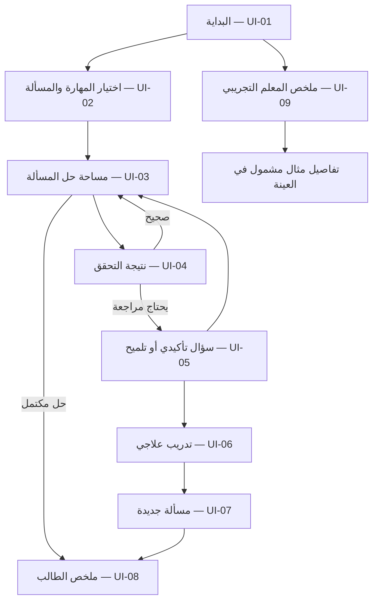

# خُطوة AI — مواصفة تصميم واجهات وتجربة المستخدم

> **اسم الوثيقة:** `08-UX-DESIGN.md`  
> **المنتج:** خُطوة AI — منصة عربية الأصل للتعلّم التشخيصي والتكيّفي  
> **الإصدار:** `1.1`  
> **تاريخ الإعداد:** 03 نوفمبر 2026  
> **الحالة:** **مواصفة تصميم تنفيذية مقترحة للمراجعة والاعتماد**؛ ليست إثباتًا لوجود واجهات منفّذة أو مختبرة  
> **المستهدف:** نسخة هاكثون شِراع — واجهة ويب متجاوبة للطالب ولوحة معلم مختصرة  
> **المراجع:** `00-PROJECT-VISION.md`، `01-PRD.md`، `02-MVP-SCOPE.md`، `04-ARABIC-NOTATION.md`، `05-CURRICULUM.md`، `06-MISCONCEPTIONS.md`، `07-TUTORING-POLICY.md`  
> **المالكون:** مالك المنتج، قائد UX/UI، مختص رياضيات/تربية، قائد محرر الرياضيات، مسؤول الإتاحة والجودة  
> **المستفيدون:** المصممون، مطورو الواجهة، الخلفية، محرك الرياضيات، الذكاء الاصطناعي، الاختبار، ووكلاء البرمجة

---

## 0. الغرض والسلطة وحدود القرار

تحدد هذه الوثيقة **كيف يمر الطالب والمعلم بتجربة خُطوة عمليًا**: تنظيم الشاشات، الحركات والإجراءات، حالات النتائج، النصوص، الإتاحة، وسلوك المحرر الرياضي العربي. وهي وثيقة تسليم قابلة للتنفيذ وليست مجرد توجيه بصري.

- **الرؤية** يملكها `00`، والمتطلبات الوظيفية **يملكها** `01`، ونطاق الهاكثون **يملكه** `02`.
- **الاصطلاح الرياضي والمدخلات والمعنى واتجاه الصيغ** يملكها `04`؛ هذه الوثيقة لا تعيد تفسير `٢س` أو تحدد رموزًا جديدة.
- **المهارات والمحتوى المعتمد** يملكها `05`، و**أنماط التشخيص وحججه** يملكها `06`، و**متى نظهر التلميح ونتيجة التعلم** يملكها `07`.
- `08` تملك **العرض والتفاعل والنصوص المرئية ومسارات التنقل والحالات البصرية**. أي أسماء دلالية للحقول الواردة هنا ليست عقد API نهائيًا؛ يملكه `12-API-CONTRACT.yaml`.
- نستخدم `P0` لما يلزم لبناء MVP، و`P1` لما يُضاف فقط بعد اجتياز بوابات الجودة، و`P2` لما يؤجل لما بعد الهاكثون.
- **القرارات المعلقة مذكورة في §24**. لا يجوز لوكيل أن يعتمد لونًا أو أداة أو تنقلًا أو سياسة جمع بيانات لمجرد ظهوره هنا دون مراجعة الجهات المعنية.

**تعريف نجاح UX:** يستطيع طالب جديد استخدام واجهة عربية لكتابة حل جبري، ويفهم الحكم على *خطوة بعينها*، ويعرف ماذا يفعل بعدها، ويتلقى المساعدة المناسبة، ويجرب مهارة في مسألة مختلفة، مع القدرة على تتبع النتيجة دون أن يختلط عليه العطل التقني والخطأ الرياضي.

---

## 1. نطاق التصميم وما لا نعد به

### 1.1 ضمن P0

1. موقع ويب متجاوب يعمل بالماوس واللمس ولوحة المفاتيح قدر الإمكان ضمن حدود المحرر المختبَر.
2. تجربة **عربية أصلًا**؛ واجهة عربية RTL ومُدخل رياضي عربي مستقل اتجاهيًا.
3. مسار طالب تجريبي لا يطلب هوية شخصية إلزامية؛ اختيار مسألة من الجبر المدرسي الأساسي.
4. إدخال **معادلة واحدة في السطر** وخطوات حل متعددة، مع التعديل والتحقق.
5. نتائج رياضية مختلفة بصريًا ونصيًا: صحيح، غير صحيح، إدخال غير سليم، غير مدعوم، غير محسوم، وعطل خدمة.
6. تشخيص تربوي حذر، وسؤال تأكيدي حيث يلزم، ومساعدة متدرجة `H0–H4` وفق `07`.
7. تدريب علاجي ومسألة نقل فهم جديدة، وملخص أدلة دون إعلان «إتقان نهائي».
8. ملخص معلم **مختصر** يعرض بيانات اصطناعية موسومة فقط في P0، مع فتح مثال قابل للتتبع.
9. حالات التحميل والفراغ والأذونات وفشل المكونات والتعديل المتزامن؛ عدم إضاعة عمل الطالب.

### 1.2 خارج P0

- تطبيق جوال أصلي؛ حسابات واسعة؛ فصول وواجبات ومدارس واشتراكات ومدفوعات؛ نظام مراسلة مفتوح.
- رفع صور أو OCR أو صوت أو رسم يدوي للمسائل؛ محادثة حرة بديلاً عن حل الخطوات.
- دعم الجذور والأسس في المتغير والدوال المثلثية (`جا` و`جتا` و`ظا`) والفيزياء والكيمياء والبرمجة في محرك الهاكثون.
- حاسبة رسومية شاملة، لوحة تحكم مؤسسات، تصدير شهادات، تصنيفات تنافسية للطلاب، أو احتساب درجات عالية الأثر.
- الوضع الداكن كالتزام؛ يكون `P1` بعد إثبات سلامة المعادلات في الوضع الأساسي.

### 1.3 قيود صحة لا تنازل عنها

- جبر MVP يركز على **معادلات خطية بمتغير واحد `س`**، ومعاملات صحيحة وكسور عددية بسيطة مشروطة باجتياز فحص العرض؛ لا تُنشر دروس الكسور غير الجاهزة.
- لا يُعرَض نجاح محاولة بعد تعديل خطوة سابقة دون إعادة تحقق **كل النتائج التابعة**.
- نتيجة `unsupported` أو `inconclusive` أو `service_error` **لا تُعرض كإخفاق للطالب** ولا تدخل ضمن أخطاء المفاهيم.
- لا يستخدم لون وحده للتفريق بين الأحكام، ولا تٌعرض النسب والمؤشرات التركيبية كأنها بيانات طلاب حقيقية.

---

## 2. الأشخاص والسياقات

| الشخصية | الحاجة | مستوى الخبرة المفترض | العائق الأكثر تأثيرًا |
|---|---|---|---|
| `PERSONA-STU-01` طالب ثانوي | يفهم أي خطوة تحتاج مراجعة ثم يستمر | يعرف الكتابة العربية والعمليات الجبرية الأساسية | الرموز غير المألوفة والتقييم الذي يخلط الفشل التقني بالخطأ |
| `PERSONA-STU-02` طالب يتعلم بالهاتف | يكتب المعادلة ويتتبع الخطوات على شاشة ضيقة | يستخدم اللمس أكثر من لوحة مفاتيح كاملة | انقلاب الأقواس، التصاق الأزرار، ضياع التركيز |
| `PERSONA-TEA-01` معلم في تجربة الهاكثون | يرى أنماط التعثر ودليل حالة واحدة | متمكن من المفهوم العلمي وليس بالضرورة من تقنية AI | تقارير واثقة دون أدلة أو مصدر بيانات |
| `PERSONA-REV-01` مراجع جودة/محكم | يعيد اختبار مسألة غير محفوظة مسبقًا | قد لا يعرف تفاصيل النظام | عرض معدّ مسبقًا يخفي حدود الدعم |

**عدم افتراض:** طالب «ضعيف» أو «ذكي» أو «بطيء» بناء على زمن الكتابة أو خطأ مفرد؛ نعرض عملًا ومساعدة ونتائج محددة فقط.

---

## 3. مبادئ تجربة خُطوة

1. **المسألة أولًا، المحادثة ثانيًا:** مساحة الحل منظمة؛ لا تكون شاشة البدء مربع محادثة فارغًا.
2. **العربية في المعنى لا المظهر فقط:** `س` و`٢س` أدوات إدخال فعلية، وليست بديلًا بصريًا عن `x`.
3. **الحكم ثم التفسير:** «هذا الانتقال غير صحيح» منفصلة عن «قد يكون السبب…».
4. **أول نقطة تحتاج مراجعة:** تجنب تلوين كل خطوات الحل باللون الخطأ إذا كانت الخطوة الثالثة فقط غير صحيحة.
5. **التلميح يُطلب أو يبرره السياق:** لا نكشف الحل كاملًا افتراضيًا ولا نمنع الطالب من التعلم.
6. **لا فشل بسبب عطل خدمة:** يبقى الإدخال قابلًا للمراجعة والإعادة.
7. **إظهار حدود القدرة:** التعذّر والموضوع غير المدعوم نتيجتان مشروعان.
8. **الاستقلالية لها سياق:** الفرق بين حل دون مساعدة وحل بمستوى `H4` يجب أن يظهر في الملخص.
9. **كل قرار قابل للتتبع:** يستطيع الطالب والمعلم فتح خطوة وسياق دليلها دون تسريب بيانات.
10. **إتاحة قبل الزخرفة:** الوضوح، التركيز، قراءة الرياضيات، وملاءمة الهاتف أهم من الحركات والمؤثرات.

---

## 4. بنية المعلومات والتنقل (IA)

### 4.1 خريطة النسخة الأولى



- **`UI-04` و`UI-05`** يمكن أن يكونا لوحتين داخل `UI-03` بدل صفحات منفصلة؛ **الالتزام بالتجربة لا بعدد مسارات URL**.
- **`UI-06` و`UI-07`** يمكن أن يعيدا استخدام مكوّن حل المعادلات، بشرط ظهور عنوان وسياق مختلف ووضع المساعدة المسموح.
- **`UI-09`** يعرض مدخلًا منفصلًا عن مساحة الطالب؛ لا يعطي صلاحية قراءة الجلسات بمجرد معرفة رابط.

### 4.2 مسارات URL مفهومية وليست عقودًا نهائية

| الواجهة | مسار مقترح | ملاحظة |
|---|---|---|
| البداية | `/` | دون حساب إلزامي |
| اختيار المسألة | `/learn/algebra` | موضوعات P0 فقط |
| جلسة الحل | `/learn/session/:opaqueId` | مرجع جلسة عشوائي غير قابل للتخمين وحده لا يكفي للصلاحية |
| ملخص الطالب | `/learn/summary/:opaqueId` | تحقق صلاحية/ملكية الجلسة |
| ملخص المعلم | `/demo/teacher` | بيانات اصطناعية موسومة فقط، مع حماية الوصول وفق `16` |

يُحسم الربط الفعلي مع الخلفية في `12`، ويمنع استنتاج صلاحيات من مجرد مسار URL.

---

## 5. تجربة الطالب من البداية إلى النهاية

### `UX-J-01` — حل صحيح بطريق مختلفة عن النموذج

1. يفتح الطالب الصفحة؛ يرى «ابدأ بالجبر» ويعرف أن هذا المسار يخص المعادلات الخطية.
2. يختار مهارة ومسألة؛ يقرأ «اكتب معادلة جديدة لكل خطوة».
3. يكتب `٢(س + ٣) = ١٠` ← `س + ٣ = ٥` ← `س = ٢`.
4. يعود تحقق صحيح على كل انتقال حتى لو اختلف عن الحل النموذجي المخزن.
5. يشاهد «وصلت إلى حل صحيح لهذه المسألة»، مع وصف هل استخدم تلميحات؛ لا تظهر شهادة إتقان مطلق.

### `UX-J-02` — خطأ توزيع ثم تأكيد ثم علاج ثم نقل

1. تظهر `٢(س + ٣) = ١٠`، ويكتب الطالب `٢س + ٣ = ١٠`.
2. يظهر **أول انتقال غير صحيح** مع إبراز الانتقال، لا وصف شخصية الطالب.
3. ترد نتيجة الرياضيات `verified_invalid`، ويظهر تشخيص منفصل: «قد يكون السبب نسيان توزيع العدد على الحد الثاني» إذا أجاز `06` الترشيح.
4. يطرح سؤال تأكيد عند الحاجة ثم يوفر `H1` وتلميحات أعمق وفق السياسة.
5. يكمل الطالب أو ينتقل إلى تدريب أصغر؛ ثم يحاول مسألة نقل جديدة مثل `٣(س + ٢) = ١٨` لم تعرض له سابقًا.
6. تظهر نتيجة النقل وفق `07`: دليل مستقل، تقدم بمساعدة، يحتاج متابعة، أو لم يمكن التقييم؛ لا نقول «أتقن الجبر».

### `UX-J-03` — خطأ في الصياغة لا في المفهوم

1. يكتب الطالب `٢(س + ٣ = ١٠` أو `١/٢س`.
2. المحرر/المحلل يوضح موضع الغموض أو القوس الناقص ويقترح تعديل الصياغة.
3. **لا تُسجَّل حالة «تعثر مفاهيمي»**، ولا يزيد عداد المحاولات المعرفية بمجرد إصلاح كتابة غير قابلة للتحليل.

### `UX-J-04` — خدمة تعذرت أو نتيجة متأخرة

1. يطلب الطالب التحقق ثم يعدل الخطوة قبل وصول الرد.
2. تظهر نسخة الطالب الحالية فورًا؛ تُوسم الاستجابة القديمة غير صالحة ولا تُطبق عليها أحكام.
3. يمكنه إعادة التحقق دون إنشاء محاولة مكررة؛ يبقى نصه محفوظًا ما دامت آلية حفظ الجلسة متاحة.

### `UX-J-05` — طلب الحل الكامل

1. في وضع التعلم `learning`، يضغط «اشرح الحل كاملًا».
2. تظهر رسالة: «سأشرح الحل، لكن هذه المسألة لن تُحسب محاولة مستقلة. يمكنك بعدها تجربة مسألة مختلفة».
3. بعد موافقته يعرض حلًا **مراجعًا ومتحققًا منه**؛ وتصبح `H4` أعلى مساعدة في المحاولة.
4. في `transfer_check` يظهر خيار «أحتاج مساعدة» **للخروج من القياس**، ولا يكشف الحل ثم يحتسب النقل مستقلًا.

### `UX-J-06` — فتح لوحة المعلم

1. يفتح مراجع مصرح صفحة المعلم التجريبية.
2. يرى بانر واضحًا «بيانات توضيحية اصطناعية» دائمًا في P0، وعدد المحاولات التي تُحلل ضمن العينة.
3. يفتح نمط «خاصية التوزيع»، فيرى مثالًا وحكمًا وفرضية تشخيصية ودرجة مساعدة دون هوية طالب غير مخول بها.

---

## 6. مواصفات الشاشات `UI-01` إلى `UI-09`

### `UI-01` — البداية واختيار المسار · `P0`

**الهدف:** يحدد الطالب خلال ثوانٍ ما يستطيع فعله الآن وكيف يتعامل المنتج مع عمله.

**الهيكل المقترح من أعلى لأسفل:** شريط هوية بسيط؛ عنوان «افهم سبب الخطأ، وتعلّم الخطوة التالية»؛ وصف موجز؛ بطاقة مسار «الجبر — معادلات خطية»؛ زر رئيسي «ابدأ التعلم»؛ ملاحظة «تجربة دون حساب شخصي إلزامي»؛ رابط «كيف يعمل خُطوة؟»؛ مدخل منفصل «عرض المعلم التجريبي».

**الحدود المعروضة:** «يدعم هذا النموذج معادلات خطية بمتغير س. لا يدعم الدوال المثلثية أو المسائل المصورة حاليًا».

**الإجراءات:** بدء جلسة، مشاهدة شرح قصير، الاطلاع على الخصوصية؛ لا روابط توحي بتوفر مواد `P2`.

**الحالات:** `loading` لبدء الجلسة، `service_error` لإنشاء الجلسة، و`permission_denied` إذا اختير مدخل لا يملكه المستخدم.

**معيار الإكمال:** يستطيع شخص جديد البدء دون اسم أو هاتف أو بريد، ولا يُفهم خطأً أن الفيزياء والبرمجة تعملان الآن.

### `UI-02` — اختيار الموضوع والمسألة · `P0`

**الهدف:** اختيار مادة مناسبة وبيان هدف التعلم وحدود مستوى الصعوبة.

**المكونات:** عنوان «اختر ما تريد التدرب عليه»، بطاقات مهارات `SK-ALG-01–08` مع وصف عربي قصير، علامة «متاح» أو «مشروط باجتياز اختبار» بحسب المحتوى المنشور، ثم قائمة مسائل مراجعة من بنك `05`.

**معلومات البطاقة:** اسم المهارة، ما الذي سيتدرب عليه الطالب، المتطلب السابق عند الحاجة، مستوى الصعوبة **من المحتوى المعتمد**، زر «ابدأ المسألة».

**الحالات:** عدم توفر بنك منشور للمهارة → «لا توجد مسائل جاهزة لهذا الموضوع الآن»؛ لا نعرض بطاقة مفعلة بلا مسألة قابلة للحل. `empty` و`loading` و`service_error` مطلوبة.

**ممنوع:** توصية شخصية حاسمة من دون أدلة؛ يمكن عرض «ابدأ بخاصية التوزيع» كاقتراح عام إذا كان معلنًا أنه مقترح.

### `UI-03` — مساحة حل المسألة · `P0` ومحور التجربة

**التخطيط المكتبي المقترح:**

```text
┌────────────────────────────────────────────────────────────────────────────┐
│ خُطوة             الجبر / خاصية التوزيع                  مسألة ١ من ...      │
├─────────────────────────────┬──────────────────────────────────────────────┤
│ المساعدة (جانبية)           │ السؤال: حل المعادلة                         │
│ الهدف الحالي               │ [ ٢(س + ٣) = ١٠ ]                           │
│ التلميحات عند الطلب         │                                              │
│ خطوات الحل                  │ ١. [ ٢(س + ٣) = ١٠ ]       (المسألة الأصلية)  │
│ دليل نتيجة سابقة            │ ٢. [ محرر المعادلة العربية ............. ]   │
│                             │ [لوحة أرقام ورموز عربية]                    │
│                             │ [تحقق من الخطوة] [إضافة خطوة] [حفظ]         │
└─────────────────────────────┴──────────────────────────────────────────────┘
```

**تنبيه:** هذا تخطيط هيكلي؛ لا يقرر اتجاه رسم التعبير الرياضي نفسه. كتلة المعادلة تحتاج عرضًا رياضيًا معزولًا ومختبرًا، لا سطر HTML يُعكس تلقائيًا.

**على الهاتف:** يصبح الترتيب عموديًا: عنوان مضغوط ← المسألة ← الخطوات ← المحرر ← لوحة الرموز ← إجراء رئيسي ثابت ضمن مساحة آمنة عند الحاجة ← نتيجة التحقق ← التلميحات عند الطلب. لا تخفي لوحة المساعدة المسألة كاملةً ولا تغطي زر التأكيد.

**المكونات الأساسية:**

- كتلة سؤال ثابتة مرئية أو قابلة للوصول بضغطة واحدة أثناء كتابة الخطوات.
- قائمة خطوات مرقّمة بتسلسل واضح؛ خطوة أصلية غير قابلة لتغيير نصها، وخطوات الطالب قابلة للتعديل وفق صلاحية الجلسة.
- سطر تحرير معادلة مستقل؛ لا يمرر أي طلب تحقق قبل اكتمال الصيغة وفق المحرر/المحلل، لكن يمكن حفظ المسودة غير المكتملة.
- لوحة رموز عربية بها `٠–٩`، `س`، `+`، `−`، `×`، `÷`، `=`، `(`، `)`، وزر حذف وتراجع حيث تدعم الأداة؛ تفاصيل الإدخال بموجب `04`.
- زر «تحقق من الخطوة» للتحقق من الانتقال الأخير الجاري؛ «أضف خطوة» فقط عندما يُسمح بالاستمرار من حالة صالحة.
- أزرار واضحة «عدّل» و«احذف خطوة» مع تأكيد عند فقد بيانات تابعة غير محفوظة.
- إعلان «جاري التحقق…» عند الطلب، مع السماح للمستخدم بقراءة محتواه وتعديله؛ الاستجابة التي تخص نسخة قديمة تُهمل.

**قواعد المسار:**

1. لا يمكن بناء سلسلة معتمدة من خطوة تالية على انتقال ثبت عدم صحته قبل تصحيح المرجع أو اختيار مسار تعليمي آخر.
2. تعديل خطوة `ن` يجعل أحكام الخطوة `ن` وما بعدها **تحتاج إعادة تحقق**؛ يمكن الاحتفاظ بالنصوص كمَسودات، لا كأحكام صحيحة.
3. لا يعيد النظام إرسال طلبات التحقق المتكررة كعمليات منفصلة؛ التكرار الآمن موكول للخلفية وعقد `12`.
4. إذا فقد الاتصال، يعرض حالة «لديك تغييرات غير مرسلة» بدل «تم الحفظ» ما لم يثبت ذلك.
5. لا يغير ترتيب الإشارات أو الأقواس لمجرد إصلاح اتجاه بصري؛ المشكلة البصرية تحل في عارض الرياضيات.

**حالات أساسية:** تحرير، صيغة غير مكتملة، جاهز للفحص، انتظار، صحيح، غير صحيح، غير محسوم، غير مدعوم، خدمة متعطلة، تعديل يبطل نتائج سابقة، انتهاء جلسة.

### `UI-04` — نتيجة فحص الخطوة · `P0`

**الهدف:** فصل ما أثبته المحرك عن تفسير سبب الخطأ واقتراح الخطوة التعليمية التالية.

**العناصر:** عنوان نتيجة مع رمز ونص؛ مؤشّر «الانتقال من الخطوة ١ إلى ٢»؛ المعادلتان المعنيتان؛ وصف رياضي موجز ومأمون؛ دليل قابل للتوسع إن وجد؛ قسم مستقل «ما السبب المحتمل؟» فقط إن توفرت فرضية مؤيدة؛ إجراء مناسب («تابع»، «راجع الخطوة»، «أحتاج تلميحًا»، «أعد التحقق»).

| حالة المحرك | عنوان عربي واجب | الإجراء المناسب | أثره على الطالب |
|---|---|---|---|
| `verified_valid` | «الانتقال صحيح» | «أكمل الحل» | لا تشخيص خطأ |
| `verified_invalid` | «هذا الانتقال يحتاج مراجعة» | «راجع الخطوة» / «أحتاج تلميحًا» | يجوز عرض فرضية منفصلة ضمن `06` |
| `syntax_error` | «لم أستطع قراءة هذه الصيغة» | «عدّل الصيغة» | ليست خطأ مفاهيميًا |
| `unsupported` | «هذا النوع غير مدعوم حاليًا» | «اختر مسألة مدعومة» / «عدّل الصيغة» | لا تقويم للطالب |
| `inconclusive` | «لا أستطيع تأكيد هذا الانتقال الآن» | «وضّح خطوتك» / «جرّب صياغة أخرى» | لا حكم بصحة أو خطأ |
| `service_error` | «تعذر التحقق الآن» | «أعد المحاولة» | لا حكم تعليمي |

**إظهار الدليل:** في `verified_invalid` يمكن إظهار «الحل قبل الخطوة وبعدها مختلف» ضمن قضية محددة؛ لا يُعرض شاهد حسابي اعتباطي على أنه برهان شامل. التفصيل الرياضي ملك المحرك.

**منع التصريحات المبالغ فيها:** لا تعرض «هذه الخطوة صحيحة ٩٨٪» أو «سبب خطئك هو…» ما لم توجد درجة معرفة موثوقة ومعتمدة، وغير مقترحة حاليًا.

### `UI-05` — السؤال التأكيدي والتلميحات · `P0`

**الهدف:** مساعدة الطالب على معرفة ما يراجعه دون إجباره على رؤية الحل النهائي.

**الهيكل:** نص مثل «لنراجع جزءًا من هذه الخطوة»، سؤال محدد عندما يلزم، حقل أو اختيارات جواب مناسبة، زر «تحقق من إجابتي»، قسم تلميحات تدريجية، زر «أتابع بنفسي»، زر «أحتاج مساعدة أكثر» عند توفر مستوى معتمد.

**التدرج المرئي:**

| مستوى | تسمية مرئية | ما يظهر عادة |
|---|---|---|
| `H0` | دون تلميحات | دعوة لمحاولة مستقلة |
| `H1` | تلميح أول | يوجه الانتباه إلى موضع يحتاج مراجعة |
| `H2` | تلميح يذكّر بالقاعدة | شرح مفهوم دون إكمال كل العمليات |
| `H3` | شرح خطوة جزئية | مثال أو حد جزئي يساعد الطالب على الاستمرار |
| `H4` | شرح الحل كاملًا | فقط في الوضع المسموح وبعد إعلام الطالب بأثره |

- لا تٌفتح `H2–H4` تلقائيًا لأن الطالب تأخر في الكتابة.
- لا تُظهر «٤ من ٤» بما يوحي أنها مراحل إجبارية؛ تظهر أسماء المساعدة المتاحة وما شاهد الطالب بالفعل.
- إذا غاب محتوى تلميح معتمد: يعرض «لا يتوفر تلميح إضافي لهذه الخطوة الآن» مع بديل تعليمي آمن، لا يبتكر نصًا غير مراجع.
- سؤال التأكيد **ليس اختبار ذكاء أو شخصية**، ولا يعامل الجواب الوحيد دليلًا على ضعف دائم.
- لا يبقى تلميح مرتبط بخطوة قديمة بعد تغييرها؛ تظهر ملاحظة «تغيرت الخطوة؛ سنراجعها من جديد».

**نافذة كشف الحل `H4`:** عنوان «هل تريد شرح الحل؟»، وصف أثر ذلك على استقلالية المحاولة، زران «العودة للحل» و«اشرح الحل»، مع حفظ التأكيد الصريح.

### `UI-06` — التدريب العلاجي · `P0`

**الهدف:** تدريب قصير على **مهارة واحدة أساسية** وراء التعثر دون تكرار السؤال الأصلي حرفيًا.

**الهيكل:** شارة «تدريب على [اسم المهارة]»؛ هدف قابل للفهم؛ مثال تمهيدي عند الحاجة؛ تمرين من بنك معتمد؛ محرر عربي مع إعادة استخدام مكون `UI-03`؛ تلميحات خاضعة للسياسة؛ انتقال واضح إلى المسألة الجديدة.

**سلوك الخطأ:** تظهر ملاحظة محددة دون إذلال؛ إذا ظهر ضعف في متطلب سابق مثل الإشارات، يجوز اقتراح تمرين أقصر عليه بمقتضى `05` و`07`.

**التقدم:** لا نعرض دورة تعلم لا نهائية؛ بعد تعثر متكرر يظهر خيار «مثال مشروح»، أو «ارجع للمهارة السابقة»، أو «توقف الآن» بحسب المحتوى والسياسة.

### `UI-07` — مسألة جديدة للتحقق من الفهم · `P0`

**الهدف:** فصل نتيجة التدريب عن دليل تطبيق المهارة في موقف لم تُكشف إجابته مسبقًا.

**التباين البصري والنصي الإلزامي:** عنوان «جرّب مسألة جديدة بنفسك»، ونص «هذه المحاولة دون تلميحات أثناء التقييم»، مع إعلان «إذا طلبت مساعدة فسننتقل إلى وضع التعلم ولن تُحسب المحاولة مستقلة».

**الأزرار:** «ابدأ المحاولة»، «تحقق من الخطوة»، «أحتاج مساعدة» (يحول إلى التعلم بعد تأكيد)، «أنهِ المحاولة» (إغلاق لا يحسب خطأً مفهوميا بسبب الانقطاع).

**حالات الخروج:** `transfer_evidence`، `assisted_progress`، `needs_followup`، `not_assessable` حسب `07`، دون نسب اتقان افتراضية.

**قيد محوري:** لا تظهر `H1–H4` داخل وضع النقل المستقل؛ طلب المساعدة يحوّل الوضع أولًا وبوضوح، ولا يسرّب حلًا قبل تسجيل الخروج من وضع القياس.

### `UI-08` — ملخص الطالب وخريطة المهارات · `P0`

**الهدف:** تلخيص ما حدث بالفعل وما يزال يحتاج تجربة أو مراجعة.

**المكونات:** عنوان «ما الذي تعلّمته في هذه الجلسة؟»؛ ملخص المسائل المُجربة؛ حالات الأدلة لكل `SK-ALG-*`؛ أعلى مساعدة استخدمت؛ عرض مقارنة قبل/بعد **فقط عند وجود بيانات فعلية قابلة للمقارنة**؛ زر «تدرّب على مهارة أخرى»؛ فتح تفاصيل محاولة دون تسريب بيانات.

**مفردات حالات الأدلة المقبولة:** «لم تُختبر»، «ظهر تعثر في هذه المحاولة»، «تقدم بمساعدة»، «ظهر دليل مستقل في مسألة جديدة»، «تحتاج متابعة»، «لم يمكن التقييم».

**ممنوع:** تصنيف «طالب ضعيف»، شارة «إتقان ١٠٠٪» دون أساس، أو مؤشرات خطية تختزل حالة تعذر التقييم إلى صفر.

**حالة الفراغ:** «لم تُحل مسائل بعد. ابدأ بمسألة قصيرة ليتكون سجل تعلمك.»

### `UI-09` — ملخص المعلم التجريبي · `P0` مختصر

**الهدف:** دعم مراجعة نمط تعثر في **عينة معلومة المصدر**، لا إصدار قرارات تعليمية عالية الأثر.

**العناصر:** شريط عنوان «عرض المعلم»؛ بانر مصدر البيانات؛ الفترة/الإصدار/حجم العينة؛ بطاقات عدد المحاولات **القابلة للتقييم** وأعداد التعذر بشكل منفصل؛ جدول/رسم بسيط لأنماط التعثر حسب `ERR-ALG-*` والمهارات حسب `SK-ALG-*`؛ قائمة أمثلة تفتح تفاصيل الأدلة.

**مثال بطاقة:** «خاصية التوزيع — ٤ انتقالات ثبت عدم صحتها من أصل ٢٠ انتقالًا قابلًا للتقييم في هذه العينة الاصطناعية». الأعداد **مثال نصي للواجهة وليس بيانات حقيقية** ولا تستخدم كقيم افتراضية دون وسم.

**تفاصيل المثال:** السؤال وإصداره، قبل/بعد خطوة الانتقال، الحالة الرياضية، ترشيح الخطأ إن وجد، تلميحات ظهرت فعلًا، حالة مسألة النقل، وسياق مصدر البيانات دون هوية غير مأذون بها.

**أمن واجهة:** لا يكفي إخفاء اسم الطالب؛ يجب تطبيق صلاحية الوصول في الخادم، وعدم تحميل بيانات الآخرين في المتصفح ثم إخفائها بـCSS. مسار المعلم في P0 لا يعرض إلا بيانات اصطناعية موسومة، ولا يصل إلى جلسات ضيوف حقيقية.

**حالات خاصة:** لا بيانات، عينة صغيرة، غير قابل للتقييم، صلاحية مرفوضة، أو تعذر التحميل. لا تُنشأ مقارنة بين صفوف أو مؤسسات في P0.

### 6.1 شاشات `P1/P2` غير المنفذة

| الرمز | الحالة | السبب |
|---|---|---|
| `UI-10` | P1: سجل موسع | يحتاج آلية هوية واستئناف وحذف/تصدير معتمدين |
| `UI-11` | P2: الفصول والواجبات | يحتاج صلاحيات وموافقات تربوية ومؤسسية |
| `UI-12` | P2: لوحة مؤسسة | خارج هدف العرض ولا توجد بيانات مؤسسية معتمدة |

---

## 7. تصميم محرر الرياضيات العربي — المكوّن الأشد خطورة

### 7.1 متطلبات الإدخال

- يقبل المكوّن الأرقام `٠–٩`، والمتغير `س`، والأقواس، والمساواة، والجمع/الطرح، والضرب الصريح والضمني، والقسمة المسموح بها فقط.
- إدخال `٢س` و`٢(س + ٣)` و`−٣س + ١٢ = ٠` لا يتطلب تغيير لوحة المفاتيح إلى الإنجليزية.
- يمكن قبول كتابة `2س + 3` وفق `04` ثم إظهار الصياغة العربية المعتمدة **بعد التفسير الآمن**؛ لا تجرى عملية تحويل صامتة لمعنى مختلف.
- تُعرض أمثلة غير مدعومة مثل `جا(٣٠°)` برسالة حد دعم، ولا تُعالج كضرب بين أحرف.
- لا تعد الرموز `س²` والجذور والدوال المثلثية من أزرار P0؛ تظهر فقط في مواد رؤية المنتج لا لوحة الإدخال الحالية.
- **عدم اليقين يوقف التفسير:** مثال `١/٢س` يجب أن يطلب أقواسًا، لا اختيار معنى اعتمادًا على اتجاه الشاشة.

### 7.2 الفصل بين ثلاث صور للتعبير

1. `raw_input`: ما كتبه الطالب حرفيًا، مع الاحتفاظ به بعد تعذر التحليل؛ محكوم بتقليل البيانات.
2. `semantic_expression`: شجرة تمثيل رياضي موحدة ينتجها محلل موثوق، لا يكتبها CSS ولا AI.
3. `display_expression`: الصيغة العربية المعروضة بأداة الرياضيات؛ مشتقة من المعنى أو المصدر وفق الحالة، دون إفساد المدخل الأصلي.

**سلوك المحرر:** لا يستخدم النص المرئي/LaTeX المصيَّر كأنه دليل مستقل على التكافؤ. الصيغ والمجال وتفسير المقامات تُحسم في `10-MATH-ENGINE.md`.

### 7.3 RTL الحقيقي وليس مجرد `dir=rtl`

- توضع الصفحة في سياق عربي RTL، ولكن **كل معادلة وحدة عرض معزولة**، ويجري فحص اتجاهها بالأداة المختارة على الجهاز الحقيقي.
- يُفحص ترتيب `١٢٣`، والقوس في `٢(س + ٣)`، وإشارة `−٣س`، والبسط والمقام في `س = ١/٢`، والخلط مع نص عربي محيط.
- يُمنع عكس ترتيب الرموز في البيانات أو وضع محارف تحكم خفية لتضليل التحقق؛ التعديل البصري لا يغير المعنى الرياضي.
- يخضع النسخ واللصق للفحص: نسخ `٢س + ٣ = ٧` وإعادة إدخاله يجب أن يعطي التعبير الدلالي نفسه.
- عند فشل عرض الكسر على جهاز مستهدف، **لا تُفعّل مسائل الكسور** قبل إصلاح المشكلة أو إجراء تغيير نطاق موثق.

### 7.4 التركيز ولوحة المفاتيح ومهام اللمس

- ظهور موضع الإدخال `caret` بوضوح، مع معرفة انتقال التركيز داخل المعادلة.
- لوحة رموز على الهاتف قابلة للإغلاق؛ لا تغطي الخطوة الحالية أو زر الحفظ.
- أسماء مفهومة لقارئ الشاشة: «أدخل المتغير س»، «افتح قوسًا»، «علامة مساواة»، «العدد ثلاثة»؛ تفصل التسمية عن النص البصري حين يلزم.
- لصق نص غير صالح يعرض رسالة إصلاح واضحة ولا يمحو جميع الخطوات.
- أزرار اللمس بحجم مستهدف مريح، لا تعتمد على أيقونات دون تسمية.
- يستعمل المحرر حلاً احتياطيًا **قابلًا للاختبار** عند تعذر تكامل أداة تحرير متقدمة؛ يمنع خفض الجودة بصمت إلى نص يقلب المعادلات.

### 7.5 إثبات الصلاحية قبل التصميم النهائي (Editor PoC)

على قائد الواجهة والمحرك والجودة توثيق فيديو أو سجل تحقق لما يلي على حاسوب وهاتف فعليين: كتابة وتعديل `٢س`، الأقواس، الإشارات السالبة، الكسور المشروطة، تحريك المؤشر، النسخ/اللصق، كتابة `2س`، إدخال خطأ ثم إصلاحه، وعدم انقلاب العرض عند تغيير عرض الشاشة.

**قرار الإيقاف:** إذا تعذر إدخال/عرض جبري عربي صحيح، لا نغير الهوية إلى `x`؛ نصحح الأداة أو نضيق النطاق الرياضي بعد موافقة الفريق وفق `GATE-1`.

---

## 8. نموذج حالات التفاعل (UI State Model)

### 8.1 حالات الخطوة داخل المتصفح

| الحالة المفهومية | ما يراه المستخدم | إجراء واجهة مسموح |
|---|---|---|
| `draft` | خطوة يجري تحريرها | تعديل، حفظ مسودة، فحص عند صلاحية الإدخال |
| `invalid_syntax` | جزء يحتاج إكمالًا | تعديل فقط، لا حكم تربوي |
| `checking` | «جاري التحقق…» | قراءة/تعديل؛ تعديل جديد يُلغي صلاحية الرد السابق |
| `verified_valid` | «الانتقال صحيح» | إضافة خطوة أو إنهاء إن اكتمل الحل |
| `verified_invalid` | «هذا الانتقال يحتاج مراجعة» | تعديل أو سؤال تأكيدي/تلميح |
| `unsupported` | «غير مدعوم» | تعديل أو الرجوع لمسألة مدعومة |
| `inconclusive` | «لم أستطع تأكيد صحة الانتقال» | توضيح أو صياغة أخرى دون عقوبة |
| `service_error` | «تعذر التحقق» | إعادة آمنة أو حفظ مسودة |
| `stale` | «تغيرت الخطوة وتحتاج إعادة تحقق» | إعادة فحص السلسلة التابعة |

### 8.2 حالات الجلسة

تطابق المفهوم الوارد في PRD: `created` ← `in_progress`، ثم عند الحاجة `awaiting_clarification` أو `needs_support` أو `remediation` أو `recheck`، وأخيرًا `completed` أو `abandoned`.

- **الجلسة ليست درجة طالب**: إتمام الدورة قد يعني تعلمًا بمساعدة أو تعذر تقييم النقل، وليس إتقانًا نهائيًا.
- حالات الجلسة تُدار بمصدر موثوق من الخلفية؛ لا يقرر الواجهة وحدها أن المحاولة «مكتملة» بسبب إظهار شارة نجاح.

### 8.3 التأخر والتعديل والتكرار

1. كل طلب تحقق يرتبط بمرجع المحاولة، ومعرّف الخطوة، ونسخة المحتوى الحالية، وترتيب التعديل `revision` أو ما يكافئها.
2. لا يُعرض الرد إلا إذا طابق **الإصدار الحالي**. إذا جاء رد قديم بعد تعديل، يُهمل في الواجهة ولا يعيد نتيجة قديمة.
3. تعديل خطوة سابقة يبطل نتائجها والتابعة بصريًا؛ تظل النصوص محفوظة في وضع «بحاجة للتحقق» عند السماح.
4. النقر المكرر على زر الفحص لا يزيد عدد المحاولات أو التلميحات؛ يعرض واجهة انتظار واحدة.
5. حالة الحفظ واضحة: «تم الحفظ» لا تظهر إلا بعد تأكيد فعلي؛ وإلا «لم يُرسل التعديل بعد».
6. إذا فشل AI وحده، يستمر عرض حكم الرياضيات المثبت ويمكن استخدام رسالة مساعدة مُراجَعة ثابتة.

---

## 9. مصفوفة المحتوى والحالة المرئية

| الحالة | عنوان واضح | شرح قصير | الإجراء الرئيسي | ما لا يجوز |
|---|---|---|---|---|
| تحميل التحقق | «جاري التحقق من الخطوة» | «قد يستغرق هذا بعض الوقت؛ يمكنك مراجعة ما كتبت.» | «انتظر النتيجة» أو السماح بالتعديل | إظهار نجاح قبل الرد |
| انتقال صحيح | «الانتقال صحيح» | «حافظت هذه الخطوة على الحل وفق القواعد المدعومة.» | «أكمل الحل» | «أنت متقن» |
| انتقال غير صحيح | «هذا الانتقال يحتاج مراجعة» | «تغيّر الحل بين الخطوتين.» عند إثبات ذلك | «راجع الخطوة» | الجزم بسبب مفاهيمي دون دليل |
| تشخيص محتمل | «قد يكون السبب…» | «لنراجع خاصية التوزيع بسؤال صغير.» | «أجب عن السؤال» | تحويله إلى حقيقة ثابتة |
| خطأ كتابة | «المعادلة غير مكتملة» | «تأكد من إغلاق القوس.» | «عدّل الصيغة» | زيادة أخطاء الطالب المفاهيمية |
| غير مدعوم | «الموضوع غير مدعوم حاليًا» | «هذا المسار يركز على المعادلات الخطية.» | «اختر مسألة مدعومة» | تقييم الصيغة على أنها خطأ |
| غير محسوم | «تعذر تأكيد هذه الخطوة» | «فهمت الصيغة لكن لا يمكنني الحكم بأمان.» | «وضّح الخطوة» | «صحيح» أو «خاطئ» تخمينًا |
| عطل تقنية | «تعذر الاتصال بخدمة التحقق» | «احتفظنا بما وصلنا إليه/التعديل لم يُحفظ بعد» وفق الواقع | «إعادة المحاولة» | ادعاء الحفظ دون تأكيد |
| محتوى غير متاح | «لا يتوفر تمرين لهذا الموضوع الآن» | «جرّب موضوعًا آخر متاحًا.» | «عودة إلى الموضوعات» | عرض محتوى غير مُراجع |
| جلسة بلا تقدم | «لا توجد محاولات بعد» | «ابدأ بمسألة قصيرة.» | «اختر مسألة» | رسم صفر مضلل كدرجة إتقان |
| ممنوع الوصول | «لا تملك صلاحية عرض هذه البيانات» | لا تفصح عن وجود بيانات لمستخدم آخر | «عودة» | جلب بيانات محمية للواجهة أصلًا |

---

## 10. نظام التصميم البصري (Design System)

### 10.1 هوية بصرية مقترحة لا معتمدة

**الطابع:** تعليمي هادئ، حديث، واضح، بعيد عن زخرفة الألعاب التي قد تجعل الخطأ يبدو عقابًا. يمكن أن تتضمن الهوية رمز «خطوة/مسار» مجردًا، لا طالبًا مصنفًا بدرجة.

**اقتراح مبدئي للسمات:** خلفيات فاتحة محايدة، نص داكن عالي التباين، لون أساسي هادئ للروابط والأزرار، ولون دلالي للنجاح والتنبيه. الألوان الدقيقة وخطوط الهوية تعتمد بعد مراجعة إمكانية الوصول والعرض على الأجهزة.

**قاعدة إلزامية:** لا يُستعمل الأخضر/الأحمر وحده لنقل الحالة؛ تجمع الرسالة بين رمز متاح، وعنوان عربي، وشرح مرتبط بالخطوة.

### 10.2 رموز تصميم مقترحة — أسماء لا قيم منتج معتمدة

| الفئة | الرموز المطلوبة | الملاحظات |
|---|---|---|
| الألوان | `surface`, `surface-muted`, `text-primary`, `text-secondary`, `border`, `action-primary`, `status-success`, `status-review`, `status-unknown`, `status-error` | لا يثبت اللون دون اختبار تباين |
| الخطوط | `font-arabic-ui`, `font-math`, `font-code-future` | خط الرياضيات يجب أن يحافظ على علامات الترقيم والأرقام والأقواس |
| المسافات | مقياس موحد مثل `4, 8, 12, 16, 24, 32` بكسل | أرقام أولية قابلة للتعديل |
| الزوايا | `radius-sm`, `radius-md`, `radius-lg` | تفضيل بطاقات واضحة على حواف حادة |
| الحركات | `motion-fast`, `motion-normal` | قابلة للإيقاف؛ لا حركة أساسية لنقل معنى الحالة |
| الطبقات | `z-navigation`, `z-editor-keyboard`, `z-dialog`, `z-notification` | لا تحجب لوحة الرموز نافذة الموافقة أو حقول الإدخال |

### 10.3 الخطوط والطباعة

- اختبر خط واجهة عربي واضح يدعم التشكيل والأرقام العربية والمسافات، مع خط/عارض رياضي مناسب؛ لا نفترض أن خط الواجهة يستطيع رسم كل الرموز الرياضية بأمان.
- يتطلب نص الشرح حجمًا مريحًا افتراضيًا؛ وتظل المعادلات قابلة للتكبير دون أن تُقص أطرافها.
- عناوين واضحة للصفحات والأقسام، ونصوص أزرار فعلية لا أيقونات فقط.
- لا يخلط وزن الخط الضعيف بين الإشارة السالبة والشرطة أو بين الرمز والمعامل.
- لا نربط نجاح التصميم باسم خط بعينه قبل اختباره على محرر المعادلات الحقيقي.

### 10.4 التباين والحالات

- يستهدف النص العادي تباينًا لا يقل عن **4.5:1**، والنص الكبير **3:1**، ومؤشرات الإدخال والمكونات الأساسية **3:1** حيث تنطبق معايير WCAG 2.2 AA.
- مؤشر التركيز مرئي دائمًا، وليس تغيرًا طفيفًا في لون الحد.
- عند إظهار نتيجتين مختلفتين تكون الرموز والعناوين صريحة حتى في وضع تدرج رمادي.
- لا يختفي محتوى مهم بسبب تحريك أو وميض أو انتقال تلقائي.

---

## 11. التجاوب والهاتف أولًا ضمن حدود الرياضيات

| العرض التقريبي | بنية الصفحة | معالجة المحرر |
|---|---|---|
| `320–599px` — هاتف صغير/عادي | عمود واحد؛ عنوان مختصر؛ أزرار رئيسية واضحة | لوحة رموز قابلة للطي؛ عدم قص المسألة؛ تكبير المعادلة عند الحاجة |
| `600–899px` — هاتف عريض/لوحي | عمود واحد واسع أو عمودان حسب المحتوى | مساحة أكبر للخطوات، لا يُفرض تخطيط يقطع الرموز |
| `900px+` — حاسوب | منطقة الحل رئيسية ولوحة مساعدة جانبية | عرض الخطوات والمساعدة معًا دون إغراق |

هذه **نقاط ضبط تصميمية مقترحة**، لا ادعاء دعم نُفِّذ. يختبر الفريق بعروض حقيقية (مثل 360 و390 و768 و1280) بعد بناء المكوّن.

**قاعدة التجاوب:** لا تجعل الواجهة كلها تمريرًا أفقيًا بسبب معادلة واحدة. إذا كانت المعادلة أطول من المساحة، عالج **كتلة المعادلة فقط** بسلوك واضح؛ لا تقطع البسط/المقام أو تجعل الأقواس غير مرئية.

**الأولوية في الهاتف:** وصول الطالب إلى السؤال والخطوة الحالية ولوحة الرموز وزر التحقق بأقل تنقل ممكن، مع عدم التضحية بتفسير الحكم.

---

## 12. إتاحة الاستخدام (Accessibility)

### 12.1 أهداف أساسية

- هيكل عناوين مترتب، وعناصر نماذج ذات أسماء عربية، ومحتوى لا يعتمد على الصورة وحدها.
- تنقل أساسي بلوحة المفاتيح دون فخ تركيز؛ دعم `Tab` و`Shift+Tab` و`Enter` و`Esc` حسب المكوّن.
- إعلان متزن للنتائج الجديدة لقارئ الشاشة؛ لا يجعل كل حرف يكتبه الطالب إعلانًا حيًا مزعجًا.
- عند `verified_invalid` يعلن «الانتقال من الخطوة الأولى إلى الثانية يحتاج مراجعة» بدل «خطأ» دون سياق.
- وسيلة لقراءة الصيغة أو وصفها معنويًا: مثل «اثنان مضروبًا في مجموع س وثلاثة يساوي عشرة» بشرط مطابقة المعنى، مع اختبار قارئ شاشة حقيقي.
- توفر وقت كافٍ؛ لا نحتسب التأخر أو التوقف دليل ضعف.
- عند عرض تلميح أو حوار كشف الحل يتحرك التركيز بطريقة مفهومة ويعود إلى موضعه بعد الإغلاق.
- احترام إعدادات `reduced motion` إن استُخدمت الحركة.

### 12.2 الوصول إلى المحرر الرياضي: قيد يتطلب اختبارًا حقيقيًا

لا يكفي وضع `aria-label` على معادلة معقدة وإعلان دعم قارئ الشاشة. يجب اختبار التأشير داخل المعادلة، وحركة المؤشر، والكسور، والأقواس، والنسخ واللصق، مع قارئ شاشة وبيئة محددة. يُوثق ما نجح وما لم ينجح؛ إن لم يتوافر بديل كامل في P0 لا يُسوَّق المنتج على أنه متاح بالكامل.

### 12.3 خط أساس للاختبار

- تمرير لوحة المفاتيح بالكامل في رحلة `UI-01 → UI-08`.
- تباين الألوان والحالات والفوكس.
- تكبير الصفحة والنص دون فقد التحكم.
- قارئ شاشة واحد على الأقل ضمن بيئة فعلية مع توثيق الحدود؛ واختبار اتجاه المعادلة والقراءة النصية المعبرة.
- تجربة اللمس الفعلية للوحة الرموز وعدم تغطية أزرار الإرسال والعودة.

---

## 13. النصوص العربية (Microcopy) وقواعد الأسلوب

### 13.1 صوت خُطوة

- مختصر، هادئ، مفسِّر، بلا تعالٍ أو سخرية.
- يصف الفعل والمعلومة: «راجِع توزيع الضرب» لا «لا تفهم الضرب».
- يعترف بالتردد: «قد يكون السبب…»، «أحتاج سؤالًا صغيرًا للتأكد».
- لا يمجّد النجاح بصورة مضللة: «ظهر دليل على تطبيقك للمهارة» بدل «أصبحت عبقريًا».
- تتبع المصطلحات `04` و`05` ولا تبتكر مرادفًا جديدًا لمجرد التنويع الأسلوبي.

### 13.2 قاموس أزرار مبدئي

| الإجراء | النص المرئي المقترح |
|---|---|
| بدء التعلم | «ابدأ التعلم» |
| اختيار موضوع | «اختر مهارة» |
| إدخال خطوة | «اكتب الخطوة التالية» |
| فحص | «تحقق من الخطوة» |
| إضافة | «أضف خطوة» |
| تعديل | «عدّل الخطوة» |
| طلب مساعدة | «أحتاج تلميحًا» |
| تلميح أعمق | «مساعدة أكثر» |
| سؤال تأكيد | «أجب عن السؤال» |
| مراجعة | «راجع خطوتك» |
| علاج | «تدرّب على هذه الفكرة» |
| نقل | «جرّب مسألة جديدة» |
| كشف حل | «اشرح الحل كاملًا» |
| متابعة | «تابع التعلم» |
| إعادة محاولة خدمة | «أعد التحقق» |
| انتهاء | «ملخص الجلسة» |

### 13.3 لا تسرب للرموز التقنية في الواجهة

- لا يرى الطالب `verified_invalid` أو `inconclusive` أو `H3` أو `ERR-ALG-01` كنص خام؛ هذه معرّفات داخلية وسجلات للمطورين.
- يمكن للمعلم رؤية أسماء المهارات والأمثلة، ولا يحتاج إلى رؤية JSON أو رموز أخطاء البرامج ضمن لوحة الملخص.
- في البرمجة مستقبلًا تبقى الكلمات المحجوزة الإنجليزية كما هي؛ لا ينطبق تعريب الجبر على الكود.

---

## 14. لوحات التقدم: تصميم يحترم عدم اليقين

### 14.1 ملخص الطالب

يفضل عرض قائمة مهارات مع أوصاف أدلة، لا نسبة إتقان عامة. المثال أدناه **صياغة توضيحية فقط**:

| المهارة | ما يظهر عند وجود أدلة صحيحة | عند غياب الأدلة |
|---|---|---|
| خاصية التوزيع | «حللت مسألة جديدة دون تلميحات» | «لم تُختبر بعد» |
| الإشارات | «تحتاج مراجعة في هذه المحاولة» | «لم تُختبر بعد» |
| عزل المتغير | «تقدمت بمساعدة» | «لم تُختبر بعد» |

- يجب أن تؤدي كل شارة إلى تفصيل يوضح ما ظهر ومتى وضمن أي سؤال.
- لا يساوي عدد النقرات أو الوقت المنقضي «تقدمًا معرفيًا».
- نتائج `not_assessable` منفصلة عن `needs_followup`.

### 14.2 ملخص المعلم

- تشرح كل بطاقة المقام: «من أصل محاولات قابلة للتقييم».
- إذا كانت العينة صغيرة أو تركيبية، تظهر هذه الحقيقة داخل الصفحة وفي سياق تنزيل/لقطة العرض إن وُجد.
- لا تُرسم مقارنة بين مهارات دون بيانات مناسبة.
- تقرير المعلم **للمراجعة لا لاتخاذ قرار مصيري آلي**؛ يسمح له بفتح الدليل ومراجعة المحتوى.

---

## 15. الخصوصية وثقة المستخدم داخل الواجهة

- **P0 تجريبي دون حساب شخصي إلزامي**؛ لا حقول اسم/هاتف/بريد في بداية التعلم.
- يظهر بيان موجز لما يُحفظ ولماذا؛ نص الخصوصية المعتمد تحدده `16-SECURITY-PRIVACY.md`، لا يخترعه المصمم.
- لا تظهر رسالة «حُفظت جلسة الطالب» حتى يؤكد المصدر المسؤول ذلك؛ إن كان الحفظ محليًا فقط يذكر بوضوح أنه محلي وغير مضمون بعد إغلاق الجلسة.
- لا تُشارك محاولات طالب حقيقي مع لوحة المعلم في P0؛ النسخة التجريبية تستخدم بيانات اصطناعية موسومة فقط.
- لا تتضمن السجلات العامة نصوص إجابات حساسة أو مفاتيح API؛ واجهات الأخطاء لا تسرب تفاصيل الخادم.
- عندما تُعرض تحليلات تركيبية للاختبار أو العرض، يظل الوسم ظاهرًا ولا يُخفى عند فتح التفاصيل.
- نضع مكانًا لاختيار «ابدأ جلسة جديدة» وتحذيرًا واضحًا قبل فقد بيانات غير محفوظة؛ لا ندعي زر حذف بيانات قبل تنفيذ عمليته فعلًا.

---

## 16. أمان المحتوى وسلوك AI في الواجهة

1. يحق للنموذج المساعدة في **صياغة تفسير تربوي** فقط ضمن الحدود المراجعة؛ لا يعطي حكمًا رياضيًا مستقلًا مخالفًا للمحرك.
2. إذا تعارض التفسير مع نتيجة التحقق، يمتنع العرض عن إظهار التفسير وتظهر جملة آمنة مراجعَة: «الانتقال يحتاج مراجعة، ويمكنك إعادة كتابته أو طلب مساعدة».
3. لا تعرض الواجهة نصًا مولدًا يتضمن اختراع معادلة نهائية غير معتمدة أو روابط تعليمية غير مثبتة.
4. إذا فشل AI، لا تُمحى النتيجة الرياضية أو تتغير إلى `verified_valid`؛ تعرض بديلًا ثابتًا معتمدًا إن وُجد.
5. لا يتبع المساعد تعليمات يكتبها الطالب تهدف إلى تبديل صلاحيات النظام أو كشف أسرار أو تغيير سياسة التلميحات.
6. جميع الرسائل الرياضية والتربوية العربية المولدة تمر عبر قواعد سلامة ومراجعة وفق `13-AI-ENGINE.md`؛ لا يُعتمد شكل الاستجابة قبل `12`.

---

## 17. مكتبة المكونات (Component Inventory)

| المعرّف | المكوّن | الشاشات | السلوك الحاسم |
|---|---|---|---|
| `CMP-01` | شريط الهوية والتنقل | جميعها | اتجاه عربي وروابط واضحة |
| `CMP-02` | بطاقة مهارة/مسألة | `UI-02` | مستوى ومعنى «متاح» مضبوط |
| `CMP-03` | عارض معادلات عربي | `UI-02–09` | RTL/أقواس/إشارات/كسور صحيحة |
| `CMP-04` | محرر معادلات | `UI-03,06,07` | إدخال `س` والأرقام العربية دون تغيير لوحة الجهاز |
| `CMP-05` | لوحة مفاتيح رموز رياضية | `UI-03,06,07` | لمس ولوحة مفاتيح وتركيز قابلان للاختبار |
| `CMP-06` | قائمة خطوات الحل | `UI-03` | ترقيم وتعديل وإبطال أحكام تابعة |
| `CMP-07` | بطاقة نتيجة التحقق | `UI-04` | فصل الحكم عن السبب التربوي |
| `CMP-08` | بطاقة سؤال تأكيدي | `UI-05` | سؤال واحد محدد ونتيجة موثقة |
| `CMP-09` | كاشف تلميحات | `UI-05,06` | تدرج `H0–H4` وفق السياسة |
| `CMP-10` | حوار كشف حل | `UI-05` | موافقة صريحة وأثر الاستقلالية |
| `CMP-11` | رأس وضع التعلم/النقل | `UI-06,07` | عنوان وتلميحات/قياس مختلفان |
| `CMP-12` | شارات دليل مهارة | `UI-08,09` | وصف قائم على العمل لا حكم مطلق |
| `CMP-13` | لوحة تحليل بيانات المعلم | `UI-09` | وسم بيانات اصطناعية، مقام العينة |
| `CMP-14` | حالة فارغة/فشل/رفض | جميعها | رسائل آمنة وإجراء إنقاذ |
| `CMP-15` | إشعار حفظ/إعادة محاولة | `UI-03–08` | منع النجاح المبكر وتكرار الطلب |

**مخرجات تصميم كل مكوّن:** حالة عادية، تركيز، تحميل، خطأ، تعطيل، شاشة هاتف، قارئ شاشة، وربط بمعرف متطلب، دون تحويل أسماء هذه المكونات إلى حقول API ملزمة.

---

## 18. عقود تفاعل دلالية بين الواجهة والخدمات

> الأمثلة التالية **حقول مفهومية** لتنسيق العمل، ولا تُنسخ كأسماء تنفيذية قبل اعتماد `11-DATA-MODEL.md` و`12-API-CONTRACT.yaml`.

### 18.1 عند إدخال معادلة

تحتاج الواجهة: `session_reference`, `problem_reference`, `problem_version`, `step_reference`, `raw_input`, `revision`, `input_status`, `normalized_display` عند قبول التحليل، وموقع الخطأ إن وجد.

### 18.2 عند التحقق من انتقال

تحتاج الواجهة: `from_step`, `to_step`, `revision`, `verification_status`, `domain_constraints`, `evidence_summary`, `engine_version`, `is_current_revision` أو نظيرًا مضبوطًا.

### 18.3 عند إظهار تدخل تربوي

تحتاج الواجهة: `diagnosis_state`, `misconception_code` إذا أجيز، `skill_code`, `question_or_hint`, `hint_level`, `approved_content_version`, `source_step_revision`, `help_recorded`.

### 18.4 عند عرض ملخص

تحتاج الواجهة: `skill_reference`, `attempts_evaluable`, `highest_hint_level_seen`, `transfer_status`, `evidence_links`, `content_version`, `data_provenance`؛ ويجب إظهار **عدم التقييم** منفصلًا عن خطأ الطالب.

### 18.5 قواعد التوافق

- لا تعتمد UI على أسماء حقل متخيلة من الوكيل قبل توقيع العقد.
- الحالات `verified_valid`, `verified_invalid`, `syntax_error`, `unsupported`, `inconclusive`, `service_error` لا تُختزل في `success: true/false` فقط.
- على الخادم فرض صلاحية الجلسة ورفض التكرار غير المقصود؛ على UI منع عرض رد قديم.
- تتبع كل رسالة عربية حالة موثقة، لا خاصية نصية عامة تصنع حالة جديدة.

---

## 19. سيناريوهات تنفيذ التصميم واختبارات الاستخدام

### 19.1 حالات اختبار واجهة `UX-TEST-*`

| المعرّف | السيناريو | النتيجة المطلوبة |
|---|---|---|
| `UX-TEST-001` | يبدأ مستخدم بلا حساب | جلسة تعلم دون بيانات شخصية إلزامية |
| `UX-TEST-002` | اختيار موضوع خارج بنك منشور | يظهر «غير متاح» ولا يفتح محررًا زائفًا |
| `UX-TEST-003` | إدخال `٢س + ٣ = ٧` | ظهور صحيح الاتجاه ومصدر إدخال عربي |
| `UX-TEST-004` | إدخال `٢(س + ٣) = ١٠` | تظهر الأقواس والحدود بمواقعها الصحيحة |
| `UX-TEST-005` | إدخال `2س + 3` | لا يتغير المعنى؛ عرض عربي عند دعم الصيغة |
| `UX-TEST-006` | إدخال `١/٢س` | طلب توضيح بالأقواس؛ لا تخمين |
| `UX-TEST-007` | إدخال `جا(٣٠°)` | `unsupported` بلا حكم تعلمي |
| `UX-TEST-008` | خطأ قوس ناقص | رسالة بناء صيغة لا تشخيص مفاهيمي |
| `UX-TEST-009` | انتقال توزيع صحيح | `verified_valid` دون إجبار مسار نموذج واحد |
| `UX-TEST-010` | انتقال توزيع خاطئ | تحديد أول انتقال معيب مع فصل السبب المحتمل |
| `UX-TEST-011` | حل بديل صحيح | يُقبل دون وصفه أنه خطأ |
| `UX-TEST-012` | خدمة تعود `inconclusive` | لا تعرض خطأ ولا نجاحًا |
| `UX-TEST-013` | خدمة تعود `service_error` | لا تضيع المسودة مع إعادة محاولة آمنة |
| `UX-TEST-014` | تعديل خطوة ٢ بعد نتيجة خطوة ٣ | أحكام الخطوتين المعنيتين والتابعة تصبح «تحتاج إعادة تحقق» |
| `UX-TEST-015` | وصول رد قديم بعد تعديل | لا يعيد الحكم القديم إلى الشاشة |
| `UX-TEST-016` | نقر الفحص مرتين سريعًا | عملية واجهة واحدة ولا عداد محاولات مكرر |
| `UX-TEST-017` | طلب H1 ثم H2 | تدرج معلن، لا كشف حل تلقائي |
| `UX-TEST-018` | سؤال تشخيصي بإجابة ملتبسة | لا جزم بسبب خطأ محدد |
| `UX-TEST-019` | طلب H4 في learning | تحذير وموافقة؛ المحاولة موسومة بمساعدة كاملة |
| `UX-TEST-020` | طلب مساعدة في transfer_check | خروج واضح من القياس قبل كشف المساعدة |
| `UX-TEST-021` | نتيجة نقل مستقل صحيحة | وصف «ظهر دليل مستقل في هذه المسألة» دون «إتقان نهائي» |
| `UX-TEST-022` | نتيجة نقل غير قابلة للتقييم | `not_assessable` لا يساوي ضعفًا |
| `UX-TEST-023` | ملخص مهارة لم تُختبر | «لم تُختبر» لا صفر بالمئة |
| `UX-TEST-024` | بيانات معلم اصطناعية | وسم مرئي ثابت وتوضيح مقام الإحصاء |
| `UX-TEST-025` | وصول غير مصرح للمعلم | رفض من الخادم وواجهة عربية دون تسريب |
| `UX-TEST-026` | لوحة مفاتيح هاتف | لا تُغطّي المحرر وزر التحقق |
| `UX-TEST-027` | تنقل كامل بلوحة المفاتيح | ترتيب تركيز مفهوم دون فخ |
| `UX-TEST-028` | قراءة نتيجة بقارئ الشاشة | إعلان واضح للانتقال المقصود لا لون فقط |
| `UX-TEST-029` | تكبير الصفحة وتغيير العرض | لا تنقلب المعادلة أو تُقص خطوة مهمة |
| `UX-TEST-030` | نسخ/لصق معادلة عربية | تستعيد دلالتها دون قلب الترتيب |
| `UX-TEST-031` | انقطاع أثناء حفظ مسودة | توضيح عدم تأكيد الحفظ وعدم ادعاء النجاح |
| `UX-TEST-032` | فشل AI مع نجاح التحقق | يظل الحكم الرياضي كما هو وتظهر مساعدة آمنة أو اعتذار |
| `UX-TEST-033` | بيانات معلم قليلة/فارغة | لا تستنتج أن فصلًا «ضعيف» من عينة غير كافية |
| `UX-TEST-034` | مسألة ذات حل كسري مشروط | لا تنشر قبل اختبار صحة العرض والنسخ واللصق |
| `UX-TEST-035` | إدخال متغير x في جبر P0 | يطلب س بدل x وفق المعيار، بلا تحويل صامت |
| `UX-TEST-036` | ظهور النص العربي مع معادلة وسطه | يحافظ على ترتيب المعادلة والنص المتصل |

### 19.2 مصفوفة البيئات (تُملأ بعد الفحص)

| البيئة | إدخال | RTL/الأقواس | اللمس/التركيز | قارئ الشاشة | الحالة |
|---|---|---|---|---|---|
| حاسوب Windows + Chrome (إصدار يوثّق عند الاختبار) | مطلوب | مطلوب | لوحة مفاتيح | بحسب إعداد الاختبار | غير مختبر |
| حاسوب مع Firefox أو Edge | مطلوب | مطلوب | لوحة مفاتيح | بحسب المتاح | غير مختبر |
| هاتف Android + Chrome فعلي | مطلوب | مطلوب | لمسي | بحسب المتاح | غير مختبر |
| هاتف iOS + Safari (إن توفر) | مرغوب | مطلوب عند إعلان الدعم | لمسي | بحسب المتاح | غير مختبر |

**لا تُكتب «ناجح» قبل تشغيل الاختبار فعليًا وتوثيق الجهاز والإصدار واللقطة/النتيجة.** يمكن تضييق مصفوفة الأجهزة المعلنة للهاكثون وفق ما جرى اختباره فعلًا.

---

## 20. معايير قبول تصميم تجربة المستخدم (`UX-AC-*`)

| المعرّف | معيار القبول | الأولوية |
|---|---|---|
| `UX-AC-01` | بداية عربية تعرّف نطاق الجبر دون تسويق مواد غير مدعومة | P0 |
| `UX-AC-02` | بدء مسار دون مطالبة ببيانات شخصية إلزامية | P0 |
| `UX-AC-03` | اختيار موضوع لا يفتح مسألة غير منشورة | P0 |
| `UX-AC-04` | محرر يكتب `س` والأرقام العربية دون تغيير لغة الجهاز إلى الإنجليزية | P0 |
| `UX-AC-05` | يعرض `٢س` و`٢(س + ٣)` والأقواس والإشارات باتجاه سليم | P0 |
| `UX-AC-06` | لكل خطوة نص محفوظ ونسخة تحقق مرتبطة بها | P0 |
| `UX-AC-07` | تعديل خطوة قديمة يُبطل الأحكام التابعة قبل عرضها | P0 |
| `UX-AC-08` | لا تطبق الواجهة رد تحقق قديمًا على نسخة أحدث | P0 |
| `UX-AC-09` | نتائج التحقق المختلفة تظهر بعناوين ورموز ونصوص متميزة | P0 |
| `UX-AC-10` | تعرض `verified_invalid` منفصلة عن فرضية `candidate` | P0 |
| `UX-AC-11` | `unsupported` و`inconclusive` و`service_error` لا تظهر كفشل للطالب | P0 |
| `UX-AC-12` | خطأ الصيغة يحدد ما يحتاج تصحيحًا ولا يعد خطأ مفاهيميًا | P0 |
| `UX-AC-13` | مسار التلميحات يعرض أقل مساعدة مناسبة وفق `07` | P0 |
| `UX-AC-14` | `H4` يتطلب إفصاحًا وموافقة في `learning` | P0 |
| `UX-AC-15` | `transfer_check` لا يكشف تلميحات مع احتساب النقل مستقلًا | P0 |
| `UX-AC-16` | التدريب مرتبط بمهارة معتمدة ويمكن الانتقال لمسألة مختلفة | P0 |
| `UX-AC-17` | يصف ملخص الطالب أدلة فعلية ولا يدعي إتقانًا نهائيًا | P0 |
| `UX-AC-18` | «لم تُختبر» حالة متميزة عن «تحتاج متابعة» | P0 |
| `UX-AC-19` | لوحة المعلم تبيّن مصدر العينة والمقام وفتح مثال | P0 |
| `UX-AC-20` | الخادم لا يسرب محاولات مستخدم غير مصرح للمعلم | P0 |
| `UX-AC-21` | يستعمل الطالب الرحلة الأساسية على هاتف وحاسوب مختبرين | P0 |
| `UX-AC-22` | أزرار الواجهة وحالات التركيز والنتائج متاحة بلا اعتماد على لون وحده | P0 |
| `UX-AC-23` | حالات انقطاع الخدمة لا تمحو عملًا مؤكد الحفظ أو تدعي حفظًا وهميًا | P0 |
| `UX-AC-24` | النسخ واللصق والاتجاه يحافظان على المعنى المعتمد | P0 |
| `UX-AC-25` | يمكن تشغيل سيناريو جديد أمام المحكم دون نتائج ثابتة مسبقًا | P0 |
| `UX-AC-26` | لا تظهر شاشة P2 أو زر مفعّل يوحي بقدرة غير منفّذة | P0 |
| `UX-AC-27` | حقول/حالات AI لا تتجاوز حكم المحرك الرياضي | P0 |
| `UX-AC-28` | أداة الإدخال تعلن حدود إتاحتها المتحقق منها بدل ادعاء دعم مطلق | P0 |

**العتبات الرقمية** المتعلقة بزمن التحقق أو معدل نجاح المهام أو تغطية الإتاحة يملكها `15-TEST-AND-ACCEPTANCE.md` بعد تجربة فعلية، ولا تُستنتج من عدد حالات الجدول.

---

## 21. ربط الشاشات بالمتطلبات والوثائق (Traceability)

| الشاشة | PRD | وحدات MVP | مالك التفاصيل الحاسمة |
|---|---|---|---|
| `UI-01` | `FR-001–004`, `FR-048–050` | `MVP-01`, `MVP-12` | `00`, `01`, `16` |
| `UI-02` | `FR-002`, `FR-003`, `FR-008` | `MVP-01` | `05` |
| `UI-03` | `FR-004–008`, `FR-011–027`, `FR-052–053` | `MVP-02–06`, `MVP-12` | `04`, `10`, `11`, `12` |
| `UI-04` | `FR-019–031` | `MVP-05–07` | `06`, `10` |
| `UI-05` | `FR-029–034`, `FR-038` | `MVP-07–08` | `06`, `07`, `13` |
| `UI-06` | `FR-033–035`, `FR-037` | `MVP-08–09` | `05`, `07` |
| `UI-07` | `FR-036–038` | `MVP-09` | `05`, `07` |
| `UI-08` | `FR-037`, `FR-041–042` | `MVP-10` | `05`, `07`, `11` |
| `UI-09` | `FR-043–045`, `FR-048–051` | `MVP-11–12` | `06`, `11`, `16` |

**قاعدة:** الأرقام هنا مراجع لمتطلبات سابقة لا تضيف التزامًا جديدًا يتعارض مع `02`. إذا تغير `PRD` أو `MVP`، يعاد فحص هذا الجدول.

---

## 22. توزيع العمل على الوكلاء/الفريق

| الدور | مخرجاته | يمنع عنه منفردًا |
|---|---|---|
| مالك المنتج + مختص المادة | اعتماد المسارات والمصطلحات وحالات الأدلة والنصوص التعليمية | إلغاء أساس الهوية العربية لتسريع العرض |
| وكيل UX/UI | خريطة شاشات ونماذج واجهات وحالات التحميل والخطأ والتجاوب | اختراع متطلبات جديدة أو صلاحيات للمعلم |
| وكيل محرر الرياضيات | PoC يثبت إدخال وعرض RTL ولوحة الرموز والنسخ/اللصق | تغيير معنى المعادلة لإصلاح شكلها |
| وكيل Frontend | بناء `UI-01–09` مع مكونات قابلة لإعادة الاستخدام | اتخاذ قرار رياضي أو تربوي من الواجهة وحدها |
| وكيل Backend | حفظ الحالة والإصدارات وحماية الوصول والتزام العقود | الادعاء بحفظ أو صلاحيات دون تحقق |
| وكيل AI/تعليم | الرسائل والأسئلة والتلميحات المعتمدة وفق السياسة | قلب حكم رياضي أو اختلاق نسب تقدم |
| وكيل QA/إتاحة | حالات `UX-TEST-*`، فحوص RTL، الهاتف، التركيز، تقارير الأدلة | تغيير اختبار لكي يمرّ تصميم مخالف |

**التسليم المتقاطع الملزم:** قبل تنفيذ الواجهة النهائية يجب اتفاق الواجهة والمحرك والخلفية على معنى حالات التحقق، ونسخة الخطوة، وسياسة التلميحات، وسلوك فشل الخدمة. ويُربط كل Pull Request بمعرف `UX-AC-*` ومتطلب `FR-*` ولقطة/اختبار مناسب.

---

## 23. خطة تسليم تصميم واجهة الهاكثون وبواباته

| المرحلة | التصميم والتكامل | شرط الخروج |
|---|---|---|
| تحضير `GATE-0` | اعتماد النطاق والشخصيات والنصوص الحساسة وحدود المحتوى | لا تضارب مع `02`, `04`, `07` |
| `GATE-1` أولًا | PoC المحرر العربي وRTL واختبارات هاتف/حاسوب أساسية | إدخال وعرض وتحليل `٢س` و`٢(س + ٣)` دون خداع بصري |
| `GATE-2` | `UI-03–07`، حكم/تشخيص/تلميح/تدريب/نقل في دورة واحدة | لا تسريب للحل في النقل، ولا إشارة قديمة بعد تعديل |
| `GATE-3` | `UI-08–09` وتوضيح مصدر البيانات والصلاحيات | تقدم الطالب مصدره سجله المخول؛ لوحة المعلم في P0 مصدرها اصطناعي موسوم فقط |
| `GATE-4` | اختبار مسار كامل، شاشات الهاتف، تعذّر الخدمة والعرض المباشر | لا أخطاء حرجة في المعنى الرياضي أو الخصوصية أو RTL |

**الأيام العشرة:** يحدد `17-IMPLEMENTATION-PLAN.md` التوزيع التنفيذي الدقيق؛ هذه الوثيقة لا تفترض أن التصميم منفصل عن الاختبار إلى اليوم الأخير. يجب اختبار المحرر مبكرًا لأن فشله سيؤثر على كل الواجهات.

---

## 24. قرارات التصميم المفتوحة (`UX-DEC-*`)

| المعرّف | القرار | الاقتراح | جهة الاعتماد |
|---|---|---|---|
| `UX-DEC-01` | اسم/شعار/لوحة ألوان العلامة | هوية عربية تعليمية هادئة | مالك المنتج + المصمم |
| `UX-DEC-02` | خط واجهة وخط رياضيات | اختيار بعد فحص عرض الرموز العربية | المصمم + قائد المحرر |
| `UX-DEC-03` | أداة محرر المعادلات | قرار بعد PoC مقارنة عملية؛ MathLive مجرد مرشح | الواجهة + المحرك + الجودة |
| `UX-DEC-04` | اتجاه الصيغ وآلية العرض النهائي | معيار `04`، وفحص متصفحات حقيقي | الواجهة + مختص الرياضيات |
| `UX-DEC-05` | شكل تخزين الجلسة واستئنافها | تجربة بلا حساب، مع تمييز المحفوظ من المسودة | الخلفية + الخصوصية |
| `UX-DEC-06` | هل النتيجة لوحة جانبية أم صفحة مستقلة؟ | لوحة متكيفة ضمن `UI-03` | UX + الفريق |
| `UX-DEC-07` | مقدار شرح الدليل الرياضي لطالب ثانوي | ملخص أولًا ثم تفاصيل عند الطلب | مختص المادة + UX |
| `UX-DEC-08` | سقف الحوار التأكيدي/التلميحات | يتبع `07` بعد اعتماده | التربية + المنتج |
| `UX-DEC-09` | عرض المعلم وصلاحيات بيانات العرض | تركيبي موسوم مع أمثلة مجهزة للتجربة | المنتج + الخصوصية |
| `UX-DEC-10` | مصطلحات الصف/المنهج الأول | مسار ثانوي مشرقي مبدئيًا مع مراجعة مختص | مختص الرياضيات + `05` |
| `UX-DEC-11` | تفعيل عرض الكسر العددي في P0 | مشروط باختبارات الاتجاه/المجال على الأجهزة | المحرك + الواجهة + الجودة |
| `UX-DEC-12` | سياسة الإتاحة التي يمكن إعلان دعمها | إعلان ما اختُبر فقط، مع توثيق القيود | الجودة + UX |
| `UX-DEC-13` | تكوين صفحات الهاتف ونقاط التحول | عمود واحد أساسًا، تحقق من الجهاز الفعلي | UX + الواجهة |
| `UX-DEC-14` | نص الإفصاح عن خدمة AI والبيانات | بعد اعتماد `16` | الخصوصية + المنتج |

أي قرار لم يُعتمد يبقى **مقترحًا**، ولا يتحول إلى أصل تصميم ملزم بمبادرة وكيل AI.

---

## 25. إدارة التغيير ومرجع الاعتماد

### 25.1 متى نفتح طلب تغيير؟

- تغيير صيغة الرياضيات العربية أو لوحة الرموز أو طريقة تحرير الأقواس والكسور.
- تغيير متى يظهر `H4` أو متى تتحول مسألة النقل إلى وضع تعلم.
- إخفاء نوع من نتائج التحقق أو اختزاله إلى صحيح/خطأ.
- تغيير صلاحية وصول المعلم أو مصدر البيانات.
- إضافة شاشة دعم مادة خارج P0 أو نقل مطلب `P1/P2` إلى `P0`.
- تعديل طريقة حفظ الإصدارات والردود القديمة بما يؤثر على دقة الحكم.

### 25.2 إجراء التغيير

1. يكتب طالب التغيير السبب والمسار المتأثر ومعرف `UX-AC-*`/`FR-*`.
2. تُراجع الوثيقة المالكة (`02/04/05/06/07/16`) حسب نوع القرار.
3. تُعدَّل الشاشات والمكونات والنصوص والاختبارات وعقود `11/12` عند الحاجة.
4. يُسجل قرار الموافقين وتاريخه ونتيجة اختبار التطبيق.
5. لا يُغلق التغيير بتعليق «تم» دون شاهد على الرحلة والأجهزة المعتمدة.

### 25.3 تعريف اكتمال الوثيقة (Document DoD)

- [ ] `UI-01–09` ممثلة في النموذج المرئي الفعلي أو مكونات قابلة للتشغيل.
- [ ] جميع حالات الفحص موجودة بنصوص متميزة مع فصل الحكم الرياضي عن التشخيص.
- [ ] PoC للمعادلات العربية مجتاز وموثق على جهاز حاسوب وهاتف.
- [ ] مسارات H0–H4 والعلاج والنقل مطابقة لـ`07`.
- [ ] تعديل خطوة وإعادة فحص النتائج التابعة جرى اختبارهما.
- [ ] لوحة المعلم لا تعلن بيانات حقيقية إذا كانت تركيبية، وتحترم الصلاحيات.
- [ ] حالات الخدمة والانقطاع والحفظ لا تُضلل المستخدم.
- [ ] الاختبارات `UX-TEST-*` رُبطت بحالات التنفيذ ولم تُستبدل بصور ثابتة.
- [ ] اختبر مختص مادة النصوص والرموز، واختبر مسؤول جودة تجربة جهاز حقيقي.
- [ ] القرارات المفتوحة المعوقة للبناء حُسمت وسُجلت في محضر الاعتماد.

---

## 26. سجل الإصدارات ومحضر الاعتماد

| النسخة | التاريخ | التغيير | الحالة |
|---|---|---|---|
| `1.0` | 2026-11-03 | إعداد مواصفة التجربة العربية، شاشات `UI-01–09`، محرر الرياضيات، حالات الفشل، التعلم، الإتاحة والاختبارات | مسودة للاعتماد |

### محضر الاعتماد (يملؤه الفريق)

| الدور | الاسم أو المعرّف | القرار | التاريخ | ملاحظات |
|---|---|---|---|---|
| مالك المنتج | — | قيد المراجعة | — | — |
| مختص رياضيات/تربية | — | قيد المراجعة | — | — |
| قائد UX/UI | — | قيد المراجعة | — | — |
| قائد المحرك الرياضي | — | قيد المراجعة | — | — |
| قائد QA/الإتاحة | — | قيد المراجعة | — | — |

---

## مراجع داخلية إلزامية قبل التنفيذ

- `00-PROJECT-VISION.md` — هوية خُطوة ووعده وحدود الادعاءات.
- `01-PRD.md` — قصص المستخدم والمتطلبات والحالات ومصفوفة الشاشات.
- `02-MVP-SCOPE.md` — الوحدات `MVP-01–14` والبوابات `GATE-0–4`.
- `04-ARABIC-NOTATION.md` — الحقيقة المرجعية للاصطلاحات العربية والاتجاه والقبول.
- `05-CURRICULUM.md` — المهارات الثماني وأسئلة البنك وحدود المنهج.
- `06-MISCONCEPTIONS.md` — أنماط `ERR-ALG-01–06` ومستوى تشخيصها.
- `07-TUTORING-POLICY.md` — سياسة `H0–H4` والعلاج والنقل والأدلة.
- `09-SYSTEM-ARCHITECTURE.md` و`10-MATH-ENGINE.md` و`11-DATA-MODEL.md` و`12-API-CONTRACT.yaml` و`13-AI-ENGINE.md` و`15-TEST-AND-ACCEPTANCE.md` و`16-SECURITY-PRIVACY.md` — وثائق لاحقة لازمة لتثبيت عقود التنفيذ والجودة.

**ملاحظة ختامية:** هذه الوثيقة مرجع تصميم يحدد سلوك الواجهة؛ لا تعني أن محرك الرياضيات أو AI أو الدعم الكامل لقارئات الشاشة قد تم تنفيذه بالفعل. لا نعرض ادعاء جاهزية إلا بناء على اختبارات تشغيل مستقلة موثقة.


## ملحق تصحيح PH-00 — 2026-11-04

توحيد وثائقي بتكليف المالك لاستكمال PH-00 فقط؛ لا اعتماد أمني/تربوي أو اجتياز بوابة. سجل التغيير والأدلة في [تقرير التصحيح](../qa-reports/ph00-correction-report.md).

## ملحق قبول Desktop MVP — 2026-11-06

قرار المالك اللاحق في [02-MVP-SCOPE](02-MVP-SCOPE.md#قرار-نطاق-لاحق--desktop-mvp--2026-11-06) و[نصه](../planning/approvals/MVP-CLOSURE-OWNER-ORDER-2026-11-06.md) يبدل شرط الهاتف في هذه النسخة إلى `DEFERRED_BY_APPROVED_SCOPE_CHANGE`. لا نتيجة هاتف PASS. يستمر شرط Chrome للحاسوب والرياضيات العربية والأمان وP0؛ تبقى الكسور غير المقبولة وSK08 محجوبة. يطبّق الاستثناء على البوابات وPH10/11 ومصفوفة الأجهزة دون تخفيف صحة الرياضيات أو مراجعة المحتوى. الأقسام السابقة سجل الأساس؛ هذا الملحق يعلو فقط على شرط الجهاز المؤجل.
