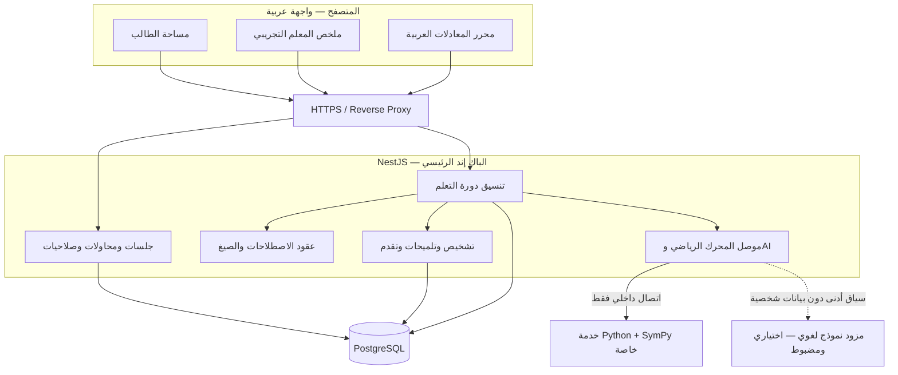
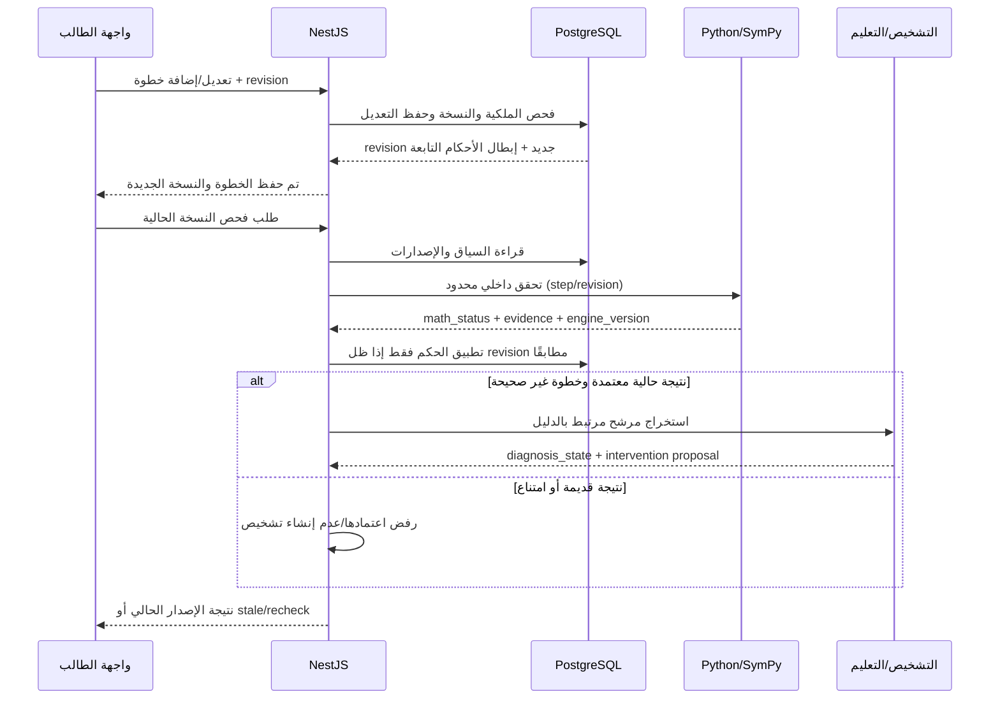
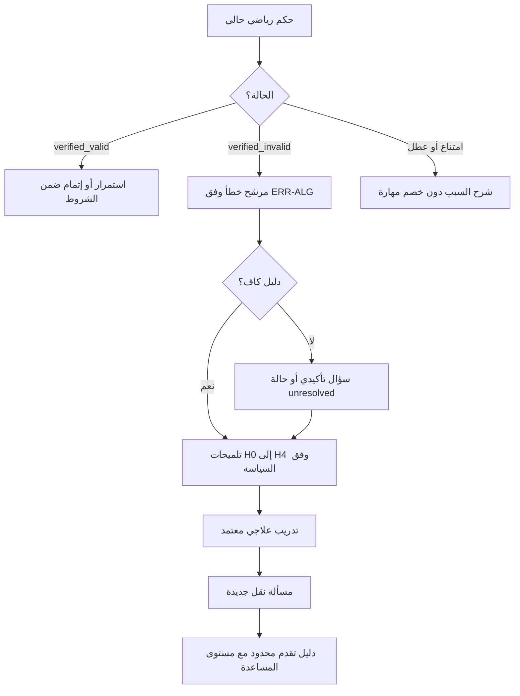

# خُطوة AI — المعمارية البرمجية للنظام

> **الملف:** `09-SYSTEM-ARCHITECTURE.md`  
> **المشروع:** خُطوة AI — منصة عربية الأصل للتعلّم التشخيصي والتكيّفي  
> **الإصدار:** `1.1`  
> **التاريخ:** 03 نوفمبر 2026  
> **الحالة:** مواصفة معمارية تنفيذية للمراجعة والاعتماد؛ **اختيار NestJS باك إند رئيسيًا قرار معتمد من مالك المشروع**  
> **النطاق:** نسخة هاكثون شِراع للجبر المدرسي العربي بمعادلات خطية بمتغير واحد «س»  
> **المراجع:** `00-PROJECT-VISION.md`، `01-PRD.md`، `02-MVP-SCOPE.md`، `04-ARABIC-NOTATION.md`، `05-CURRICULUM.md`، `06-MISCONCEPTIONS.md`، `07-TUTORING-POLICY.md`، `08-UX-DESIGN.md`  
> **الجهات المعنية:** مالك المنتج، قائد المعمارية، المطورون، اختصاصي الرياضيات والتربية، مسؤول الجودة، ووكلاء البرمجة  
> **وثائق التنفيذ التابعة:** `10-MATH-ENGINE.md`، `11-DATA-MODEL.md`، `12-API-CONTRACT.yaml`، `13-AI-ENGINE.md`، `14-GOLDEN-DATASET.md`، `15-TEST-AND-ACCEPTANCE.md`، `16-SECURITY-PRIVACY.md`، `17-IMPLEMENTATION-PLAN.md`، `AGENTS.md`

---

## 0. الغرض، السلطة، وكيفية استخدام الوثيقة

تشرح هذه الوثيقة **كيف تُركَّب مكونات خُطوة، وما مسؤولية كل مكوّن، وكيف تتبادل المعلومات بأمان**. وهي المرجع الأعلى للقرارات المعمارية، لكنها ليست مخطط قاعدة بيانات نهائيًا ولا عقد API نهائيًا ولا إذنًا بتوسيع نطاق الـMVP.

**قرار ثابت بناءً على توجيه مالك المشروع:** **الخادم الرئيسي NestJS باستخدام TypeScript**، وليس FastAPI. يبقى Python/SymPy **محركًا رياضيًا داخليًا متخصصًا فقط**، لا يتحول إلى واجهة المنتج أو المصدر الموثوق للجلسات والمستخدمين. لا يُستخدم FastAPI ضمن البنية المختارة.

### 0.1 ترتيب المرجعيات ومنع التضارب

1. `00-PROJECT-VISION.md`: ما الغاية غير القابلة للتغيير ضمنًا.
2. `01-PRD.md`: سلوك المنتج والمتطلبات الوظيفية وغير الوظيفية.
3. `02-MVP-SCOPE.md`: الحدود والأولويات وبوابات الدخول للهاكثون.
4. `04`–`08`: الدلالة الرياضية، والمنهج، والتشخيص، والتلميحات، والتجربة.
5. **هذه الوثيقة:** توزيع المكونات وبنية الاتصالات والاعتماديات والتشغيل.
6. `10`–`16`: التفصيل الدقيق لكل تخصص وعقود البيانات والأمان والاختبارات.

إذا وجد تعارض: يُكتب **طلب قرار تغييري**، ويذكر المراجع المتأثرة؛ لا يُحسم بصمت بواسطة وكيل AI.

### 0.2 معنى الحالات

- **معتمد:** قرار صريح من صاحب المشروع أو ثابت في الوثائق السابقة.
- **اختيار معماري مرجّح:** اقتراح يتوقف اعتماده النهائي على اختبار ملاءمة محدود.
- **قرار مفتوح:** يحتاج اختيارًا موثقًا من المسؤول المذكور.
- **P0:** مطلوب لتسليم نسخة الهاكثون، **P1:** تحسين اختياري بعد نجاح البوابات، **P2:** توسع لاحق.

---

## 1. المبادئ المعمارية غير القابلة للتفاوض

1. **NestJS هو الباك إند الرئيسي والوحيد المكشوف للمتصفح** عبر `/api`، وهو مالك الجلسات والتفويض والتنسيق وتسجيل التقدم والبيانات. لا يستدعي المتصفح Python أو مزود AI مباشرة.
2. **الكتابة العربية جزء من البيانات والدلالة**، لا من الزينة: تُحفظ الصيغة الأصلية، والبنية الدلالية، وصيغة العرض منفصلات.
3. **التحقق الرياضي يقود الأحكام الرياضية**، ولا يُسمح للـLLM بإصدار أو تغيير `verified_valid` أو `verified_invalid`.
4. **التشخيص التربوي فرضية مدعومة بأدلة**، منفصل عن حكم صحة الخطوة؛ لا يُستنتج ضعف مفاهيمي دائم من خطوة خاطئة واحدة.
5. **سلامة الإصدار شرط لكل نتيجة:** أي تحرير يغيّر الخطوة أو ما قبلها يُبطل نتائج الفحص والتشخيص والتلميح التابعة، حتى لو وصلت استجابات قديمة لاحقًا.
6. **الامتناع الآمن حالة صحيحة للنظام:** `syntax_error`، `unsupported`، `inconclusive`، و`service_error` لا تُحسب خطأً معرفيًا على الطالب.
7. **السير التعليمي موثق قابل للتدقيق:** كل نتيجة تعتمد على نسخة السؤال والمحرك والسياسة والاصطلاحات والدليل.
8. **الحماية بالحد الأدنى من البيانات:** لا أسماء حقيقية أو بريد أو هاتف مطلوبة لبدء تجربة الطالب في P0؛ لوحة المعلم في P0 للبيانات الاصطناعية الموسومة فقط، دون جلسات ضيوف حقيقية.
9. **إتقان دورة واحدة أهم من تعدد المواد:** لا أنظمة معادلات، ولا `جا/جتا`، ولا صور، ولا مواد فيزياء/كيمياء/برمجة في الـP0.
10. **الوكلاء لا يتجاوزون الحدود:** لا تغيير لعقود الخدمات أو المعنى الرياضي أو قواعد الوصول دون تحديث وثيقة مالكة واختبارات قبول.

---

## 2. القرار التنفيذي المختصر (Technology Decision)

| الطبقة | التقنية | الحالة | سبب الاختيار/حدوده |
|---|---|---|---|
| واجهة الويب | React + TypeScript + Vite | مرجّح ومتسق مع وثائق المشروع | تجربة عربية تفاعلية قابلة للاختبار على الهاتف والحاسوب |
| التصميم | CSS حديث/مكتبة مكونات خفيفة، RTL أولًا | قرار مفتوح للتفصيل | لا تُفرض هوية أو إطار تصميم لم يعتمد في `08` |
| محرر الرياضيات | تقييم MathLive أو بديل متوافق مع العربية | **مشروط ببوابة إثبات** | لا يُعتمد قبل إثبات إدخال `٢س` والأقواس والكسور واتجاه العرض |
| واجهة التطبيق والخادم | **NestJS + TypeScript** | **معتمد** | جلسات، بيانات، صلاحيات، REST، تنسيق المحركات، وطبقة تكامل AI |
| نمط خادم NestJS | **Modular Monolith** | مرجّح P0 | وحدات منفصلة منطقيًا في عملية نشر واحدة؛ أقل تعقيدًا من Microservices متعددة |
| محرك الرياضيات | Python + SymPy + محلل عربي مقيّد | مرجّح P0 | حساب رمزي وفحص مجموعة الحل ضمن مجال محدد |
| موصل محرك الرياضيات | HTTP/JSON داخلي خاص عبر خدمة Python صغيرة (مثل `aiohttp`) | مرجّح يحتاج PoC | لا يُتاح للإنترنت؛ لا يُستخدم FastAPI ولا يُنشئ حسابات أو جلسات |
| قاعدة البيانات | PostgreSQL | مرجّح ومتسق مع التوجه السابق | علاقات واضحة، معاملات، قيود مرجعية، وإصدارات للمحتوى |
| الوصول للبيانات | Prisma أو بديل متفق عليه مع NestJS | قرار مفتوح (`ARCH-DEC-02`) | migrations وtransactions وtype safety؛ لا تُثبَّت الأداة قبل تجربة قصيرة |
| مزود الذكاء الاصطناعي | واجهة Provider Adapter داخل NestJS | قرار مفتوح | تبديل مزود، خفض التكلفة، التحقق من الاستجابة، وبدائل عند الفشل |
| سجل المهارات | PostgreSQL + أحداث وأدلة منظمة | مرجّح P0 | تحديث محدود مبني على محاولة صحيحة وسياق المساعدة |
| التتبع | Structured Logs + request ID + health/readiness | مرجّح P0 | كشف مصدر العطل دون تسجيل نصوص طلاب أو مفاتيح سرية في السجلات |
| النشر | Docker Compose / بيئة حاويات صغيرة + HTTPS Reverse Proxy | مرجّح P0 | نشر متكرر بسيط لثلاث خدمات أساسية، لا حاجة إلى Swarm أو Kubernetes |
| Redis/Queues | مؤجّل P1 | مستبعد من P0 إلا لسبب مثبت | لا نضيفه لمجرد تعقيد التصميم |
| رفع الصور وOCR والصوت | مؤجل P1/P2 وفق الوثائق | خارج P0 | إثبات النصوص الرياضية العربية أسبق |

**ملاحظة حول الإصدارات:** لا تُثبت أرقام نسخ NestJS أو Node أو Python أو مكتبات التصميم بلا مصفوفة توافق مجرّبة. يُستخدم إصدار مدعوم وتُحفظ النسخ النهائية في lockfiles وصور Docker محددة.

---

## 3. الرسم المعماري عالي المستوى



**حدود الثقة:**

- **عام:** المتصفح ↔ HTTPS ↔ NestJS فقط.
- **داخلي:** NestJS ↔ PostgreSQL؛ NestJS ↔ Python/SymPy عبر شبكة خاصة.
- **خارجي مضبوط:** NestJS ↔ مزود AI عند الحاجة، مع إعدادات سرية وحدود تكلفة ومدة انتظار ومراجعة مخرجات.
- **ممنوع:** متصفح ↔ Python، متصفح ↔ قاعدة البيانات، متصفح ↔ مفتاح AI، أو Python ↔ قاعدة الطالب مباشرة.

### 3.1 لماذا ليس Backend كاملًا بلغة Python؟

هذا قرار مالك المنتج: **NestJS يدير منطق النظام وواجهات API**. نستخدم Python **فقط** لأن SymPy مناسب للحساب الرمزي. لا ننقل التوثيق أو إدارة المحاولات أو REST العام إلى خدمة Python، ولا نضيف FastAPI. فصل محرك الرياضيات منطقيًا يسمح لاحقًا بتبديله دون تغيير تجربة المستخدم.

### 3.2 لماذا لا نبدأ بعدة Microservices في NestJS؟

تدعم NestJS بنى المكونات والخدمات الصغيرة، لكن مزاياها لا تبرر في نموذج عشرة أيام بناء ناقل رسائل وقواعد بيانات موزعة وتنسيق معاملات. نبدأ **Modular Monolith** ونستخرج خدمة فقط إذا ظهرت حاجة حقيقية. خدمة Python الرياضية استثناء تقني بسبب المكتبة والبيئة، وليست تطبيقًا ثانيًا للمنتج.

---

## 4. حدود المسؤوليات (Ownership Boundaries)

| المكوّن | يملك | لا يملك |
|---|---|---|
| React | الإدخال، عرض الحالات، UX، دعم RTL، إخفاء الرد القديم بصريًا | الحكم الرياضي النهائي، قرار الإتقان، وصول المعلم إلى جلسات أخرى |
| NestJS | سياق الطلب، الجلسة، التحقق من الوصول، الحفظ، orchestration، فرض السياسة، نسخ الأحداث | تعديل نتائج محرك الرياضيات بناء على نص AI |
| مكوّن الاصطلاحات | قاعدة الرموز المقبولة، قواعد العرض والتطبيع والعقود | تخمين تعبير ملتبس أو اعتبار دالة خارج النطاق مدعومة |
| Python/SymPy | تحليل محدود لشجرة تعبير آمنة، فحص انتقالات، دليل صحة/عدم صحة وحالة امتناع | الطلاب، الجلسات، الصلاحيات، التلميحات، الدرجات، استدعاء AI |
| محرك التشخيص | استخراج نمط مرشح من انتقال **ثبت خطؤه** وسياق أدلة | تغيير حكم التحقق أو إثبات سمة شخصية للطالب |
| سياسة التعليم | اختيار `H0–H4`، السؤال التأكيدي، العلاج، النقل، حفظ أثر المساعدة | الإقرار بصحة تحويل دون حكم المحرك |
| AI Adapter | توليد تفسير/صياغة منضبطة بالقوالب والبيانات المعتمدة | توليد درجات إتقان نهائية أو أسئلة منشورة دون تحقق |
| قاعدة البيانات | الحالة المستمرة وإصداراتها والقيود، وسجل أدلة | معنى القواعد التربوية من ذاتها |
| مراجع المحتوى | اعتماد السؤال والدليل والتلميح والأخطاء المرجعية | تغيير الـAPI أو الخادم دون مراجعة تقنية |

**قاعدة:** كل ملف برمجي يملك سببًا واضحًا للوجود؛ ممنوع إدراج SymPy داخل NestJS أو تشغيل محرّك JavaScript رمزي آخر يناقض نتائج Python دون اعتماد جديد.

---

## 5. تقسيم NestJS إلى وحدات فعلية

الهدف أن تعمل الوحدات **داخل تطبيق واحد** عبر interfaces وdependency injection، وألا تستدعي Controllers قواعد بيانات وحدات أخرى مباشرة.

| وحدة NestJS | المسؤولية | الحد العمومي الداخلي المقترح |
|---|---|---|
| `ConfigModule` | قراءة الإعدادات والتحقق من متغيرات البيئة | Typed Configuration |
| `HealthModule` | liveness/readiness للمكوّنات الأساسية | `HealthService` |
| `GuestSessionModule` | إنشاء جلسة مجهولة وملكية الجلسة وصلاحيتها | `GuestSessionService` |
| `CurriculumModule` | مهارات، مسائل مراجعة، إصدارات محتوى | `CurriculumService` |
| `AttemptsModule` | حلول وخطوات وإصدارات وتعديل وإبطال نتائج | `AttemptsService` |
| `MathGatewayModule` | اتصال HTTP داخلي ببايثون ومعالجة النتائج/الوقت | `MathVerificationPort` |
| `DiagnosisModule` | حالات `ERR-ALG-*`، فرضيات وسؤال تأكيدي | `DiagnosisService` |
| `TutoringModule` | التلميحات والعلاج ومسألة النقل وسياسة المساعدة | `TutoringService` |
| `ProgressModule` | أدلة تعلم محدودة وملخص طالب | `ProgressService` |
| `TeacherDemoModule` | ملخص آمن للمعلم ببيانات اصطناعية موسومة فقط في P0 | `TeacherSummaryService` |
| `AiIntegrationModule` | مزود AI، التحقق من الناتج، قوالب بديلة | `AiExplanationPort` |
| `AuditModule` | أحداث إصدار/قرار غير حساسة وrequest ID | `AuditEventService` |

### 5.1 شكل مقترح لتنظيم المستودع

```text
khotwa-ai/
├── apps/
│   ├── web/                         # React + TypeScript
│   │   └── src/
│   │       ├── pages/
│   │       ├── features/math-editor/
│   │       ├── features/learning-session/
│   │       ├── features/teacher-demo/
│   │       └── shared/
│   └── api/                         # NestJS: الباك إند الرئيسي
│       ├── src/
│       │   ├── modules/
│       │   │   ├── guest-session/
│       │   │   ├── curriculum/
│       │   │   ├── attempts/
│       │   │   ├── math-gateway/
│       │   │   ├── diagnosis/
│       │   │   ├── tutoring/
│       │   │   ├── progress/
│       │   │   ├── teacher-demo/
│       │   │   ├── ai-integration/
│       │   │   └── health/
│       │   ├── common/
│       │   └── main.ts
│       └── test/
├── services/
│   └── math-engine/                 # Python + SymPy, اتصال داخلي فقط
│       ├── khotwa_math/
│       │   ├── tokenizer.py
│       │   ├── parser.py
│       │   ├── ast.py
│       │   ├── verifier.py
│       │   ├── evidence.py
│       │   └── server.py
│       └── tests/
├── packages/
│   └── contracts/                   # Schemas/types المُوَلَّدة من عقود معتمدة
├── content/
│   ├── curriculum/
│   ├── problems/
│   ├── misconceptions/
│   └── tutoring/
├── infra/
│   ├── docker/
│   └── compose/
├── docs/                             # المواصفات المتاحة؛ AGENTS.md التشغيلي في الجذر
└── README.md
```

- **اقتراح تنظيم وليس شرطًا لاسم كل مجلد**؛ يثبت بعد `17-IMPLEMENTATION-PLAN.md`.
- العقود المشتركة تحتوي types/JSON Schemas قابلة للتحقق؛ لا يجوز الاعتماد على استيراد شيفرة Python مباشرة في TypeScript.
- لا تُنشأ مكتبات مشتركة واسعة قبل الحاجة، ولا يستورد كود الواجهة ملفات خادم تحتوي أسرارًا أو منطق تفويض.

### 5.2 التدفق داخل NestJS

```text
Controller (DTO + Guard)
    -> Application Service (orchestrator)
       -> Domain policy (حالات وتبعيات)
       -> Repository/transaction
       -> MathVerificationPort / AiExplanationPort
    -> Response Mapper (DTO آمن بالعربية)
```

لا تُوضع عمليات الحفظ المعقدة داخل Controller؛ لا يُنفذ HTTP الخارجي مباشرة داخل Repository؛ والـLLM لا يحصل على connection string ولا صلاحيات قاعدة بيانات.

---

## 6. نموذج البيانات المنطقي — لا يحل محل `11-DATA-MODEL.md`

الكيانات المتوقعة في P0:

| الكيان | الوظيفة | حقول أساسية *دلالية* لا مخطط نهائي |
|---|---|---|
| `GuestSession` | جلسة ذات صلاحية محدودة | `id`, `token_hash`, `created_at`, `expires_at`, `status` |
| `Skill` | مهارة معرّفة في المنهج | `skill_id`, `version`, `prerequisites`, `status` |
| `Problem` | سؤال مراجَع ومحدد الصعوبة | `problem_id`, `version`, `skill_id`, `notation_profile`, `status` |
| `Attempt` | محاولة طالب في مشكلة | `attempt_id`, `session_id`, `problem_version`, `revision`, `mode` |
| `SolutionStep` | خطوة كتبها الطالب | `step_id`, `sequence`, `raw_input`, `step_revision`, `current_state` |
| `VerificationResult` | حكم محرك مرتبط بإصدار | `step_id`, `attempt_revision`, `status`, `evidence`, `engine_version` |
| `DiagnosisRecord` | فرضية تربوية مرتبطة بدليل | `verification_ref`, `error_code`, `diagnosis_state`, `policy_version` |
| `TutoringEvent` | سؤال أو تلميح أو كشف حل | `attempt_id`, `kind`, `hint_level`, `content_version` |
| `LearningEvidence` | دليل محدود لتقدم مهارة | `skill_id`, `source_attempt`, `assistance`, `result_kind` |
| `TeacherDemoFixture` | بيانات للوحة التجريبية | `fixture_version`, `synthetic_label`, `summary` |
| `AuditEvent` | تتبع فعل غير حساس | `event_type`, `reference`, `revision`, `timestamp` |

**لا تقرر هذه الوثيقة أسماء الجداول أو الفهارس أو القيود النهائية**؛ ذلك اختصاص `11-DATA-MODEL.md`. يجب على الوثيقة الأخيرة ضمان العلاقات، وعدم تسرب جلسة إلى أخرى، والاحتفاظ بإصدار المسألة، وعدم إعادة استخدام دليل من مراجعة قديمة.

### 6.1 البيانات التي يجب حفظها منفصلة

عند إدخال `٢(س + ٣) = ١٠` نحفظ على نحو متمايز:

1. `raw_input`: ما أدخله الطالب دون تبديل صامت.
2. `parsed_semantics`: تمثيل داخلي موحد (AST/JSON) بعد تحقق من قواعد الاصطلاح والنطاق.
3. `display_representation`: طريقة عرض عربية صحيحة بالملف المختار، قد تُشتق من المصدر المحفوظ.
4. `notation_profile_version`: مثل `ar-mashriq-school-v1` بعد الاعتماد.
5. `problem_version` و`engine_version` و`attempt_revision`: لضبط صحة نتيجة التحقق.

**ممنوع** الاعتماد على تحويل حرفي مثل استبدال `س` بـ`x` دون تحليل دلالي مضبوط، أو إرسال HTML/LaTeX من العميل باعتباره تمثيلًا موثوقًا للمعادلة.

---

## 7. محرك الاصطلاحات والعربية الرياضية

تحدد `04-ARABIC-NOTATION.md` الرموز المسموحة. القرارات المعمارية هنا:

- الواجهة تعرض محررًا عربيًا، لكن **الخادم يعيد التحقق من الإدخال**؛ صحة شكل الواجهة لا تغني عن التحقق الخادمي.
- التحليل الحقيقي للتعبير يتم في **محرك Python الرياضي** أو parser واحد معتمد يملكه الفريق، ولا نكرر تحليلًا دلاليًا مختلفًا في TypeScript وPython.
- يمكن للواجهة توليد تمثيل مؤقت لغرض المؤشر والتحرير، لكنه غير معتمد للتحقق أو حساب المهارة.
- الإدخال الغامض `١/٢س` يُرفض مع طلب توضيح الأقواس بحسب معيار `04`؛ لا نختار معنى خفيًا.
- `٢س` و`2س` يخضعان لقواعد التطبيع المنشورة، ويظل النص الأصلي محفوظًا.
- دوال `جا` و`جتا` و`ظا` خارج محرك P0، وتنتج `unsupported` بدل تحويلها إلى ضرب أو محاولة حل.
- أي تجاوز للحدود (رمز غير مسموح أو تعبير غير خطي) يحدد سبب رفض واضحًا ولا يكتب تعثرًا مفاهيميًا.
- لا يتغير ترتيب المعادلة أو اتجاه الأقواس والكسور أثناء النسخ والإدخال والعرض وقراءة قارئ الشاشة قدر الإمكان، مع تحقق يدوي حسب `08`.

### 7.1 سلوك parse المقترح

```text
raw Arabic input
  -> Unicode-aware tokenizer (قائمة سماح)
  -> syntax grammar ضمن P0
  -> typed AST بدون تنفيذ أي تعليمات
  -> domain validation: خطية متغير واحد وشروط المقام
  -> canonical semantics
  -> verification-ready expression
```

التمثيل الوسيط له `schema_version` واضح ويُختبر بتحويلات ثنائية الاتجاه، لكن **شكل JSON النهائي** يملكه `10-MATH-ENGINE.md` و`12-API-CONTRACT.yaml`.

---

## 8. خدمة الرياضيات Python/SymPy — محرك خاص لا Backend بديل

### 8.1 نطاق الخدمة

**مدخلها:** نص الخطوة السابقة والحالية وسياق المسألة وإصداراتها، أو AST معتمد، بحدود طول وتعقيد محددة.  
**مخرجاتها:** حالة التحقق وقرينة/دليل وإصدار المحرك والتمثيل الدلالي أو سبب تعذر التحليل.  
**لا تملك:** جلسات الطلاب، أو واجهة عامة، أو استدعاء مزود AI، أو اتصال قاعدة بيانات إنتاجية.

### 8.2 بروتوكول التواصل الداخلي

اختيار P0 المرجح هو HTTP/JSON خاص من NestJS إلى خدمة Python خفيفة (مثال: `aiohttp`)، عبر شبكة Docker داخلية مع **مُهلة واضحة وحد أقصى للطلبات واستجابة ذات schema معتمد**.

- **لا** رابط عام لخدمة الرياضيات.
- **لا** يُسمح للمتصفح بإرسال HTTP إليها.
- يُحدد اسم الخدمة من إعدادات نشر موثوقة وليس من URL يرسله الطالب، لمنع SSRF.
- تُقيّد أحجام الطلب/الرد وتُفعل قيود زمن/ذاكرة/CPU للعملية الرياضية، ويفضل عزل التقييم الثقيل في عملية محدودة الموارد عند الحاجة.
- مصادقة خدمة لخدمة عند عبور شبكة غير موثوقة؛ وفي المضيف نفسه شبكة داخلية خاصة مع قواعد منع الوصول، من دون اعتبار الشبكة وحدها ضمانًا مطلقًا.
- أي تغيير في API الداخلي يرافقه contract test بين NestJS وPython.

### 8.3 حالات التحقق المُلكية

| `math_status` | التفسير | أثره على التعليم |
|---|---|---|
| `verified_valid` | الانتقال صحيح ضمن مجموعة حلول وشروط المسألة المدعومة | دليل موجب محدود |
| `verified_invalid` | ثبُت أن الانتقال غير مكافئ/خرق شرطًا لازمًا، مع دليل | يسمح بتشخيص مرشح فقط |
| `syntax_error` | الإدخال غير صالح أو ملتبس بنيويًا | إصلاح الكتابة؛ لا يحسب تعثرًا |
| `unsupported` | التعبير خارج ما يعلنه المحرك | توضيح الحدود؛ لا يحسب تعثرًا |
| `inconclusive` | التعبير مفهوم جزئيًا لكن الحكم غير مأمون | لا اعتبار خطأ أو نجاح |
| `service_error` | فشل خدمة أو اتصال | حفظ العمل وإعادة آمنة |

**شرط رياضي:** لا يكفي تشابه الطرفين نصيًا. تتحقق الخدمة من تكافؤ مجموعة الحلول في النطاق، وتراعي المقامات الثابتة غير الصفرية وشروط المجال. كما تقبل اختصار خطوات صحيحًا دون فرض طريقة حل واحدة. لا تساوي النتيجة المحتملة أو الملاحظة اللغوية دليلًا رياضيًا.

### 8.4 أمثلة لازمة للاختبار

| الحالة | المتوقع |
|---|---|
| `٢(س + ٣) = ١٠` ← `٢س + ٦ = ١٠` | `verified_valid` |
| `٢(س + ٣) = ١٠` ← `٢س + ٣ = ١٠` | `verified_invalid` مع دليل |
| `٢(س + ٣) = ١٠` ← `س + ٣ = ٥` | `verified_valid`؛ لا اتهام للطالب بتجاوز التوزيع |
| `−٢(س − ٣) = ١٠` ← `−٢س + ٦ = ١٠` | `verified_valid` |
| `جا(٣٠°) = ١/٢` | `unsupported` |
| `١/٢س = ١` | `syntax_error` أو التباس حسب `04` |
| `٣س = ٧` ← `س = ٧/٣` | لا يُفعّل إلا بعد اجتياز بوابة الكسور؛ وإلا امتناع صريح |

### 8.5 ضوابط تنفيذ آمن

- **لا** يُمرر نص الطالب مباشرة إلى `eval` أو `exec` أو `sympify` غير مقيد أو `parse_expr` غير آمن؛ توثق SymPy أن `parse_expr` يستخدم `eval`، فلا يجوز على مدخلات غير معقمة.
- يسمح المحلل ببنية AST محدودة: أعداد محدودة الطول، متغير معروف، جمع/طرح/ضرب وقسمة على ثابت غير صفري وأقواس ومساواة ضمن P0.
- قيود على عمق AST، وطول السلسلة، وعدد العمليات، والوقت والذاكرة؛ تجاوزها `unsupported` أو `inconclusive` بحسب السبب، وليس محاولات لا نهائية.
- لا يحدث رفع ملفات أو تنفيذ أوامر نظام أو قراءة نظام الملفات من تعبير الطالب.
- ترجع الخدمة `engine_version` و`schema_version` في كل استجابة، وترفض العقود غير المتوافقة.

---

## 9. تدفق التحقق من الخطوة — السيناريو الرئيسي



### 9.1 قواعد السباق والتكرار الملزمة

1. **كل كتابة** تخضع لفحص ملكية الجلسة و`attempt_revision` متوقع؛ عدم التطابق ينتج `revision_conflict` ولا تُكتب نتيجة على نسخة أخرى.
2. **تعديل خطوة رقم ٢** يبطل الحكم على الخطوة ٢ والخطوات التابعة، وأي تشخيص وتلميح يخص السلسلة المعدلة؛ يمكن حفظ التاريخ، لا استخدامه بوصفه الحكم الحالي.
3. **نتيجة Python المتأخرة** لا تُطبّق إذا تغيّر إصدار المحاولة أو الخطوة أو المسألة/الاصطلاح أثناء انتظارها.
4. **نقر مكرر على «تحقق»** يجب ألا يكرر المحاولة أو يرفع عداد التلميحات أو يخزن دليلين مختلفين؛ يستخدم `idempotency key` أو مفتاح طلب مشتق محكوم بالجلسة والإصدار، مع ضمان uniqueness خادمي.
5. حسم نتيجة العملية/النسخة يتم في قاعدة البيانات بطريقة ذرية (قيد/شرط إصدار أو transaction مع فحص جديد)، وليس بحكم React فقط.
6. لا يُعاد توليد نتيجة AI في كل إعادة جلب للصفحة دون سبب؛ المحتوى/التلميح مرتبط بإصدار قرار وتعليم محدد.
7. تسجيل «تم الحفظ» لا يتم قبل تأكيد قاعدة البيانات؛ الواجهة تفرق بين مسودة محلية وحفظ معتمد.

### 9.2 تقييم الخطوات المتسلسلة

- يحدد النظام **أول انتقال معيب أو غير محسوم**، ولا يعتبر الخطوات التالية دليلًا مستقلاً على الإتقان إذا بُنيت على سلسلة غير صحيحة.
- عندما تكون الخطوات صحيحة ومكتملة، يتحقق من الحل النهائي ضمن شروط المسألة قبل عرض انتهاء المسألة.
- إذا كان الحل صحيحًا بطريقة بديلة، يقبله ما دام ضمن النطاق ولا يفرض خطوات تجميلية.

---

## 10. التدفق التربوي والتكيفي

الـNestJS `TutoringModule` ينظم الرحلة بعد الحكم؛ لا تُرسل بيانات خام إلى LLM ويُطلب منه «أكمل المعلم» دون سياق مضبوط.



### 10.1 تقسيم التحقق والفرضية والمساعدة

- **التحقق:** Python/SymPy مع أدلة قابلة للفحص.
- **الترشيح:** قواعد تربوية موثقة في `06-MISCONCEPTIONS.md` (الأنماط الستة `ERR-ALG-01` إلى `ERR-ALG-06`).
- **تأكيد السبب:** سؤال تشخيصي أو دليل إضافي؛ الحالات `candidate`, `needs_disambiguation`, `supported_in_attempt`, `unresolved` وغيرها كما في `06`.
- **التدخل:** `07-TUTORING-POLICY.md` يحدد مستويات `H0–H4` وحالات كشف الحل الكامل.
- **النقل:** مسألة مختلفة من بنك معتمد، **غير مستخدمة في الشرح**؛ النتيجة لا تعني إتقانًا دائمًا.

### 10.2 كيف يستخدم AI؟

يجوز له، ضمن سياق منقح ومحدود:

- صياغة توجيه لطيف بلغة عربية سليمة من تشخيص مدعوم.
- اقتراح سؤال تأكيدي من بدائل معتمدة أو إعادة صياغة سؤال ثابت دون تغيير مضمونه.
- شرح قرينة رياضية استلمها من محرك معتمد؛ **لا invent evidence**.
- تعديل طول الشرح أو مستواه مع ثبات المعنى وفق سياسة التعليم.

ولا يجوز له:

- تغيير `math_status`، أو «رفع» حكم غير محسوم إلى صحيح/خاطئ.
- إنتاج سؤال علاجي أو نقل يُستخدم في القياس دون تحقق/اعتماد.
- توليد درجة نهائية أو تشخيص دائم لشخصية الطالب.
- تجاوز إصدارات المحتوى أو إظهار حل كامل قبل سياسة وضع النشاط.

### 10.3 إن تعطل AI

يستمر عرض حكم الرياضيات المثبت، ويُستعمل تلميح ثابت مُراجع متوافق مع `ERR-ALG-*` و`H*` إن توافر. إن لم يوجد تدخل صالح، يُعرض اعتذار واضح مع حفظ العمل وإمكانية المحاولة أو المراجعة. **فشل AI لا يُحتسب رسوبًا.**

---

## 11. عقود الاتصال — أمثلة توضيحية وليست `12-API-CONTRACT.yaml`

المسارات التالية **للتصميم فقط**؛ لا تُعدّ عقدًا نهائيًا حتى اعتماد OpenAPI. جميعها يملكها NestJS.

| عملية المنتج | مسار توضيحي | الملاحظات |
|---|---|---|
| إنشاء تجربة | `POST /api/v1/guest-sessions` | تنشئ صلاحية جلسة آمنة مع عمر محدد |
| جلب المهارات | `GET /api/v1/skills` | فقط مهارات P0 المعتمدة |
| جلب المسائل | `GET /api/v1/problems` | مُرشحة وفق المجال، مع إصدارات |
| بدء محاولة | `POST /api/v1/attempts` | يربط مشكلة/نسخة بجلسة مالك |
| حفظ خطوة | `PUT /api/v1/attempts/:id/steps/:stepId` | تعديل مع revision وإبطال الأحكام التابعة |
| فحص حل | `POST /api/v1/attempts/:id/verify` | idempotency + check revision |
| طلب تلميح | `POST /api/v1/attempts/:id/hints` | تسلسل H0–H4 وترخيص الحالة |
| بدء علاج | `POST /api/v1/attempts/:id/remediation` | محتوى معتمد مناسب للمهارة |
| بدء نقل | `POST /api/v1/attempts/:id/transfer` | لا يكرر سؤالًا كشفت إجابته |
| ملخص الطالب | `GET /api/v1/progress` | يقتصر على صاحب الجلسة |
| ملخص المعلم | `GET /api/v1/teacher-demo/summary` | بيانات اصطناعية موسومة فقط في P0 وحارس وصول |

### 11.1 نموذج دلالي لطلب التحقق

> **هذا مثال غير ملزم لشكل JSON النهائي، لا يُنسخ إلى الكود بوصفه OpenAPI معتمدًا.**

```json
{
  "attemptId": "example-attempt-id",
  "expectedRevision": 4,
  "idempotencyKey": "example-request-key"
}
```

لا نسمح للعميل بتحديد نتيجة تحقق، ولا نثق في AST أرسلها دون مصادقة دلالية. يقرأ NestJS الخطوات الحقيقية من قاعدة البيانات، ثم يرسل طلبًا داخليًا إلى Python.

### 11.2 نموذج دلالي للاستجابة

```json
{
  "attemptId": "example-attempt-id",
  "attemptRevision": 4,
  "verification": {
    "status": "verified_invalid",
    "stepId": "example-step-id",
    "engineVersion": "math-engine-example",
    "evidenceRef": "example-evidence-id"
  },
  "diagnosis": {
    "state": "candidate",
    "errorCode": "ERR-ALG-01"
  }
}
```

معلومات الدليل وترجمة الرسائل للعربية وتفاصيل الأخطاء النهائية تعتمد في `12-API-CONTRACT.yaml`؛ لا نرسل traceback أو stack trace إلى الطالب.

### 11.3 جدول أخطاء API المقترح

| الخطأ | دلالته | السلوك المتوقع |
|---|---|---|
| `invalid_input` | DTO غير صحيح | رسالة عربية ومكان الحقل، بلا إنشاء تشخيص |
| `revision_conflict` | تغيرت المحاولة منذ قراءة العميل | إعادة تحميل الإصدار الحالي ثم استكمال التعديل |
| `not_owner` | لا يملك الجلسة | رفض دون كشف وجود جلسة مستخدم آخر |
| `math_unsupported` | رمز/عملية خارج حدود P0 | توضيح حدود المحتوى |
| `math_inconclusive` | فحص غير محسوم | حفظ الخطوة دون خصم مهارة |
| `math_unavailable` | تعطل المحرك الرياضي | retry مضبوط دون تكرار أحداث |
| `ai_unavailable` | فشل خدمة AI | تقديم نص مُراجع عند وجوده أو رسالة امتناع |
| `rate_limited` | تجاوز معدل استخدام معقول | توضيح متى يمكن المحاولة وفق سياسة API |
| `content_version_conflict` | تغيير محتوى مسألة/سياسة | إظهار النسخة المسندة للمحاولة أو إعادة بدء آمنة |

---

## 12. التزامن وحالة البيانات والحدود الذرية

### 12.1 قاعدة مصدر الحقيقة

- **PostgreSQL** هو المصدر الموثوق لحالة الجلسة والمحاولة والخطوات والنتائج المقبولة حاليًا.
- React يحفظ مسودة محلية قابلة للتعديل، لكنه لا يملك إعلان اكتمال المهمة أو تحديث مستوى الطالب.
- Python يعيد نتيجة حسابية، لكن **NestJS يتحقق من صلاحية الإصدار قبل اعتمادها**.

### 12.2 سير الحفظ والتصحيح

1. يتحقق NestJS من هوية الجلسة وصلاحيتها و`expectedRevision`.
2. يحفظ التعديل مع زيادة revision للمحاولة والخطوة ضمن معاملة.
3. يعطّل كل نتائج وتلميحات ودلائل تقدم تعتمد على الخطوة المعدلة وفق علاقة التبعيات.
4. يستدعي Python خارج المعاملة الطويلة لتجنب قفل قاعدة البيانات أثناء الحساب.
5. عند استلام الجواب يعيد فحص revision داخل معاملة قصيرة قبل حفظ نتيجة سارية.
6. إذا تغيّر الإصدار، يضع النتيجة القديمة في سجل تشغيلي مناسب أو يهملها، **ولا** يعرضها حكمًا جديدًا.

### 12.3 حدود استقلالية التجربة

- لا توجد عمليات مالية في P0.
- لا يوجد ادعاء حفظ دائم لجلسة بلا تعريف؛ تُوضح مدة بقاء الجلسة في الواجهة.
- قواعد التقدم تتجنب ترقية مهارة عند إتمام خطوة بتلميح H4 أو في وضع تدريب موجّه.
- لا يسمح باستخراج بيانات مستخدم من خلال اختصار في URL أو معرف يمكن تخمينه.

---

## 13. حماية النظام والخصوصية

### 13.1 مصادقة تجربة الطالب

اقتراح P0 هو **جلسة ضيف ذات رمز عالي العشوائية بصلاحية قصيرة**، محفوظ بصمة الرمز في الخادم، ويُنقل للمتصفح عبر `HttpOnly; Secure; SameSite` cookie عند استخدام نفس أصل الواجهة وAPI. تُحمى الطلبات المعدِّلة ضد CSRF وفق طريقة المصادقة والإطار المعتمد. لا يعتبر `session_id` وحده تصريحًا بالوصول.

- واجهة الويب وAPI يفضل أن يقدما من أصل واحد عبر Reverse Proxy لتبسيط سياسة cookies وCORS.
- يملك الخادم وحده قرار انتهاء الجلسة والوصول للمحاولة.
- يُمنع تسجيل الرمز أو نسخه في URL أو مشاركته في ملفات العرض.
- إن استُخدم أسلوب مختلف للرمز، تُراجع مخاطره صراحة في `16-SECURITY-PRIVACY.md`.

### 13.2 المعلم في P0

يستخدم لوحة تجريبية **ذات وصول محمي منفصل** وبيانات اصطناعية موسومة فقط في P0؛ لا تعرض محاولات ضيوف حقيقية حتى مع الموافقة. لا تُفعّل صلاحية المعلم افتراضيًا بمجرد زيارة `/teacher`، ولا تُكشف جلسات الطالب للمعلم عبر معرف عشوائي. نظام المدارس والفصول والصلاحيات المؤسسية خارج P0.

### 13.3 حواجز إدخال وطلبات

- NestJS: DTO validation، منع الخصائص غير المسموح بها، حدود body size، فحص نوع المحتوى، وضبط أخطاء موحّدة.
- React: عدم إدراج HTML غير موثوق ضمن محرر/رسائل AI، واستخدام renderer آمن للرياضيات.
- Math engine: قائمة سماح grammar والحدود الحسابية وعزل العملية.
- AI: تعليمات النظام والتوثيق لا يمكن تغييرها بواسطة نص الطالب؛ تعامل مع النص على أنه بيانات غير موثوقة، مع تحقق من مخرجات JSON والتطابق مع الأدلة.
- حماية من كثافة الطلبات عبر rate limiting على مستوى IP والجلسة بنظام مناسب، وحد للمكالمات الخارجية وتكاليفها.
- HTTPS، رؤوس أمان، أسرار خارج Git، مستخدم قاعدة بيانات بأقل الصلاحيات، نسخ احتياطي مضبوط.

### 13.4 بيانات القُصّر

لا نجمع أسماء أو هواتف أو بريدًا أو بيانات صحية أو تعريفية للطلاب في النموذج التجريبي. يجب توثيق سياسة الاحتفاظ والحذف، والموافقة قبل مشاركة أي محاولات مع معلم أو مزود خارجي. أي انتقال لحسابات طلاب حقيقيين يحتاج سياسة خاصة في `16` قبل الإنتاج.

---

## 14. متانة الخدمة والتعامل مع الفشل

| المكوّن الذي فشل | التصرف المطلوب | ما لا يجوز حدوثه |
|---|---|---|
| Python/SymPy غير متاح | حفظ المسودة، `service_error`، إعادة آمنة لاحقًا | احتساب الخطوة غير صحيحة أو توليد دليل من AI |
| Python بطيء | انتهاء مدة الطلب، وإظهار حالة قابلة للمحاولة | إبقاء واجهة الطالب معلقة بلا نهاية |
| AI غير متاح | نتيجة الرياضيات تبقى متاحة؛ تلميح ثابت معتمد إن وجد | تغيير الحكم أو حذف أدلة سابقة |
| PostgreSQL غير متاح | عدم إظهار «تم الحفظ»، رسالة خطأ واستعادة من مسودة محلية | فقدان صامت أو حفظ وهمي |
| رد قديم بعد تعديل | تجاهله أو وسمه قديمًا | إعادة إحياء تشخيص أو نجاح لنسخة مهجورة |
| محتوى غير معتمد | إخفاؤه عن الطلاب وبيان سبب عدم التوفر | توليد سؤال نشر فوري واحتسابه في الإتقان |
| تجاوز حدود الإدخال | رفض واضح `unsupported` أو `syntax_error` | تنفيذ كود أو استهلاك موارد غير محدود |
| خطأ داخلي عام | `request_id` ورسالة آمنة | تسريب stack trace ومفاتيح وتفاصيل قاعدة البيانات |

### 14.1 سياسة retry

- لا نعيد تلقائيًا **طلبًا يغيّر حالة المحاولة أو يستهلك تلميحًا** ما لم يكن له مفتاح idempotency ومعاملة تمنع التكرار.
- يمكن إعادة قراءة أو فحص نسخة رياضية ثابتة عددًا محدودًا من المرات، مع timeout وbackoff وميزانية زمنية.
- لا نكرر استدعاءات AI بشكل غير محدود؛ fallback إلى محتوى معتمد بعد نفاد الميزانية.
- `inconclusive` ليس عطلًا دائمًا بالضرورة، وقد يتطلب توضيحًا بشريًا بدل retry.

### 14.2 ميزانيات الأداء (أهداف تخطيطية لا نتائج فعلية)

| العملية | الهدف التخطيطي المبدئي | طريقة القياس |
|---|---|---|
| استجابة حفظ الخطوة (دون AI) | سريعة بما يكفي لرد واضح؛ يبدأ التقييم المبدئي بـp95 أقل من 1 ثانية في البيئة التجريبية | قياس p50/p95 على حالات مرجعية |
| تحقق معادلة P0 البسيطة | يبدأ التقييم المبدئي بـp95 أقل من 3 ثوانٍ | قياس خادم ومحرك منفصلين |
| التلميح إذا استدعى LLM | زمن انتظار محدود مع نص بديل؛ لا نعد بزمن ثابت قبل القياس | p95 + معدلات fallback |
| العرض على هاتف حقيقي | تحرير معادلة وتعديلها دون قلب اتجاه أو تجميد | اختبارات UX يدوية ومؤتمتة مستهدفة |

هذه **أهداف غير معتمدة**، تتغير بعد قياس الجهاز/المضيف المختار. العتبات النهائية تُملك في `15-TEST-AND-ACCEPTANCE.md`.

---

## 15. التتبع والمراقبة (Observability)

### 15.1 الحد الأدنى من السجلات

حقول سجلات غير حساسة مقترحة:

- `request_id`، `trace_id` إن فُعل، `module`, `operation`, `duration_ms`, `status_code`.
- `attempt_id` بصيغة مرجعية محكومة أو معرف داخلي لا يكشف طالبًا، `attempt_revision`.
- `math_engine_version`, `notation_profile_version`, `problem_version`, `tutoring_policy_version`.
- عدد الاستدعاءات الخارجية وحالة fallback، دون نص الطلب الكامل أو رد الطالب في logs عامة.

### 15.2 المقاييس

- معدل `verified_valid` و`verified_invalid` والامتناع وفق نوع الإدخال، **دون اعتبار ارتفاع valid وحده نجاحًا تربويًا**.
- معدل `revision_conflict`, `service_error`, `ai_unavailable` والمهل الزمنية.
- عدد محاولات الحل والتلميحات والتدريبات وأسئلة النقل المكتملة.
- معدل تكرار الإرسال المعاد بشكل آمن، والتباين بين نتائج المحرك والمجموعة المرجعية.
- فحوص الصحة: NestJS `live`، و`ready` تشمل اتصال قاعدة البيانات والمحرك الرياضي عند الحاجة، مع فصل فشل AI غير الحرج عن عدم جاهزية أساسية.

### 15.3 الخصوصية في القياس

لا نسجل المدخلات الرياضية الخام في خدمة مراقبة عامة أو مزود analytics افتراضي. أي تخزين تحليلي لأعمال الطلاب يحتاج غرضًا محددًا وإذنًا وسياسة تقليل وحذف.

---

## 16. النشر والبيئات

### 16.1 بيئات العمل

| البيئة | البيانات | الغرض |
|---|---|---|
| Local | بيانات تركيبية ثابتة | تطوير سريع واختبارات مستهدفة |
| Test/Preview | بيانات مرجعية غير شخصية | تحقق تكامل ومراجعة UX |
| Hackathon Demo | حسابات/بيانات تجريبية آمنة | عرض أمام اللجنة مع حالات جديدة غير محفوظة النتائج |
| Production مستقبلًا | بعد مراجعة الأمان والموافقات | غير مفعل ضمن P0 تلقائيًا |

### 16.2 بنية Docker Compose المقترحة

```text
Internet
   |
HTTPS Reverse Proxy  --> static React assets
   |
   +--> NestJS API (public through proxy only)
           |
           +--> PostgreSQL (private network / persistent volume)
           +--> Python/SymPy Math Engine (private network / resource-limited)
           +--> Optional External LLM (controlled egress)
```

- لا يُنشر منفذ PostgreSQL أو Python إلى الإنترنت؛ يمكن استخدام ports محلية فقط عند الحاجة التطويرية.
- صور نسخ محددة ومستخدم غير root حيث أمكن، مع healthchecks وحدود موارد.
- migration تُنفّذ إجراءً واضحًا مع نسخة احتياطية قبل أي تحديث لبيانات مهمة.
- إعدادات الأسرار عبر متغيرات بيئة/secret store، لا في Dockerfile ولا git history.
- لا حاجة لنظام نشر موزع أو Queue أو Redis كي تنجح الحلقة التعليمية الأولى.
- إذا تقرر استخدام بنية استضافة موجودة لاحقًا، يكتب ملف Deployment خاص ولا تُفرض تلقائيًا على هذه الوثيقة.

### 16.3 الإعدادات البيئية — أسماء إرشادية

```dotenv
# NestJS
NODE_ENV=development
PORT=3000
DATABASE_URL=<configured-securely>
MATH_ENGINE_BASE_URL=http://math-engine:8001
MATH_ENGINE_TIMEOUT_MS=3000
SESSION_TTL_SECONDS=<policy-value>
LLM_PROVIDER=<selected-or-disabled>
LLM_API_KEY=<secret-if-enabled>
LLM_TIMEOUT_MS=<budget-value>
PUBLIC_APP_ORIGIN=<approved-origin>

# Python math engine
MATH_ENGINE_PORT=8001
MAX_EXPRESSION_LENGTH=<validated-policy-value>
MAX_AST_NODES=<validated-policy-value>
MAX_EXECUTION_MS=<validated-policy-value>
```

**الأسماء/القيم هنا مقترحة وليست إعدادات تشغيل حقيقية.** لا يوضع مفتاح حقيقي في الملفات النموذجية؛ عند عدم اختيار مزود AI يعمل النظام على قوالب المساعدة المراجعة.

---

## 17. استراتيجية الاختبارات من منظور المعمارية

### 17.1 طبقات الفحص

| المستوى | نطاقه | عينة معيار قبول |
|---|---|---|
| Unit — Parser | tokenizer/grammar/AST للمصطلحات العربية | `٢س`, `٢(س + ٣)`, إدخال مختلط، غموض ورفض |
| Unit — Math Engine | صحة انتقال وحالات حدود مجال | valid/invalid/unsupported/inconclusive؛ لا `eval` غير مقيد |
| Unit — NestJS | DTO/guards/domain policy/versioning | مستخدم لا يقرأ جلسة غيره؛ تلميح H4 لا يسجل حلًا مستقلًا |
| Contract | NestJS ↔ Python؛ Web ↔ NestJS | JSON schema version، status، evidence، الفشل/timeout |
| Integration — DB | محاولات/نسخ/معاملات | تعديل خطوة يبطل نتائجها والتابعة بشكل ذري |
| Integration — AI | provider adapter / fallback | رد خاطئ أو صيغة غير صحيحة لا يتجاوز حكم المحرك |
| UI/RTL | محرر عربي واتجاه الصيغ | حفظ وعرض خطوة على حاسوب وهاتف مع عدم قلب الأقواس |
| E2E صغير | رحلة: محاولة → خطأ → تأكيد → تلميح → علاج → نقل | دليل تقدّم محدود وصحيح |
| Golden Evaluation | مجموعة `14` بمراجعة معلم | نشر النتائج الفعلية والامتناع والإنذارات الكاذبة |

### 17.2 حالات حراسة لا يُسمح بتجاوزها

1. تكرار طلب verify نفسه لا يضاعف الأدلة أو المساعدة.
2. وصول رد v3 بعد اعتماد v4 لا يغير النتيجة الحالية.
3. تغيير أول خطوة يبطل الاعتماد التربوي على الخطوات التابعة.
4. `syntax_error`, `unsupported`, `inconclusive`, `service_error` لا تنقص الإتقان.
5. مدخل غير صالح لا يصل إلى `eval` أو تنفيذ كود.
6. الطالب لا يمكنه عرض محاولة طالب آخر بمجرد معرفة ID.
7. لوحة المعلم لا تعرض جلسات حقيقية دون إذن واضح.
8. عمل AI غير متاح لا يمنع توجيهًا ثابتًا صالحًا ولا يخلق حكمًا بديلًا.
9. إدخال عربي صحيح يظل صحيح الدلالة بعد normalize/render/parse.
10. كشف H4 يجعل نتيجة المهمة مُساعَدة ولا يحولها إلى نجاح مستقل.

### 17.3 سياسة التنفيذ للفريق والوكلاء

لا تُشغل اختبارات أداء ثقيلة أو كامل بيئة الإنتاج افتراضيًا. ينفذ كل وكيل lint/format/build المناسب لمجاله، واختبارات وحدة/عقود مستهدفة ضمن الموارد المتاحة. **قبل إعلان الـMVP جاهزًا** يلزم اختبار تكامل صغير مع قاعدة بيانات ومحرك الرياضيات وواجهة فعلية؛ تجنب الاختبارات الثقيلة لا يعني حذف اختبار السلامة الأساسي.

---

## 18. خارطة تنفيذ هندسية مرتبطة ببوابات MVP

| البوابة | العمل الهندسي | دليل العبور |
|---|---|---|
| `GATE-0` | مراجعة عقود العربية والمنهج ونطاق P0 واعتماد هذا التصميم | قرارات مفتوحة مسندة إلى مالكيها |
| `GATE-1` | PoC محرر عربي + tokenizer/AST آمن + اختبار Python/SymPy | نجاح إدخال صحيح وخطأ توزيع وحالة غموض/امتناع |
| `GATE-2` | NestJS جلسات وخطوات ومراجعات + تحقق/تشخيص + تلميح وعلاج ونقل | رحلة متكاملة دون ردود قديمة |
| `GATE-3` | أدلة التقدم والملخص والمعلم/الخصوصية | قيود بيانات وصلاحيات مع اختبارات موجّهة |
| `GATE-4` | الاختبارات المرجعية، الأداء، العرض العربي، النشر | Demo مباشر بحالات غير محفوظة النتائج وتقرير صادق |

### 18.1 تقسيم مهام تنفيذ متوازٍ بعد العقود

- **فريق React/UX:** `UI-01..UI-09` وسلوك المحرر وRTL وحالات `stale`.
- **فريق NestJS:** جلسات وضبط revisions/المعاملات وREST وأمان الوصول والتكامل.
- **فريق Python/SymPy:** parser الآمن وAST والتحقق والدليل وcontract داخلي.
- **فريق التعليم/AI:** `ERR-ALG-*`, `H0–H4`, قوالب التلميح والتدريب ومسألة النقل.
- **فريق الجودة:** dataset والعقود والاختبارات وحالات السباق والتحقق النهائي.

لكل مهمة تسليم: الملفات المتغيرة، والعقود المتأثرة، ومعرّفات `MVP-*` و`FR-*` و`AN-*`، والاختبارات التي جرت، والمخاطر المفتوحة.

---

## 19. ما الذي لا نبنيه الآن (Non-goals)

- لا Backend FastAPI ولا واجهة عامة منفصلة بلغة Python؛ **NestJS هو الباك إند الرئيسي**.
- لا تسجيل طلاب حقيقيين بالهواتف أو إدارة فصول ومؤسسات.
- لا أنظمة Kubernetes أو بنية microservices متعددة من أجل الاستعراض.
- لا Redis أو RabbitMQ أو WebSockets أو بث أحداث حي إلا عند ثبوت حاجة P1.
- لا صفحات اشتراكات ومدفوعات ولا LMS كامل.
- لا رفع صور وأوراق بخط اليد أو صوت في P0.
- لا دعم `جا` و`جتا` والفيزياء والكيمياء والبرمجة في محرك P0.
- لا تدريب نموذج AI من الصفر ولا إصدار شارات إتقان دائمة.
- لا توليد عشوائي لأسئلة التقييم دون فحص واعتماد.
- لا قبول جميع صيغ LaTeX أو متغيرات إنجليزية باعتبارها مدعومة لمجرد قدرتنا على عرضها.

---

## 20. سجل قرارات معمارية (Architecture Decision Records)

| الرقم | القرار | الحالة | المبرر |
|---|---|---|---|
| `ADR-001` | **NestJS + TypeScript هو الباك إند الرئيسي** | **معتمد من المالك** | اختيار صريح من صاحب المشروع |
| `ADR-002` | Python/SymPy خدمة تحقق داخلية فقط | معتمد من جهة حدود المسؤولية، وواجهة التشغيل بانتظار PoC | الاستفادة من SymPy دون استبدال NestJS |
| `ADR-003` | Modular Monolith في NestJS للـMVP | مرجّح | تطوير أسرع وتماسك معاملات الجلسة |
| `ADR-004` | PostgreSQL مع معاملات ذرية ومراجع الإصدارات | مرجّح | سلامة السجل والحكم المتعلق بنسخة الحل |
| `ADR-005` | مخرجات AI لا تغيّر الحقيقة الرياضية | ثابت/معتمد في الرؤية | منع الهلوسة التشخيصية |
| `ADR-006` | محرر RTL عربي بعد PoC | معلّق على `GATE-1` | صحة المعنى أهم من اختيار مكتبة شهيرة |
| `ADR-007` | تجربة ضيف محدودة دون حساب طالب حقيقي | مرجّح P0 | الخصوصية والوقت القصير |
| `ADR-008` | HTTP/JSON داخلي NestJS ↔ Python | مرجّح يحتاج PoC | بروتوكول بسيط قابل للاختبار |
| `ADR-009` | عدم إدخال Redis/Queue في P0 | مرجّح | تقليل نقاط الفشل والتشغيل |
| `ADR-010` | بيانات لوحة المعلم تركيبية/بموافقة | ثابت بنطاق MVP | عدم تسريب بيانات الطالب |

---

## 21. القرارات المفتوحة ومسؤوليات اعتمادها

| المعرّف | المسألة | الخيارات/الاقتراح | مالك الاعتماد | توقيت الحسم |
|---|---|---|---|---|
| `ARCH-DEC-01` | مكتبة محرر المعادلات | MathLive أو بديل بعد PoC عربي | الواجهة + قائد المحرك + مختص المادة | قبل `GATE-1` |
| `ARCH-DEC-02` | ORM لـNestJS | Prisma أو Drizzle/TypeORM بناء على احتياجات schema | قائد الخلفية | قبل migrations |
| `ARCH-DEC-03` | آلية HTTP الداخلية لخدمة Python | `aiohttp` مع schema version/قيود موارد، أو worker داخلي مثبت | قائد المحرك + الخلفية | قبل `GATE-1` |
| `ARCH-DEC-04` | طريقة جلسة الضيف وCSRF | cookie محمي بنفس الأصل أو بديل مُراجع | مسؤول الأمان + الخلفية | قبل الربط |
| `ARCH-DEC-05` | اختبارات الكسور ومتى تفعّل | بعد دعم عرض عربي صحيح | الرياضيات + الواجهة + الجودة | قبل نشر محتوى كسري |
| `ARCH-DEC-06` | مزود LLM / البديل الثابت / الميزانية | Provider adapter وفق `13` | قائد AI + المالك | قبل الدمج |
| `ARCH-DEC-07` | مستوى دخول المعلم التجريبي | مسار مؤمّن ببيانات تركيبية أو منح مشاركة صريحة | الأمان + المنتج | قبل `GATE-3` |
| `ARCH-DEC-08` | سياسة الاحتفاظ بالبيانات والحذف | حد أدنى موثق وفق `16` | مالك المنتج + الأمان | قبل نشر Demo |
| `ARCH-DEC-09` | أهداف الأداء والقبول | نتائج أولية ثم `15` | الجودة + قائد الهندسة | قبل `GATE-4` |
| `ARCH-DEC-10` | بيئة الاستضافة النهائية | مضيف حاويات صغير مع HTTPS | DevOps + المالك | قبل النشر |
| `ARCH-DEC-11` | مكان بناء parser الموثوق | محرك Python وحده مع معاينة frontend غير موثوقة | قائد المحرك + الواجهة | قبل عقود `10/12` |
| `ARCH-DEC-12` | اعتماد الصف/الدولة/المنهج الفعلي | اختيار مراجَع من معلم، لا يختاره الوكيل | مختص المادة + المالك | قبل المحتوى النهائي |

**لا يُعد أي قرار مفتوح «معتمدًا» من تقرير وكيل وحده.** توثق المصادقة على القرار مع تاريخها، وأثرها على `10/11/12/13/14/15/16`.

---

## 22. مصفوفة تتبع المخاطر إلى متطلبات الـMVP

| خطر معماري | متطلبات/مراجع مرتبطة | الضابط الإلزامي |
|---|---|---|
| تعريب ظاهري يغير المعنى | `MVP-02`, `MVP-03`, `FR-011..017`, `04`, `08` | Parser واحد واختبار UI RTL |
| إصابة خطوة صحيحة بخطأ كاذب | `MVP-05`, `FR-019..027`, `06` | تحقق مجموعة حلول وقبول طرق بديلة |
| تشخيص جازم دون دليل | `MVP-07`, `FR-029..032`, `06` | حالات candidate/unresolved وقرينة قابلة للتدقيق |
| تلميح يكشف الحل أو يلوّث القياس | `MVP-08..10`, `07` | H0–H4، تسجيل المساعدة، فصل النقل عن العلاج |
| رد قديم بعد تعديل | `MVP-04..06`, `FR-006`, `08` | revision check ذري وإبطال تابع |
| تسريب جلسة طالب | `MVP-12`, `FR-048..053`, `16` | جلسة مملوكة وحارس API وتشفير نقل |
| كشف بيانات للمعلم | `MVP-11..12`, `08`, `16` | Fixture صناعي أو موافقة وصلاحية فصل |
| حكم AI غير صحيح | `MVP-07..09`, `13` | الفصل بين Math Gateway وExplanation Adapter |
| عرض نجاح وهمي | `MVP-13..14`, `14`, `15` | مجموعة مرجعية مستقلة وتقرير فعلي يشمل الفشل |

---

## 23. تعريف اكتمال المعمارية للبدء بالتنفيذ

قبل تكليف عدة وكلاء بمهام متوازية، يتأكد قائد التكامل من الآتي:

- [ ] **NestJS معتمد بوصفه backend وحيدًا للمنتج؛ Python/SymPy داخلية فقط؛ لا FastAPI.**
- [ ] حدود P0 في `02-MVP-SCOPE.md` واصطلاحات `04-ARABIC-NOTATION.md` مفهومة للفريق.
- [ ] برهان إدخال وعرض `٢س`، `٢(س + ٣)`، حالات الأقواس والاتجاه على هاتف ومتصفح.
- [ ] نوع البيانات الداخلي للمعادلة وإصدار schema وطريقة نقلها بين Node وPython متفق عليها.
- [ ] حالات نتائج الرياضيات الست ومعنى كل منها ثابتة بين الواجهة والخادم والمحرك.
- [ ] حفظ `revision` وإبطال نتائج الخطوات التابعة مغطى باختبار تكامل.
- [ ] الصلاحيات والبيانات التجريبية ولوحة المعلم محمية وموثقة.
- [ ] أول رحلة تعليمية كاملة دون اعتماد إلزامي على AI متاح عند فشل مزوده.
- [ ] عقود `10`, `11`, `12` جاهزة قبل العمل المتوازي واسع النطاق.
- [ ] توثيق قرارات `ARCH-DEC-*` المفتوحة دون تخمين.

**المعمارية لا تُقبل لأن الرسم جميل؛ تُقبل عندما تسمح لفرق مستقلة ببناء مكونات متوافقة وتنجح اختبارات الفشل والاتساق.**

---

## 24. المراجع التقنية الرسمية

هذه الروابط تدعم قرارات استخدام الأدوات أو التحذيرات الفنية؛ اختيارات نطاق خُطوة نفسها قرارات فريق لا تُنسب إلى الوثائق الخارجية.

1. **NestJS — Modules:** https://docs.nestjs.com/modules
2. **NestJS — Validation:** https://docs.nestjs.com/techniques/validation
3. **NestJS — OpenAPI:** https://docs.nestjs.com/openapi/introduction
4. **NestJS — HTTP Client:** https://docs.nestjs.com/techniques/http-module
5. **NestJS — Authentication & Authorization:** https://docs.nestjs.com/security/authentication
6. **NestJS — Rate limiting:** https://docs.nestjs.com/security/rate-limiting
7. **NestJS — Microservices (للمقارنة لا لاعتماده P0):** https://docs.nestjs.com/microservices/basics
8. **SymPy — Parsing والتحذير من `eval`:** https://docs.sympy.org/latest/modules/parsing.html
9. **W3C — Arabic Mathematical Notation:** https://www.w3.org/TR/arabic-math/
10. **W3C — MathML Core:** https://www.w3.org/TR/mathml-core/
11. **الوثائق الداخلية:** `00`, `01`, `02`, `04`, `05`, `06`, `07`, `08` ثم `10`–`18` حسب اختصاص كل وثيقة.

---

## 25. سجل الإصدار والموافقات

| الإصدار | التاريخ | التغيير | الحالة |
|---|---|---|---|
| `1.0` | 2026-11-03 | أول معمارية كاملة لـMVP: NestJS رئيسي، Python/SymPy داخلي، PostgreSQL، عقود ومراجعات وحماية وطبقات اختبار | جاهزة لمراجعة واعتماد المسؤولين |

### سجل الاعتماد الذي يملؤه الفريق

| الدور | الاسم/التوقيع | التاريخ | ملاحظات |
|---|---|---|---|
| مالك المنتج | — | — | قرار NestJS سبق اعتماده صراحة |
| قائد الخلفية/NestJS | — | — | يراجع `ARCH-DEC-02`, `04`, `08` |
| قائد محرك الرياضيات | — | — | يراجع `ARCH-DEC-03`, `05`, `11` |
| مختص الرياضيات والتربية | — | — | يعتمد المنهج والقرائن والتلميحات |
| قائد الواجهة | — | — | يثبت PoC المعادلات العربية |
| مسؤول الجودة والأمان | — | — | يعين بوابات السلامة قبل العرض |

**الوثيقة التالية المقترحة:** `10-MATH-ENGINE.md` — تحدد grammar/AST العربي، والتحقق من الانتقالات، ودليل الحكم، والامتناع، والتواصل الداخلي مع NestJS بالتفصيل.


## ملحق تصحيح PH-00 — 2026-11-04

مواءمة سياسة Teacher Demo مع OWN-05: بيانات اصطناعية موسومة فقط في P0. لا اعتماد تشغيلي أو اجتياز بوابة. [الأدلة وسجل التغيير](../qa-reports/ph00-correction-report.md).
