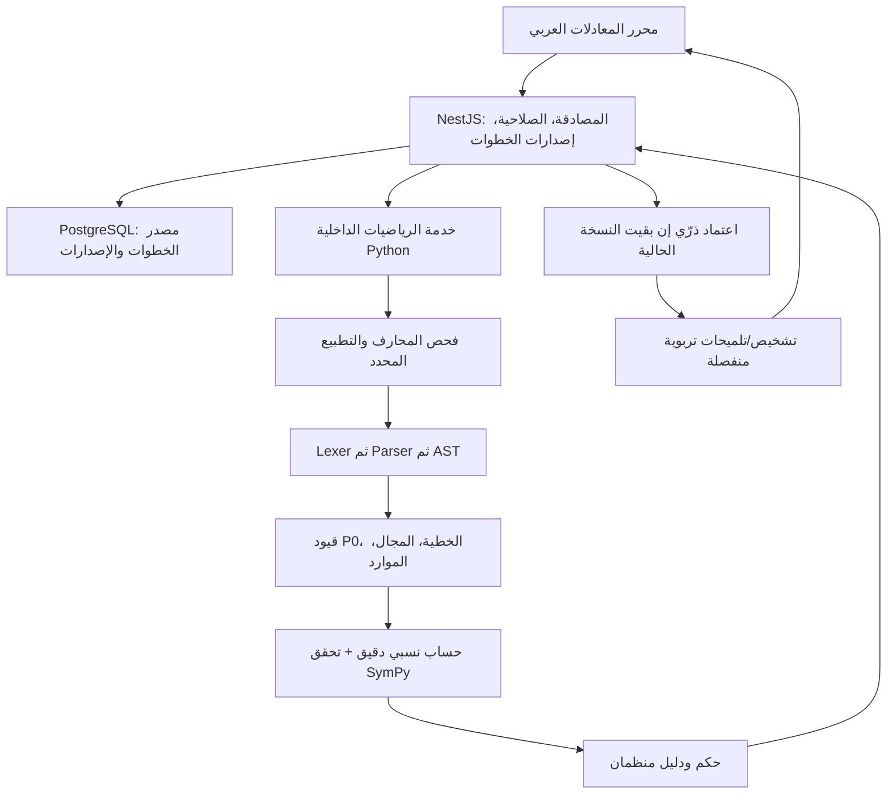

# خُطوة AI — مواصفة محرك الرياضيات العربي

> **اسم الوثيقة:** `10-MATH-ENGINE.md`  
> **المشروع:** خُطوة AI — منصة عربية الأصل للتعلّم التشخيصي والتكيّفي  
> **الإصدار:** `1.1`  
> **التاريخ:** 03 نوفمبر 2026  
> **الحالة:** **مواصفة هندسية مقترحة للتنفيذ، بانتظار اعتماد بوابة إثبات المحرك (`GATE-1`)**  
> **المسؤولون عن الاعتماد:** قائد الخلفية (NestJS)، قائد محرك الرياضيات (Python/SymPy)، مختص الرياضيات، مسؤول الجودة والأمان  
> **المراجع الملزمة:** `00-PROJECT-VISION.md`، `01-PRD.md`، `02-MVP-SCOPE.md`، `04-ARABIC-NOTATION.md`، `05-CURRICULUM.md`، `06-MISCONCEPTIONS.md`، `07-TUTORING-POLICY.md`، `08-UX-DESIGN.md`، `09-SYSTEM-ARCHITECTURE.md`  
> **الوثائق التابعة:** `11-DATA-MODEL.md`، `12-API-CONTRACT.yaml`، `13-AI-ENGINE.md`، `14-GOLDEN-DATASET.md`، `15-TEST-AND-ACCEPTANCE.md`، `16-SECURITY-PRIVACY.md`، `17-IMPLEMENTATION-PLAN.md`، `AGENTS.md`

---

## 0. الغرض، السلطة وحدود المواصفة

هذه الوثيقة تصف **كيف يقرأ خُطوة المعادلات المكتوبة بالعربية، ويحوّلها إلى معنى رياضي محدود وواضح، ويفحص الانتقال من خطوة إلى التي تليها، ويُنتج حكمًا مع دليل**. لا تصف كيف يشخّص الطالب نفسيًا أو تربويًا، ولا كيف تُخزَّن الجلسات، ولا تحل محل عقد OpenAPI النهائي.

### 0.1 ما نُثبته وما لا ندّعيه

- **المعتمد من صاحب المشروع:** الباك إند الرئيسي هو **NestJS + TypeScript**، وليس FastAPI. يملك NestJS المصادقة والجلسات وسجل الحل وقاعدة البيانات والتكامل مع AI؛ **Python + SymPy خدمة رياضيات داخلية فقط**.
- **الثابت في رؤية المنتج:** العربية أصل تجربة الرياضيات، و`س` متغير حقيقي، وأرقام `٠–٩` أساسية، والحكم الرياضي لا يصدر من نموذج لغوي.
- **المحدود في الهاكثون P0:** معادلة خطية واحدة في **س**، بأعداد صحيحة ومعاملات/نتائج كسرية بسيطة، وبعمليات محددة، مع قبول حلول مكافئة بطرق مختلفة.
- **غير المعتمد بعد:** مكتبة محرر الرياضيات، عتبات الموارد النهائية، تشغيل الكسور في واجهة الهاتف، اختيار مكتبة HTTP الخفيفة داخل Python، وأرقام الإصدارات النهائية.
- **الحكم على خطأ انتقال** لا يعني إثبات سبب مفهوم خاطئ لدى الطالب؛ `06-MISCONCEPTIONS.md` و`07-TUTORING-POLICY.md` وحدهما يملكان قواعد فرضيات التشخيص والتلميحات.

### 0.2 المرجعية عند التعارض

تُحترم أولًا ثوابت الرؤية وقرارات صاحب المشروع، ثم نطاق `02-MVP-SCOPE.md` وقرارات PRD؛ ويملك `04-ARABIC-NOTATION.md` **الاصطلاحات والقبول السطحي واتجاه العرض**؛ وتملك هذه الوثيقة **التمثيل الدلالي والتحقق الرياضي ومحدوديات الأمان والأدلة**؛ ويملك `12-API-CONTRACT.yaml` **الواجهة التعاقدية النهائية**. عند التعارض يُفتح طلب تغيير ولا يعالج وكيل المشكلة باجتهاد صامت.

### 0.3 تعريف نجاح المحرك

في حالة المسألة `٢(س + ٣) = ١٠` يستطيع الطالب تقديم أيٍّ من التحويلين الصحيحين:

- `٢س + ٦ = ١٠` (توزيع)، أو
- `س + ٣ = ٥` (قسمة الطرفين على ٢).

ويحصل كلاهما على `verified_valid`. أما `٢س + ٣ = ١٠` فيحصل على `verified_invalid` مع دليل على اختلاف مجموعة الحل، **لا** على تشخيص قطعي لضعف الطالب. وعندما لا يمكن التحقق بأمان تكون النتيجة امتناعًا صريحًا.

---

## 1. النطاق الرياضي المسموح في P0

| المجال | مسموح في المحرك | الحدود |
|---|---|---|
| المتغير | الحرف `س` فقط (`U+0633`) | لا `x` ولا `ص` ولا أكثر من متغير |
| الأرقام | `٠–٩` افتراضيًا، و`0–9` في الإدخال | لا أعداد عشرية ولا صيغة علمية |
| الإشارات | `+` و`−` و`-` وسالب أحادي | لا إشارات غير معتمدة |
| الضرب | `×` و`*`؛ وبعض صيغ الضرب الضمني المحددة | لا ضرب تعبيرين يحويان `س` |
| القسمة | قسمة على ثابت عددي **غير صفري** | لا مقام يحتوي متغيرًا |
| الأقواس | أقواس عادية مع تعشيق محدود | لا دوال ولا أقواس مبهمة |
| المعادلات | مساواة واحدة؛ معادلة خطية بمتغير واحد | لا متباينات أو مساواة متسلسلة |
| القيم | معاملات ونتائج دقيقة من الأعداد النسبية | لا تقريب عشري في الحكم |
| الانتقالات | تساوي **مجموعات الحل** ضمن المجال المعلن | لا فرض لمسار حل واحد |
| الحل النهائي | عزل `س` لقيمة ثابتة متحققة، بعد سلسلة صحيحة | لا اعتماد لصحة الناتج منفصلة عن المسار |

**بنك المحتوى المنشور P0** يقتصر على مسائل خطية ذات **حل وحيد** كما في `05-CURRICULUM.md`. يجب أن يفهم المحرك الحالات الحسابية الحدية مثل `٠ = ٠` و`٠ = ٣` لأغراض السلامة، لكن هذا لا يطلق منهجًا تعليميًا عن المعادلات ذات عدد لا نهائي من الحلول أو بلا حل.

### 1.1 خارج P0 ولا يجوز الادعاء بدعمه

- `جا`، `جتا`، `ظا`، `sin`، `cos`، الدوال عمومًا، والزاوية بالدرجات/الراديان.
- أسس `س` والجذور والقيمة المطلقة واللوغاريتمات؛ المعادلات غير الخطية أو التربيعية.
- القسمة على متغير مثل `١/س`، أو تعبير قد يساوي صفرًا.
- المتغيرات المتعددة وأنظمة المعادلات والمتباينات والوحدات الفيزيائية والكيمياء والبرمجة.
- استنتاج المعادلات من صورة أو حديث حر، أو تحليل LaTeX العام غير المقيد.
- مساواة تعبيرين تقريبًا بإجراء اختبار عددي عشوائي بدل إثبات رياضي.

**القاعدة:** خارج النطاق يُعرض `unsupported` أو `inconclusive` بحسب السبب؛ لا يُوصف الطالب بأنه أخطأ.

---

## 2. القرارات العلمية الحاسمة

### `MATH-RULE-01` — مجال الحل

- المجال الافتراضي لمسار الجبر هو **الأعداد الحقيقية**.
- داخل P0، كل معادلة مدعومة ذات معاملات نسبية ولا تحتوي مقامات متغيرة؛ ومن ثم يمكن تمثيلها بالصيغة `أ × س + ب = ٠` حيث `أ` و`ب` عددان نسبيان دقيقان.
- **لا يجوز** إلغاء شرط مجال، أو إضافة شرط جديد، أو حذف حالة حل محتملة أثناء التحقق.

### `MATH-RULE-02` — التكافؤ هو حفظ مجموعة الحلول

لتكن `ح(م)` مجموعة القيم الحقيقية التي تحقق المعادلة `م`. يكون انتقال المعادلتين صحيحًا في هذا النطاق عندما يمكن للمحرك **إثبات**:

`ح(م السابقة) = ح(م الحالية)`.

- **التطابق النصي غير مطلوب:** يجوز تغيير ترتيب الحدود، أو إجراء عمليات مكافئة، أو اختصار خطوات.
- **تشابه صيغة الطرفين لا يكفي:** إذا اختلفت مجموعة الحل، فالانتقال غير صحيح ولو بدا مشابهًا بصريًا.
- **لا يكفي الحل النهائي الصحيح:** إذا احتوت سلسلة المحاولة انتقالًا باطلًا فلا تتحول السلسلة كلها إلى «حل مستقل صحيح» بسبب وصولها لاحقًا إلى قيمة صحيحة بالمصادفة.

### `MATH-RULE-03` — حدود دعوى الصحة

`verified_valid` يعني صحة **هذا الانتقال** ضمن المجال والقواعد المعتمدة؛ لا يعني أن الطالب أتقن المهارة أو أن جميع خطوات المحاولة صحيحة. `verified_invalid` يثبت خطأ الانتقال، وليس تلقائيًا سبب ارتكابه.

### `MATH-RULE-04` — الدليل جزء من الحكم

لا ترجع الخدمة `verified_invalid` دون سبب قابل للفحص أو شاهد يبيّن اختلاف مجموعات الحل، ولا ترجع `verified_valid` اعتمادًا على رأي LLM أو تشابه شكلي فقط.

### `MATH-RULE-05` — التمثيل المنظم قبل أي حساب

**ممنوع** تمرير مدخل الطالب الخام إلى `eval`، أو `exec`، أو `sympify`/`parse_expr` غير المقيَّدين. تُحلَّل المدخلات أولًا بواسطة محلل محدد القواعد ينتج AST معروف الأنواع، ثم تُنشأ كائنات SymPy مباشرة من العقد التي اجتازت الحراسة.

---

## 3. خط التنفيذ داخل النظام



### 3.1 مسؤوليات كل طرف

| الطرف | يملك | لا يملك |
|---|---|---|
| واجهة React | إدخال الطالب وإظهار الاتجاه والرسائل والتلميحات | اعتبار نتيجة محلية حكمًا معتمدًا |
| NestJS | الجلسة، الملكية، حفظ المسودة، النسخ، استدعاء Python، اعتماد الحكم، التكامل التربوي | تحليل التعبير عبر `eval` أو حكم AI فقط |
| Python Math Engine | فحص اللغة الرياضية، AST، المجال، حساب مجموعة الحل، دليل التكافؤ | حسابات المستخدمين، قاعدة بيانات الإنتاج، الاتصال المباشر بالطالب |
| SymPy | عمليات رمزية مضبوطة على AST معتمد | تحليل نص الطالب غير الموثوق مباشرة |
| LLM/Tutoring | صياغة شرح أو سؤال اعتمادًا على الحكم المثبت | تغيير `math_status` أو اختلاق شاهد رياضي |

### 3.2 خدمة مستقلة صغيرة وليست FastAPI

يظل الاختيار الذي أقره صاحب المشروع **NestJS كباك إند رئيسي**. خدمة Python قد تستخدم خادم HTTP داخليًا خفيفًا مثل `aiohttp` أو بديلًا تقرره تجربة الإثبات، **لكن ليس FastAPI كبديل للباك إند**. تستقبل خدمة الرياضيات طلبات داخلية من NestJS فقط، وهي بلا جلسات ولا قاعدة بيانات مستخدمين ولا API عام.

---

## 4. مدخلات العربية: النص الخام أولًا

### 4.1 ملفات الاصطلاح

الملف المبدئي: `ar-mashriq-school-v1` بحسب `04-ARABIC-NOTATION.md`. يحمل اسمًا وإصدارًا، وقاموس رموز محدودًا، وقواعد كتابة وأولوية عمليات. لا يحق للمحرك استنتاج الملف من لغة المتصفح إذا كانت المسألة أُنشئت بإصدار محدد.

### 4.2 المحارف المدعومة والمحظورة

| الإدخال | المعالجة |
|---|---|
| `٢س` أو `2س` | تحليل ضرب ضمني صحيح وعرض موحد `٢س` |
| `٢(س+٣)` | ضرب في قوس |
| `−٣س` أو `-3س` | سالب أحادي موثق |
| `٢×س` أو `٢*س` | ضرب صريح |
| `س/٢` | قسمة على ثابت غير صفري |
| `س = ١/٢` | كسر عددي دقيق |
| `١/٢س` | **ملتبس**؛ لا يُختار تفسير افتراضي |
| `٢س٣` أو `س(٢)` | غير مقبول بضرب ضمني تلقائي |
| `x+٣=٧` أو `ص+٣=٧` | متغير غير مدعوم؛ لا استبدال صامت |
| `جا(٣٠°)` أو `س²` | `unsupported`؛ لا تحليل تخميني |
| `٣٫٥` أو `3.5` | عدد عشري خارج P0؛ لا تحويل إلى ٣٥ |
| `سَ`، أشكال العرض العربية، أو تطويل `ـ` | ترفض/يُطلب التصحيح وفق `04` |
| محارف تحكم بالاتجاه `U+200E` و`U+200F` و`U+202A–U+202E` و`U+2066–U+2069` | رفض أمني قبل التحليل، وعدم حفظها بوصفها رموزًا رياضية |

### 4.3 التطبيع المحدد (Safe normalization)

1. **احفظ الأصل** في NestJS مع نسخة محتوى المسألة وفق سياسة الخصوصية.
2. **تحقق من المحارف:** اسمح فقط بمجموعة P0، وافصل بين محرف غير مسموح ومفهوم علمي معروف لكنه غير مدعوم.
3. **حوّل شكل الأرقام** الشرقية/ASCII إلى قيم `Integer`، لا إلى استبدال نصي غير متتبع.
4. **وحّد الإشارات المسموح بها** إلى أنواع رمزية، ولا تنفذ تطبيع Unicode شاملًا مثل `NFKC` بلا مراجعة.
5. **أنتج المصدر الموحد والعرض** من AST؛ لا تستخدم `reverse()` لقلب السلاسل بحجة RTL.
6. **احتفظ بخريطة مواضع المصدر** حتى تظهر المشكلة في المكان الصحيح داخل محرر المعادلات.

### 4.4 مواضع الأخطاء (spans)

تحدد الخدمة المواضع `[start,end)` بوحدات **Unicode code points** بالنسبة إلى النص الأصلي بعد فحص المحارف، وليس bytes أو UTF-16 code units. على واجهة JavaScript تحويل المواضع عند عرض مؤشر الخطأ. لا يزاح الموضع عند التطبيع دون خريطة مقابلة صريحة.

### 4.5 حفظ ثلاث صور منفصلة

- `raw_input`: النص كما أدخله الطالب؛ مصدر التدقيق عند السماح بالتخزين.
- `semantic_ast`: شجرة معنى محكومة ومثبتة بإصدار؛ لا يُقبل AST غير موثق يرسله العميل كحقيقة.
- `display_ar`: نص/بنية عرض عربية مولّدة من الشجرة، مع حماية اتجاه التعبير.

كل نسخة جديدة للتعبير تلغي صلاحية نتيجة التحليل القديمة، إلا إذا وُجدت آلية إعادة استخدام آمنة تربط النص والإصدار والمعنى بالنتيجة نفسها.

---

## 5. لغة التعبير المسموح بها (Grammar)

> هذه قواعد معنوية للمحلل، وليست إذنًا بتنفيذ صيغة رياضية عامة. يجب أن يُثبت الـParser الالتباسات المذكورة قبل الحوسبة. أسماء الرموز التقنية أدناه **داخلية فقط**، وليست النص الذي سيظهر للطالب.

### 5.1 قواعد EBNF مفهومية

```ebnf
line       = expression, "=", expression ;
expression = term, { ("+" | "−" | "-"), term } ;
term       = unary, { ("×" | "*" | "÷" | "/"), unary } ;
unary      = [ ("+" | "−" | "-") ], atom ;
atom       = integer | variable | "(", expression, ")" ;
integer    = digit, { digit } ;
variable   = "س" ;
digit      = "٠" | "١" | "٢" | "٣" | "٤" | "٥" | "٦" | "٧" | "٨" | "٩"
           | "0" | "1" | "2" | "3" | "4" | "5" | "6" | "7" | "8" | "9" ;
```

**توسعات Parser المرخّصة فوق القواعد العامة:**

- `integer variable` مثل `٢س` و`٢ س`؛ و`integer "(" expression ")"` مثل `٢(س + ٣)`، على أنها **عقدة ضرب صريحة في AST**.
- `٢س/٣` تقرأ `(٢×س)/٣` عندما يكون المقام ثابتًا؛ `١/٢س` ترفض بوصفها صيغة ملتبسة **قبل** تطبيق أولوية العمليات.
- الأقواس حول البسط والمقام توضح الغرض. عند الحاجة لإزالة الالتباس نطلب كتابة `(١/٢) × س` أو `١/(٢ × س)`؛ الثانية خارج P0 بسبب المقام المتغير.
- الضرب الضمني بعد متغير أو بين قوسين، مثل `س(٢)` و`(س+١)(س+٢)`، **ليس مرخصًا تلقائيًا** في P0.
- بعد التحليل البنيوي نفحص أن أي مقام لا يحوي `س` وأنه لا يساوي صفرًا، ثم أن التعبير خطي. لا يكفي قبول العبارة نحويًا لجعلها مدعومة.

**ملاحظة مقصودة:** الصياغة الشكلية أعلاه لا تحاول ترميز كل حالات الضرب الضمني في EBNF؛ تُحدد هذه الحالات بواسطة قواعد adjacency صريحة واختبارات وحدة منفصلة. لا يترك القرار لافتراضيّات مكتبة Parsing عامة.

### 5.2 أولوية العمليات

1. الأقواس.
2. السالب/الموجب الأحادي.
3. الضرب والقسمة والصيغ المحددة للضرب الضمني.
4. الجمع والطرح.
5. المساواة بين تعبيرين.

لا نحسب قيمة متغير أو نعالج مساواة متسلسلة بطريق التخمين.

### 5.3 الحدود البنيوية

- سطر الجبر يملك **علامة مساواة واحدة**؛ التعبير المنفصل قد يكون صالحًا كجزء من واجهة الإدخال، لكنه لا يمثل خطوة حل مكتملة.
- الأقواس يجب أن تكون متوازنة.
- لا يتيح المحلل إنشاء عقد غير معروفة أو استدعاءات دوال.
- إذا كانت العبارة صحيحة نحويًا لكنها تنتج حاصل ضرب متغيرين، أو أسسًا، أو مقامًا متغيرًا، تُصنف `unsupported` بدل حيلة تبسيط قد تخفي الخروج من النطاق.

---

## 6. شجرة المعنى (AST) المسموح بها

### 6.1 أنواع العقد

| النوع | أمثلة قيم | القيد |
|---|---|---|
| `Integer` | `2`, `-3` | صحيح محدود الحجم |
| `Variable` | `س` | المتغير الوحيد |
| `Negate` | `−(س+٢)` | عقدة أحادية |
| `Add` | `س + ٢` | حدان أو قائمة محددة |
| `Subtract` | `س − ٢` | طرح ثنائي |
| `Multiply` | `٢ × س` | لا تضرب تعبيرين يحويان متغيرًا |
| `Divide` | `س / ٢` | المقام قيمة ثابتة غير صفرية |
| `Equation` | `٢س + ٣ = ٧` | جذر واحد ذو طرفين |

يمكن تمثيل الكسر `١/٢` داخليًا بعقدة `Divide(Integer(1),Integer(2))` ثم بنوع `Rational(1,2)` بعد التحقق. لا يسمح للعميل باختيار عقدة دلالية مخالفة لنصه.

### 6.2 مثال بنية توضيحية

**النص:** `٢(س + ٣) = ١٠`

```json
{
  "schemaVersion": "math-ast-v1",
  "notationProfileVersion": "ar-mashriq-school-v1",
  "sourceRaw": "٢(س + ٣) = ١٠",
  "root": {
    "type": "Equation",
    "sourceSpan": {
      "start": 0,
      "end": 13,
      "unit": "unicode_codepoint"
    },
    "left": {
      "type": "Multiply",
      "sourceSpan": {
        "start": 0,
        "end": 8,
        "unit": "unicode_codepoint"
      },
      "implicit": true,
      "left": {
        "type": "Integer",
        "value": "2",
        "sourceSpan": {
          "start": 0,
          "end": 1,
          "unit": "unicode_codepoint"
        }
      },
      "right": {
        "type": "Add",
        "sourceSpan": {
          "start": 2,
          "end": 7,
          "unit": "unicode_codepoint"
        },
        "groupSpans": [
          {
            "start": 1,
            "end": 8,
            "unit": "unicode_codepoint"
          }
        ],
        "left": {
          "type": "Variable",
          "name": "س",
          "sourceSpan": {
            "start": 2,
            "end": 3,
            "unit": "unicode_codepoint"
          }
        },
        "right": {
          "type": "Integer",
          "value": "3",
          "sourceSpan": {
            "start": 6,
            "end": 7,
            "unit": "unicode_codepoint"
          }
        }
      }
    },
    "right": {
      "type": "Integer",
      "value": "10",
      "sourceSpan": {
        "start": 11,
        "end": 13,
        "unit": "unicode_codepoint"
      }
    }
  }
}
```

هذا مثال مُواءم مع مقترح `AstDocument` في [العقد الداخلي](contracts/math-internal-v1.schema.json)، وليس استجابة محرك شُغّل. `sourceSpan/groupSpans` بوحدات Unicode code points؛ يحفظ `sourceRaw` والبنية الأصلية و`implicit` دون استنتاج المعنى من العرض. نسخة AST `math-ast-v1`، وملف الاصطلاح مرتبط بالنسخة. يظل اعتماد المختص وQA معلقًا؛ `12` يملك أسماء الحقول العامة، والمقترح الداخلي يملك أسماء امتداد AST.

### 6.3 لا نفقد معنى الإدخال بعد التبسيط

احتفظ بتسلسل العقد الأصلي بما فيه الأقواس والضرب الذي استخدمه الطالب (أو شجرة مصدر/metadata للعرض والتشخيص)، وكذلك بنسخة معيارية للحساب. لو حسب المحرك مباشرة `٢(س+٣)` على أنها `٢س+٦` دون الاحتفاظ بالشكل الأصلي، فسيصعب على `06-MISCONCEPTIONS.md` اكتشاف سهو التوزيع على نحو موثوق.

---

## 7. التحقق الدلالي قبل SymPy

يُنفذ هذا الفحص **على AST** وليس على نص معادلة مبسّط:

1. أرقام صحيحة ضمن الحجم المسموح، وعدم وجود حرف خارج `س`.
2. لا دوال أو أسس أو رموز غير معتمدة.
3. لا حاصل ضرب تعبيرين يحتوي كل منهما على متغير، حتى لو اختفت الحدود غير الخطية بعد تبسيط لاحق.
4. أي قسمة مقامها ثابت معلوم بعد تقييم جزء عددي فقط، وغير صفري.
5. لا مقام متغير حتى لو أمكن اختصاره مع بسط آخر؛ مثل `س/س` **خارج P0** ولا يُختزل إلى `١`.
6. لا عمليات تصنع شروط مجال جديدة خارج مجال المتغير المعلن.
7. لا سلسلة مساواة أو معادلات متعددة في السطر.
8. البنية الخطية قابلة للتمثيل بدقة في صورة معاملات نسبية.

**السبب:** يمكن لصيغة تبدو قابلة للتبسيط لاحقًا أن تخفي قسمة على صفر، أو مقامًا متغيرًا، أو حاصل ضرب متغيرين. اختبار الحدود قبل التبسيط يمنع اعتماد نتيجة خارج النطاق.

---

## 8. الحساب الدقيق ومعيار مجموعة الحل

### 8.1 التحويل إلى صورة خطية معيارية

كل تعبير صالح ومدعوم يتحول إلى زوج من الأعداد النسبية الدقيقة:

`(أ، ب)` بحيث `expression = أ×س + ب`.

قواعد التركيب:

| العقدة | التحويل |
|---|---|
| `Integer(n)` | `(٠، n)` |
| `Variable(س)` | `(١، ٠)` |
| `Negate(E)` | `(-أ_E, -ب_E)` |
| `Add(E,F)` | `(أ_E+أ_F, ب_E+ب_F)` |
| `Subtract(E,F)` | `(أ_E-أ_F, ب_E-ب_F)` |
| `Multiply(C,E)` | `(c×أ_E, c×ب_E)` إذا كان `C` ثابتًا، وبالعكس |
| `Divide(E,C)` | `(أ_E/c, ب_E/c)` إذا كان `c` ثابتًا غير صفري |

عند استخراج طرفي المعادلة نحسب **الطرف الأيسر ناقص الأيمن** فنحصل على `أ×س+ب=٠`.

### 8.2 فئات مجموعة الحل

| الحالة | مجموعة الحل ضمن ℝ | النوع الداخلي المقترح |
|---|---|---|
| `أ ≠ ٠` | `{−ب/أ}`، عدد نسبي وحيد | `singleton` |
| `أ = ٠` و`ب = ٠` | جميع الأعداد الحقيقية | `all_reals` |
| `أ = ٠` و`ب ≠ ٠` | المجموعة الخالية | `empty` |

**مثال:** `٢س + ٦ = ١٠` يعطي `أ = ٢`، `ب = −٤`، ومن ثم مجموعة الحل `{٢}`.

### 8.3 قاعدة التكافؤ P0

تُقارن مجموعتا الحل بالأنواع والقيم النسبية الدقيقة، لا بالتمثيل النصي:

```text
function compare(oldEquation, newEquation):
    oldAST = parseAndValidate(oldEquation)
    newAST = parseAndValidate(newEquation)
    oldSet = exactLinearSolutionSet(oldAST)
    newSet = exactLinearSolutionSet(newAST)
    if oldSet == newSet:
        return verified_valid with proof of equal solution sets
    else:
        return verified_invalid with witness / solution-set difference
```

هذه **خوارزمية دلالية**؛ وليست دعوة لكتابة مقارن سلسلة من مدخلات غير موثوقة. تُنفّذ فقط بعد اجتياز الحراس.

### 8.4 ما دور SymPy تحديدًا؟

- بناء كائنات `Symbol`, `Integer`, `Rational`, `Add`, `Mul`, `Eq` **من عقد AST الموثوقة فقط**.
- التحقق المرجعي من المعاملات والحل والتعويض، أو استخدام `solveset` ضمن مجال `Reals` بعد التحقق من الخطية، لا كبديل مفتوح عن المحلل المقيَّد.
- تثبيت النتائج بصيغ دقيقة، لا بالأعداد العائمة `float`.
- إنتاج تحقق ثانٍ يلتقط عيوب التنفيذ في خوارزمية الصورة الخطية.

**قيد أمان:** لا يُستعمل `parse_expr` ولا `sympify` لاستقبال نص الطالب، ولا يُنفذ أي استدعاء دالة مستمد من اسمه في الإدخال. على AST، تنشأ عقد SymPy بقائمة أنواع معتمدة. توثق SymPy رسميًا أن `parse_expr` تستخدم `eval`، ولذلك لا تصلح للنص غير الموثوق. انظر قسم المراجع.

### 8.5 التطابق الرياضي مع اختلاف الخطوات

- `٢(س+٣)=١٠` ← `س+٣=٥`: صحيح، لأن الحالتين مجموعتهما `{٢}`.
- `٢(س+٣)=١٠` ← `٢س+٦=١٠`: صحيح.
- `٣س=٧` ← `س=٧/٣`: صحيح **إذا كان دعم الكسر واجتياز عرض RTL مفعلين**.
- `س=٢` ← `س=٣`: غير صحيح لاختلاف الحل.
- `٢س=٤` ← `٠=٠`: غير صحيح لأن الحل الواحد تحول إلى جميع الأعداد الحقيقية.
- `٠=٣` ← `٠=٤`: تكافؤ مجموعات الحل في الحساب المجرد، **لكنه خارج بنك التعلم المنشور**؛ قد يسجل دليل تحقق تقنيًا، ولا يُعتمد مسار تعلم على هذا المثال دون قرار محتوى.

### 8.6 سلامة الشروط ومثال خارج النطاق

`س² = س` ثم «قسمة الطرفين على س» قد تُسقط الحل `س=٠`. هذا **اختبار حارس خارج P0**: يجب أن يعيد المحرك `unsupported` (لأن `س²` غير مدعوم) أو يمتنع بأمان، وليس `verified_valid` بتمرير الصيغة إلى أداة عامة. أما داخل P0، يُحظر أي مقام متغير قبل التبسيط.

---

## 9. أنواع الأدلة (Evidence) وطريقة بنائها

الحكم الرياضي لا يُعاد إلى NestJS بوصف «صحيح» أو «خطأ» فقط. يجب أن يكون بالإمكان فحص سببه:

| نوع الدليل | يستخدم عندما | المحتوى المسموح |
|---|---|---|
| `equal_solution_sets` | انتقال صحيح | نوع وقيمة مجموعة الحل قبل وبعد، والنسخ المرجعية |
| `counterexample` | اختلاف المجموعتين ويمكن إعطاء قيمة شاهدة | قيمة `س` تنتمي لإحدى المجموعتين ولا تنتمي للأخرى، مع قيم طرفي المعادلتين |
| `solution_set_mismatch` | اختلاف المجموعتين حتى لو لا يلزم شاهد واحد معروض | وصف منظم للفرق دون اختراع تحويل موضعي |
| `domain_or_scope_guard` | صيغة قد تفقد شروطًا أو تتجاوز النطاق | كود حارس ثابت دون إدانة المتعلم |
| `parse_issue` | إدخال ناقص/ملتبس | موضع المشكلة ورمزها واقتراح إدخال واضح |
| `internal_failure` | عطل خدمة أو تعذر حساب | كود تشغيلي ومعرّف ارتباط؛ بلا traceback للطالب |

### 9.1 مثال على دليل خطأ توزيع

انتقال `٢(س + ٣) = ١٠` ← `٢س + ٣ = ١٠`:

- مجموعة الحل السابقة `{٢}`.
- مجموعة الحل التالية `{٧/٢}`.
- نختار الشاهد `س = ٢`، الذي يحقق المعادلة السابقة ولا يحقق الجديدة.
- النتيجة `verified_invalid` مع `counterexample` وبيانات قيم الطرفين، دون تأكيد تلقائي لسبب تربوي محدد.

تُحسب قيم التعويض بشكل دقيق داخل المحرك. لا يكتب LLM شاهدًا رياضيًا من خياله.

### 9.2 حارس جودة الدليل

- يجب أن يثبت الشاهد فعلًا اختلاف صدق المعادلتين؛ يفشل اختبار المحرك إذا لم يثبت ذلك.
- تظل الأرقام المخزنة في الدليل كقيم نسبية منظمة؛ تولد العربية في طبقة العرض وفق ملف الاصطلاح.
- لا يُعرض دليل تجريدي مضلل مثل «تغيرت الإشارة» إلا عندما يمكن إثباته في التحويل الملاحظ؛ يكفي `counterexample` عندما تكون الخطوات متعددة.
- لا تُحوّل أسماء أنماط `ERR-ALG-*` إلى «proof type»؛ تلك فرضيات تربوية منفصلة.

---

## 10. تصنيف حالات التحقق الموحد

| `math_status` | التعريف الدقيق | استخدامه في التعلم |
|---|---|---|
| `verified_valid` | ثبت تكافؤ الخطوتين ضمن المجال والنطاق | دليل إيجابي **للانتقال فقط** |
| `verified_invalid` | ثبت اختلاف مجموعة الحلول مع دليل | يسمح **بترشيح** نمط خطأ |
| `syntax_error` | الإدخال ناقص/ملتبس/مخالف لصياغة القواعد، بما فيه قسمة صريحة على صفر في P0 | إصلاح الصيغة؛ لا يعد فشلًا مفاهيميًا |
| `unsupported` | العبارة معروفة المعنى العام لكن خارج مجال P0 | توضيح الحدود؛ لا أثر سلبي على الإتقان |
| `inconclusive` | المدخل قابل للفهم لكن التحقق لم يستطع إعطاء حكم مأمون | الامتناع وطلب توضيح أو مراجعة |
| `service_error` | فشل داخلي/اتصال/مهلة يمنع نتيجة موثوقة | حفظ العمل وإعادة آمنة |

### 10.1 رموز أسباب مستقرة مقترحة

| كود السبب | الحالة | المثال |
|---|---|---|
| `UNBALANCED_PARENTHESIS` | `syntax_error` | `٢(س+٣=١٠` |
| `MULTIPLE_EQUAL_SIGNS` | `syntax_error` | `س=٢=٣` |
| `AMBIGUOUS_DIVISION` | `syntax_error` | `١/٢س` |
| `DIVISION_BY_ZERO` | `syntax_error` | `س/٠=٢` |
| `UNEXPECTED_ADJACENCY` | `syntax_error` | `٢س٣` |
| `UNSUPPORTED_VARIABLE` | `unsupported` | `x+٣=٧` |
| `UNSUPPORTED_FUNCTION` | `unsupported` | `جا(٣٠°)` |
| `UNSUPPORTED_POWER` | `unsupported` | `س²+١=٠` |
| `UNSUPPORTED_DECIMAL` | `unsupported` | `٣٫٥س=٧` |
| `VARIABLE_DENOMINATOR` | `unsupported` | `١/س=٢` |
| `NONLINEAR_EXPRESSION` | `unsupported` | `س×س=٤` |
| `UNSAFE_CONTROL_CHARACTER` | `syntax_error` | محرف اتجاه خفي |
| `RESOURCE_COMPLEXITY_LIMIT` | `inconclusive` أو `unsupported` بحسب صلاحية الإدخال والتقييد المعتمد | تعبير يتجاوز حد الموارد |
| `MATH_TIMEOUT` | `service_error` | تجاوز مهلة خدمة التحقق |
| `SCHEMA_VERSION_MISMATCH` | `service_error` في التكامل | اختلاف نسخ العقد الداخلي |

**ملاحظة:** يجوز أن يعيد NestJS استجابة HTTP خطأ مع `service_error` أو كود `math_unavailable`؛ لا يعني ذلك أن حالة الطالب الرياضية هي خطأ.

### 10.2 تصنيف المراحل

- خطأ في **صياغة الإدخال** → لا انتقال تربوي.
- نجاح في **التحليل** → لا يعني نجاحًا في حل المسألة.
- نجاح في **فحص انتقال** → لا يعني اكتمال المحاولة.
- اكتمال **الحل النهائي** → يحتاج إثباتًا إضافيًا بأن صيغة النهاية عزلت المتغير وأن السلسلة كاملة صحيحة.

---

## 11. فحص اكتمال الحل النهائي

لا يعتمد المحرك اكتمال المسألة من مجرد تطابق قيمة كتبها الطالب مع الإجابة المتوقعة.

**الشروط المتراكبة:**

1. نص المسألة وإصدارها مثبتان في المحاولة.
2. جميع الانتقالات المطلوبة من الأصل إلى النهاية `verified_valid` للإصدارات الحالية، دون `syntax_error` أو `unsupported` أو `inconclusive` في السلسلة.
3. المعادلة النهائية في شكل معزول، مثل `س = ٢` أو `٢ = س`، حيث الطرف الآخر **ثابت نسبي** مدعوم.
4. القيمة النهائية تحقق معادلة المسألة الأصلية ومجالها (تعويض دقيق).
5. مجموعة حل الخطوة النهائية تساوي مجموعة حلول الأصل ذات الحل الوحيد.
6. لم تُستخدم أحكام سابقة أُبطلت بعد تعديل خطوة أو تغيير إصدار.

إذا بقيت المعادلة `٢س = ٤`، قد تكون **صحيحة ومكافئة** لكن الحل **لم يكتمل بصيغة العزل**. وإذا كتب الطالب `س=٢` بعد انتقال خاطئ فلا يُعتمد إكمالًا صحيحًا مع تجاهل الخطأ السابق.

### 11.1 مصدر صلاحية الإكمال

خدمة Python تُعيد معلومة رياضية عن العزل وصحة التعويض عند الطلب، بينما يجمع NestJS سلامة **السلسلة الحالية** ونسخ خطواتها ويقرر حالة المحاولة. لا يجوز للخدمة الداخلية أن تكتب مباشرة `completed=true` في قاعدة البيانات.

---

## 12. التفاعل مع كشف الأخطاء التربوية

### 12.1 ما ترسله الرياضيات

- `math_status`، وموضع الانتقال، ودليل/شاهد.
- شجرة المعنى المصدرية والمعيارية، مع مصدر الرموز عند الحاجة.
- `engine_version` و`notation_profile_version` و`schema_version`.
- رموز التفسير **الرياضي المحايد** عند وجودها، مثل `equal_solution_sets` أو `counterexample`.

### 12.2 ما لا ترسله الرياضيات

- لا تصدر `diagnosis.state = supported_in_attempt`.
- لا تصدر حكمًا «الطالب لا يفهم التوزيع».
- لا تقرر المستوى `H1–H4`، ولا تقدير الإتقان، ولا محتوى تمرين النقل.
- لا تغير نتيجة التحقق بسبب نص يكتبه LLM.

### 12.3 ربط مع الأنماط الستة المستهدفة

مرجع التشخيص `06-MISCONCEPTIONS.md` يعرّف:

| النمط | الوصف التربوي | ملاحظة هندسية |
|---|---|---|
| `ERR-ALG-01` | إغفال توزيع الضرب على حد | لا يكفي نص الخطوة دون تحليل شكل الضرب قبل/بعد |
| `ERR-ALG-02` | تغيير إشارة بغير تبرير | يفحص مقابل عمليات تغيير الطرفين |
| `ERR-ALG-03` | عملية على طرف دون الطرف الآخر | قد يتداخل مع `ERR-ALG-04` |
| `ERR-ALG-04` | اختيار عملية غير مناسبة لعزل المتغير | يحتاج سؤال تمييز عندما يحتمل أكثر من سبب |
| `ERR-ALG-05` | خطأ حسابي في الأعداد الصحيحة | لا يثبت بمفرده ضعف مفهوم الجبر |
| `ERR-ALG-06` | خطأ توزيع معامل سالب | يتداخل مع التوزيع والإشارات؛ لا جزم آلي |

لا يُنتج محرك الرياضيات **نمط خطأ تربويًا** لمجرد ثبوت عدم التكافؤ؛ تنفذ طبقة تشخيص منفصلة في NestJS/AI وفق بطاقات المهارات والأسئلة التأكيدية.

---

## 13. التكامل مع NestJS: دورة التحقق الآمنة

### 13.1 ترتيب الطلب

1. واجهة الطالب تحفظ/تعدل خطوة عبر NestJS مع `expectedRevision`.
2. NestJS يتحقق من ملكية الجلسة ويكتب الخطوة في PostgreSQL، ويزيد إصدار المحاولة، ويبطل نتائج الخطوة المعدلة والتابعة.
3. عند طلب الفحص، يقرأ NestJS **البيانات المحفوظة المعتمدة** من قاعدة البيانات، لا AST يدعيه العميل.
4. يرسل إلى Python الطلب الحالي مع `attemptRevision` وإصدار المسألة والاصطلاح، عبر اتصال داخلي.
5. تعود Python بنتيجة ودليل وإصدارات؛ تفحص NestJS المخطط والدلالة، ثم تعيد قراءة الإصدار في **تحديث ذرّي**.
6. إن تغير الإصدار، تحفظ النتيجة كسجل تاريخي إن لزم أو تتجاهل؛ **لا تعتمدها بوصفها حكمًا حاليًا**، وتعيد حالة تعارض/إعادة فحص آمنة.
7. إذا ظلت النتيجة صالحة، تُسجل، ثم يمكن بدء التشخيص التربوي بعد التحقق من صلاحية السياق.

### 13.2 قواعد السباق والتكرار

- **Revision pinning:** لا توجد نتيجة دون بصمة لنسخة المسألة، وخطوة المصدر، وخطوة الوجهة، وإصدار المحاولة.
- **Idempotency:** النقر مرتين على «تحقق» لا يولد محاولتين أو يزيد عدد الأخطاء/التلميحات.
- **Dependency invalidation:** تعديل خطوة رقم ٢ يبطل نتائج الانتقالات من/إلى الخطوة ٢ وكل الخطوات اللاحقة، والتشخيصات والتلميحات التابعة.
- **Stale response:** رد Python المتأخر بعد التعديل لا يستعيد الحالة القديمة.
- **AI failure isolation:** عطل LLM لا يلغي حكمًا رياضيًا ثابتًا ولا يفقد مسودة.
- **Domain/engine version:** تحديث المحرك لا يغيّر سجلًا قديمًا في صمت؛ يتم طلب إعادة فحص أو وضع علامة اختلاف إصدار عند الضرورة.

### 13.3 أثر تعديل المسألة أو سياقها

المسألة تُربط بنسخة محتوى ثابتة وقت بدء المحاولة. إذا استُبدل السؤال أو اصطلاحه، لا تُعاد نسبة حكم قديم إلى السؤال الجديد. يقرر NestJS هل تحتفظ المحاولة بنسختها الأصلية أو تطلب بداية جديدة مع الحفاظ على السجل.

---

## 14. عقد خدمة Python الداخلي — **نموذج تصميمي قابل للتعديل**

> الأمثلة التالية مُواءمة بنيويًا مع مخططات InternalMathTransition* الحالية في `12-API-CONTRACT.yaml`، التي لا تزال مسودة. امتداد parse/check-final/AST في [المقترح الداخلي المُنسَّخ](contracts/math-internal-v1.md)؛ لا اعتماد بشري أو تشغيل محرك مستنتج من الأمثلة، ولا عرض مباشر للمتصفح.

### 14.1 العمليات الداخلية المقترحة

| العملية | المسار الداخلي المقترح | الغرض |
|---|---|---|
| تحليل معادلة | `POST /internal/v1/math/parse` | تحويل نص عربي إلى AST/سلوك خطأ |
| فحص انتقال | `POST /internal/v1/math/verify-transition` | مقارنة مجموعتي الحل وإرجاع دليل |
| فحص عزل النهاية | `POST /internal/v1/math/check-final` | تحقق رياضي من العزل والتعويض |
| حالة خدمة | `GET /internal/health` | فحص خدمة بلا بيانات طالب |

### 14.2 مثال طلب انتقال

```json
{
  "schemaVersion": "math-internal-v1",
  "requestId": "00000000-0000-4000-8000-000000000003",
  "context": {
    "attemptId": "00000000-0000-4000-8000-000000000001",
    "attemptRevision": 4,
    "problemRevisionId": "00000000-0000-4000-8000-000000000002",
    "notationProfile": "ar-mashriq-school-v1",
    "domain": "reals"
  },
  "transition": {
    "fromKind": "step",
    "fromStepVersionId": "00000000-0000-4000-8000-000000000004",
    "toStepVersionId": "00000000-0000-4000-8000-000000000005",
    "fromRaw": "٢(س + ٣) = ١٠",
    "toRaw": "٢س + ٣ = ١٠"
  }
}
```

`attemptId` و`requestId` هنا **للتتبع وربط النسخ فقط**؛ لا تكتسب خدمة Python صلاحية تعديل محتوى الطالب منهما.

### 14.3 مثال استجابة انتقال خاطئ

```json
{
  "schemaVersion": "math-internal-v1",
  "requestId": "00000000-0000-4000-8000-000000000003",
  "engineVersion": "example-only-not-a-build",
  "notationProfileVersion": "ar-mashriq-school-v1",
  "attemptRevision": 4,
  "status": "verified_invalid",
  "reasonCode": "SOLUTION_SET_MISMATCH",
  "evidence": {
    "type": "counterexample",
    "domain": "reals",
    "previousSolution": {
      "kind": "singleton",
      "value": {
        "num": "2",
        "den": "1"
      }
    },
    "nextSolution": {
      "kind": "singleton",
      "value": {
        "num": "7",
        "den": "2"
      }
    },
    "witness": {
      "variable": "س",
      "value": {
        "num": "2",
        "den": "1"
      },
      "satisfiesPrevious": true,
      "satisfiesNext": false
    }
  },
  "issue": null
}
```

النص العربي المرئي والدليل المفصل يخرجان من طبقة عرض/شرح معتمدة، لا بإظهار رموز الخدمة مباشرة. تُولّد قيم الأعداد كنسب دقيقة، ولا تُخزن نتائج مقارنة على هيئة `float`.

### 14.4 مثال خطأ إدخال

```json
{
  "schemaVersion": "math-internal-v1",
  "requestId": "00000000-0000-4000-8000-000000000006",
  "engineVersion": "example-only-not-a-build",
  "notationProfileVersion": "ar-mashriq-school-v1",
  "attemptRevision": 4,
  "status": "syntax_error",
  "reasonCode": "AMBIGUOUS_DIVISION",
  "evidence": null,
  "issue": {
    "reasonCode": "AMBIGUOUS_DIVISION",
    "messageAr": "أضف أقواسًا لتوضيح موضع المقام.",
    "spanStart": 0,
    "spanEnd": 4,
    "spanUnit": "unicode_codepoint",
    "hintKey": "use_parentheses"
  }
}
```

### 14.5 مبدأ تعاقد لا يُخرق

`NestJS ↔ Python` **عقد داخلي ثابت النسخة**؛ لا تخمّن الواجهة أسماء حقول Python، ولا تُمرر ردود Python مباشرة إلى المتصفح بلا DTO وتحقق وترجمة وإخفاء معلومات تشغيلية.


### 14.6 امتداد parse وcheck-final وAST — مقترح PH-00

- [JSON Schema Draft 2020-12](contracts/math-internal-v1.schema.json) يحدد طلب/رد parse وcheck-final وAST، ويطابق نسخ مخططات الانتقال الحالية من `12` دون تعديل العقد العام.
- [أمثلة التبادل](contracts/math-internal-v1.examples.json) مصطنعة للتحقق من schema فقط؛ `engineVersion` فيها ليس build موجودًا.
- [وثيقة التوافق](contracts/math-internal-v1.md) تربط context بنسخ PostgreSQL، وتفصل تحقق Python الرياضي عن قرار NestJS النهائي بشأن اكتمال السلسلة.
- رفض النسخة غير المدعومة، مصادر الخطوات، توافق context، حدود spans والموارد، ومصادقة الخدمة تُراجع قبل التجميد. لا يُقبل AST من المتصفح كحقيقة، ولا يصل Python إلى قاعدة البيانات.
- check-final لا يكتب completed ولا يمنح استقلالية؛ قد تكون الخطوة متكافئة وغير معزولة. NestJS وحده يضم نتيجة المحرك إلى أحكام السلسلة الحالية والمساعدة المسجلة.

---

## 15. تصميم الأمان والموارد

### 15.1 نموذج التهديد

المهاجم المحتمل يستطيع إرسال نص رياضي طويل أو متعمد الالتباس، أو محارف تحكم خفية، أو رموز Python/LaTeX تبدو حسابية، أو طلب عدد كبير من الحسابات. ويجب افتراض أن كل نص من العميل **غير موثوق** مهما كان شكل محرر الواجهة.

### 15.2 محظورات إلزامية

- ممنوع `eval` و`exec` على نص المستخدم، وممنوع أي تحليل حر يمكنه إنشاء أسماء كائنات/استدعاء دوال من الإدخال.
- لا يُستعمل `sympify` أو `parse_expr` مباشرة على النص غير الموثوق؛ ولا يُمرر LaTeX حر إلى مفسر عام كبديل عن grammar P0.
- لا يُستخدم `pickle` لتبادل AST؛ JSON محدود الأنواع فقط.
- لا ملفات مؤقتة قابلة للتنفيذ، ولا shell، ولا إنشاء عمليات اعتباطية من نص الطالب.
- لا صلاحيات قاعدة بيانات لعملية Python، ولا وصول عام إلى خدمة الرياضيات.
- لا تُرسل أسرار AI ولا بيانات الطالب الكاملة إلى خدمة الرياضيات بلا ضرورة.

### 15.3 حدود موارد **مقترحة تجريبيًا** وليست ضمانات نهائية

| المورد | حد ابتدائي قابل للضبط والتجربة | ماذا نفعل عند تجاوزه؟ |
|---|---|---|
| طول سطر الإدخال | 256 Unicode code points | رد حارس آمن دون حساب |
| عدد الرموز (tokens) | 128 | `unsupported` أو حارس تعقيد مع إرشاد |
| عمق الأقواس/AST | 16 | حد تعقيد مع تفسير غير اتهامي |
| طول العدد المفرد | 18 رقمًا | حارس حجم |
| عدد العقد | 128 | حارس تعقيد |
| حدود كسر وسيط | 256 bit للبسط والمقام | `inconclusive`/حارس موارد |
| المهلة لكل انتقال داخل الخدمة | هدف مبدئي 1000 ms | مهلة خادمية مقيدة؛ إعادة آمنة |
| الحد الخارجي NestJS للخدمة | أكبر قليلًا من مهلة Python بهامش معلوم | `math_unavailable` دون فقد الإدخال |

يجب قياس هذه الحدود بأجهزة النشر الفعلية وتعديلها في `15-TEST-AND-ACCEPTANCE.md`. **لا نسمح للمستخدم بإرسال قيمة حد الموارد أو مهلة التشغيل لتجاوز الضوابط**. التقييد يجري في NestJS ثم يتحقق Python من الحدود من جديد.

### 15.4 عزل الخدمة ونشرها

- اتصال على شبكة Docker داخلية فقط؛ لا توجيه من الإنترنت إلى منفذ Python.
- لا root داخل حاوية الرياضيات، وتحديد CPU وذاكرة، وتقليل صلاحيات الملفات، وإغلاق network egress عندما لا يلزم.
- مفاتيح/إثبات هوية خدمة لخدمة عند الحاجة، مع فحص المصدر الموثوق وتهيئة endpoint ثابتة داخل NestJS؛ لا URL يحدده العميل.
- مهلات اتصال وقراءة وحدود التزامن ومعالجة rate limits على نقطة دخول NestJS.
- عند احتمالية تعقيد عمليات SymPy، تكون العزلة بعملية/عامل محدود الموارد، وليس مجرد إيقاف خيط Python بعد فوات المهلة.

---

## 16. الأداء والمتانة والتشغيل

### 16.1 السلوك عند الفشل

- **انقطاع Python:** تحافظ NestJS على الخطوة المحفوظة، وتعرض `service_error`/`math_unavailable`، مع إعادة لاحقة لا تضاعف المحاولات.
- **مهلة رياضية:** لا تسقط في حكم افتراضي `verified_invalid`؛ تُسجل لأغراض التتبع وتُعرض للمستخدم رسالة مناسبة.
- **تعطل LLM:** يبقى الحكم الرياضي كما هو؛ قد يظهر شرح ثابت معتمد أو تتأخر المساعدة.
- **نسخة مخطط غير مدعومة:** رفض تعاقدي واضح؛ لا تُقبل مفاتيح زائدة على أنها صدق للحساب.
- **إعادة محاولة مكررة:** مفتاح idempotency/بصمة نسخة تمنع إنشاء أثر تربوي مزدوج.

### 16.2 المراقبة دون تسريب بيانات

المقاييس الضرورية: عدد طلبات التحليل، نسب حالات `math_status`، زمن الفحص، حدود الموارد المتجاوزة، أخطاء نسخ العقود، نتائج قديمة مرفوضة، واختلافات الحساب المرجعي إن ظهرت. لا تسجل النص الخام للمسائل أو بيانات الطلاب في سجلات عامة أو خدمة قياس خارجية بلا مبرر وموافقة مناسبة.

### 16.3 معايير الثبات

- إعادة الطلب نفسه للنص والإصدارات والمعطيات نفسها تعطي **النتيجة الرياضية نفسها** ضمن إصدار المحرك، بغض النظر عن صياغة التلميح التعليمي.
- لا تتغير نتيجة تاريخية بأثر رجعي؛ يحمل كل حكم `engine_version` و`notation_profile_version`.
- أي تغيير دلالي في القواعد يرافقه إصدار جديد وحالات انحدار (regression tests).

---

## 17. حزمة اختبارات القبول المرجعية للمحرك

> الحالات التالية **مواصفات اختبارات** وليست نتائج اختبارات منفذة. تعتمد الأعداد والرموز العربية في نص الإدخال كما ستُعرض للطالب. الحالات الكسرية لا تُنشر للطلاب قبل اجتياز `GATE-1` في العرض والتحقق.

### 17.1 قراءة وتطبيع (`ME-001` إلى `ME-015`)

| المعرّف | الإدخال | المتوقع |
|---|---|---|
| `ME-001` | `٢س + ٣ = ٧` | parse ناجح؛ متغير س، حل `{٢}` |
| `ME-002` | `2س + 3 = 7` | parse ناجح؛ عرض `٢س + ٣ = ٧` |
| `ME-003` | `٢ س + ٣ = ٧` | ضرب ضمني مسموح |
| `ME-004` | `٢٣س = ٤٦` | ٢٣ عدد واحد، لا `٢ × ٣` |
| `ME-005` | `٢(س + ٣) = ١٠` | AST ضرب/جمع/مساواة |
| `ME-006` | `−٣س = ٦` | السالب الأحادي صحيح؛ حل `−٢` |
| `ME-007` | `-3س = 6` | نفس المعنى مع توحيد العرض |
| `ME-008` | `٢×س = ٤` | ضرب صريح صحيح |
| `ME-009` | `٢*س = ٤` | نفس المعنى؛ عرض عربي |
| `ME-010` | `س/٢ = ١` | قسمة على ثابت؛ حل `٢` |
| `ME-011` | `س = ١/٢` | كسر دقيق وعرض بسط/مقام صحيح |
| `ME-012` | `٢س/٣ = ٤` | `(٢×س)/٣`؛ حل `٦` ضمن grammar المعتمد |
| `ME-013` | `س + (٢ + ٣) = ١٠` | أقواس ونتيجة `{٥}` |
| `ME-014` | `س = ١٢٣` | ترتيب الأرقام صحيح في العرض على الهاتف والحاسوب |
| `ME-015` | نسخ ولصق `٢س+٣=٧` | إعادة تحليل تكافئ الإدخال الأصلي |

### 17.2 الصيغ الملتبسة والخارجة عن النطاق (`ME-016` إلى `ME-033`)

| المعرّف | الإدخال | المتوقع |
|---|---|---|
| `ME-016` | `١/٢س = ٣` | `syntax_error / AMBIGUOUS_DIVISION` |
| `ME-017` | `س/٠ = ٢` | `syntax_error / DIVISION_BY_ZERO` |
| `ME-018` | `٢(س + ٣ = ١٠` | `syntax_error / UNBALANCED_PARENTHESIS` |
| `ME-019` | `س = ٢ = ٣` | `syntax_error / MULTIPLE_EQUAL_SIGNS` |
| `ME-020` | `٢س٣ = ٦` | `syntax_error / UNEXPECTED_ADJACENCY` |
| `ME-021` | `س(٢) = ٤` | طلب ضرب صريح؛ لا تخمين دالة |
| `ME-022` | `x + ٣ = ٧` | `unsupported / UNSUPPORTED_VARIABLE` |
| `ME-023` | `ص + ٣ = ٧` | `unsupported / UNSUPPORTED_VARIABLE` |
| `ME-024` | `جا(٣٠°) = ١/٢` | `unsupported / UNSUPPORTED_FUNCTION` |
| `ME-025` | `س² + ١ = ٠` | `unsupported / UNSUPPORTED_POWER` |
| `ME-026` | `١/س = ٢` | `unsupported / VARIABLE_DENOMINATOR` |
| `ME-027` | `س×س = ٤` | `unsupported / NONLINEAR_EXPRESSION` |
| `ME-028` | `٣٫٥س = ٧` | `unsupported / UNSUPPORTED_DECIMAL` |
| `ME-029` | `١،٥س = ٣` | لا تتحول الفاصلة العربية إلى عدد عشري |
| `ME-030` | `سَ = ٢` | لا يزيل التشكيل بصمت؛ تصحيح اصطلاح |
| `ME-031` | `س` + `U+202E` + `=٢` | رفض محرف التحكم المخفي |
| `ME-032` | `س/س = ١` | `unsupported / VARIABLE_DENOMINATOR` قبل الاختصار |
| `ME-033` | `(س+١)(س+٢)=٠` | رفض ضرب الأقواس الضمني؛ لا يُعلن دعم تربيعي |

### 17.3 صحة الخطوات (`ME-034` إلى `ME-049`)

| المعرّف | من ← إلى | المتوقع |
|---|---|---|
| `ME-034` | `٢(س + ٣) = ١٠` ← `٢س + ٦ = ١٠` | `verified_valid` |
| `ME-035` | `٢(س + ٣) = ١٠` ← `س + ٣ = ٥` | `verified_valid`؛ بديل صحيح |
| `ME-036` | `٢(س + ٣) = ١٠` ← `٢س + ٣ = ١٠` | `verified_invalid` مع شاهد `س = ٢` |
| `ME-037` | `٢س + ٦ = ١٠` ← `٢س = ٤` | `verified_valid` |
| `ME-038` | `٢س = ٤` ← `س = ٢` | `verified_valid` |
| `ME-039` | `−٢(س − ٣) = ١٠` ← `−٢س + ٦ = ١٠` | `verified_valid` |
| `ME-040` | `−٢(س − ٣) = ١٠` ← `−٢س − ٦ = ١٠` | `verified_invalid` |
| `ME-041` | `س + ٥ = ١٢` ← `س = ٧` | `verified_valid` |
| `ME-042` | `س + ٥ = ١٢` ← `س = ١٧` | `verified_invalid` |
| `ME-043` | `٣س = ٧` ← `س = ٧/٣` | `verified_valid` بعد تفعيل الكسور |
| `ME-044` | `س = ٢` ← `٢ = س` | `verified_valid` |
| `ME-045` | `س = ٢` ← `س = ٣` | `verified_invalid` |
| `ME-046` | `٢س = ٤` ← `٠ = ٠` | `verified_invalid`؛ حل وحيد مقابل جميع الحقيقية |
| `ME-047` | `س + ٣ = ٧` ← `٢س + ٦ = ١٤` | `verified_valid`؛ ضرب ثابت غير صفري |
| `ME-048` | `س + ٣ = ٧` ← `٠ × (س + ٣) = ٠` | `verified_invalid`؛ سقوط قيد الحل |
| `ME-049` | `س − س = ٠` ← `٠ = ٠` | `verified_valid` حسابيًا، دون نشر درس «حلول لا نهائية» في P0 |

### 17.4 الإكمال والتسلسل والأمان (`ME-050` إلى `ME-062`)

| المعرّف | السيناريو | المتوقع |
|---|---|---|
| `ME-050` | `٢س=٤` آخر سطر | صحيح حسابيًا لكن غير مكتمل من جهة عزل س |
| `ME-051` | `٢س=٤` ← `س=٢` وسلسلة صحيحة | حل مكتمل إذا ثبت الأصل والإصدارات |
| `ME-052` | خطوة خاطئة وسط الحل ثم `س=٢` بالصدفة | لا يُعتمد اكتمال الحل |
| `ME-053` | تعديل خطوة رقم ٢ بعد التحقق من الخطوة ٣ | إبطال أحكام الخطوة المعدلة والتابعة |
| `ME-054` | وصول رد Python قديم بعد تغيير revision | لا يُطبَّق على السجل الحالي |
| `ME-055` | ضغط زر «تحقق» مرتين | لا دليل ولا محاولة مكرران |
| `ME-056` | تعطل Python بعد حفظ المسودة | `service_error` مع حفظ الخطوة |
| `ME-057` | تعطل LLM بعد `verified_valid` | يظل الحكم الرياضي محفوظًا وصحيحًا |
| `ME-058` | payload يتضمن كود Python أو استدعاء دالة | رفض آمن؛ لا تنفيذ شيفرة |
| `ME-059` | مدخل يتجاوز حد عمق AST/طول المدخل | توقف محدود الموارد؛ لا حبس للعملية |
| `ME-060` | بيانات AST مرسلة من متصفح تخالف النص | تجاهل AST غير موثوقة؛ إعادة تحليل خادمية |
| `ME-061` | اختلاف `schemaVersion` بين NestJS وPython | رفض منظم دون قبول نتيجة جزئية |
| `ME-062` | مسألة قديمة بإصدار مختلف بعد تعديل المحتوى | لا يُعاد ربط حكم قديم بمسألة جديدة |

### 17.5 اختبارات لا تقاس بالنتيجة العددية فقط

- **Round trip:** `raw -> AST -> display -> AST` يحفظ نفس المعنى ضمن ملف الاصطلاح والإصدارات.
- **Property-based testing:** ولِّد معادلات خطية آمنة ذات حل وحيد، وأجرِ تحويلات مكافئة مقيدة، واطلب من المحرك قبولها دون إنذارات خاطئة.
- **Mutation tests:** غيّر إشارة أو ثابتًا أو أحد طرفي المعادلة، وتحقق من رفض الاختلاف مع شاهد صحيح؛ لا تفترض أن كل تغيير شكلي يغيّر الحل.
- **Differential checks:** قارن الحساب النسبي الداخلي مع SymPy على حالات ضمن P0، ثم افحص أي اختلاف يدويًا.
- **Rendering tests:** اختبر الكسور والأقواس واتجاه نص `س=١٢٣` في الهاتف والحاسوب، بما في ذلك النسخ واللصق.
- **Resource fuzzing:** مدخلات غير موثوقة، ومحارف تحكم، وتداخلات أقواس، وأحجام أعداد مرتفعة، وحدود مهلة.
- **Contract tests:** NestJS ↔ Python على الإصدارات والاستجابات والأخطاء وأدلة الحكم.

---

## 18. معايير القبول التنفيذية (`MATH-AC-01` إلى `MATH-AC-20`)

| المعرّف | معيار القبول | مرجع |
|---|---|---|
| `MATH-AC-01` | إدخال `٢س` و`٢(س+٣)` يُفهم دون تغيير المعنى | AN-001–AN-005 |
| `MATH-AC-02` | قبول أرقام ASCII وإظهار أرقام عربية شرقية | AN-002, AN-007 |
| `MATH-AC-03` | ضرب ضمني مقيّد ورفض الحالات الملتبسة | AN-013–AN-015 |
| `MATH-AC-04` | حساب كسور دقيقة مع عدم قلب البسط والمقام | AN-010, AN-011 |
| `MATH-AC-05` | رفض دوال وأُسس ومقامات متغيرة خارج النطاق | AN-020–AN-023 |
| `MATH-AC-06` | رفض محارف اتجاه خفية وعدم تنفيذ أي نص مدخل | AN-030–AN-031 |
| `MATH-AC-07` | حفظ raw وAST والعرض كتصورات منفصلة | `04` §7 |
| `MATH-AC-08` | قبول كل التحويلات المكافئة ضمن P0 ولو اختلف شكل الحل | FR-019, FR-021 |
| `MATH-AC-09` | كشف اختلاف مجموعتي الحل دون الاكتفاء بمقارنة النص | FR-022 |
| `MATH-AC-10` | تقديم شاهد صحيح/سبب موثق لكل `verified_invalid` | FR-025 |
| `MATH-AC-11` | لا يقبل تغيير المجال أو القسمة على متغير مجهول الصفر | FR-023 |
| `MATH-AC-12` | `syntax_error` و`unsupported` و`inconclusive` لا تحسب فشلًا تعليميًا | FR-024, `06` |
| `MATH-AC-13` | الحكم لا يُحوّل مباشرة إلى تشخيص مفاهيمي قطعي | `06`, `07` |
| `MATH-AC-14` | اكتمال الحل يحتاج عزلًا وتحقيق السلسلة الأصلية | FR-026 |
| `MATH-AC-15` | كل حكم يربط بإصدار المحرك والاصطلاح والمسألة | FR-027 |
| `MATH-AC-16` | الرد القديم لا يكتب نتيجة على revision جديد | `09` §9 |
| `MATH-AC-17` | التحقق المكرر لا يكرر الأدلة أو الأحداث | `09` §9 |
| `MATH-AC-18` | تعطل خدمة Python أو AI لا يفقد خطوة محفوظة | `08` §8, `09` §14 |
| `MATH-AC-19` | خدمة Python داخلية لا تتصل مباشرة بالمستخدم أو قاعدة البيانات | ADR-001, ADR-002 |
| `MATH-AC-20` | نتائج حالات الاختبار الفعلية تُوثق مع حالات الفشل دون ادعاء نسب مسبقة | `14`, `15` |

**عتبات نسب النجاح والأداء المقبولة** تُعتمد بعد بناء مجموعة تقييم مستقلة ومراجعتها في `15-TEST-AND-ACCEPTANCE.md`. ليس وجود الحالات في هذه الوثيقة دليلًا على اجتيازها.

---

## 19. خطة تنفيذ المحرك وبوابات التسليم

### المرحلة A — إثبات القراءة العربية قبل الدمج

**مخرجات:** Lexer/Parser محدود، AST مع source spans، إدخال/إخراج عربي ثابت، ونتائج مرجعية للحالات `ME-001..ME-033`. تثبت سلامة RTL والكسور مع فريق الواجهة، وتغلق قرارات `AN-DEC-*` المؤثرة.

**بوابة:** `GATE-1` في `02-MVP-SCOPE.md`؛ إن فشل إثبات اتجاه المعادلات فلا تُفعّل المسائل الكسرية للطلاب حتى إصلاحها أو اتخاذ قرار نطاق موثق.

### المرحلة B — تحقق رياضي دقيق

**مخرجات:** قيود المجال والخطية، تحويل affine، مقارنة مجموعات الحل، أدلة موثوقة، والتحقق المرجعي عبر SymPy؛ ثم `ME-034..ME-049`.

### المرحلة C — التكامل مع NestJS

**مخرجات:** عقد HTTP داخلي، إصدارات ورابط نتيجة بمحاولة، نشر محلي خاص، مهلات، مراجعة stale/idempotency، وحالات `ME-050..ME-062`.

### المرحلة D — ربط التعليم دون خلط السلطة

**مخرجات:** NestJS يستلم الحكم ويفتح مسار تشخيص/تلميح معتمد من `06` و`07`، دون أن يغيّر AI الرياضيات.

### المرحلة E — التسليم للجودة والهاكثون

**مخرجات:** تقرير حالات التنفيذ الفعلية، سجل قصور معروف، حدود الدعم المعلنة، أمثلة عرض غير محفوظة النتائج، ونسخة محرك مثبتة.

---

## 20. توزيع العمل بين الفريق ووكلاء AI

| الطرف/الوكيل | المطلوب منه | لا يجوز له |
|---|---|---|
| وكيل الاصطلاحات/الواجهة | توافق محرر عربي مع AST والعرض والكسور وsource spans | قلب النص يدويًا بـ`reverse` أو تبديل س بـx صامتًا |
| وكيل محرك الرياضيات | Lexer/Parser آمن، قيود P0، مجموعات حل ودليل، SymPy من AST | استخدام `parse_expr` على مدخل غير موثوق أو إسناد تشخيص تربوي |
| وكيل NestJS | المصادقة، حفظ الخطوات، CAS/revision، التكرار، موصل الخدمة الداخلي | فتح Python للإنترنت أو قبول نتيجة من إصدار قديم |
| وكيل التشخيص/التعليم | تفسير الدليل وبطاقات الأخطاء والتلميحات | تغيير حكم `verified_invalid` أو اختراع إثبات |
| وكيل الجودة | اختبار cases وsecurity وcontract وRTL ونشر نتائج فِعلية | تعطيل الاختبارات لإعلان نجاح شكلي |
| مختص الرياضيات | مراجعة النطاق والأمثلة والحالات الحدية | تحويل افتراضات غير مجربة إلى وعود للطلاب |

**التزام مشترك:** أي تعديل في grammar أو المعنى الدلالي أو المجال يوجب تحديث `04` و`10` و`14` و`15` والتحقق من أثره على `05` و`06` و`07` و`09` و`11` و`12`. لا يقرر وكيل واحد تغييرًا في عقد مشترك دون إشعار بقية المالكين.

---

## 21. القرارات المفتوحة قبل اعتماد الإصدار

| الرمز | القرار | الاقتراح | صاحب القرار | موعد الحسم |
|---|---|---|---|---|
| `MATH-DEC-01` | مرجع المنهج والصف وملف الاصطلاح | ثانوي مشرقي مع مراجعة معلم | المنتج + المختص | قبل `GATE-1` |
| `MATH-DEC-02` | المحرر/العرض RTL والكسور | PoC على حاسوب وهاتف، ثم اعتماد | الواجهة + المحرك | قبل `GATE-1` |
| `MATH-DEC-03` | الشكل النهائي لقبول الكسور والضرب الضمني | الالتزام بأمثلة `04`، وتثبيت كل استثناء في حالات اختبار | المحرك + مختص المادة | قبل نشر بنك المسائل |
| `MATH-DEC-04` | القيم النهائية لطول النص وعمق AST وbit limits | قياس الحدود المقترحة وضبطها | الأمن + الجودة | قبل النشر |
| `MATH-DEC-05` | إطار الخدمة الداخلية Python وطريقة حمايتها | HTTP/JSON خاص خفيف بعد PoC؛ NestJS هو الباك إند | الخلفية + المحرك | قبل `GATE-1` |
| `MATH-DEC-06` | طريقة العزل والمهلة عند تعطل حساب رمزي | عملية/حاوية محدودة الموارد، اختبار مهلة حقيقي | العمليات + الأمان | قبل النشر |
| `MATH-DEC-07` | مخطط AST النهائي ومفاتيح evidence | تثبيت schema مُصدّر بين NestJS/Python | قائد التكامل | قبل العمل المتوازي |
| `MATH-DEC-08` | طريقة توثيق التكافؤ والحالات الحدية `all_reals/empty` | سياسة تقنية مع عدم نشرها كدروس | مختص الرياضيات + المحرك | قبل `GATE-1` |
| `MATH-DEC-09` | معيار التفسير المعروض للطالب | دليل موضوعي + صياغة عربية تراجع تربويًا | التربية + UX | قبل دورة التعلم |
| `MATH-DEC-10` | عتبات الدقة/الأداء/الامتناع | تُحدد بعد مجموعة تقييم مستقلة | الجودة + المختص | قبل `GATE-4` |
| `MATH-DEC-11` | إصدار SymPy/Python والـlockfile | تثبيت نسخ مختبرة موثقة | قائد المحرك | قبل نشر الحاوية |
| `MATH-DEC-12` | سياسة حفظ AST والتاريخ وإبطال النتائج | يؤمنها NestJS وPostgreSQL وفق `11` | الخلفية + الخصوصية | قبل دمج الجلسات |

**معيار إغلاق القرار:** اسم المعتمد، التاريخ، تجربة/اختبار مؤيد، ملفات تأثرت، وإصدار جديد إن تغير معنى المدخلات. لا تُغلق القرارات بعبارة «اعتمد تلقائيًا».

---

## 22. مخطط تتبع الالتزام إلى بقية الوثائق

| ما تملكه هذه المواصفة | المصادر المرجعية | التوثيق/التنفيذ التالي |
|---|---|---|
| لغة المعادلة والاصطلاح | `04-ARABIC-NOTATION.md` و`AN-001..035` | Parser/AST + `14` |
| نطاق المتغير والموضوع والتمارين | `02-MVP-SCOPE.md` و`05-CURRICULUM.md` | مخزن المسائل وفق `11` |
| فحص الانتقال والدليل | `FR-019..027`، `MVP-05..06` | `12-API-CONTRACT.yaml` |
| أنماط التشخيص | `06-MISCONCEPTIONS.md` و`ERR-ALG-01..06` | `13-AI-ENGINE.md` |
| التلميحات والعلاج | `07-TUTORING-POLICY.md` | سياسة تطبيق `TutoringModule` |
| حالات UX والـrevision | `08-UX-DESIGN.md` و`09-SYSTEM-ARCHITECTURE.md` | واجهة React + NestJS |
| النشر/الأمان والمهل | `09` و`16-SECURITY-PRIVACY.md` | صور Docker وإعدادات محكمة |
| حالات التقييم وعتبات القبول | `14-GOLDEN-DATASET.md`، `15-TEST-AND-ACCEPTANCE.md` | تقرير نتائج حقيقي |

---

## 23. مراجع فنية موثوقة وحدود الاستشهاد

هذه المراجع **تثبت سلوك أدوات أو معايير عامة**، ولا تثبت أن محرك خُطوة قد نُفّذ أو اجتاز الاختبارات. قيم الحدود وgrammar وأمثلة statuses الواردة في الوثيقة **قرارات تصميم للمشروع**.

1. **SymPy — Parsing (تحذير `parse_expr` من `eval`):** https://docs.sympy.org/latest/modules/parsing.html
2. **SymPy — Solve an Equation Algebraically (`solve` و`solveset`):** https://docs.sympy.org/latest/guides/solving/solve-equation-algebraically.html
3. **SymPy — Solveset، المجال والحالات الجزئية:** https://docs.sympy.org/latest/modules/solvers/solveset.html
4. **W3C — Arabic mathematical notation:** https://www.w3.org/TR/arabic-math/
5. **W3C — MathML Core:** https://www.w3.org/TR/mathml-core/
6. **Unicode — Digit terminology:** https://www.unicode.org/terminology/digits.html
7. **وثائق خُطوة الداخلية:** `00`–`09` والإصدارات المعتمدة لكل منها.

---

## 24. معايير اعتماد الوثيقة وقائمة فحص ما قبل التنفيذ

- [ ] وافق مختص رياضيات على النطاق وشروط مجموعة الحل والمعادلات ذات الحل الواحد.
- [ ] توافق `10` مع `04` في الرموز والفاصلة والضرب الضمني والكسور.
- [ ] جربت الواجهة `٢س` و`٢(س+٣)` والكسور باتجاه صحيح، مع نسخ/لصق.
- [ ] جرى تثبيت عقد AST وevidence وإصداراتهما بين NestJS وPython.
- [ ] لا توجد نقطة وصول عامة لخدمة Python، ولا صلاحية قاعدة بيانات بداخلها.
- [ ] نجحت حالات الأمان ضد `eval`/الحقن ومحارف الاتجاه الخفية.
- [ ] تعمل المقارنة الدقيقة لمجموعات الحل مع شاهد موثق للحالات الخاطئة.
- [ ] لا يخلط النظام بين `unsupported` و`inconclusive` و`verified_invalid`.
- [ ] عند تعديل خطوة قديمة تُبطل الأحكام والتلميحات التابعة.
- [ ] تُحافظ الخدمة على المسودة عند المهلة أو الفشل.
- [ ] أُعد تقرير اختبارات فعلي للحالات `ME-001..ME-062` دون اصطناع نسب نجاح.
- [ ] أُغلقت القرارات التي تمنع `GATE-1` بمحضر اعتماد صريح.

**الحالة النهائية لهذه النسخة:** مواصفة تنفيذ مرجعية للمراجعة، **وليست تنفيذًا للكود أو شهادة نجاح للمحرك**.

### سجل الإصدارات

| الإصدار | التاريخ | الوصف | حالة الاعتماد |
|---|---|---|---|
| `1.0` | `2026-11-03` | صياغة أولى لمحرك رياضيات عربي، ومجموعات حلول دقيقة، ودليل قابل للفحص، وحواجز أمان وتكامل NestJS/Python | مراجعة الفريق مطلوبة |


## ملحق تصحيح PH-00 — 2026-11-04

مواءمة الأمثلة مع `12` وإضافة مقترح مُنسَّخ للعمليات وAST، بتكليف المستخدم؛ لا تنفيذ محلل أو خدمة أو إجازة مختص. [الأدلة](../qa-reports/ph00-correction-report.md).
