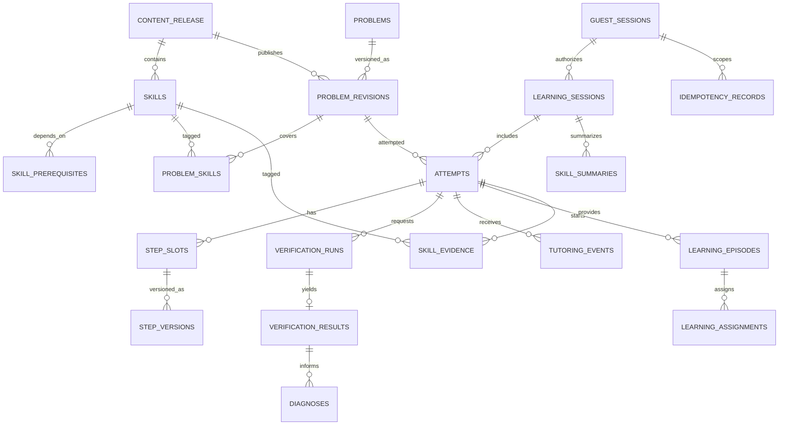

# خُطوة AI — مواصفة نموذج البيانات وقاعدة PostgreSQL

> **الملف:** `11-DATA-MODEL.md`  
> **المنتج:** خُطوة AI — منصة عربية الأصل للتعلم التشخيصي والتكيّفي  
> **الإصدار:** `1.1`  
> **التاريخ:** 03 نوفمبر 2026  
> **الحالة:** **مواصفة هندسية مقترحة للمراجعة والاعتماد**؛ ليست مخطط قاعدة منشورًا أو ترحيلات مطبقة  
> **مرجع الباك إند المعتمد:** **NestJS + TypeScript**  
> **قاعدة البيانات المقترحة:** **PostgreSQL**  
> **الخدمة الرياضية:** Python/SymPy داخلية، لا تملك اتصالًا بقاعدة البيانات  
> **الجمهور:** قائد الباك إند، مالك المنتج، محرك الرياضيات، AI/التعليم، أمن المعلومات، الجودة، ووكلاء البرمجة

---

## 0. السلطة والتوافق مع وثائق المشروع

هذه الوثيقة تحدد **ما نحفظه، ولماذا، وكيف نحافظ على تكامل البيانات عبر التعديل والتحقق والتعلم**. وهي وثيقة منطقية/فيزيائية مبدئية، لا تعوّض عقد API ولا تحدد ORM نهائيًا.

| الوثيقة | ما تملكه ولا تعيد هذه الوثيقة تعريفه |
|---|---|
| `00-PROJECT-VISION.md` | الرؤية والهوية العربية والغاية التعليمية |
| `01-PRD.md` | متطلبات المستخدم والسلوك ومعايير القبول الوظيفية |
| `02-MVP-SCOPE.md` | النطاق المجمد والبوابات؛ الجبر الخطي بمتغير «س» في P0 |
| `04-ARABIC-NOTATION.md` | اصطلاح الإدخال والعرض والتطبيع والأرقام العربية |
| `05-CURRICULUM.md` | المهارات والمتطلبات السابقة واعتماد المحتوى |
| `06-MISCONCEPTIONS.md` | رموز أنماط الأخطاء `ERR-ALG-01..06` والقرائن |
| `07-TUTORING-POLICY.md` | التلميحات `H0..H4` والتدخل ومسألة النقل والاستقلالية |
| `08-UX-DESIGN.md` | ما يظهر للطالب والمعلم والحالات المرئية |
| `09-SYSTEM-ARCHITECTURE.md` | NestJS رئيسي، Python/SymPy داخلي، وحدود المكونات |
| `10-MATH-ENGINE.md` | الحكم الرياضي `verified_valid` وغيرها، أدلة الحكم والإصدارات |
| `12-API-CONTRACT.yaml` | عقد HTTP المقترح الحالي للمتصفح؛ يحتاج اعتمادًا |
| `16-SECURITY-PRIVACY.md` | سياسة الاحتفاظ والتفويض الحالية؛ مراجعة الأمن والتنفيذ معلقان |

**قاعدة التعارض:** قرار مالك المنتج الصريح **NestJS باك إند رئيسي** غير قابل للاستبدال بـFastAPI. PostgreSQL خيار معماري مرجح يحتاج اعتماد قائد الخلفية قبل أول migration؛ لا يحق لوكيل حسم ORM بصمت. هذه الوثيقة تستخدم أسماء جداول وحقول **مقترحة لتثبيت العقد الداخلي**، ويعني أي تغيير لاحق تحديثها وتحديث الاختبارات والعقود التابعة.

**فصل مهم:** حقول قاعدة البيانات وأسماء JSON التقنية بالإنجليزية لتوافق الشيفرة وSQL؛ المحتوى الظاهر للطالب والمعلم باللغة العربية حسب `04-ARABIC-NOTATION.md`. لا يعني استخدام `status` أو `skill_code` تعريب الرياضيات المعروضة بصورة ناقصة.

---

## 1. مبادئ غير قابلة للتنازل (Data Invariants)

1. **الحقيقة الحالية تملكها NestJS + PostgreSQL:** المتصفح لا يقرر نجاح الطالب، ومحرك Python لا يكتب في قاعدة البيانات، ولا يقرر LLM صحة تحويل رياضي.
2. **النص العربي الأصلي لا يُفقد:** نخزن إدخال الطالب خامًا، ونحتفظ بصورة التحليل والتطبيع والعرض **منفصلة**. لا نشتق الأصل من التطبيع بعد ضياعه.
3. **إصدارات غير قابلة للكتابة فوقها:** لا تُستبدل خطوة قديمة داخل السجل؛ ينتج التعديل **نسخة جديدة**. ومراجعات المسائل المنشورة ثابتة.
4. **أي تحقق مرتبط بسياق:** المسألة/إصدارها، نسختا الخطوتين، إصدار المحاولة عند الطلب، اصطلاح العرض، نسخة المحرك وقواعد المجال.
5. **نتيجة قديمة ليست نتيجة حالية:** لا يحق لرد متأخر أن يعيد حكمًا أُبطل بتغيير الحل، حتى إن نجح استدعاء Python.
6. **الحكم الرياضي منفصل عن الفرضية التربوية:** `verified_invalid` لا يساوي «الطالب لا يفهم خاصية التوزيع». التشخيص قد يكون `tentative` أو `unresolved`.
7. **الامتناع ليس خطأ طالب:** `syntax_error` و`unsupported` و`inconclusive` و`service_error` لا تتحول تلقائيًا إلى ضعف مفاهيمي أو صفر في المهارة.
8. **تقدم مساعدة ليس إتقانًا مستقلًا:** نسجل مستوى التلميحات ومرحلة المحاولة، ونعزل أدلة مسألة النقل غير المساعدة عن التدريب المساعد.
9. **حماية جلسة الضيف:** معرفة UUID المحاولة أو عنوان الرابط لا تمنح صلاحية قراءتها؛ لا نعتمد على إخفاء المعرّفات كتفويض.
10. **لوحة المعلم في P0 آمنة:** تستخدم بيانات اصطناعية موسومة فقط، دون محاولات ضيوف حقيقية. لا تُتاح قائمة عامة بمحاولات الضيوف.
11. **لا نُكرر الأحداث عند إعادة الطلب:** الطلب المعاد بالمفتاح نفسه والبيانات نفسها يرد بالنتيجة ذاتها دون تكرار تلميحات أو أدلة أو محاولات.
12. **البيانات الحساسة بأقل قدر:** لا نطلب الاسم الحقيقي أو البريد أو الهاتف لإنجاز مسار الضيف؛ يمنع حفظ مفاتيح AI والكوكيز الأصلية وسلاسل التوثيق في سجلات التطبيق.
13. **البيانات المرجعية مستقرة النسخ:** تحديث السؤال أو معيار الحكم لا يغيّر تفسير محاولة قديمة في صمت.
14. **لا اعتماد على دقة مزعومة:** نتائج التحليلات مؤشرات مشتقة مع عدد ملاحظات وسياق مساعدة، ولا تُعرض أرقام افتراضية باعتبارها نتائج فعلية.

---

## 2. نطاق نموذج البيانات حسب الأولوية

| مستوى | ما يشمله | لا يشمله |
|---|---|---|
| **P0 (هاكثون)** | حزم المحتوى والمهارات، جلسة ضيف، المسألة وإصدارها، محاولة وخطوات بإصدارات، تحققات وأدلتها، فرضية تشخيص، التلميحات، العلاج/النقل، أدلة تعلم وملخص، لوحة معلم تركيبية، مفاتيح تكرار وأثر مراجعة محدود | فصول حقيقية، حسابات أولياء الأمور، تصاريح مؤسسية، دفع، شهادات، ملفات الطلاب الحقيقية واسعة النطاق |
| P1 | حساب اختياري واستكمال عبر الأجهزة، حساب معلم فعلي وتفويض مشاركة، اختبارات قبلية/مراجعة مؤجلة، تقارير أكثر تفصيلًا، تخزين ملفات عند الحاجة | عقود مدارس متعددة |
| P2 | مؤسسات وفصول وواجبات واشتراكات، محركات فيزياء وكيمياء وبرمجة، مراجعة أكاديمية بشرية، سجلات موافقات مؤسسية | ليس ضمن وعود عرض P0 |

**ممنوع على وكيل التنفيذ** إضافة جداول كاملة للمدارس والفصول والرسوم، لمجرد أنها جزء من الرؤية بعيدة المدى.

---

## 3. تصور العلاقات (ERD منطقي)



> المخطط يبين العلاقات الأساسية لا جميع المفاتيح المرجعية؛ التفاصيل الدقيقة أدناه. `CONTENT_RELEASE` وعلاقتها بإصدارات المسائل تتطلب اعتماد قاعدة النشر؛ لا نحتفظ بنسختين متناقضتين للسؤال نفسه داخل جلسة.

---

## 4. اصطلاحات عامة لأسماء الحقول والأنواع

| المجال | القرار المقترح |
|---|---|
| المعرفات | `uuid` مولد خادميًا؛ لا تعتمد قواعد التفويض على المعرّف |
| الأوقات | `timestamptz` بتوقيت UTC عند التخزين، وتحويل العرض عند الحاجة |
| رقم المراجعة | `bigint` موجب أو صفر؛ تحديث ذري `revision = revision + 1` |
| الإصدار الدلالي | `varchar` محدود، مثل `math-engine-v1` أو `ar-mashriq-school-v1` |
| الأكواد المرجعية | `text`/`varchar` مع قيود أو قائمة ثابتة؛ مثل `ERR-ALG-01` |
| حالات سير العمل | `text` مع `CHECK` أو جدول مرجعي؛ تجنب ENUM PostgreSQL إذا كانت الحالة كثيرة التغيير أثناء الهاكثون |
| الحقول المنظمة | `jsonb` **محدود بمخطط JSON معتمد**؛ ليس مخزنًا لتجاوز تصميم الجداول |
| الكسور الدقيقة | `{ "num": "2", "den": "1" }` كسلاسل أعداد صحيحة؛ **لا تستخدم `float`** لقيم الإثبات الرياضية |
| النصوص | UTF-8 دون إزالة المحارف العربية من المصدر، مع حدود طول ومراقبة محارف التحكم |
| حذف منطقي | فقط عند الحاجة التحريرية؛ بيانات التعلم ذات إصدارات وتُحذف وفق سياسة الخصوصية بصورة آمنة |
| أسماء الجداول | `snake_case` جمع؛ المفاتيح الخارجية `_id`؛ الطوابع `_at`؛ `created_at` و`updated_at` حيث يلزم |
| النسخة الأصلية | حقول `source_raw`/`normalized`/`display_text` منفصلة؛ تخزين AST بوصفه مشتقًا محكوم النسخة |

**اعتماد ORM:** Prisma أو Drizzle/TypeORM قرار مفتوح `DATA-DEC-01`. عند استخدام ORM يجب دعم القيود والفهارس الجزئية وSQL المكمّل عبر migrations صريحة، وليس الاكتفاء بـ schema مولَّد فقدَ ضمانات PostgreSQL.

---

## 5. جداول المحتوى والمنهج (Content Domain)

### 5.1 `content_releases` — حزم محتوى منشورة

| الحقل | النوع | القيد/الغرض |
|---|---|---|
| `id` | uuid | PK |
| `release_code` | varchar(80) | UNIQUE، مثل `khotwa-algebra-ar-v1` |
| `subject_code` | varchar(40) | P0: `algebra` |
| `notation_profile` | varchar(80) | الافتراضي المقترح `ar-mashriq-school-v1` |
| `curriculum_label_ar` | text | اسم واضح للمنهج، لا ادعاء انتماء لدولة غير معتمدة |
| `status` | text | `draft`, `reviewed`, `published`, `retired` |
| `reviewed_by_role` | text | اسم الدور أو معرف مراجع داخلي محدود، لا نختلق اعتمادًا |
| `reviewed_at`, `published_at` | timestamptz? | nullable وفق الحالة |
| `created_at` | timestamptz | NOT NULL |

- **قانون النشر:** بعد `published` لا تعدل الحقول المعيارية المؤثرة في حل مسائل منشورة. أي تغيير معنوي يُنشئ حزمة/نسخة جديدة.
- لا يُنشر وصف «منهج معتمد» دون مراجعة مختص محدد؛ حالة `reviewed` ليست اسمًا تجاريًا للشهادة.

### 5.2 `skills` — مهارات منهجية قابلة للتتبع

| الحقل | النوع | القيد/الغرض |
|---|---|---|
| `id` | uuid | PK |
| `release_id` | uuid | FK → `content_releases` |
| `skill_code` | varchar(80) | فريد داخل الحزمة، مطابق لمعرّفات `05-CURRICULUM.md` بعد اعتمادها |
| `name_ar` | text | الاسم التربوي بالعربية |
| `learning_objective_ar` | text | ماذا يتعلم الطالب |
| `sort_order` | int | ترتيب مقترح؛ لا يساوي ترتيبا إلزاميا لكل الطلاب |
| `status` | text | `active`, `archived` |
| `created_at` | timestamptz | NOT NULL |

قيد `UNIQUE (release_id, skill_code)`، مع مفتاح مركب أو تحقق تطبيق يضمن عدم ربط مهارات من حزم متباينة خطأ.

### 5.3 `skill_prerequisites`

| الحقل | النوع | القيد/الغرض |
|---|---|---|
| `skill_id` | uuid | FK → `skills` |
| `prerequisite_skill_id` | uuid | FK → `skills` |
| `relation_kind` | text | `required` / `recommended` |
| `rationale_ar` | text? | سبب الترتيب |

PK مركب `(skill_id, prerequisite_skill_id)`، وقيد `skill_id <> prerequisite_skill_id`. **منع الدورات** والتحقق أن المهارتين من الحزمة ذاتها يتمان بفحص graph عند اعتماد المحتوى، وليس بـCHECK يحاول قراءة جداول أخرى.

### 5.4 `problems` و`problem_revisions`

`problems` يحتوي الهوية المنطقية فقط: `id`, `problem_code` فريد، `created_at`, `archived_at`.

| حقل `problem_revisions` | النوع | المعنى |
|---|---|---|
| `id` | uuid | PK مستقل لكل نسخة |
| `problem_id` | uuid | FK → `problems` |
| `version_number` | int | موجب؛ UNIQUE `(problem_id, version_number)` |
| `release_id` | uuid | FK → `content_releases` |
| `item_kind` | text | `main`, `remediation`, `transfer`, `diagnostic` |
| `statement_ar` | text | نص المسألة كما نُشر |
| `original_equation_raw` | text? | معادلة عربية معتمدة إن وجدت |
| `original_equation_ast` | jsonb? | تمثيل مشتق **مراجع**؛ يجب إثبات schema/engine version |
| `answer_spec` | jsonb | مواصفة الحل/المجال/معايير النهاية، خاضعة JSON Schema |
| `difficulty_band` | smallint | نطاق رتبي مُراجع، وليس حكمًا دقيقًا على الطالب |
| `notation_profile` | varchar(80) | خاص بهذه النسخة |
| `review_status` | text | `draft`, `reviewed`, `published`, `retired` |
| `reviewed_at`, `published_at`, `created_at` | timestamptz | سجل النشر |
| `content_hash` | text | بصمة ثابتة لمحتوى يؤثر في الحكم؛ ليست بديلًا للتحقق من النوع |

- PK نسخة المسألة يُخزن في المحاولة، **ولا يشير الطالب إلى `problem_id` وحده**.
- عند تعديل نص/مجال/حل سؤال منشور يُنشأ `problem_revision` جديد؛ لا يتم تعديل نسخة سابقة مستخدمة.
- لا يُولَّد سؤال النقل ويُنشر بشكل تلقائي من LLM دون مراجعة وتحقق من صلاحية الحل والنطاق؛ المسائل المرشحة توليدًا تبقى في مسودة حتى تعتمد.
- `answer_spec` مثال شكل مفاهيمي: `{ "domain":"reals", "solutionKind":"singleton", "solution":{"num":"2","den":"1"}, "mustIsolateVariable":true }`. **ليس** عقد JSON نهائيًا قبل `10/12`.

### 5.5 `problem_skills`

PK مركب `(problem_revision_id, skill_id)`. الحقول: `coverage_kind` (`primary`, `secondary`) و`weight` اختياري لا يستعمل للتقييم دون اعتماد. يجب أن تنتمي المسألة والمهارة إلى **الحزمة نفسها**، مع تحقق في مسار النشر أو قيود مركبة عند تصميم SQL النهائي.

### 5.6 `misconception_catalog` و`intervention_templates` (مراجع محتوى P0)

`misconception_catalog`: `id`, `release_id`, `error_code` (`ERR-ALG-01` … `ERR-ALG-06`)، `primary_skill_id`, `name_ar`, `evidence_requirements` JSONB مراجع، `status`, `version`.

`intervention_templates`: `id`, `release_id`, `misconception_id?`, `skill_id?`, `kind` (`probe`, `hint`, `explanation`, `fallback`), `hint_level?` (`H0` … `H4`), `body_ar`, `template_version`, `review_status`, `created_at`.

- تستعمل قوالب **مراجعة** في fallback عند تعطل AI.
- يثبت كل حدث تلميح `template_id/version` أو إصدار القالب المستخدم؛ لا يبدّل تعديله تفسير أحداث قديمة.
- `kind=hint` وحده يسمح بحقل `hint_level` وفق CHECK؛ الاستثناءات تراجع عند تصميم migrations.

---

## 6. الهوية المحدودة والجلسات (Identity & Sessions)

### 6.1 `guest_sessions`

| الحقل | النوع | القيد/الغرض |
|---|---|---|
| `id` | uuid | PK؛ معرف داخلي فقط |
| `token_digest` | bytea | UNIQUE، بصمة سرية لرمز ضيف قوي وعشوائي؛ **ليس الرمز الخام** |
| `status` | text | `active`, `expired`, `revoked` |
| `expires_at` | timestamptz | NOT NULL، يجب احترامها عند كل طلب |
| `created_at`, `last_seen_at` | timestamptz | أوقات عامة |
| `revoked_at` | timestamptz? | اختياري |
| `consent_snapshot` | jsonb? | الحد الأدنى لإشعار الخصوصية/الموافقة إن لزم بعد مراجعة `16` |

**أساس الحماية المقترح:** يصدر NestJS رمزًا عشوائيًا عالي العشوائية، ويرسله في Cookie محمي `HttpOnly + Secure + SameSite` وفق نفس الأصل/سياسة CSRF المعتمدة، ويخزن فقط HMAC أو hash آمنًا مناسبًا للمفتاح السري المحمي. لا يكفي UUID `guest_sessions.id` للدخول. تدوير الرمز وسلوك الإبطال والاحتفاظ يُحسمان في `16-SECURITY-PRIVACY.md`.

**لا نطلب اسمًا/بريدًا/هاتفًا في P0.** لا نربط الجهاز ببصمة متصفح ولا نُخزن عنوان IP كمعرّف طالب. إذا لزم rate limiting عبر طبقة الحافة يجب فصل بياناته المحدودة عن بيانات التعلم.

### 6.2 `learning_sessions`

| الحقل | النوع | المعنى |
|---|---|---|
| `id` | uuid | PK |
| `guest_session_id` | uuid | FK → `guest_sessions` |
| `release_id` | uuid | FK → `content_releases` |
| `status` | text | `active`, `ended`, `abandoned` |
| `started_at`, `ended_at` | timestamptz | زمن التجربة |
| `is_synthetic` | boolean | NOT NULL DEFAULT false؛ منع خلط بيانات العرض بالبيانات الفعلية |
| `session_policy_version` | varchar(80) | تثبيت سياسة التعليم السارية عند الجلسة، أو إصدار مثبت بكل تدخل |

- لا يجوز تحويل جلسة ضيف إلى حساب مستديم ضمن P0 دون قرار أمان وخصوصية مستقل.
- مصدر الصلاحية لسرد المحاولات: ملكية `learning_session` المتسلسلة من Cookie الضيف الموثّق.
- عندما تنتهي الجلسة لا تُفتح عبر UUID فقط؛ قواعد الاستئناف لاحقة.

---

## 7. المحاولة والخطوات بنظام الإصدارات (Attempt Domain)

### 7.1 `attempts`

| الحقل | النوع | القيد/الغرض |
|---|---|---|
| `id` | uuid | PK |
| `learning_session_id` | uuid | FK → `learning_sessions` |
| `problem_revision_id` | uuid | FK → `problem_revisions` |
| `attempt_kind` | text | `main`, `probe`, `remediation`, `transfer` |
| `revision` | bigint | NOT NULL DEFAULT 0؛ إصدار التفاؤل/السباق |
| `status` | text | `in_progress`, `completed`, `assisted_completed`, `stopped` |
| `completion_verdict` | text? | `verified_complete`, `not_complete`, `unknown` وفق خدمة التحقق + السلسلة |
| `opened_at`, `closed_at`, `updated_at` | timestamptz | سجل الوقت |
| `parent_episode_id` | uuid? | FK → `learning_episodes` بعد إنشائها؛ يضاف بترحيل لاحق لتجنب علاقة إنشاء دائرية |
| `notation_profile` | varchar(80) | مُثبت عند فتح المحاولة |

- **ممنوع `completed`** من نجاح آخر خطوة فقط؛ يلزم تحقق السلسلة الحالية ومسألة النهاية وفق `10-MATH-ENGINE.md`.
- لا تُخزن النتيجة النهائية وحدها إذا كان المستخدم يحل **بخطوات**.
- `completion_verdict` نتيجة مشتقة يمكن إعادة حسابها من الأدلة الحالية؛ لا تُعتبر بديلًا عن سجل التحقق، ويُسمح بـNULL عند فقد الدليل.
- تحديث `revision` و`status` وتبعية النتائج ضمن transaction واحدة.

### 7.2 `step_slots` — مواقع منطقية للخطوات

| الحقل | النوع | المعنى |
|---|---|---|
| `id` | uuid | PK؛ هوية الخطوة بغض النظر عن تعديل النص |
| `attempt_id` | uuid | FK → `attempts` |
| `position` | integer | ترتيب مرئي موجب |
| `is_active` | boolean | افتراضيًا true؛ حذف منطقي من حل جارٍ |
| `current_version` | integer | رقم آخر نسخة معتمدة لهذا الموقع، يبدأ من 1 |
| `created_at`, `updated_at` | timestamptz | سجل التغيير |

- القيد المنطقي: **موقع نشط واحد** لكل `(attempt_id, position)` عبر فهرس UNIQUE جزئي على `is_active=true`؛ يدعم إدراج/نقل/حذف خطوة مع transaction منظمة.
- تغيير ترتيب الخطوات يرفع `attempts.revision` ويلزم إعادة تقييم الحواف المتأثرة؛ الرقم `position` لا يثبت هوية خطوة عند التحقق.
- يمكن الاستغناء عن `position` المخزن لصالح `sort_key` إذا أظهر الاختبار احتياجًا؛ القرار هنا هو إبقاء الترتيب سهلًا في P0.

### 7.3 `step_versions` — النصوص الأصلية غير القابلة للاستبدال

| الحقل | النوع | المعنى |
|---|---|---|
| `id` | uuid | PK |
| `step_slot_id` | uuid | FK → `step_slots` |
| `version_number` | integer | موجب وفريد لكل slot |
| `source_raw` | text | ما أدخله الطالب حرفيًا، ضمن حد الطول |
| `input_origin` | text | `keyboard`, `math_editor`؛ الصور خارج P0 |
| `created_at` | timestamptz | NOT NULL |
| `supersedes_step_version_id` | uuid? | FK إلى نسخة سابقة **للموقع نفسه** بعد التحقق |

- `UNIQUE(step_slot_id, version_number)`، وأي تعديل يضيف صفًا، ثم يحدّث `step_slots.current_version` و`attempts.revision` في transaction.
- **لا تُخزن حالة «صحيحة/خاطئة» هنا**؛ الحكم يتبع انتقالًا بين نسختين، لا نص خطوة منفرد.
- التطبيع وAST الناتجان عن تحليل مصدر النص يذهبان إلى `parse_results` أو تبقى مشتقات قابلة لإعادة الإنتاج، مع إصدار المحلل. لا يجوز حذف `source_raw` لمجرد نجاح التحليل.

### 7.4 `parse_results` — نتيجة تحليل النص العربي

| الحقل | النوع | المعنى |
|---|---|---|
| `id` | uuid | PK |
| `step_version_id` | uuid | FK → `step_versions` |
| `engine_version`, `notation_profile_version` | varchar | إصدارا التحليل والتطبيع |
| `parse_status` | text | `parsed`, `syntax_error`, `unsupported`, `inconclusive`, `service_error` |
| `normalized_text`, `display_text` | text? | بعد التحليل، لا بدل المصدر |
| `ast` | jsonb? | AST مقيد بمخطط/نسخة، غير معتمد من المتصفح |
| `reason_code`, `issue_span` | text?/jsonb? | سبب الالتباس وموضعه، وفق وحدة المحارف الموثقة |
| `created_at` | timestamptz | وقت إرجاع النتيجة |

القيد: `UNIQUE (step_version_id, engine_version, notation_profile_version)` **إن كان كل تحليل لنفس النسخة والإعدادات حتميًا**؛ إن احتجنا تكرارات للفحص نسجل `run_id` ويصبح الفريد مفتاح idempotency لعملية بعينها. لا يجوز الاستنتاج أن `parse_status=parsed` يساوي حلًا صحيحًا.

---

## 8. طلبات التحقق والأدلة الرياضية (Math Evidence Domain)

### 8.1 `verification_runs`

| الحقل | النوع | المعنى |
|---|---|---|
| `id` | uuid | PK |
| `attempt_id` | uuid | FK → `attempts` |
| `request_key_hash` | bytea | مفتاح تكرار مرتبط بالعملية/الطالب |
| `attempt_revision_requested` | bigint | لقطة الإصدار التي طُلب عليها الفحص |
| `problem_revision_id` | uuid | مرجع ثابت للمسألة |
| `from_kind` | text | `problem` أو `step` |
| `from_step_version_id` | uuid? | NULL فقط عند الانتقال من المسألة الأصلية |
| `to_step_version_id` | uuid | FK → `step_versions` |
| `notation_profile_version` | varchar | النسخة المستخدمة |
| `engine_version_requested` | varchar | نسخة متوقعة عند الطلب/مدعومة |
| `dispatch_status` | text | `queued`, `running`, `finished`, `failed` *(منطقي داخل الطلب؛ لا يلزم Queue)* |
| `created_at`, `finished_at` | timestamptz | زمن التنفيذ |

- **الطلب يقرأ المسألة والخطوات الحالية من قاعدة البيانات بعد التفويض**؛ لا يعتمد على `attemptId` ورسائل يضعها العميل لنقل AST إلى Python.
- تحدد هوية الحافة بنسختي المصدر والهدف وإصدار السؤال، لا بالـposition وحده.
- عند البداية `from_kind=problem` يكون المصدر `problem_revision_id` وليس خطوة مخفية ينشئها الطالب.
- القيود: `CHECK ((from_kind='problem' AND from_step_version_id IS NULL) OR (from_kind='step' AND from_step_version_id IS NOT NULL))`، مع التحقق من أن النسختين تتبعان المحاولة نفسها ونطاقها في NestJS أو بعلاقات مركبة.

### 8.2 `verification_results`

| الحقل | النوع | المعنى |
|---|---|---|
| `id` | uuid | PK |
| `verification_run_id` | uuid | FK UNIQUE → `verification_runs` |
| `math_status` | text | أحد: `verified_valid`, `verified_invalid`, `syntax_error`, `unsupported`, `inconclusive`, `service_error` |
| `reason_code` | varchar? | رمز سبب من محرك الرياضيات |
| `evidence_kind` | text? | `counterexample`, `solution_set`, `rule_violation`, `none` وفق العقد |
| `evidence_json` | jsonb? | نسب دقيقة وشاهد/شرط، يخضع لنسخة JSON Schema |
| `engine_version_actual` | varchar | نسخة المحرك الفعلية |
| `schema_version` | varchar | مثل `math-internal-v1` |
| `notation_profile_version` | varchar | نسخة الاصطلاح |
| `validated_at` | timestamptz | وقت تحقق NestJS من شكل الاستجابة |
| `received_at` | timestamptz | وقت الاستلام |

**ثبات النتيجة:** السجل التاريخي غير قابل للاستبدال. «هل الحكم **حالي**؟» يُشتق عند العرض بربطه بالمسألة والنسخ **النشطة** في `step_slots` ونسخة المحرك/السياسة المطلوب اعتمادها. قد يبقى الحكم صحيحًا رياضيًا تاريخيًا لكنه لا يسهم في إكمال المحاولة الحالية.

**قانون السباق:** لا تُعتمد النتيجة الجديدة على أنها حالية إلا إذا بقي `attempts.revision = attempt_revision_requested` عند مرحلة اعتمادها الذرية. التحقق السابق لحافة لم تتغير يمكن **إعادة استعماله فقط بقواعد موثقة**، لكن لا يجوز قبول رد متأخر جديد لتحديث حالة محاولة تغيرت أثناء العمل.

**قانون الإثبات:** عند `verified_invalid` لا نولد شاهدًا غير صحيح. إذا تعذّر بناء دليل لازم للنطاق تتحول الحالة إلى `inconclusive` أو سبب موثق، لا إلى تعليل تخميني؛ المرجع `10-MATH-ENGINE.md`.

### 8.3 عدم كتابة `verified_invalid` في `step_versions`

الخطوة نفسها قد تكون صحيحة عند النظر إليها وحدها؛ الخطأ في **الانتقال** من نسخة سابقة/الأصل إليها. كذلك `س = ٢` قد تكون معادلة صحيحة رغم أن سلسلة سابقة تحتوي خطأ. لهذا فجدول النتائج يتعلق بـ`verification_run` الذي يثبت الطرفين وسياق المسألة.

---

## 9. التشخيص والتلميحات (Diagnosis & Tutoring Domain)

### 9.1 `diagnoses` — فرضيات مفاهيمية لا أحكام رياضية

| الحقل | النوع | المعنى |
|---|---|---|
| `id` | uuid | PK |
| `verification_result_id` | uuid | FK → `verification_results`؛ مصدر رياضي مثبت عندما ينطبق |
| `attempt_id` | uuid | FK → `attempts` |
| `error_code` | varchar(32)? | `ERR-ALG-01..06` أو NULL إذا لم تكف الأدلة |
| `skill_id` | uuid? | FK → `skills` |
| `state` | text | `tentative`, `needs_probe`, `supported_by_probe`, `rejected`, `unresolved` |
| `basis_json` | jsonb | قرائن مرجعية من الحكم والسؤال/السياق، ليست رأيًا حرًا فقط |
| `diagnosis_policy_version` | varchar | نسخة قواعد التشخيص |
| `created_at` | timestamptz | وقت الفرضية |

- ليس مطلوبًا تخزين `confidence=0.92` إذا لم يكن الرقم معايرًا. الأفضل فئات تعبيرية موثقة.
- لا ننشئ `diagnosis` لفئة `service_error` أو `syntax_error` بوصفها **سبب ضعف مهارة**.
- إذا تغيّر سياق الحل، يُوسم الاستنتاج في التطبيق بأنه **تاريخي/غير صالح لتوجيه الحالة الحالية**؛ لا نمحو السجل لمجرد تعديل الخطوة.
- سجل إجابة سؤال تأكيدي `probe_responses` مستقل لضمان عدم إخفاء الدليل وراء حقل JSON غير قابل للمراجعة.

### 9.2 `probe_responses`

| الحقل | النوع | المعنى |
|---|---|---|
| `id` | uuid | PK |
| `diagnosis_id` | uuid | FK → `diagnoses` |
| `problem_revision_id` | uuid? | FK إلى سؤال تشخيصي مُراجع، أو `intervention_template_id` عند السؤال النصي |
| `response_raw` | text | نص الإجابة المرسل، محدود الحجم |
| `response_evaluation` | text | `supported`, `not_supported`, `unclear`, `unverified` |
| `assistance_level` | text | ما كان متاحًا وقت السؤال |
| `created_at` | timestamptz | وقت الإجابة |

تقييم سؤال التأكيد ليس اختبارًا نفسيًا ولا يحدد «شخصية» الطالب.

### 9.3 `tutoring_events`

| الحقل | النوع | المعنى |
|---|---|---|
| `id` | uuid | PK |
| `attempt_id` | uuid | FK → `attempts` |
| `attempt_revision` | bigint | إصدار المحاولة وقت توليد التلميح/الشرح |
| `diagnosis_id` | uuid? | FK، إذا استند إلى فرضية |
| `anchor_step_version_id` | uuid? | FK إلى الخطوة محل الإرشاد |
| `event_type` | text | `hint`, `probe`, `explanation`, `full_solution`, `fallback`, `pause` |
| `hint_level` | text? | `H0`…`H4` حيث ينطبق |
| `template_id` | uuid? | FK → `intervention_templates` |
| `policy_version` | varchar | نسخة سياسة التعليم |
| `generation_source` | text | `reviewed_template`, `llm_validated`, `manual` |
| `rendered_text_ar` | text | النص العربي المعروض **بعد التحقق والتصفية** |
| `idempotency_key_hash` | bytea | منع تكرار التلميح عند retry |
| `created_at` | timestamptz | الوقت |

- استخدام `full_solution` أو `H4` لا يُحسب حلًا مستقلًا، حتى لو انتقل الطالب إلى `س = ٢` بعدها.
- إذا تعطل LLM نستعمل قالبًا مراجَعًا أو نعرض تعذر المساعدة؛ لا تُغير حالة التحقق الرياضي.
- لا نخزن prompt/provider secret في `tutoring_events`، ولا نقبل أن يرسل المتصفح `policy_version` ليختار مستوى أعلى.
- نحتاج منع تكرار حدث «التلميح كشف» نفسه بمفتاح واحد + نطاق المحاولة.

---

## 10. التدخل ومسألة النقل (Learning Episodes)

### 10.1 `learning_episodes`

| الحقل | النوع | المعنى |
|---|---|---|
| `id` | uuid | PK |
| `root_attempt_id` | uuid | FK → `attempts` |
| `skill_id` | uuid | FK → `skills` |
| `diagnosis_id` | uuid? | FK → `diagnoses` |
| `policy_version` | varchar | إصدار سياسة التعليم |
| `state` | text | `proposed`, `probing`, `remediating`, `awaiting_transfer`, `finished`, `cancelled` |
| `created_at`, `ended_at` | timestamptz | سجل الجلسة |

- الحلقة مرتبطة **بمهارة مستهدفة واحدة** مبدئيًا؛ قد تتفرع لاحقًا بعد قرار تربوي.
- كل انتقال مرحلة يحدث فقط بعد تحقق سياسة `07-TUTORING-POLICY.md`.

### 10.2 `learning_assignments`

| الحقل | النوع | المعنى |
|---|---|---|
| `id` | uuid | PK |
| `episode_id` | uuid | FK → `learning_episodes` |
| `phase` | text | `probe`, `remediation`, `transfer` |
| `problem_revision_id` | uuid | FK → `problem_revisions` |
| `attempt_id` | uuid? | FK → `attempts` بعد بدء الحل |
| `assignment_order` | int | ترتيب داخل الحلقة |
| `assigned_at`, `completed_at` | timestamptz | الوقت |
| `assistance_policy` | text | `guided`, `limited`, `independent` |

- `UNIQUE(episode_id, phase, assignment_order)`.
- **مسألة النقل لا تُستعمل مسبقًا في الجلسة نفسها مثالًا محلولًا**. يتحقق NestJS من عدم تقديم النسخة ذاتها ضمن تدريب سابق للجلسة قبل الإسناد، لا يكتفي بفهرس فريد داخل حلقة واحدة.
- `attempt_id` بعد الإنشاء يجب أن يعود لنفس جلسة التعلم والنسخة المسندة؛ قيد/تحقق ذري قبل ربط الإسناد.

---

## 11. أدلة التعلّم وملخص المهارات (Evidence & Progress)

### 11.1 `skill_evidence`

| الحقل | النوع | المعنى |
|---|---|---|
| `id` | uuid | PK |
| `learning_session_id` | uuid | FK → `learning_sessions` |
| `skill_id` | uuid | FK → `skills` |
| `attempt_id` | uuid | FK → `attempts` |
| `verification_result_id` | uuid? | FK → `verification_results` عند دليل خطوة |
| `probe_response_id` | uuid? | FK → `probe_responses` عند دليل سؤال تأكيدي |
| `event_kind` | text | `verified_step`, `probe_observation`, `guided_practice`, `transfer_observation`, `attempt_completion` |
| `observation` | text | `positive`, `needs_review`, `assisted`, `non_assessable`؛ لا يفترض عجزًا مفاهيميًا من عطل |
| `assistance_snapshot` | jsonb | مستوى المساعدة الفعلي ومصدره، بمخطط مضبوط |
| `policy_version`, `content_release_id` | varchar/uuid | سياق الحكم |
| `created_at` | timestamptz | وقت إثبات الحدث |
| `dedup_key` | varchar | فريد وفق مصدر الحدث والمهارة وقاعدة الإضافة |

- دليل نقل مستقل يستلزم **تحققًا رياضيًا صالحًا للنسخ الحالية + عدم مساعدة تكشف الحل + مهمة جديدة**؛ لا يكفي `attempt_kind='transfer'` وحده.
- حالات `unsupported`/`inconclusive`/`service_error` لا تُولد أدلة سلبية على مستوى الطالب.
- `UNIQUE (learning_session_id, dedup_key)` يمنع احتساب الدليل نفسه مرتين؛ مصدر `dedup_key` يثبت في `12-API-CONTRACT.yaml` و `15-TEST-AND-ACCEPTANCE.md`.
- يمكن تخزين الملاحظات غير الحاسمة لأغراض مراجعة الجلسة، لكن لا تدخل كدليل ضعف عند حساب المستوى.

### 11.2 `skill_summaries` — عرض مشتق وليس مصدر حقيقة

| الحقل | النوع | المعنى |
|---|---|---|
| `learning_session_id` | uuid | FK → `learning_sessions` |
| `skill_id` | uuid | FK → `skills` |
| `summary_state` | text | `not_assessed`, `needs_followup`, `practice_with_support`, `new_evidence_of_understanding` (أوصاف إرشادية تتبع `07`) |
| `evidence_count` | int | عدد أدلة صالحة مؤثرة؛ لا يساوي كل النقرات |
| `independent_transfer_count` | int | عدد حالات نقل مستقلة مُثبتة ضمن سياق تقييم |
| `assisted_practice_count` | int | حالات تدريب بمساعدة |
| `calculation_policy_version` | varchar | نسخة سياسة تجميع الدليل |
| `computed_at` | timestamptz | وقت التحديث |

PK `(learning_session_id, skill_id)`؛ هذا **cache أو materialized summary** يعاد بناؤه من `skill_evidence`. لا يجوز تحديثه فقط من نجاح في UI دون إضافة دليل صالح.

**مهم:** لا توجد درجة `0%` افتراضية للمهارة غير المختبرة. لا ندّعي «إتقانًا نهائيًا» في P0 بناءً على محاولة واحدة؛ إن احتجنا لاحقًا تقديرًا احتماليًا فيجب اختبار نموذج المعايرة أولًا.

### 11.3 الاستقلالية بعد كشف الحل

حفظ `assistance_snapshot` يجب أن يتضمن: `highest_hint_level_seen`, `full_solution_seen`, `prior_same_problem_exposure`, `phase`, `assessment_mode`, `policy_version`. ينتج الحكم عن سياسة `07`، وليس عن Boolean يرسله الطالب أو المتصفح. لا نستخدم إخفاء العرض عن الواجهة كدليل على عدم اطلاع المستخدم عليه سابقًا.

---

## 12. لوحة المعلم وبيانات العرض (Teacher Demo)

### قاعدة P0

لوحة `UI-09` لا تُمنح وصولًا عامًا إلى محاولات الضيوف. أحد نموذجين **فقط بعد اعتماد الخصوصية**:

1. **المقترح الافتراضي للهاكثون:** جداول/عرض تجريبي مستقل، بياناته اصطناعية وموسومة `is_synthetic=true`، ومراجعته لا تكشف جلسات حقيقية.
2. **بديل بموافقة صريحة:** يختار مستخدم مشاركة تجربة محددة، وتُنَفَّذ صلاحية محدودة وقابلة للإلغاء؛ **هذا البديل غير إلزامي في P0**.

### `teacher_demo_snapshots` (P0)

| الحقل | النوع | المعنى |
|---|---|---|
| `id` | uuid | PK |
| `dataset_code` | varchar | مجموعة سيناريوهات اصطناعية معروفة |
| `content_release_id` | uuid | FK → `content_releases` |
| `is_synthetic` | boolean | **CHECK (`is_synthetic=true`)** لهذا الجدول |
| `sample_student_count`, `sample_attempt_count` | integer | مقادير افتراضية يجب أن تطابق المصدر الفعلي للبذور |
| `summary_payload` | jsonb | مؤشرات من بذور اختبار محددة؛ مخطط واضح |
| `generated_at` | timestamptz | تاريخ الإنشاء |

- تظهر شارة «بيانات توضيحية» في كل عرض مستمد منه؛ **لا تستخدم بيانات تجريبية لترويج تحسن حقيقي**.
- الأفضل اشتقاق هذا الجدول من بذور اصطناعية ثابتة قابلة للتتبع بدل إدخال أرقام تسويقية يدويًا.
- في P1 يمكن إضافة `teachers`, `teacher_access_grants`, `organizations` بعد اعتماد الدور وسياسة الوصول؛ لا تضاف بصمت أثناء تنفيذ P0.

---

## 13. التكرار والأثر التشغيلي (Idempotency & Audit)

### 13.1 `idempotency_records`

| الحقل | النوع | المعنى |
|---|---|---|
| `id` | uuid | PK |
| `guest_session_id` | uuid | FK → `guest_sessions`، أو سياق نظام مختلف مُراجع |
| `operation` | varchar | مثل `create_step`, `verify_transition`, `reveal_hint` |
| `idempotency_key_digest` | bytea | بصمة المفتاح؛ لا نخزن المفتاح المكشوف |
| `request_fingerprint` | bytea | بصمة حمولة الطلب القانونية |
| `state` | text | `processing`, `completed`, `failed` |
| `result_ref` | uuid? | مرجع الحدث الناتج، أو استجابة مخزنة محدودة بمدة |
| `response_code` | integer? | عند الحاجة |
| `created_at`, `expires_at` | timestamptz | مدة محدودة |

`UNIQUE(guest_session_id, operation, idempotency_key_digest)`؛ **إعادة مفتاح واحد بحمولة مختلفة** → `409 Conflict` مع رمز خطأ واضح؛ لا تنشئ حدثًا ثانيًا. يجب التحكم بالتزامن في نفس المعاملة، وليس فحص وجود المفتاح ثم إدراجه بلا قيد ذري.

لا تستخدم `expires_at > now()` داخل فهرس جزئي؛ الزمن يتغير والفهرس الجزئي ليس آلية انتهاء صلاحية. نظف السجلات المنتهية وفق سياسة الاحتفاظ.

### 13.2 `audit_events`

| الحقل | النوع | المعنى |
|---|---|---|
| `id` | uuid | PK |
| `correlation_id` | uuid | تتبع طلب دون تسجيل token |
| `event_type` | varchar | مثل `STEP_VERSION_CREATED`, `VERIFICATION_IGNORED_STALE`, `HINT_REVEALED` |
| `entity_kind`, `entity_id` | varchar/uuid | إشارة إلى الكيان وليس نص الطالب الخام |
| `actor_scope` | text | `guest`, `system`, `reviewer`؛ حقول محدودة |
| `details_sanitized` | jsonb | بيانات تشغيلية غير حساسة؛ منع الـprompts والتوكنات |
| `created_at` | timestamptz | وقت الحدث |

- جدول الأثر **ليس** مصدر الحقيقة الرياضي أو سجل الطالب التعليمي؛ لا يكفي وحده لإثبات الإتقان.
- حماية access logs وerror logs مطلوبة أيضًا خارج قاعدة البيانات.
- يمكن إضافة `ai_invocations` P1 إذا احتجنا تتبع تكلفة وتقييمات نموذجية؛ في P0 تكفي مقاييس غير حساسة مثل المزود/الإصدار والزمن وحالة النجاح، دون حفظ النصوص الخام افتراضيًا.

---

## 14. مقتطفات SQL مرجعية للقيود (Illustrative, not runnable migrations)

> **تنبيه:** هذه مقتطفات توضح اتجاه التصميم؛ **ليست ملفات migrations مكتملة**، ولن تُطبَّق قبل اختيار ORM، وتثبيت حزمة المحتوى، واعتماد عقود الواجهة ونسخة PostgreSQL. قد تسبقها جداول ومفاتيح أخرى غير معروضة. أسماء الجداول والحقول في هذه الأمثلة متسقة مع الأقسام أعلاه.

### 14.1 جلسة ضيف محدودة

```sql
CREATE TABLE guest_sessions (
    id uuid PRIMARY KEY DEFAULT gen_random_uuid(),
    token_digest bytea NOT NULL UNIQUE,
    status text NOT NULL CHECK (status IN ('active','expired','revoked')),
    expires_at timestamptz NOT NULL,
    created_at timestamptz NOT NULL DEFAULT now(),
    last_seen_at timestamptz,
    revoked_at timestamptz,
    consent_snapshot jsonb
);
```

**ملحوظة:** لا يغني `status='active'` وحده عن التحقق من `expires_at` في الخادم، ولا يضمن DB CHECK مرور الوقت تلقائيًا.

### 14.2 نسخة المسألة

```sql
CREATE TABLE problems (
    id uuid PRIMARY KEY DEFAULT gen_random_uuid(),
    problem_code varchar(100) NOT NULL UNIQUE,
    created_at timestamptz NOT NULL DEFAULT now(),
    archived_at timestamptz
);

-- مرجع للحقول الأساسية فقط؛ content_releases تُنشأ أولًا.
CREATE TABLE problem_revisions (
    id uuid PRIMARY KEY DEFAULT gen_random_uuid(),
    problem_id uuid NOT NULL REFERENCES problems(id),
    release_id uuid NOT NULL REFERENCES content_releases(id),
    version_number integer NOT NULL CHECK (version_number > 0),
    item_kind text NOT NULL CHECK (item_kind IN ('main','remediation','transfer','diagnostic')),
    statement_ar text NOT NULL,
    original_equation_raw text,
    answer_spec jsonb NOT NULL,
    notation_profile varchar(80) NOT NULL,
    review_status text NOT NULL,
    created_at timestamptz NOT NULL DEFAULT now(),
    UNIQUE (problem_id, version_number)
);
```

إن كانت نسخة السؤال المعتمدة تتضمن حقولًا أخرى تؤثر في الحل، يجب تغطيتها داخل migration الفعلي قبل الاستخدام.

### 14.3 خطوات بإصدارات ومواضع نشطة

```sql
CREATE TABLE step_slots (
    id uuid PRIMARY KEY DEFAULT gen_random_uuid(),
    attempt_id uuid NOT NULL REFERENCES attempts(id),
    position integer NOT NULL CHECK (position > 0),
    is_active boolean NOT NULL DEFAULT true,
    current_version integer NOT NULL DEFAULT 1 CHECK (current_version > 0),
    created_at timestamptz NOT NULL DEFAULT now(),
    updated_at timestamptz NOT NULL DEFAULT now()
);
CREATE UNIQUE INDEX step_slots_one_active_position
    ON step_slots(attempt_id, position) WHERE is_active = true;

CREATE TABLE step_versions (
    id uuid PRIMARY KEY DEFAULT gen_random_uuid(),
    step_slot_id uuid NOT NULL REFERENCES step_slots(id),
    version_number integer NOT NULL CHECK (version_number > 0),
    source_raw text NOT NULL,
    input_origin text NOT NULL CHECK (input_origin IN ('keyboard','math_editor')),
    supersedes_step_version_id uuid REFERENCES step_versions(id),
    created_at timestamptz NOT NULL DEFAULT now(),
    UNIQUE (step_slot_id, version_number)
);
CREATE INDEX step_versions_by_slot_version
    ON step_versions(step_slot_id, version_number DESC);
```

**ملاحظة تكاملية:** `step_slots.current_version` لا يملك في هذه المقتطفات FK مركبًا إلى النسخة التابعة للموقع؛ يجب إضافة قيد مركب أو التحقق داخل transaction مع اختبار rollback. لا يجوز اعتبار هذا المثال وحده ضمانًا للاتساق الكامل.

### 14.4 فهارس تجميع قابلة للتتبع

```sql
CREATE INDEX attempts_by_session_time
    ON attempts(learning_session_id, opened_at DESC);
CREATE INDEX verification_runs_by_attempt_revision
    ON verification_runs(attempt_id, attempt_revision_requested, created_at DESC);
CREATE INDEX skill_evidence_by_session_skill_time
    ON skill_evidence(learning_session_id, skill_id, created_at DESC);
```

**تفضيل:** فهارس B-tree على مفاتيح الاستعلامات الفعلية. لا ننشئ GIN على كل JSONB بلا حاجة مثبتة؛ JSONB هنا غالبًا للحمولات المنظمة التي تُقرأ بالمفتاح الأساسي.

---

## 15. معاملات ذريّة وحالات تسابق يجب أن يفهمها كل وكيل

### 15.1 إنشاء محاولة

1. التحقق من صلاحية Cookie الضيف وتاريخ انتهاء الجلسة.
2. قراءة حزمة محتوى منشورة وإصدار مسألة محدد ومراجع.
3. إنشاء `attempts` مع `problem_revision_id` و`notation_profile` ثابتين.
4. إرجاع DTO آمن إلى الواجهة، دون عرض معرّفات أو أسرار جلسات أخرى.

### 15.2 إضافة خطوة جديدة

**مخطط معاملة NestJS:**

```text
BEGIN
  Lock attempt row (SELECT ... FOR UPDATE)
  Validate ownership + current revision == expectedRevision
  Apply idempotency key reservation (unique scoped)
  Insert step_slots (+ optional reposition active slots)
  Insert step_versions(version=1, source_raw)
  Increment attempts.revision exactly once
  Commit + return current revision and step identity
COMMIT
```

- عند تعديل خطوة: أضف `step_versions` جديدًا للموقع نفسه ثم حدث `current_version` ثم `attempt.revision`.
- عند تغيير مواضع متعددة داخل المحاولة، راعِ القيد الجزئي لعدم تعارض المواضع مؤقتًا (استراتيجية إعادة ترتيب آمنة داخل المعاملة، ولا تفترض أن الفهرس الجزئي قابل للتأجيل).
- لا يبدأ اتصال Python داخل معاملة طويلة تحتفظ بقفل صف المحاولة طوال وقت الاستدعاء.

### 15.3 طلب تحقق رياضي

```text
BEGIN
  Authorize session
  Pin attempt revision + problem revision + current step version IDs
  Reserve idempotency key and create verification_run
COMMIT

Call internal Python service with bounded deadline + schemaVersion

BEGIN
  Lock attempt
  Read pinned IDs, active sequence and attempt revision again
  Persist immutable result and validate schema
  If revision changed -> do not apply it to current progress or tutoring
  Else permit derived current view and next diagnosis step
COMMIT
```

- تغير إصدار محاولة أثناء Python يعني **عدم اعتماد الرد المتأخر** في الحالة الحالية؛ يمكن تسجيله تاريخيًا مع وسم أنه غير صالح حاليًا.
- إعادة طلب بالـkey نفسه لا تنشئ نتيجتين؛ نتيجة `verification_run` واحدة كحد أقصى.
- إذا انتهت مهلة Python نسجل فشلًا تشغيليًا أو نتيجة `service_error` وفق العقد، ولا نسجل «فشل مهارة الطالب».

### 15.4 تعديل خطوة سابقة

مثال تسلسل: `١) ٢(س+٣)=١٠` → `٢) ٢س+٦=١٠` → `٣) س=٢`.

إذا تغيرت الخطوة الثانية:

1. يُنشأ `step_versions` جديد للخطوة ٢ وتزداد `attempt.revision`.
2. تبقى نتيجة التحقق بين الأصل والخطوة ١ **قابلة للتاريخ** إذا كانت نسختاهما ثابتتين.
3. جميع الحواف اللاحقة التي تستند إلى نسخة ٢ القديمة لا تستخدم في سلسلة الحل الحالية.
4. تُعرض الأحكام/التلميحات المرتبطة بالإصدار القديم كتاريخ — إن كان ذلك مسموحًا للطالب — لا كنتيجة حية.
5. لا يعيد Python أو AI المتأخر إظهار خطأ قديم على الخطوة الجديدة.
6. تلغى أي صلاحية لاكتمال المحاولة القديمة حتى يعاد إثبات السلسلة الحالية.

### 15.5 الكشف عن الحل الكامل

في معاملة واحدة:

- تحقق من سياسة التلميحات للنسخة الحالية.
- احجز مفتاح idempotency.
- أضف `tutoring_events(event_type='full_solution', hint_level='H4')`.
- تأكد من عدم إضافة دليل نقل مستقل ناشئ عن هذه المحاولة بعد الكشف.

**لا يتطلب هذا كتابة درجة صفرية؛ فقط حفظ ظرف المساعدة.**

### 15.6 حفظ دليل مهارة وتحديث الملخص

- تأكد أن المصدر `verification_result` أو `probe_response` أو إكمال محاولة **موجود وقابل للتتبع**.
- تحقق من صلاحية المصدر للنسخة النشطة وسياسة نوع الدليل.
- أدخل `skill_evidence` بمفتاح إزالة تكرار محدد.
- أعد بناء/حدث `skill_summaries` في نفس معاملة نشر الدليل أو بآلية اشتقاق قابلة للإعادة؛ لا تكتب ملخصًا إيجابيًا دون الحدث الذي يسنده.
- إن كان المصدر خطأ إدخال أو فشل خدمة، لا تضف دليلًا سلبيًا على مفهوم الطالب.

---

## 16. التزامن والـIsolation والقيود عبر الجداول

1. في P0 يفضّل اعتماد معاملات `READ COMMITTED` مع أقفال الصف `SELECT ... FOR UPDATE` للعمليات المتنافسة على **المحاولة نفسها**. الاختيار النهائي واختبارات التسابق تخص قائد الخلفية.
2. نحتاج `expectedRevision` من العميل إلى NestJS؛ الفشل يعيد `409` مع النسخة الصحيحة المقترحة أو طلب إعادة تحميل، لا كتابة صامتة فوق التغييرات.
3. قواعد صلاحية التحقق عبر عدة جداول **لا تكتب كـCHECK يستخدم subquery**؛ تُضبط بعلاقات FK مركبة عندما يمكن، وبالمعاملات/الخدمات حين تستلزم سياقًا.
4. تأمين idempotency بمفتاح فريد وحالة ذرية أهم من منع ازدواج الاستجابة على مستوى UI فقط.
5. لا تُعرّف مفاتيح `ON CONFLICT` على قيود `DEFERRABLE` غير مناسبة؛ راجع ترتيب التنفيذ عند اختيار سياسة FK/UNIQUE مؤجلة.
6. الأرقام الحسابية الدقيقة تبقى في رموز نسب/أعداد صحيحة؛ لا تُخزن قيمة إثبات رياضي كـJavaScript `number` إذا فقدت دقتها.
7. لا يوجد trigger يمنح نتيجة تشخيصية تلقائيًا بسبب إدخال صف تحقق خاطئ؛ التعليم مسؤولية طبقة المجال ذات السياسة المعتمدة.

---

## 17. سياسة الحذف والاحتفاظ واستعادة التاريخ

هذه مبادئ ملزمة **تنتظر مددًا عددية** من `16-SECURITY-PRIVACY.md`:

- نهاية صلاحية Cookie الضيف لا تعني السماح بعرض الجلسة لأي شخص يعرف معرّفها.
- الاحتفاظ بمسودات/خطوات/إجابات الطالب يجب أن يكون محدودًا ومعلنًا بوضوح.
- يفضّل **حذف مترابط** لمحتوى جلسة الضيف عند انتهاء المدة المقررة (hard delete أو إخفاء/تحويل موثوق حسب الالتزامات القانونية المعتمدة)، دون بقاء نسخ شخصية مكشوفة في جداول الأدلة أو نسخ الواجهة.
- `audit_events` التشغيلية لا تتضمن نص الطالب الخام افتراضيًا، حتى يكون الاحتفاظ المحدود بها ممكنًا دون كشف المحتوى.
- لا نخزن الاستجابة الكاملة من مزود AI أو الـprompts تلقائيًا بهدف «التحليل»؛ نحتاج موافقة وسياسة صريحة إن تغير ذلك.
- نختبر **حذف البيانات من النسخ الاحتياطية/فترة بقائها** وفق سياسة معلنة؛ لا ندّعي حذفها الفوري من نسخ احتياطية غير معدّة للحذف الفردي.
- بيانات المحتوى العام (مسائل مُراجعة، مهارات) منفصلة عن بيانات الضيوف ويمكن الاحتفاظ بها بحسب الترخيص.
- تعريف صلاحيات الشخص القاصر وموافقات المعلم/ولي الأمر يُعتمد قبل تشغيل نطاق طلاب حقيقيين.

---

## 18. استراتيجية الفهارس والاستعلامات

### 18.1 الاستعلامات المهمة في P0

| السيناريو | المسار المتوقع | فهرس مقترح |
|---|---|---|
| استعادة المسائل في جلسة | `guest_sessions` → `learning_sessions` → `attempts` | `(guest_session_id)`, `(learning_session_id, opened_at)` |
| استعادة الحل الحالي | `attempts` → `step_slots(active)` → `step_versions(version=current)` | active partial `(attempt_id, position)` و`(step_slot_id, version_number)` |
| إظهار نتيجة حالية | `verification_runs` → `results` مع مطابقة IDs النسخ النشطة | `(attempt_id, attempt_revision_requested)` وFK indexes |
| عرض تلميحات محاولة | `tutoring_events` by `attempt_id` | `(attempt_id, created_at)` |
| ملخص مهارة | `skill_evidence` حسب جلسة/مهارة | `(learning_session_id, skill_id, created_at)` |
| بيانات المعلم التركيبية | `teacher_demo_snapshots` حسب dataset | `(dataset_code, generated_at)` |
| تنفيذ retry | `idempotency_records` scoped unique | unique triple `(guest_session_id, operation, idempotency_key_digest)` |

### 18.2 ضوابط الأداء

- لا تفترض حجم بيانات ضخم في الهاكثون؛ قِس باستخدام `EXPLAIN (ANALYZE, BUFFERS)` على بيانات اختبار آمنة إذا احتجت.
- لا تنشئ index لكل عمود؛ الفهرس يؤثر في سرعة الكتابة والتخزين.
- لا تستخدم `jsonb` لجميع الحقول بحجة المرونة، ولا تضف GIN شاملًا لكل جدول.
- pagination للقراءات المتكررة عند ظهور حاجة فعلية؛ تحليلات اللوحة المصطنعة لا تستدعي محرك تحليلات منفصلًا في P0.
- احتفظ بمؤشر `attempt.revision` لأمان التزامن؛ لا تعتمد تاريخ إنشاء السطر وحده لتحديد أي نتيجة أحدث.

---

## 19. البذر (Seed)، الترحيلات والرجوع

### 19.1 ترتيب الترحيلات المقترح

1. `content_releases`, `skills`, `skill_prerequisites`.
2. `problems`, `problem_revisions`, `problem_skills`, `misconception_catalog`, `intervention_templates`.
3. `guest_sessions`, `learning_sessions`.
4. `attempts`, `step_slots`, `step_versions`, `parse_results`.
5. `verification_runs`, `verification_results`.
6. `diagnoses`, `probe_responses`, `tutoring_events`.
7. `learning_episodes`, `learning_assignments` وإضافة `attempts.parent_episode_id` لاحقًا عند الحاجة.
8. `skill_evidence`, `skill_summaries`.
9. `teacher_demo_snapshots`, `idempotency_records`, `audit_events`.
10. فهارس/قيود مركبة/سياسات الوصول والوظائف المساعدة اللازمة بعد اعتماد المخطط.

### 19.2 قواعد سلامة الترحيلات

- ملفات migration **مراجَعة ومُرقمة** ومحفوظة في Git؛ لا يعتمد الإنتاج على `schema push` تلقائي دون مراجعة.
- يجب أن تكون الترحيلات **قابلة للإعادة على قاعدة نظيفة** دون طلب خدمات AI أو Python خارجية.
- `seed` الخاص بالمحتوى **محدد النسخة**؛ يعيد التشغيل دون تكرار مسائل أو تغيير نص سؤال منشور.
- بذور العرض الاصطناعية تُوسم بوضوح؛ لا تحمل معلومات طلاب حقيقيين.
- التأكد من وجود النسخ المرجعية `ar-mashriq-school-v1` والأكواد `ERR-ALG-01..06` قبل تشغيل أمثلة تعتمد عليها.
- لا تُجرى migrations على إنتاج دون نسخة احتياطية وسياسة رجوع وقبول مسؤول النشر.

### 19.3 الترقية دون تحريف التاريخ

عند تغيير قاعدة خطأ أو تلميح أو نسخة محرك، تبقى الأحداث القديمة مرتبطة بإصداراتها. الملخصات الحالية تُعاد باعتماد سياسة مذكورة. لا تُستبدل وثيقة `answer_spec` القديمة لمسألة استخدمها طالب؛ تُنشأ `problem_revision` جديد.

---

## 20. حدود الأمن والتفويض بحسب الكيان

| الكيان | الضيف صاحب الجلسة | معلم تجريبي | محرك Python | مزود AI |
|---|---|---|---|---|
| `guest_sessions` | الوصول عبر cookie محمي وليس ID | لا | لا | لا |
| `learning_sessions`, `attempts` | جلساته فقط عبر NestJS | لا للمحتوى الحقيقي P0 | لا DB | مقتطفات محدودة بعد سياسة السماح فقط |
| `step_versions` | خطواته فقط عبر NestJS | لا، إلا عينة تركيبية | النص الحالي عبر طلب داخلي محدود | سياق تعليمي محدود بعد التحقق والسياسة |
| `verification_results` | تفاصيل مأمونة لمحاولته | أمثلة تركيبية | يرجع النتيجة، لا يكتبها | أحكام وقرائن محدودة بلا تعديل |
| `diagnoses`, `tutoring_events` | ما يخص تجربته | لا للبيانات الحقيقية P0 | لا | توليد نص محدود فقط |
| `skill_evidence`, `skill_summaries` | ملخصه المتاح | عينات موسومة | لا | لا يحتاجها افتراضيًا |
| `content_releases`, `problems` | قراءة المحتوى المنشور | قراءة المحتوى المعتمد | نص مسألة محدد عبر NestJS | لا وصول عام لقاعدة البيانات |
| `teacher_demo_snapshots` | حسب واجهة عامة مخصصة إن وجدت | قراءة محمية | لا | لا |

**تطبيق التفويض يتم في NestJS**؛ يمكن إضافة RLS كدفاع ثانٍ بعد إثبات إدارة سياق مستخدم قاعدة البيانات بشكل آمن. لا ندّعي أن RLS مفعّل في MVP بمجرد كتابته في الوثيقة.

---

## 21. تعاقدات البيانات بين المكونات (بدون تثبيت OpenAPI)

### 21.1 React → NestJS

- يرسل `expectedRevision`، و`source_raw`، ومعرّف خطوة/محاولة تسمح به الجلسة، ومفتاح idempotency عند العمليات المعدّلة.
- لا يُسمح بتمرير `math_status=verified_valid`، أو تغيير `policy_version`، أو `is_synthetic`، أو `teacher_permission` من عميل غير مخوّل.
- إرجاع النص العربي للمعادلة ومكان الخطأ والحالة التربوية في DTO منفصل عن بيانات المحرك الداخلية.

### 21.2 NestJS → Python

- ينتقل نص مصدر معرّف، ونسخة مسألة، ونسختا الخطوتين، و`attemptRevision`، و`schemaVersion` و`notationProfile`.
- تعود حالة رياضية ودليل ونسخة محرك؛ **لا تعود تغييرات جدول طالب**.
- أي توافق شكلي للاستجابة لا يعفي NestJS من فحص النسخة والسياق والدليل.

### 21.3 NestJS → AI

- إرسال أقل سياق تربوي لازم؛ ليس Cookie ولا مجموعة محاولات الآخرين.
- توثيق نسخة القالب وسياسة التلميح ونتيجة التحقق التي بُنيت عليها الصياغة.
- رفض نص مولَّد يخالف الحقيقة الرياضية، ثم fallback معتمد، دون قلب حالة الخطوة أو حذفها.

### 21.4 حقول لا تظهر مباشرة في DTO

`token_digest`, `idempotency_key_digest`, `internal engine traces`, `service credentials`, `audit.details_sanitized` الخام، وحقول `answer_spec` التي قد تكشف جواب مسألة تقييم استقلالي قبل وقتها.

---

## 22. حزمة اختبارات سلامة البيانات (DATA-001 … DATA-050)

> هذه **حالات قبول مطلوبة لاحقًا**، وليست ادعاء تنفيذ اختبارات فعلية على قاعدة بيانات في تاريخ الوثيقة. تصاغ في `15-TEST-AND-ACCEPTANCE.md` على شكل unit/integration وتنفذ في قاعدة اختبار منفصلة.

| المعرف | الحالة | المتوقع |
|---|---|---|
| DATA-001 | إنشاء إصدار محتوى ومسألة | حفظ نسخة ثابتة ومرجع صحيح |
| DATA-002 | تعديل مسألة منشورة | رفض الكتابة المباشرة وإنشاء revision جديد |
| DATA-003 | تكرار `problem_code` | UNIQUE يمنع التكرار |
| DATA-004 | محاولة تربط سؤالًا بلا نسخة | رفض الحفظ |
| DATA-005 | مهارتان لهما prerequisite ذاتي | رفض العلاقة |
| DATA-006 | حلقة prerequisite | إيقاف اعتماد المحتوى |
| DATA-007 | إصدار محتوى مختلف عن مهارة مسألة | رفض الربط غير المتوافق |
| DATA-008 | ضيف بلا بيانات شخصية | نجاح الرحلة الأساسية |
| DATA-009 | UUID جلسة ضيف دون token | رفض الوصول |
| DATA-010 | انتهاء token | رفض الوصول رغم بقاء صف الجلسة |
| DATA-011 | وصول ضيف لمحاولة ضيف آخر | رفض دون تسريب المحتوى |
| DATA-012 | إعادة استخدام الرمز بعد الإبطال | رفض |
| DATA-013 | إنشاء محاولة مع revision=0 | نجاح مع تثبيت نسخة المسألة |
| DATA-014 | إضافة خطوة مع expectedRevision صحيح | إنشاء slot ونسخة ورفع revision مرة واحدة |
| DATA-015 | تعديل خطوة | append نسخة جديدة دون فقد المصدر القديم |
| DATA-016 | تعديل مع expectedRevision قديم | تعارض 409 ولا كتابة صامتة |
| DATA-017 | ترتيب موقعين نشطين بنفس الموضع | منع الازدواج |
| DATA-018 | ترتيب/حذف خطوة | إبقاء النسخ التاريخية وتحديث التسلسل الحالي |
| DATA-019 | إعادة إرسال إنشاء خطوة بنفس المفتاح | خطوة واحدة فقط |
| DATA-020 | إعادة مفتاح idempotency بحمولة أخرى | 409 لا إعادة استخدام صامتة |
| DATA-021 | تحليل `٢س+٣=٧` | حفظ المصدر منفصلًا عن normalized وAST |
| DATA-022 | إدخال `2س+3` | حفظ الإدخال الأصلي وإظهار تمثيل عربي مدعوم |
| DATA-023 | `جا(٣٠°)` | unsupported بلا دليل ضعف |
| DATA-024 | `١/٢س` الملتبس | syntax_error ولا تخمين |
| DATA-025 | parse فاشل | لا يصنع حكم `verified_invalid` |
| DATA-026 | انتقال صحيح | `verified_valid` مع مرجع نسخ مثبت |
| DATA-027 | انتقال خاطئ | `verified_invalid` مع سند حقيقي |
| DATA-028 | فحص على step version قديم | يبقى تاريخيًا فقط |
| DATA-029 | رد Python بعد تعديل خطوة | لا يؤثر في الحالة الحالية |
| DATA-030 | إعادة فحص نفس الطلب | نتيجة واحدة فعالة دون تكرار أدلة |
| DATA-031 | تحديث إصدار المحرك | الحفظ التاريخي يذكر النسخة الأصلية |
| DATA-032 | timeout Python | service_error دون أثر سلبي على مهارة الطالب |
| DATA-033 | وصول نتيجة غير مطابقة schema | رفض الاعتماد وتسجيل عطل محدود |
| DATA-034 | حل النهاية صحيح مع انتقال سابق خاطئ | لا تصبح المحاولة completed |
| DATA-035 | حل مكافئ لم يُعزل فيه س | لا يُحسب مكتملًا |
| DATA-036 | تشخيص محتمل لخطأ توزيع | `tentative` لا جزم بلا قرينة إضافية |
| DATA-037 | سؤال تأكيدي يعارض الفرضية | تحديث حالة الفرضية دون تغيير الحكم الرياضي |
| DATA-038 | `syntax_error` متكرر | لا دليل مفهوم سلبي آلي |
| DATA-039 | كشف تلميح H2 | حدث واحد مسجل مع الإصدار المناسب |
| DATA-040 | كشف H4/حل كامل | إبطال صفة الاستقلال لمهمة متأثرة |
| DATA-041 | تعطل AI | fallback أو تعذر مساعدة، دون تغيير حكم الرياضيات |
| DATA-042 | تكرار طلب التلميح | لا تتكرر الأحداث/العدادات |
| DATA-043 | إعادة استخدام مسألة نقل في جلسة نفسها | رفض الإسناد إذا كانت مكشوفة مسبقًا |
| DATA-044 | مسألة نقل دون تلميحات | دليل مستقل فقط بعد حكم صحيح ومكتمل |
| DATA-045 | نقل بمساعدة | دليل تعلم مساعد لا مستقل |
| DATA-046 | محاولة `inconclusive` | لا تسجيل evidence سلبي تلقائيًا |
| DATA-047 | مهارة لم تُختبر | `not_assessed` لا `0%` |
| DATA-048 | تحديث ملخص مع retry مزدوج | مصدر دليل واحد وتأثير واحد |
| DATA-049 | فتح لوحة معلم تركيبية | ظهور شارة بيانات توضيحية وعدم تسريب بيانات حقيقية |
| DATA-050 | حذف جلسة وفق السياسة | عدم ترك محتوى طلاب شخصي متاح عبر جداول مرتبطة |

---

## 23. معايير قبول نموذج البيانات (DATA-AC-01 … DATA-AC-20)

| المعيار | شرط القبول |
|---|---|
| DATA-AC-01 | جميع جداول P0 تملك PK/أنواعًا وقواعد FK مناسبة |
| DATA-AC-02 | لا توجد محاولات دون `problem_revision_id` مثبت |
| DATA-AC-03 | `source_raw` محفوظ بجوار نسخ خطوات غير قابلة للاستبدال |
| DATA-AC-04 | أي تعديل يرفع revision ويبطل اعتماد الحواف التابعة |
| DATA-AC-05 | لا يعتمد أي رد متأخر إذا تغيرت نسخة المحاولة أثناء تنفيذه |
| DATA-AC-06 | حفظ كود الحالة الرياضية مستقلًا عن التشخيص التربوي |
| DATA-AC-07 | الحالات غير المحسومة/الأعطال لا تُحتسب ضعفًا |
| DATA-AC-08 | الحذف/retry لا يكرر الأدلة أو التلميحات |
| DATA-AC-09 | الدليل الرياضي يثبت المصدرين والسؤال والإصدارات اللازمة |
| DATA-AC-10 | حفظ الشواهد الرياضية الدقيقة دون floats يفقد الدقة |
| DATA-AC-11 | محتوى `ja/jta` المستقبلي لا يتحول في P0 إلى دعم خفي |
| DATA-AC-12 | بيانات الضيف محمية برمز/صلاحية وليس UUID فقط |
| DATA-AC-13 | لوحة المعلم لا تعرض بيانات ضيف حقيقية افتراضيًا |
| DATA-AC-14 | أدلة التدريب المساعد لا تتحول إلى نقل مستقل |
| DATA-AC-15 | ملخص المهارة مشتق من أدلة قابلة للمراجعة والإعادة |
| DATA-AC-16 | سجل المحتوى والرياضيات والسياسة يحافظ على الإصدارات |
| DATA-AC-17 | قيود UNIQUE الجزئية والفهارس مقصودة ومغطاة باختبارات |
| DATA-AC-18 | الترحيلات تعمل على قاعدة نظيفة وتولد بذورًا idempotent |
| DATA-AC-19 | عدم حفظ أسرار جلسة/AI في الجداول أو السجلات |
| DATA-AC-20 | سياسة الاحتفاظ والحذف قابلة للتنفيذ ومراجعة قبل تشغيل بيانات حقيقية |

---

## 24. تتبع المتطلبات بين وثائق المشروع والنموذج

| المتطلبات | الجداول/السياسات المالكة |
|---|---|
| `FR-001..FR-008` | `guest_sessions`, `learning_sessions`, `problem_revisions`, `attempts`, `step_slots`, `step_versions` |
| `FR-011..FR-017` | `step_versions`, `parse_results`, `content_releases.notation_profile` |
| `FR-019..FR-027` | `verification_runs`, `verification_results`, قواعد اكتمال المحاولة |
| `FR-029..FR-032` | `diagnoses`, `probe_responses`, `misconception_catalog` |
| `FR-033..FR-038` | `tutoring_events`, `learning_episodes`, `learning_assignments`, `skill_evidence` |
| `FR-041..FR-045` | `skill_evidence`, `skill_summaries`, `teacher_demo_snapshots` |
| `FR-048..FR-055` | ملكية الجلسات، `idempotency_records`, `audit_events`, الخصوصية والتشغيل |
| `10-MATH-ENGINE.md` | النسب الدقيقة، الأدلة، النسخ، domain, reason codes |
| `07-TUTORING-POLICY.md` | H0–H4، النقل المستقل، التلميحات والتدخلات |
| `04-ARABIC-NOTATION.md` | المدخل الخام، normalized, display, notation profile, RTL |

مرجعية أكواد المهارات في `05-CURRICULUM.md`، وأكواد الأخطاء الستة في `06-MISCONCEPTIONS.md`؛ لا يُسمح باستبدالها بأكواد جديدة داخل قاعدة البيانات دون تحديث الوثيقتين.

---

## 25. خطة وكلاء التنفيذ والتسليم بين المكونات

| الوكيل | نطاق العمل | ممنوع عليه منفردًا |
|---|---|---|
| **NestJS/Data** | migrations, repositories, transactions, guest guards, idempotency | حسم ORM/حذف بيانات دون اعتماد؛ إصدار حكم رياضي بديل عن Python |
| **Math Engine** | schema بيانات AST/evidence والنسخ وخدمة Python الداخلية | الكتابة في PostgreSQL أو تغيير API العميل |
| **Tutoring/AI** | تطبيق إصدار القواعد والفرضيات والتلميحات والأدلة | تعديل math_status أو حساب الإتقان من نص LLM بلا دليل |
| **Frontend** | إرسال source_raw وexpectedRevision وعرض نتائج DTO | رفع `is_synthetic` أو `completed` أو `confidence` من الواجهة |
| **QA/Security** | فحص الوصول، القيود، التزامن، البيانات التركيبية، الحذف | تجاوز إخفاقات اختبارات الأساس بإخفاء النتائج |

### قواعد التسليم الملزمة

1. يراجع قائد الخلفية هذه المواصفة ويعتمد `DATA-DEC-*` الحاسمة قبل كتابة migration نهائية.
2. يُثبت schema نسخة المسألة والرموز الدلالية/الحقول بين NestJS وPython أولًا.
3. تُكتب اختبارات transactions وidempotency وstale response **قبل** دمج وحدات tutoring/progress.
4. تستخدم بيانات العرض أسماء/جمل عربية صحيحة ومعلّمة بأنها تركيبية.
5. تنفّذ فحوص lint/build واختبارات مستهدفة؛ لا تُشغَّل بيئة إنتاج أو ترحيلات فيها من الوكيل دون موافقة صريحة.
6. تقرير كل وكيل يذكر الملفات التي تغيّرت، والترحيلات، والاختبارات المنفذة، والقرارات التي ما زالت مفتوحة، والتوافق مع نسخة الوثيقة.

---

## 26. بوابات جاهزية نموذج البيانات

| البوابة | المطلوب | معيار الانتقال |
|---|---|---|
| `GATE-0` | اعتماد نطاق P0، معايير العربية، والقرار التقني NestJS/PostgreSQL/ORM | عدم وجود قرار متناقض بين الوثائق |
| `GATE-1` | PoC parser عربي مع شجرة معنى وبيانات نسخة خطوة | حفظ النص الخام واسترجاعه ورفض الغموض بأمان |
| `GATE-2` | جلسة ضيف، محاولة، revisions، تحقق/دليل مرتبط بالنسخ | كشف رد stale ومنع تكرار الطلب |
| `GATE-3` | التشخيص والتلميحات والعلاج والنقل وسجل الأدلة | لا خلط بين التقدم بمساعدة والنقل المستقل؛ لوحة آمنة |
| `GATE-4` | استعلامات المحتوى، تدقيق البيانات، حذف/نسخ احتياطي، تجربة عرض | اختبارات قبول موجّهة ومعاينة بيانات فعلية/تركيبية بوسم صحيح |

---

## 27. قرارات مفتوحة (DATA-DEC-01 … DATA-DEC-14)

| الرمز | القرار | الاقتراح الحالي | المالك | موعد الحسم |
|---|---|---|---|---|
| DATA-DEC-01 | ORM لـNestJS | Prisma أو Drizzle/TypeORM بعد اختبار القيود الجزئية والمعاملات | قائد الخلفية | قبل migrations |
| DATA-DEC-02 | إصدار PostgreSQL المستهدف | إصدار مدعوم يتوافق مع بيئة Docker ونظام ORM | DevOps + الخلفية | قبل GATE-1 |
| DATA-DEC-03 | نظام Cookie الضيف والتدوير وCSRF | Cookie آمن بنفس الأصل مع ربط server-side | أمان + الخلفية | قبل الربط |
| DATA-DEC-04 | مدة جلسة الضيف والاحتفاظ | سياسة قصيرة معلنة؛ تُقرر في `16` | المنتج + الأمان | قبل النشر |
| DATA-DEC-05 | جدول أحداث التحليل `parse_results` والتكرار | حفظ نتيجة أحدث تحليل لكل إصدار محرك/خطوة مع تاريخ | المحرك + الخلفية | قبل GATE-2 |
| DATA-DEC-06 | صلاحية/إعادة استعمال نتائج تحقق قديمة لخطوات لم تتغير | افتراضي محافظ: لا تُحتسب إلا بعد إعادة ربط سياق آمن | المحرك + QA | قبل GATE-2 |
| DATA-DEC-07 | تمثيل `answer_spec` وAST وEvidence بـJSON Schema | عقود مقيّدة ونسخ صريحة | المحرك + الخلفية | قبل GATE-1 |
| DATA-DEC-08 | سياسة حساب الملخص `skill_summaries` | تجميع متحفظ من evidence لا نسبة إتقان نهائية | تربوي + المنتج | قبل GATE-3 |
| DATA-DEC-09 | آلية المعلم في P0 | لوحة تركيبية مع شارة صريحة | المنتج + الأمان | قبل GATE-3 |
| DATA-DEC-10 | شروط الاحتفاظ بإصدارات النص والشرح | أقل مدة لازمة ودون كشف نسخ احتياطية | الأمان | قبل النشر |
| DATA-DEC-11 | مرونة تحرير/إعادة ترتيب الخطوات | مواضع نشطة مع append step_versions؛ اختبارات تزامن | UX + الخلفية | قبل GATE-2 |
| DATA-DEC-12 | من يراجع/ينشر مسائل المحتوى | مختص رياضيات بعد اعتماد المنهج الأول | مالك المنتج + مختص المادة | قبل البذور النهائية |
| DATA-DEC-13 | نموذج استدعاء Python المزامن والمهلات | HTTP داخلي قصير؛ لا Redis في P0 | الخلفية + المحرك | قبل GATE-2 |
| DATA-DEC-14 | هل نحتاج RLS في P0؟ | حراسة NestJS إلزامية، وRLS إضافة بعد إثبات صحة التنفيذ | أمان + الخلفية | قبل النشر |

**تعليمات للوكيل:** لا يُكتب في تقريره «تم اعتماد القرار» ما لم يوجد اسم/دور المراجع وتاريخ ودليل اختبار. إذا تعذر القرار، يختار التنفيذ الأكثر محافظة على الخصوصية والأدلة ويترك نقطة الاعتماد مفتوحة.

---

## 28. ما الذي لم يُنجَز بمجرد كتابة الوثيقة؟

- لم تُطبَّق migrations على قاعدة PostgreSQL حقيقية.
- لم يُعتمد ORM أو نسخة PostgreSQL أو سياسة احتفاظ نهائية.
- لم تُجر اختبارات تكامل أو حمل أو تزامن على النظام الفعلي.
- لم تُراجع جميع حقول JSON Schemas نهائيًا مع خدمة Python أو الـAPI.
- لم تُعتمد أحكام المحتوى تربويًا لمنهج ودولة محددين.
- لم يتم منح وصول حقيقي للمعلمين أو إعداد حسابات طلاب P1/P2.

**معيار الجاهزية الصحيح:** تكفي الوثيقة لتوجيه تصميم وتنفيذ نموذج البيانات **بعد اعتماد القرارات المغلقة المتبقية**؛ ولا يجوز تقديمها على أنها إثبات أن النظام يعمل.

---

## 29. مصادر تقنية مرجعية

هذه مصادر **خصائص قاعدة البيانات** وليست مصدرًا لقراراتنا التربوية أو اصطلاحات خُطوة:

1. PostgreSQL — Constraints: https://www.postgresql.org/docs/current/ddl-constraints.html
2. PostgreSQL — Partial Indexes: https://www.postgresql.org/docs/current/indexes-partial.html
3. PostgreSQL — CREATE INDEX: https://www.postgresql.org/docs/current/sql-createindex.html
4. PostgreSQL — Transaction Isolation: https://www.postgresql.org/docs/current/transaction-iso.html
5. PostgreSQL — Row Security: https://www.postgresql.org/docs/current/ddl-rowsecurity.html
6. PostgreSQL — JSON Types: https://www.postgresql.org/docs/current/datatype-json.html
7. PostgreSQL — SET CONSTRAINTS: https://www.postgresql.org/docs/current/sql-set-constraints.html
8. NestJS — Database techniques: https://docs.nestjs.com/techniques/database
9. NestJS — Authentication: https://docs.nestjs.com/security/authentication
10. وثائق خُطوة المعتمدة/قيد الاعتماد: `00`, `01`, `02`, `04`, `05`, `06`, `07`, `08`, `09`, `10`; ويأتي بعدها `12`, `13`, `14`, `15`, `16`, `17`, `18`.

---

## 30. سجل الإصدارات والاعتماد

| النسخة | التاريخ | نطاق التغيير | الحالة |
|---|---|---|---|
| 1.0 | 2026-11-03 | تصميم PostgreSQL منطقي، حدود NestJS/Python، نسخ المحاولات، الأدلة، التلميحات، التقدم، الخصوصية والاختبارات | مقترحة لاعتماد الفريق |

### قائمة اعتماد مختصرة

- [ ] اختيار ORM ونسخة PostgreSQL وقرار ترحيلات SQL المكمّلة.
- [ ] تثبيت schema لإصدارات المسائل وAST وEvidence.
- [ ] مراجعة قواعد نسخ الخطوات والنتائج القديمة وعمليات التزامن.
- [ ] اعتماد نموذج الضيف ومدة الاحتفاظ والحذف.
- [ ] اعتماد معايير نشر المحتوى وصلاحية كل مهارة/خطأ من مختص.
- [ ] تثبيت نسخة سياسة التعليم وربطها بالتلميحات ومستويات الاستقلال.
- [ ] بناء بيانات تركيبية واضحة للمعلم دون تداخل مع جلسات الضيوف.
- [ ] تحويل مقتطفات SQL إلى migrations حقيقية واختبارات تكامل موجّهة.
- [ ] توثيق العقود النهائية في `12-API-CONTRACT.yaml` قبل تنفيذ متوازي واسع.

**الخطوة التالية المقترحة:** `12-API-CONTRACT.yaml` — عقد OpenAPI الخارجي لـNestJS، مع فصل عقد Python الداخلي بنسخة مستقلة ودعم `expectedRevision` وIdempotency وحالات التحقق الستة.


## ملحق تصحيح PH-00 — 2026-11-04

مواءمة سياسة Teacher Demo مع OWN-05: بيانات اصطناعية موسومة فقط في P0. لا اعتماد تشغيلي أو اجتياز بوابة. [الأدلة وسجل التغيير](../qa-reports/ph00-correction-report.md).


### ربط مخطط PH-00 الداخلي بالبيانات

المقترح [math-internal-v1](contracts/math-internal-v1.md) يربط context.attemptRevision وproblemRevisionId ومراجع stepVersionId بحقول هذه الوثيقة. يخزن غلاف AstDocument المُنسَّخ داخل parse_results.ast، مع engine_version وnotation_profile_version؛ لا أعمدة أو migrations جديدة في PH-00. check-final معلومة رياضية فقط؛ NestJS يضمها إلى السلسلة الحالية ويقرر اكتمال المحاولة، ولا يكتب Python إلى PostgreSQL. schema المقترح ومراجعته المشتركة [هنا](contracts/math-internal-v1.schema.json)؛ لا اعتماد DB أو تنفيذ فعلي مستنتج من فحص الحقول.

## إغلاق Desktop MVP المحلي — 2026-11-06

اعتمد المالك نطاق الحاسوب وتفويض A…F في [الأمر](../planning/approvals/MVP-CLOSURE-OWNER-ORDER-2026-11-06.md). نفذت migration إضافية 0010 لمسار صيانة منفصل: سبعة أيام بعد أقل زمن من انتهاء الجلسة المطلق أو الخمول أو الإبطال، dry-run افتراضي، دفعات 100 بحد أقصى 1000، معاملة وقفل، وحذف مترابط. لا توقيت مستقبلي يمرره المستدعي، ولا endpoint جديد، ولا حذف محتوى عام. حماية التاريخ تستمر لتطبيق API؛ استثناء DELETE محصور بمالك دالة NOLOGIN لا يمنح للتطبيق، ومنفذ صيانة لا يحصل إلا على EXECUTE. بيئة العرض الاصطناعية تستخدم حساب API غير superuser وحساب صيانة مستقل ودورة ساعة؛ هذا تردد تشغيل محلي لا تغيير مدة الاحتفاظ. لم تنفذ migration على قاعدة حقيقية أو منشورة.

الأدلة الفعلية والتراجع وحدود النسخ الاحتياطية في [التقرير الموحد](../qa-reports/MVP-CLOSURE-REPORT.md). لا نسخ احتياطية حقيقية أو استعادة اختبرت هنا، ولا وعد بحذف من مزود خارجي أو نسخ غير موجودة. مراجعة الأمان المستقلة ما زالت معلقة. مرجع مدة السياسة الأصلي OWN-11/16 §15 يظل نافذًا.
