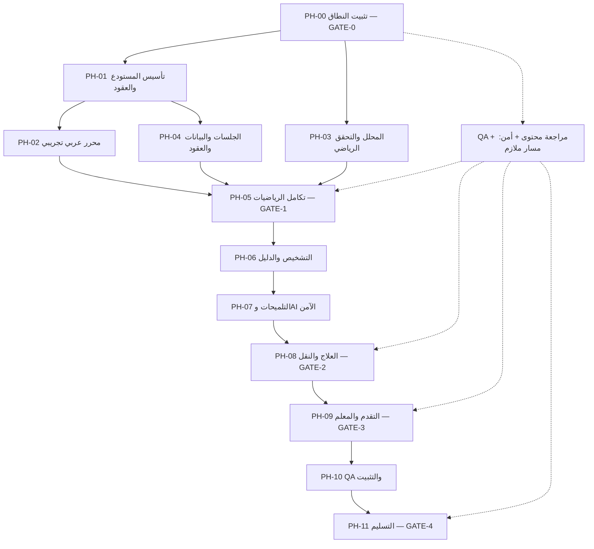

# خُطوة AI — خطة التنفيذ المرحلية وضوابط الانتقال بين المراحل

> **الملف:** `17-IMPLEMENTATION-PLAN.md`  
> **المشروع:** خُطوة AI — منصة عربية الأصل للتعلّم التشخيصي والتكيّفي  
> **الإصدار:** `1.0`  
> **التاريخ:** 04 نوفمبر 2026  
> **الحالة:** **خطة تنفيذ مقترحة لاعتماد الفريق؛ ليست أمرًا ببدء التنفيذ أو إعلانًا بإكمال المراحل**  
> **النطاق:** نسخة هاكثون شِراع `P0` فقط: جبر عربي، معادلات خطية بمتغير واحد «س»، ومهام تعليمية قابلة للتحقق.  
> **المعمارية المعتمدة:** React + TypeScript + Vite ↔ **NestJS** + PostgreSQL ↔ خدمة Python/SymPy داخلية؛ تكامل AI من خلال NestJS فقط.  
> **المراجع الملزمة:** `AGENTS.md`، `00-PROJECT-VISION.md`، `01-PRD.md`، `02-MVP-SCOPE.md`، `04-ARABIC-NOTATION.md` حتى `16-SECURITY-PRIVACY.md`، وملف `14-GOLDEN-DATASET.cases.json`.  
> **الملاك:** مالك المنتج، قائد التكامل، قائد NestJS، قائد الرياضيات، قائد الواجهة، مختص المادة والتربية، QA، مسؤول الأمان.  
> **المدة:** توزيع تخطيطي على **عشرة أيام بناء** بعد بدء الفترة الرسمية؛ الزمن ليس ضمان إنجاز ولا إذنًا بمخالفة شروط المنظم.

---

## 0. الغرض وطريقة استخدام الخطة

هذه الوثيقة هي **خريطة تنفيذ قابلة للتكليف والتتبع والقبول**. تحدد **ما يسبق ماذا**، ومن يعمل على كل جزء، وما شرط البدء وشرط الانتهاء، والبوابات التي يجب اجتيازها قبل الانتقال إلى عمل معتمد على الجزء المنجز.

- `AGENTS.md` يحدد سلوك الوكلاء ومحظوراتهم، ولا يُستبدل بهذه الخطة.
- `02-MVP-SCOPE.md` و`15-TEST-AND-ACCEPTANCE.md` يملكان بوابات `GATE-0` إلى `GATE-4`؛ **لا ننشئ بوابات منافسة**.
- `12-API-CONTRACT.yaml` هو **المصدر الوحيد** لأسماء المسارات العامة وحقول JSON وأخطاء NestJS. الأمثلة البرمجية في المستندات الأخرى ليست عقدًا بديلًا.
- `10-MATH-ENGINE.md` يملك الأحكام الرياضية والأدلة؛ `06-MISCONCEPTIONS.md` يملك *مرشحات* سبب الخطأ؛ `07-TUTORING-POLICY.md` يملك سلوك التلميحات.
- `14-GOLDEN-DATASET.*` مجموعة **151 حالة أُعدّت**؛ لا تُوصف بأنها معتمدة علميًا أو اختُبرت على المنتج قبل تحقق ذلك وإثباته.
- تشير رموز `PH-*` إلى مراحل هذه الخطة، و`TASK-*` إلى مهام قابلة للتكليف، و`GATE-*` إلى بوابات الجودة المعرَّفة مسبقًا؛ و`MVP-*` إلى وحدات P0.

**القاعدة العليا:** لا يعني انتهاء المدة أو موافقة الوكيل على تقريره اجتياز بوابة. الانتقال المعتمد يتطلب **مخرجات + أدلة تشغيل + موافقة المراجعين**، أو قرار نطاق موثق من مالك المشروع حيث يسمح بذلك. عند تعذر قرار مانع، يُوقف الفرع المعتمد عليه وتستمر فقط المهام المستقلة.

### 0.1 تعريف حالات كل مهمة/مرحلة

| الحالة | معناها |
|---|---|
| `not_started` | لم يبدأ عمل المصدر البرمجي |
| `in_progress` | يوجد تنفيذ نشط، ولم تُثبت شروط الخروج |
| `ready_for_review` | توجد مخرجات واختبارات موجّهة وتقرير مراجعة |
| `blocked` | تعارض مواصفات، قرار معلق، أو عيب مانع |
| `accepted` | راجع صاحب الصلاحية الأدلة واعتمد المرحلة |
| `rejected` | رُفضت؛ تُفتح مهام إصلاح ثم إعادة اختبار |
| `deferred` | أُجلت **بقرار نطاق مكتوب**، ولا يحق حذف P0 بهذه الصفة دون تعديل النطاق |

لا تستخدم حالة `done` منفردة لإخفاء الفرق بين انتهاء كتابة الكود وبين قبوله.

---

## 1. ثوابت المشروع التي لا يغيّرها وكيل

1. **NestJS هو الباك إند الرئيسي الوحيد** لواجهة React؛ لا FastAPI بديلاً له ولا اتصال متصفح مباشر بـPython أو مزوّد AI أو PostgreSQL.
2. خدمة **Python/SymPy داخلية ومعزولة** لتحليل الرياضيات والتحقق منها فقط؛ لا تملك بيانات الطلاب أو الصلاحيات أو الجلسات.
3. **العربية أصلية**: `س`، `٢س`، `٢(س + ٣)`، وعرض أرقام عربية شرقية مع ضوابط RTL/MathML؛ لا نستبدل `س` بـ`x` لتسهيل التطوير.
4. محرك رياضي آمن ذو محلل محدود وAST. لا `eval`/`exec` على نص الطالب ولا تمرير نصه الخام إلى parser ينفذ شيفرة.
5. **LLM لا يصدر ولا يغيّر** `verified_valid` أو `verified_invalid`؛ كلاهما يعتمد على التحقق الرياضي والشروط.
6. `syntax_error` و`unsupported` و`inconclusive` و`service_error` **ليست أخطاء مفاهيمية** للطالب.
7. تعديل خطوة أو سابقاتها يغيّر مراجعة المحاولة ويُبطل الأدلة والمخرجات التابعة؛ تُرفض النتائج المتأخرة/المكررة.
8. الواجهة والخادم وقاعدة البيانات تتبع `12-API-CONTRACT.yaml`، مع `expectedRevision` و`Idempotency-Key` أين يفرضهما العقد.
9. تجربة الضيف محدودة بلا بيانات شخصية إلزامية؛ لوحة المعلم في P0 **تركيبية فقط** ومعلَّمة بذلك، ولا تصل إلى بيانات الطلاب الحقيقيين.
10. ستة أنماط أخطاء مستهدفة (`ERR-ALG-01`…`ERR-ALG-06`) ومهارات منهجية محددة؛ لا تعميم على جميع الرياضيات.
11. الدعم الإضافي لجا/جتا/الفيزياء/الكيمياء/البرمجة/الصور/OCR/الصوت/الدفع خارج P0، حتى إن ورد ضمن الرؤية بعيدة المدى.
12. الخطط والأوامر الموضوعة هنا **لا تُشغِّل بيئة نشر حية أو ترحيلات إنتاجية**؛ يتطلب ذلك تفويضًا منفصلًا واضحًا.

---

## 2. خريطة المراحل والإلزام والتبعيات

### 2.1 الترتيب الرسمي للمراحل

| المرحلة | الاسم المختصر | لا تبدأ قبل | ناتج يجب أن يمر للمرحلة التالية | البوابة المرتبطة |
|---|---|---|---|---|
| `PH-00` | تجميد القرارات والنطاق | توفّر الوثائق والمالكين | قرارات مراجَعة، نطاق P0، baseline للاختبارات | `GATE-0` |
| `PH-01` | تأسيس المستودع والعقود والتشغيل المحلي | `GATE-0` | هيكل يعمل وفحوص أولية وعقود ثابتة | تمهيد `GATE-1` |
| `PH-02` | إثبات محرر ومفردات الرياضيات العربية | `GATE-0` + مشروع واجهة أولي من `PH-01` | PoC إدخال/عرض/نسخ صحيح على حاسوب وهاتف | جزء `GATE-1` |
| `PH-03` | المحلل الرياضي والتحقق والشواهد | `GATE-0` + قواعد `04/10/14` | parser + AST + تحقق صحيح/خاطئ/امتناع | جزء `GATE-1` |
| `PH-04` | جلسات NestJS والبيانات وإصدارات المحاولات | `GATE-0` + عقد API/DB ثابت | CRUD مخول وآمن وتزامن واختبارات عقد | تمهيد `GATE-1/2` |
| `PH-05` | دمج الواجهة والخادم ومحرك الرياضيات | `PH-02` + `PH-03` + أساس `PH-04` | تحقق E2E حقيقي عبر NestJS، وإغلاق `GATE-1` | **`GATE-1`** |
| `PH-06` | محرك التشخيص والأدلة | `GATE-1` + محتوى معتمد مبدئيًا | تصنيف محافظ/سؤال تأكيدي/امتناع متسق | جزء `GATE-2` |
| `PH-07` | التلميحات وAI والبدائل الآمنة | `PH-06` + سياسة `07/13` | مستويات H0–H4 وقوالب ومخرجات مضبوطة | جزء `GATE-2` |
| `PH-08` | التدريب العلاجي ومسألة النقل | `PH-06` + `PH-07` + بنك مسائل | رحلة كاملة محفوظة مع مستوى المساعدة | **`GATE-2`** |
| `PH-09` | التقدم ولوحة المعلم وعزل البيانات | `GATE-2` + بيانات/صلاحيات `PH-04` | ملخص صحيح ولوحة تركيبية وأمان | **`GATE-3`** |
| `PH-10` | اختبارات تكامل/أمان/RTL وتجميد الإصلاحات | وحدات P0 متكاملة من `PH-05`…`09` | حزمة نتائج فعلية وعيوب مصنفة وإصلاحات | تجهيز `GATE-4` |
| `PH-11` | إصدار العرض والتسليم | `GATE-3` + `PH-10` واجتياز المراجعة | Release Candidate وديمو قابل للتغيير وإفصاحات | **`GATE-4`** |

**ملحوظة محورية:** الرسم **ترتيب تبعيات، وليس منعًا لكل التوازي**؛ `PH-03` و`PH-04` يمكن تطويرهما بالتوازي بعد تثبيت العقود، وQA/المحتوى/الأمان تعمل بصورة مستمرة ولا تنتظر `PH-10`.

### 2.2 الرسم البياني للمسار الحرج



### 2.3 قاعدة انتقال صارمة

- **مسموح:** تنفيذ تمهيد/Mock/Fixture لمكوّن لاحق بناءً على **عقد مجمد**، دون دمجه كميزة مُعتمدة قبل البوابة المطلوبة.
- **غير مسموح:** إغلاق `GATE-1` لمجرد أن Parser يعمل دون محرر عربي، أو إغلاق `GATE-2` لأن LLM كتب تلميحًا دون اختبار علاج ومسألة نقل.
- **غير مسموح:** تخطي `GATE-3` إلى النشر لأن الديمو «يبدو جيدًا». الحقوق/التزامن/الأمان جزء من المنتج.
- **عند التأخر:** يُقلص `P1` أولًا، ثم تحسينات المظهر والمحتوى غير الملزم؛ تقليص `P0` يستلزم **قرار تغيير معتمدًا** قبل تعديل الوثائق والديمو.

---

## 3. المرحلة `PH-00` — تثبيت النطاق والقرارات وقاعدة التقييم

**هدف المرحلة:** منع اختلاف الوكلاء حول ما سيبنونه وما سيعتبر نجاحًا.  
**شرط البدء:** الوثائق `00`–`16` و`AGENTS.md` متاحة للمراجعة (لا يلزم وجود مشروع عامل).  
**المالك:** مالك المنتج + مختص رياضيات/تعليم + قائد التكامل + QA + الأمن.

| المهمة | المطلوب | المخرج |
|---|---|---|
| `TASK-001` | قراءة الوثائق وتسجيل التعارضات والقرارات المفتوحة | `planning/spec-conflicts.md` |
| `TASK-002` | اختيار الصف/مرجع المنهج وملف الاصطلاح العربي (مشرقي أولًا) بموافقة مختص | `planning/decisions.md` مع قرار `DEC-01/AN-DEC-01` |
| `TASK-003` | اعتماد حدود الكسور، الإشارات، المسموح/المرفوض من المدخلات، وبنك المسائل الأول | نسخة معتمدة من `04/05/10` أو سجل تغييراتها |
| `TASK-004` | حسم جلسة الضيف، لوحة المعلم التركيبية، سياسة الحفظ والاحتفاظ اللازمة للنسخة الأولى | سجل قرار أمن/خصوصية يطابق `16` |
| `TASK-005` | مراجعة حالات `14-GOLDEN-DATASET.cases.json` وتحديد حالاتها (مُعدة/مراجعة/مجمدة) | `qa/golden-review-register.md` |
| `TASK-006` | تثبيت OpenAPI وعقد Python الداخلي وتمثيل المراجعة/الخطوات | سجل إصدارات للعقود ونقاط التكامل |
| `TASK-007` | حسم ORM ومزود AI والمحرر بعد تجربة محدودة إن كان القرار يؤثر في البناء | سجل قرارات تقنية مع مالك محدد |
| `TASK-008` | تحديد من يعتمد كل `GATE` وموعد المراجعة والتغييرات المسموحة | `planning/owners-and-gates.md` |

**شروط الخروج/اجتياز `GATE-0`:**

- [ ] مالك المنتج اعتمد نطاق `MVP-01..14` وحدوده.
- [ ] مختص المادة عيّن المرجع المدرسي واعتمد قواعد المعنى والاصطلاح ذات الأثر على الاختبار.
- [ ] حدود الحالات المرجعية والافتراضات معلنة؛ لم تتحول الحالات غير المراجعة إلى «نتائج معتمدة».
- [ ] عقود البيانات العامة والخاصة ونظام المراجعات معلنة لأصحاب الواجهة والخادم والرياضيات.
- [ ] خصوصية جلسة الضيف ولوحة المعلم وقرار الاحتفاظ الذي يلزم العمل محسومة أو محجوبة بصورة صريحة.
- [ ] لا قرار **مانع** بلا مالك أو تاريخ مراجعة؛ يوجد ملف قرارات موقع/معتمد من أدوار الفريق.

**إذا فشلت:** لا يبدأ العمل متعدد الوكلاء على العقود غير المحسومة؛ يمكن إعداد نماذج محلية منفصلة بلا دمج.

---

## 4. المرحلة `PH-01` — تأسيس المستودع والبنية والبيئات

**التبعيات:** `GATE-0`. **المالك:** قائد التكامل + NestJS/Frontend/Python/DB.  
**الوثائق:** `09` و`11` و`12` و`16` و`AGENTS.md`.

| المهمة | المطلوب | دليل الاختبار |
|---|---|---|
| `TASK-011` | تهيئة مستودع واحد أو تنظيم مستودعات موثّق، مع مسارات واضحة `apps/web`, `apps/api`, `services/math-engine`, `packages/contracts`, `docs` | شجرة ملفات قابلة للمراجعة |
| `TASK-012` | تهيئة React/TS/Vite وNestJS/TS وPython/SymPy وPostgreSQL على بيئة تطوير معزولة | إقلاع محلي محدود + حالة health مسموحة |
| `TASK-013` | اعتماد lint/format/typecheck وطرق build المتوافقة مع حزم المشروع الفعلية | سجل نجاح/فشل حقيقي، لا أوامر افتراضية |
| `TASK-014` | نشر OpenAPI في المسار المرجعي، وضبط التحقق من schema وتوليد الأنواع إن اختير | validation وعينات DTO صالحة |
| `TASK-015` | إعداد `.env.example` وقيود الأسرار وشبكات الخدمة الداخلية دون تسريب | فحص secrets/configuration |
| `TASK-016` | تنظيم CI خفيف على الوحدات المتأثرة + بوابة قبول مستقلة للإصدار | CI قابل للتشغيل ومثبتة أوامره |
| `TASK-017` | إعداد Seed تركيبي أولي مرتبط بإصدار المنهج ومسائل مسموحة فقط | إعادة seed في بيئة اختبار دون بيانات حقيقية |

**شروط الخروج:** كل مكوّن يملك مسارًا ومَن يُراجعه؛ عقد `12` يمر validation؛ وحدات البداية تُبنى أو يُسجل سبب عائق معلوم؛ لا منافذ عامة لقاعدة البيانات/Python؛ لا أسرار داخل Git.

**لا يلزم في هذه المرحلة** تشغيل كامل الـE2E أو بناء Queue/Redis أو بيئة إنتاج متعددة الخدمات. يبدأ `PH-02` عند توفر أساس الواجهة، و`PH-03` بعد اعتماد القواعد حتى إن كان `PH-01` لم يكتمل في جوانبه غير الحرجة.

---

## 5. المرحلة `PH-02` — إثبات إدخال وعرض الرياضيات العربية (PoC)

**التبعيات:** `GATE-0` + الأساس الأدنى من `PH-01`. **المالك:** وكيل Frontend/UX + مراجعة مختص الرياضيات.  
**الوثائق:** `04`، `08`، `10`، `14`، `15`.

| المهمة | المطلوب | دليل |
|---|---|---|
| `TASK-021` | تجربة محرر فعلي (MathLive أو بديل) على حالات عربية ملموسة؛ لا اعتماد بالأسماء | PoC قابل للنقر والتعديل |
| `TASK-022` | إدخال `٢س`، `2س`، `٢(س + ٣)` والإشارات والكسور البسيطة المسموحة | نتائج حالات `AN-*`, `GOLD-PARSE-*` |
| `TASK-023` | حماية مواضع الأقواس والإشارات/الكسور من قلب المعنى مع RTL | فحص حاسوب وهاتف مع صور/فيديو |
| `TASK-024` | ضبط copy/paste وإعادة عرض التعبير دون تغيير المصدر الدلالي | لقطات قبل/بعد وfixture |
| `TASK-025` | عرض `syntax_error` و`unsupported` دون لوم الطالب أو كسر التحرير | UI states وعينات محلية |

**شروط الخروج:** تعرض وتُدخل الأمثلة العربية دون فرض `x`؛ اتجاه المعادلة لا يغيّر المعنى؛ تُحفظ الصيغة الخام، ويتضح مكان الالتباس. إن تعذر دعم عنصر، يوثق ويُرفع لمالك النطاق؛ لا يتحول تلقائيًا إلى صياغة لاتينية.

**لا يُعتبر `GATE-1` مكتملًا بعد هذه المرحلة وحدها**؛ يلزم المحرك وNestJS والتكامل في `PH-05`.

---

## 6. المرحلة `PH-03` — المحلل والتحقق الرياضي والشواهد

**التبعيات:** `GATE-0` وثبات حدود `04/10/14`، ويمكن بالتوازي مع `PH-04`.  
**المالك:** وكيل Python/Math + مراجعة مختص الرياضيات وQA.

| المهمة | المطلوب | دليل |
|---|---|---|
| `TASK-031` | lexer محدود للرموز العربية وعمليات P0، وضبط Unicode والأحرف غير المسموحة | اختبارات تحليل أعداد ورموز وأقواس |
| `TASK-032` | parser مقيّد إلى AST دلالي؛ عدم تحليل الإدخال عن طريق eval/exec | اختبارات نحو وصيغ ضارة |
| `TASK-033` | تطبيع أرقام وعلامات مقبولة مع حفظ المصدر الخام وعدم تحويل المتغير اللاتيني بصمت | عينات قبل/بعد والتحقق من المعنى |
| `TASK-034` | تمثيل معادلة خطية بمتغير س وعدديات دقيقة rational، وفرض قيود المجال | اختبارات كسور ومقام صفر/متغير |
| `TASK-035` | التحقق من انتقال خطوتين عن طريق **مجموعات الحلول** والشروط، لا مقارنة نصية | حالات بديلة صحيحة وخاطئة |
| `TASK-036` | إنتاج شاهد معتبر لعدم التكافؤ حيث يقتضيه العقد، أو امتناع صادق | شاهد قابل لإعادة الحساب |
| `TASK-037` | تصنيف نتائج `verified_valid`, `verified_invalid`, `syntax_error`, `unsupported`, `inconclusive`, `service_error` | اختبارات مخطط العقد الداخلي |
| `TASK-038` | حدود وقت/حجم/تعقيد/موارد، ودليل عدم تنفيذ كود المستخدم | اختبارات أمان/فشل موجّهة |
| `TASK-039` | تثبيت إصدار المحرك ودلالات الطلب والاستجابة الخاصين به | fixture version + سجل تغيير |

**شروط الخروج:** أُنجزت حالات الإدخال/التحقق الحرجة المتفق عليها، لا أخطاء حكم جازم في الحالات **المراجعة والمجمدة**؛ شواهد الفشل صحيحة؛ الحالات خارج P0 تمتنع دون تضليل؛ خدمة Python ليست بوابة عامة.

**إذا ظهر اختلاف بين Golden والحساب الصحيح:** افتح `DATASET-ISSUE`، ولا تبدّل الاختبار لتجاوز الخطأ دون موافقة المراجع.

---

## 7. المرحلة `PH-04` — NestJS وPostgreSQL وسلامة المحاولات

**التبعيات:** `GATE-0` + العقود وثابت `revision`; تُنفّذ بالتوازي مع `PH-03`، وتُدمج عند `PH-05`.  
**المالك:** وكيل NestJS/API + وكيل DB + QA/الأمن.

| المهمة | المطلوب | دليل |
|---|---|---|
| `TASK-041` | migrations وقيود الجداول والمعرّفات حسب `11-DATA-MODEL.md`، بعد اعتماد ORM | تنفيذ محلي/اختباري وrollback عند الحاجة |
| `TASK-042` | جلسة ضيف وحماية cookie/CSRF/Origin وربط ملكية الموارد | محاولات طلب موارد جلسة أخرى مرفوضة |
| `TASK-043` | صفحات كتالوج مهارات ومسائل منشورة؛ عدم كشف حلول ومسائل نقل قبل الإسناد | Contract tests على API |
| `TASK-044` | إنشاء محاولة وحفظ/إضافة/تعديل/حذف خطوة مع `expectedRevision` | اختبار تعديل وتحديث ذري |
| `TASK-045` | `Idempotency-Key` وعدم تكرار الأثر عند إعادة إرسال الطلب | اختبار إرسال متكرر بحمولة مطابقة ومختلفة |
| `TASK-046` | تاريخ نسخ الخطوات وإبطال مشتقات التحقق والتشخيص والتلميحات التابعة عند تعديل | اختبارات optimistic concurrency/stale results |
| `TASK-047` | adapter داخلي للرياضيات وAI؛ DTO validation، timeouts، fallback، منع تسرب التفاصيل | اختبارات Mock ومهلات/فشل |
| `TASK-048` | سلوك أخطاء HTTP وschemas مطابق `12-API-CONTRACT.yaml` | OpenAPI contract run |

**شروط الخروج:** يمكن إنشاء جلسة/محاولة وتحديثها في بيئة اختبار دون الوصول إلى موارد ضيف آخر؛ تعديل سابق يبطل ما بعده؛ retry لا يضاعف الأثر؛ لا migration على بيئة نشر حية دون تفويض.

**ملاحظة:** لا تُعد هذه المرحلة إثباتًا للحكم الرياضي؛ ذلك يتطلب التكامل في `PH-05`.

---

## 8. المرحلة `PH-05` — تكامل المسار الرياضي واعتماد `GATE-1`

**التبعيات الحاسمة:** `PH-02` + `PH-03` + أساس `PH-04`.  
**المالك:** قائد التكامل + واجهة + NestJS + Python + QA.

### سيناريو تكامل إلزامي

1. يدخل طالب ضيف إلى React ويختار مسألة جبر عربية مراجعَة.
2. يكتب خطوة (`٢س + ٦ = ١٠`) مع حفظ النص الخام والتعبير المنظم.
3. يرسل React إلى NestJS بعقد API الصحيح ورقم المراجعة.
4. يؤكد NestJS ملكية المحاولة ويرسل طلب تحقق محدودًا إلى Python الداخلي.
5. يعيد المحرك حكمًا موثقًا؛ يثبت NestJS النتيجة **فقط إذا طابقت المراجعة الحالية**.
6. تعرض React العربية الصحيحة: حالة صحيحة/خاطئة/غير محسومة/غير مدعومة، دون إعلان تشخيص تربوي غير مثبت.
7. يحرر الطالب خطوة أقدم بينما طلب تحقق سابق قيد التنفيذ؛ لا تصل النتيجة القديمة إلى حالته الحالية.

### شروط خروج `GATE-1` (كلها مطلوبة)

- [ ] PoC محرر **واقعي** على متصفح حاسوب وهاتف، مع أدلة عدم قلب معنى الأقواس والإشارات.
- [ ] الحالات `GOLD-PARSE-*` و`GOLD-VERIFY-*` الحرجة **المعتمدة** شُغلت بنتائج فعلية مع تقرير تغطية.
- [ ] تأكدت صحتا انتقال مكافئ وغير مكافئ وحالة امتناع، وأمكن تكرارها بمدخلات جديدة.
- [ ] يمر الطلب من React → NestJS → Python ثم يعود مع schema سليم وبدون تنفيذ نص الطالب كشيفرة.
- [ ] شروط المجال والشواهد تفي بعقد المحرك؛ لا قبول خاطئ أو رفض خاطئ **جازم** في الحزمة الحرجة المجمدة.
- [ ] تعديل خطوة يوقف أثر الاستجابات المتأخرة، ولا تضيع الخطوات أو يتكرر أثر الطلب.
- [ ] المراجعون: الرياضيات + واجهة + NestJS + QA؛ تُسجل الموافقة/الرفض مع `run_id`.

**قاعدة منع انتقال:** لا يبدأ اعتماد `PH-06` على أنها تشخيص موثوق قبل `GATE-1`. يجوز تجهيز محتوى الأنماط وأسئلة التدريب بالتوازي، دون تشغيلها بوصفها أحكامًا على طالب حقيقي.

---

## 9. المرحلة `PH-06` — التشخيص التربوي المحافظ

**التبعيات:** `GATE-1`، ومحتوى `05/06` ومجموعة حالات متفق عليها.  
**المالك:** وكيل تعليم/تشخيص + مختص المادة + QA.

| المهمة | المطلوب | الدليل |
|---|---|---|
| `TASK-061` | ربط الأدلة الرياضية الموثقة بمعرّفات الأخطاء `ERR-ALG-01`…`06` | مصفوفة دليل ⇄ نمط، وتداخلات موثقة |
| `TASK-062` | تمييز `verified_invalid` عن التشخيص؛ لا استنتاج سبب واحد حتمي بلا دليل | حالات التباس وقواعد عدم اليقين |
| `TASK-063` | اختيار سؤال تأكيدي مناسب عند تعدد الفرضيات | اختبار سؤال يغير التمييز بين فرضيات |
| `TASK-064` | ضمان عدم إصدار تشخيص مفاهيمي بعد `unsupported/inconclusive/service_error/syntax_error` | اختبارات سلبية |
| `TASK-065` | حفظ فرضية التشخيص وسؤال التأكيد ومرجعهما للمحاولة الحالية فقط | اختبار ربط revision وتسجيل الدليل |

**شروط الخروج:** يوجد لكل نمط دليل رياضي متوقع/التباس معروف/سؤال تأكيدي أو امتناع؛ لا يوجد جزم «طالب لا يفهم» من خطأ واحد؛ لا تشخيص على مخرجات قديمة.

---

## 10. المرحلة `PH-07` — التعليم الذكي ومستويات المساعدة

**التبعيات:** `PH-06` + اعتماد سياسة `07-TUTORING-POLICY.md` و`13-AI-ENGINE.md`.  
**المالك:** وكيل AI/Tutoring + محتوى تربوي + NestJS + QA.

| المهمة | المطلوب | الدليل |
|---|---|---|
| `TASK-071` | تنفيذ محرك قرار التلميح `H0` إلى `H4` وفق سياسة مراجعة | اختبارات TUT وأمثلة لكل مستوى |
| `TASK-072` | ربط AI خلف NestJS؛ إرجاع مخرجات JSON منظمة ومُتحقق منها | validator + اختبارات رفض المخرجات غير الصالحة |
| `TASK-073` | منع الموجهات والمخرجات من تغيير الحكم الرياضي أو كشف حل النقل المحجوب | حالات حقن/تسريب مضبوطة |
| `TASK-074` | توفير قالب عربي مُراجع عند مهلة/فشل مزود AI | محاكاة timeout وfallback بدون فقد الحل |
| `TASK-075` | تسجيل استعمال التلميحات والمساعدة، وعدم احتساب `H4` إتقانًا مستقلًا | سجل evidence صحيح |
| `TASK-076` | حد استدعاءات/تكلفة/وقت مع مراقبة دون إرسال بيانات زائدة إلى المزود | تقرير baseline ومثال sanitizer |

**شروط الخروج:** التلميحات عربية صحيحة علميًا، متدرجة، لا تكشف الحل في مستوى غير مسموح؛ المخرجات المفاجئة تُرفض؛ فشل AI لا يكذب على الطالب أو يُغير حكمًا رياضيًا؛ توثيق حجم المساعدة محفوظ.

---

## 11. المرحلة `PH-08` — التدريب العلاجي ونقل الفهم واعتماد `GATE-2`

**التبعيات:** `PH-06` و`PH-07` وبنك مسائل `05/14` مراجع.  
**المالك:** قائد التعلم + الواجهة + NestJS + QA.

| المهمة | المطلوب | الدليل |
|---|---|---|
| `TASK-081` | اختيار تدريب علاجي مُراجع مرتبط بالمهارة، لا توليد عشوائي غير موثق | pairing concept/problem |
| `TASK-082` | مسألة نقل مختلفة عن مثال الشرح، لا يُسرَّب حلها قبل الحالة المسموحة | test transfer isolation |
| `TASK-083` | تطبيق سياسة التلميحات والتوقف/المتابعة وتسجيل المساعدة | أحداث مراجَعة |
| `TASK-084` | تحديث دليل المهارة بحذر: `not_assessed` مقابل تدريب بمساعدة مقابل مسألة جديدة | تقدم يتطابق مع الدليل |
| `TASK-085` | استكمال رحلة طالب من مسألة خاطئة إلى علاج ثم نقل دون نتائج محفوظة مسبقًا | E2E حي على نسخة معروفة |

### شروط خروج `GATE-2`

- [ ] توجد مسألة صحيحة/خاطئة يمكن حلها من محرر عربي إلى NestJS ومحرك الرياضيات.
- [ ] يظهر تشخيص محتمل **مدعوم بدليل** أو سؤال تأكيدي مناسب.
- [ ] يعمل تلميح بمستوى صحيح وتدريب علاجي مرتبط بنفس المهارة.
- [ ] تعود **مسألة مختلفة** للتقييم، وتُسجل النتيجة ومستوى المساعدة.
- [ ] لا يُستخدم AI لتغيير الصحة الرياضية أو اختلاق تحسن وإتقان نهائي.
- [ ] تنجح رحلة تكامل فعلية مع اختبار فشل AI وسياسة الحل الكامل.
- [ ] يصادق مختص التربية + QA + قائد التكامل على التقرير.

**إذا فشلت:** لا يُفتح مسار لوحة المعلم بوصفه مظهرًا لاكتمال التعلم؛ يُصلَح منطق التعلم أولًا.

---

## 12. المرحلة `PH-09` — أدلة التقدم ولوحة المعلم واعتماد `GATE-3`

**التبعيات:** `GATE-2` + سلامة الجلسات والملكية من `PH-04`.  
**المالك:** NestJS + DB + Frontend + الأمن/QA.

| المهمة | المطلوب | الدليل |
|---|---|---|
| `TASK-091` | ملخص تقدم الطالب مبني على أدلة المحاولات لا نسب وهمية | مقارنة الردود بسجل evidence |
| `TASK-092` | فصل `not_assessed` و`practice_with_support` و`new_evidence_of_understanding` | حالات مراجعة مسجلة |
| `TASK-093` | لوحة معلم P0 ببيانات **اصطناعية فقط** مع وسم واضح ومصادر أرقام | Fixture واضح + مصدر الكروت |
| `TASK-094` | اختبار رفض وصول المعلم/الضيف إلى بيانات مستخدم آخر | SEC/authorization tests |
| `TASK-095` | اختبارات الجلسة وCSRF/Origin والاحتفاظ/السرية والنسخ المكررة | تقرير أمان وتزامن |
| `TASK-096` | اختبار فشل Python/AI عند وجود محاولة محفوظة وإظهار رسائل صحيحة | fault-injection محدودة |

### شروط خروج `GATE-3`

- [ ] تقدم الطالب يعرض مصدر كل حكم وحدوده، ولا يحوّل «لم يُختبر» إلى صفر مضلل.
- [ ] لوحة المعلم مميزة بأنها تركيبية ولا تُعرض فيها محاولات ضيف حقيقي.
- [ ] اختبارات ملكية الموارد وCSRF الأساسية و`expectedRevision` و`Idempotency-Key` الحرجة ناجحة.
- [ ] عند تعطل AI/Python لا تُحذف بيانات الحل ولا يتحول `service_error` إلى خطأ في فهم الطالب.
- [ ] لا سر مكشوف في السجلات أو واجهة المتصفح؛ لا منفذ Python/DB عام.
- [ ] الموافقة: قائد الخلفية + مسؤول الأمان + QA + مالك المنتج عند وجود قرار خصوصية.

---

## 13. المرحلة `PH-10` — تثبيت الجودة والاستعداد للإصدار

**التبعيات:** تكامل `PH-05`…`PH-09` وبوابة `GATE-3` أو قائمة عيوب مانعة معروفة.  
**المالك:** QA + قائد التكامل + مالكو المجالات.

### المطلوب تشغيله هنا (وليس في كل تعديل صغير)

1. **الحالات المرجعية:** تشغيل `14-GOLDEN-DATASET.cases.json` وتصنيف كل حالة: `pass/fail/blocked/not_run/not_applicable`، مع حالة المراجعة البشرية؛ لا تختلق نتائج لحالات غير قابلة للتشغيل آليًا.
2. **الرياضيات:** قبول حلول بديلة، رفض انتقال غير مكافئ، فحص الشواهد، شروط المجال، الكسور، وصدق الامتناع.
3. **التشخيص:** الأنماط الستة، حالات السهو/التداخل، الإحجام عن الجزم دون دليل.
4. **AI والتلميحات:** H0–H4، JSON غير صالح، prompt injection، تسريب الحل، fallback، وتسجيل مستوى المساعدة.
5. **NestJS/DB:** مطابقة OpenAPI، صلاحيات الضيف، CSRF/Origin، idempotency، مراجعات المحاولة وسباق الطلبات.
6. **الواجهة:** اتجاه الأرقام/الأقواس/الكسور ونسخ/لصق على هاتف فعلي ومتصفح حاسوب، إتاحة لوحة المفاتيح، رسائل الأخطاء.
7. **E2E:** رحلات `J-01`…`J-05` والحالات الحرجة `EDGE-*` كما في `15`.
8. **الأداء والتكلفة:** قياس p50/p95 إن أمكن في البيئة المحددة، مهلات الخدمات، استخدام AI، مع ذكر أنها قياسات لهذه البيئة فقط.
9. **المراجعة البشرية:** تدقيق مجموعة فرعية ممثلة من المسائل والتلميحات وأسباب الأخطاء، وتوثيق ما لم يُراجع.
10. **الأمان:** اختبارات `SEC-*` الحرجة مع تحليل ما إذا كان العيب `BLOCKER/HIGH`.

**سياسة العتبات:** تستند معايير القرار إلى `15-TEST-AND-ACCEPTANCE.md`، وما يزال بعضها **مقترحًا يحتاج اعتمادًا**. يُرفض أي حكم رياضي جازم كاذب على الحالات الحرجة المعتمدة، وأي تسرب بيانات/أسرار أو انقلاب يعكس المعنى؛ لا يحل متوسط نجاح مرتفع محل تصحيح خطأ مانع.

**شروط الخروج:** تقارير تشغيل **حقيقية**، عيوب مصنفة، إصلاح عيوب BLOCKER (وHIGH التي تمس مسارًا إلزاميًا)، وإعادة اختبار بعد كل إصلاح على الإصدار المرشح. لا إعلان «100%» لمجموعة لم تُشغّل أو لم تُعتمد تربويًا.

---

## 14. المرحلة `PH-11` — تجميد الإصدار واعتماد `GATE-4`

**التبعيات:** `GATE-3` + نتائج `PH-10` المقبولة، مع السماح بالإصلاحات العاجلة الموثقة ثم إعادة الاختبار.  
**المالك:** قائد التكامل + QA + مالك المنتج + مختص الرياضيات.

| المهمة | المخرج |
|---|---|
| `TASK-111` | إصدار مرشح ببصمة commit ونسخ واجهة/خادم/محرك/منهج/موجهات وملفات الاختبار |
| `TASK-112` | README تشغيل ونشر/إيقاف/استعادة لبيئة العرض المصرح بها، بلا أسرار |
| `TASK-113` | تقرير اختبارات: حالات مرجعية ناجحة/فاشلة/غير شغالة، ومستوى اعتمادها، ومقاييس صحيحة |
| `TASK-114` | ديمو مباشر يمكن للمحكم تغيير مسألة أو خطوة فيه، وليس فيديو يعيد ناتجًا محفوظًا |
| `TASK-115` | سيناريو بديل عند انقطاع AI: قالب تعليمي عربي مُراجع أو شرح حدود الخدمة؛ دون تزوير نتيجة |
| `TASK-116` | بيان الميزات المدعومة وغير المدعومة، ومصادر المكتبات والنماذج وإفصاح شِراع المطلوب |
| `TASK-117` | تسليم مستودع وملفات/روابط مطلوبة ومعلومات تشغيل وفق متطلبات المنظم المؤكدة |

### شروط خروج `GATE-4` — قرار تسليم النسخة

- [ ] `GATE-0` و`GATE-1` و`GATE-2` و`GATE-3` موثقة ومقبولة.
- [ ] لا `BLOCKER` مفتوح؛ قرارات `HIGH` التي تمس P0 حُسمت أو عولجت قبل عرض الجزء المتأثر.
- [ ] حالات `GOLD-*` و`QA-*` و`SEC-*` ذات الصلة لها نتائج تشغيل حقيقية وتغطية وبيان حالة مراجعة بشرية.
- [ ] مسارات E2E الحرجة نجحت على **الإصدار المرشح نفسه**.
- [ ] واجهة الطالب عربية المعنى، مع عدم استخدام x بدلاً من س ولا قلب رموز الرياضيات.
- [ ] مسألة جديدة على المسرح أو في جلسة تجريبية تؤدي إلى نتيجة تحقق حقيقية قابلة للتفسير.
- [ ] التعليمات/الروابط/الإفصاح والمخاطر وحدود المنتج واضحة، ولم تُقدَّم بيانات تركيبية كحقائق مدرسية.
- [ ] اعتماد المنتج + الرياضيات/التربية + QA + التكامل موثق بالتاريخ والإصدار.

**الانتقال النهائي:** بعد موافقة مالك المنتج فقط، يتم النشر/التسليم في بيئة أو بوابة الهاكثون المحددة. النشر أو رفع الملفات إلى خدمة خارجية **ليس إجراءً مفوضًا مسبقًا لوكيل**.

---

## 15. الجدول التخطيطي لعشرة أيام وربط المراحل بالبوابات

| اليوم | مسار التنفيذ الحرج | عمل موازٍ مسموح | نتيجة نهاية اليوم المستهدفة | بوابة |
|---|---|---|---|---|
| **1** | `PH-00` اعتماد قرارات الجبر والمنهج والعقود | مراجعة المحتوى وGolden، وتهيئة قوالب التقارير | سجل القرارات وP0 مجمد | `GATE-0` |
| **2** | `PH-01` وتقديم `PH-02` مبكرًا | بدء `PH-03` parser و`PH-04` migrations/contracts | PoC إدخال عربي وهيكل يعمل | استعداد `GATE-1` |
| **3** | استكمال `PH-03` + `PH-02` | `PH-04` بيانات وجلسات | تحقق صحيح/خاطئ/امتناع محليًا، وصحة RTL | استعداد `GATE-1` |
| **4** | `PH-05` تكامل حقيقي والتحقق من النسخ | إكمال اختبارات NestJS والصلاحيات | عبور `GATE-1` بدليل تشغيل | **`GATE-1`** |
| **5** | `PH-06` التشخيص | مراجعة وتثبيت المحتوى/موجهات AI | فرضيات مدعومة وأسئلة تأكيدية | جزء `GATE-2` |
| **6** | `PH-07` و`PH-08` التلميحات والعلاج والنقل | متابعة تكامل وتغطية فشل AI | رحلة تعلم كاملة | **`GATE-2`** |
| **7** | `PH-09` التقدم والمعلم | اختبار أمان وRTL/الاستجابات | بيانات تركيبية معلمة وبوابة أمان | **`GATE-3`** |
| **8** | `PH-10` تشغيل تكامل/Golden/E2E والأمان | إصلاح عيوب BLOCKER فورًا | تقرير أداء وأخطاء معاد تشغيلها | تجهيز `GATE-4` |
| **9** | `PH-10` مراجعة رياضية/تربوية وعينات محجوبة | ضبط العرض البديل وتحسين الوصول | حزمة نتائج واضحة وإصدار مرشح | تجهيز `GATE-4` |
| **10** | `PH-11` تجميد/اختبار/عرض/تسليم | إصلاح محدود فقط مع إعادة فحص | إصدار موثق قابل للتجربة | **`GATE-4`** |

**ليس المقصود أن تبدأ QA أو مراجعة الأمان يوم 8**؛ يبدأان من اليوم الأول ويتصاعد نوع الفحص تدريجيًا. إذا تأخر `GATE-1` بسبب محرر عربي لا يحافظ على المعنى، تُعاد جدولة بقية الأنشطة ويُخفض غير الإلزامي بدل الادعاء بأن الإنجاز اكتمل.

### 15.1 الميزانية الزمنية للمخاطر

- أعلى مخاطرة: **تحليل/عرض العربية الرياضي** و**صحة الحكم الجازم**؛ لذلك نبدأ بهما مبكرًا.
- ثاني أعلى مخاطرة: **التزامن والنسخ**؛ يجب اختباره في أول مسار متكامل، لا في آخر يوم.
- ثالث أعلى مخاطرة: **سلامة AI والمحتوى**؛ يكون fallback المُراجع جاهزًا قبل الاعتماد عليه في العرض.
- لا يبدأ تحسين لوحة المعلم أو زخرفة التصميم على حساب استقرار المسار الرياضي.

---

## 16. سياسة المهام المتوازية والدمج (Parallel Work Rules)

### 16.1 ما يجوز بالتوازي بعد `GATE-0`

| مسار العمل | يبدأ بعد | ما يمكن فعله بالتوازي | محظور حتى الاتفاق |
|---|---|---|---|
| UI/RTL | هيكل الواجهة والاصطلاح | PoC محرر وشاشات بمخرجات fixture | اختراع عقود API أو معنى جديد للرموز |
| Python/Math | تثبيت Grammar/AST | parser والتحقق والعينات | قبول صياغات خارج P0 أو تغيير expected results |
| NestJS/DB | تثبيت OpenAPI/Revision | جلسات وترحيلات وDTOs وadapters وهمية | تغيير أسماء حقول OpenAPI منفردًا |
| تعليم/محتوى | حسم المنهج ومراجعة الأنماط | مراجعة مسائل وتلميحات وعلاج | اعتباره تشخيصًا علميًا دون نتائج محرك |
| AI/Tutoring | سياسة H0–H4 وschemas | قالب prompt/validator/fallback باستخدام mocks | إصدار حكم رياضي أو تسريب حل النقل |
| QA/Security | منذ `GATE-0` | Golden review، اختبارات موجهة، محاكاة خصم | تغيير نتائج Golden لتناسب التنفيذ |

### 16.2 ترتيب الدمج الموصى به

1. عقود + هيكل CI + إصدارات fixtures.
2. محرك الرياضيات الداخلي واختبارات وحداته.
3. NestJS session/revision/contract مع adapter داخلي تجريبي ثم حقيقي.
4. محرر React وربط التحقق الفعلي (إغلاق GATE-1).
5. تشخيص مدعوم بأدلة.
6. تلميحات وعلاج ونقل.
7. تقدم/لوحة معلم/أمان نهائي.
8. Release Candidate بعد التكامل والجودة.

**عند تعارض فرعين:** صاحب العقد/الوثيقة يراجع أولًا، ثم تُحدّث جميع الجهات المستهلكة واختبار العقد في تغيير متناسق، ولا تُخفى مشكلة التوافق بتحويلات ارتجالية في React.

---

## 17. مصفوفة الملكية والمراجعة (RACI مبسطة)

| المجال | المنفّذ | المراجع المختص | المعتمد النهائي للبوابة/القرار |
|---|---|---|---|
| النطاق والقرارات | قائد التكامل + المنتج | QA والمختصون | مالك المنتج |
| الاصطلاحات والمنهج | الواجهة + مختص رياضيات | مختص الرياضيات/التربية | المنتج + مختص المادة |
| التحقق الرياضي | وكيل Python/Math | مختص الرياضيات + QA | قائد الرياضيات وQA لــGATE-1 |
| الجلسات والبيانات والعقد | NestJS + DB | QA + الأمن + مستهلك API | قائد NestJS + QA |
| التشخيص والتلميحات | AI/Tutoring | مختص التربية + QA | مختص التربية وQA لــGATE-2 |
| التقدم ولوحة المعلم | NestJS + الواجهة | الأمن + QA | الأمن + QA لــGATE-3 |
| الإصدار والتسليم | التكامل + QA | كل مجال متأثر | مالك المنتج + QA + المختصون لــGATE-4 |

إذا كان الفريق صغيرًا، يمكن للشخص الجمع بين دورين تنفيذيين؛ **لكن لا يلغي ذلك الحاجة لمراجعة مستقلة قدر الإمكان للأحكام الرياضية والأمنية**.

---

## 18. سياسة الفحص حسب مرحلة العمل

| متى؟ | الفحوص المطلوبة | ما لا نفعله بلا حاجة |
|---|---|---|
| في كل مهمة | تنسيق/Lint + Typecheck/Build للحزمة المتأثرة + اختبارات وحدة محلية مرتبطة + تقرير | لا تشغيل suite ثقيل لكل تعديل صغير |
| عند تغيير API | فحص OpenAPI وDTO وعميل React واختبار contract | لا حقل غير موثق ولا endpoint مرتجل |
| عند تغيير الاصطلاح أو الحساب | حالات AN/MATH/GOLD ذات الصلة مع دليل رياضي + فحص واجهة | لا تغيير نتيجة Golden لإرضاء الاختبار |
| عند تغيير الجلسات أو DB | معاملات/تزامن/ملكية/تكرار ومراجعة migrations | لا تشغيل ترحيلات إنتاجية دون إذن |
| عند تغيير AI/التلميحات | schema validation وتسريب الحل والحقن والعربية العلمية وfallback | لا اعتبار مخرج النموذج مرجعًا مستقلًا |
| عند `GATE-1/2/3` | اختبارات تكامل موجهة + إثبات حقيقي من العميل للخادم | لا اجتياز نظري من ملفات الكود فقط |
| عند `GATE-4` | حزمة قبول شاملة وE2E/RTL/SEC ونتائج Golden ومراجعة بشرية | لا إعلان إطلاق إذا بقي مانع معلوم |

**أي أمر تنفيذ** في هذه الخطة مفهومي حتى يتأكد الوكيل من scripts الموجودة في المستودع؛ لا يقول «نجح npm run build» ما لم ينفذه بالفعل.

---

## 19. حالات الإيقاف والتراجع وطلب القرار

| الحالة | التصرف الإلزامي | من يملك القرار؟ |
|---|---|---|
| تغيير صحة معادلة أو شهادة شاهد | حجب الدمج + برهان وحالة Golden مستقلة | مختص الرياضيات + QA |
| RTL يقلب معنى إشارة أو قوس | منع GATE-1 + إصلاح المحرر/الرندر | الواجهة + الرياضيات |
| LLM يعرض إجابة حاسمة خاطئة/يسرب الحل | وقف مسار AI وإتاحة fallback مُراجع | التعليم + AI + QA |
| نتيجة قديمة بعد تعديل خطوة | حجب الميزة + اختبار سباق واسترجاع حالة صحيحة | NestJS/DB + QA |
| تسريب جلسة أو مفتاح أو بيانات | وقف النشر/الدمج للجزء المتأثر + إجراءات حادث | الأمن + المنتج |
| تعارض وثيقتين أو API | فتح `SPEC-CONFLICT` و`DECISION-REQUEST` | مالك الوثيقة المعنية |
| خطأ في حالة Golden | `DATASET-ISSUE` مع دليل وتحكيم؛ تحديث MD وJSON بعد اعتماد | QA + مختص المادة |
| تجاوز الجدول | حذف P1 والتجميل أولًا، ثم طلب تغيير رسمي إن تأثر P0 | مالك المنتج |
| غياب مختص لتوقيع قرار مؤثر | حجب اعتماد الجزء العلمي/الأمني، مع مواصلة المستقل فقط | مالك المنتج يحدد المراجع |

### 19.1 قالب طلب تغيير أو قرار

```markdown
# DECISION-REQUEST
- المعرف: DR-...
- المرحلة/المهمة: PH-... / TASK-...
- المتطلب/الوثيقة المالكة:
- القرار المطلوب / موضع التعارض:
- الخيارات الممكنة:
- أثر كل خيار على الجدول وAPI والرياضيات والأمان والاختبارات:
- نتيجة اختبار أو مثال يكشف المشكلة:
- توصية الوكيل (غير معتمدة):
- صاحب صلاحية الاعتماد:
- القرار: pending | approved | rejected
- التاريخ والإصدار المرجعي:
```

لا يتخذ وكيل قرارًا باسم مالك المشروع. وإذا ظهر تعارض بعد الدمج، يُوثَّق وتتوقف الأعمال اللاحقة المعتمدة عليه حتى حسمه.

---

## 20. معايير اكتمال المهمة وملف التسليم الإلزامي

### 20.1 كل مهمة `TASK-*` لا تعتبر جاهزة للمراجعة إلا إذا

- [ ] نُفذت **ضمن P0** وتذكر مراجع `FR-*` و`MVP-*` والاختبارات المعنية.
- [ ] راجعت الوثيقة المالكة للمجال ولا يوجد تغيير غير معتمد في API أو الاصطلاح أو الأمن.
- [ ] الملفات المعدلة وأسبابها معروفة، والاختبارات الموجهة المطبقة موثقة فعليًا.
- [ ] الفشل/الامتناع ومعالجة الأخطاء موثقان؛ لا حالات مزيفة تمر بجانب المنطق الحقيقي.
- [ ] جرى فحص `git diff` ومنع المساس بتغييرات وكلاء آخرين أو المستخدم.
- [ ] يوجد تقرير تسليم يتضمن الأدلة والعيوب والمراجعين والقرارات المتبقية.

### 20.2 قالب تقرير مهمة الوكيل

```markdown
# DELIVERY — TASK-...
- المرحلة PH-... | الفرع/commit:
- الحالة: ready_for_review | blocked | rejected | accepted
- النطاق المنفذ ومعرّفات FR/MVP:
- الوثائق/العقود التي روجعت:
- الملفات المعدلة:
- migrations/DTOs/contracts/fixtures المتأثرة:
- أوامر الفحوص التي شُغلت حرفيًا ونتائجها:
- الحالات المرجعية التي شُغلت وعددها:
- ما لم يُشغّل والسبب:
- اختبار يدوي/مرئي والبيئة/الجهاز:
- حالات الفشل/الأعطال/الحدود المعروفة:
- قرارات مفتوحة أو مانعة:
- رابط/مسار الأدلة دون أسرار:
- المراجع البشري/الدور وحالة موافقته:
- الخطوة التالية/شروط التسليم للمستهلك:
```

### 20.3 تقرير كل بوابة

```markdown
# GATE-N ACCEPTANCE
- Release/commit/build + نسخ العقد/المحرك/المنهج:
- المرحلة أو مجموعة المراحل التي تحققت:
- المتطلبات الحرجة المنفذة ومرجع الاختبار:
- نتائج Golden / Contract / E2E / Security / UX مع رابط الأدلة:
- الاختبارات غير المنفذة والحالات غير المراجعة:
- عيوب BLOCKER/HIGH/MEDIUM وتبرير القرار:
- القرارات المطلوبة قبل البوابة التالية:
- القرار: approved | rejected | blocked
- أسماء المراجعين وأدوارهم وتاريخ القرار:
```

**أماكن مخرجات موصى بها** (تُنشأ أثناء التنفيذ ولا يُدَّعى وجودها الآن):

```text
planning/
  decisions.md
  owners-and-gates.md
  spec-conflicts.md
qa-reports/
  README.md
  release-candidate.json
  golden-results.json
  acceptance-summary.md
  api-contract-results.md
  rtl-device-checklist.md
  security-checklist.md
  e2e-results.md
  gate-0.md
  gate-1.md
  gate-2.md
  gate-3.md
  gate-4.md
agent-reports/
  TASK-011.md
  TASK-031.md
  ...
```

---

## 21. مصفوفة تغطية وحدات P0 الأربعة عشر

| الوحدة من `02-MVP-SCOPE.md` | مرحلة الإنشاء الرئيسية | بوابة قبولها النهائية | أدلة الاختبار الأساسية |
|---|---|---|---|
| `MVP-01` بدء الجلسة/المسألة | `PH-04` ثم `PH-05` | `GATE-1/2` | API + UX + ownership |
| `MVP-02` محرر عربي | `PH-02` و`PH-05` | `GATE-1` | `AN-*`, `GOLD-PARSE-*`, RTL |
| `MVP-03` التحليل والتطبيع | `PH-03` | `GATE-1` | `MATH-*`, `GOLD-PARSE-*` |
| `MVP-04` تسلسل الحل | `PH-04/05` | `GATE-1/3` | revision, concurrency, API |
| `MVP-05` التحقق من التحويل | `PH-03/05` | `GATE-1` | `GOLD-VERIFY-*`, شاهد، مجال |
| `MVP-06` نتيجة قابلة للتفسير | `PH-05` | `GATE-1/2` | حالات status وواجهة |
| `MVP-07` تشخيص حذر | `PH-06` | `GATE-2` | MIS/AI + أسئلة تأكيدية |
| `MVP-08` تلميحات تدريجية | `PH-07` | `GATE-2` | TUT/AI وH0–H4 |
| `MVP-09` العلاج/النقل | `PH-08` | `GATE-2` | E2E + independence |
| `MVP-10` ملخص الطالب | `PH-09` | `GATE-3` | evidence consistency |
| `MVP-11` لوحة المعلم | `PH-09` | `GATE-3` | synthetic-only + provenance |
| `MVP-12` الأمان/الخصوصية | من `PH-01` إلى `PH-10` | `GATE-3/4` | SEC/ownership/secrets |
| `MVP-13` تقييم مرجعي مستقل | من `PH-00` إلى `PH-10` | `GATE-4` | 151 حالات مُعدّة وحالات معتمدة حقيقية |
| `MVP-14` العرض والتسليم | `PH-11` | `GATE-4` | Release + Docs + live demo |

لا تتغير رموز `MVP-*` أو مضمونها لمجرد تعديل تقسيم المراحل؛ تبقى المرجعية عند `02-MVP-SCOPE.md`.

---

## 22. سجل القرارات المفتوحة الواجب حسمها

الوثائق السابقة تحتوي **قرارات عديدة مفتوحة**؛ لا تعني هذه القائمة أن البقية أُغلقت. يبدأ قائد التكامل بإنشاء سجل جامع لكل `DEC-*`, `AN-DEC-*`, `AI-DEC-*`, `DATA-DEC-*`, `SEC-DEC-*`, `QA-DEC-*`, `TUT-DEC-*`, `UX-DEC-*` وما شابهها ثم يصنفها:

| الأولوية | مجال القرار | متى يجب حسمه؟ | ما الذي يتوقف عليه؟ |
|---|---|---|---|
| `D0` مانع | منهج/صف/اصطلاح عربي/تغطية الكسور | قبل اعتماد `GATE-0` | parser/المحرر/المحتوى |
| `D0` مانع | ملكية جلسة الضيف/سياسة خصوصية اللازمة لـP0 | قبل اعتماد `GATE-0` | DB/API/المعلم |
| `D0` مانع | عقد Python وAPI/versioning | قبل تكامل الوكلاء وبعد تثبيت المرجع | frontend/NestJS/Python |
| `D1` حرج | اختيار المحرر بعد PoC على الحاسوب والهاتف | قبل إغلاق `PH-02` | GATE-1 |
| `D1` حرج | ORM وmigrations والهوية المحدودة | قبل `PH-04` | DB/جلسات |
| `D1` حرج | مزود AI والميزانية والبديل | قبل `PH-07` | التلميحات/النشر |
| `D1` حرج | اعتماد مسائل/تلميحات الأنماط الستة | قبل `PH-06/08` | التشخيص/النقل |
| `D1` حرج | عتبات القبول الدقيقة ونسخة Golden المجمدة | قبل القرار النهائي للبوابات | قبول QA |
| `D2` مؤجل | مواد P2 وحسابات مدارس فعلية وOCR | بعد الهاكثون | لا يعيق P0 |

**ليس القرار معتمدًا لمجرد وروده في هذه الوثيقة.** يجب كتابة الاختيار ومراجعه ودليل صحته وصاحب الصلاحية وتاريخه في `planning/decisions.md`، وتحديث الوثيقة المالكة عند وجود تغيير.

---

## 23. مصفوفة المخاطر وخطط المعالجة المبكرة

| الخطر | أثره | إجراء وقائي مبكر | بديل مشروع غير مضلل |
|---|---|---|---|
| محرر يفسد RTL في الرياضيات | خطأ معنى مؤثر | PoC اليوم الثاني على هاتف وحاسوب | تضييق صياغات الإدخال المعتمدة **بقرار نطاق** مع بقاء العربية |
| Parser يفسر ضربًا ضمنيًا خطأ | أحكام خاطئة | Grammar مقيّد + GOLD-PARSE | `syntax_error` أو `unsupported` للغامض |
| SymPy يقبل خطوة ليست مكافئة | انهيار الثقة | حلول/شواهد دقيقة واختبارات مجال | `inconclusive` إذا تعذر الإثبات بدل الجزم |
| غموض منشأ الخطأ التربوي | نصيحة غير مبررة | فرضيات + سؤال تأكيدي | لا تشخيص قاطع |
| تباطؤ/فشل AI | تعطيل مسار التعليم | fallback محتوى مُراجع/مهلة محددة | شرح عربي ثابت مع إعلان حدود الخدمة |
| تسابق request/revision | دليل من محاولة قديمة | compare-and-set + invalidation | رفض stale وإعادة الاستعلام |
| تسريب بيانات معلم/طالب | خطر خصوصية | demo synthetic-only واختبارات ملكية | تعطيل مكوّن المعلم المتضرر حتى إصلاحه، مع قرار نطاق إن كان P0 |
| وقت الهاكثون لا يكفي | تسليم غير متكامل | محرك عربي أولًا، ثم دورة واحدة كاملة | حذف P1/الزينة، لا تزييف إنجاز |
| لا يوجد مراجع تربوي متاح | تشخيص غير معتمد | تعيين مختص مبكرًا | بيان حدود المراجعة، ولا اعتماد تربوي مزعوم |
| قواعد الهاكثون/التسليم تغيرت | مخالفة أو تأخر | التحقق مع المنظم قبل البدء/التسليم | تحديث خطة النشر دون تغيير المنتج جذريًا |

---

## 24. قائمة فحص ما قبل إعطاء الوكلاء أمر التنفيذ الشامل

- [ ] جميع وثائق المشروع المطلوبة **موجودة في المستودع**، لا مجرد روابط خارجية؛ و`AGENTS.md` في الجذر.
- [ ] وثائق `00` و`01` و`02` و`04`–`16` مرجع متاح؛ `03-RESEARCH.md` اختيار بحثي، و`18-DEMO-AND-DELIVERY.md` يُعد قبل التسليم، مع عدم ادعاء وجودهما الآن.
- [ ] جميع قرارات `D0` متخذة وموقعة أو وُصفت صراحة بأنها **مانعة**؛ لا نبدأ بمجهول جوهري.
- [ ] NestJS وPython/SymPy وReact/PostgreSQL مثبتة أدوارها ولا FastAPI كـbackend.
- [ ] `12-API-CONTRACT.yaml` سليم وفق validator، وتوجد آلية واضحة لنسخه وتتبعه.
- [ ] `14-GOLDEN-DATASET.cases.json` صالح بنيويًا وموثق حالة مراجعة الحالات.
- [ ] عرف قائد التكامل أسماء الوكلاء والفروع وملكية الملفات ومن يراجع من.
- [ ] إعداد بيئة اختبار معزولة وأسرار تجريبية فقط، لا اتصال عرضي بإنتاج حي.
- [ ] حُددت شروط كل `GATE` والملفات المطلوب إرفاقها بعد كل مرحلة.
- [ ] تم تحديد متطلبات المنظم الرسمية الحالية؛ لا يبدأ بناء مخالف للوقت المسموح.

---

## 25. أمر تكليف موحد ينسخ لأي وكيل عند بدء مرحلة

> **هذه صيغة تكليف نموذجية تُملأ بمعرّفات حقيقية، وليست أمرًا عامًا يجيز تنفيذ جميع المراحل أو النشر.**

```text
المشروع: خُطوة AI (Khotwa AI)
الدور: [Frontend | NestJS | Math | AI/Tutoring | DB | QA/Integration]
المرحلة: PH-XX
المهام المحددة: TASK-XXX, TASK-YYY
الفرع/المستودع: [...]

قبل التنفيذ:
1) اقرأ AGENTS.md كاملًا ثم 00-PROJECT-VISION.md و02-MVP-SCOPE.md.
2) اقرأ الوثائق المالكة للمهام المحددة بما فيها 12-API-CONTRACT.yaml إن كانت مهمة API.
3) تحقق من أن البوابة السابقة معتمدة وأبرز رقم قرارها ودليلها.
4) افحص حالة git ولا تمس أعمال الآخرين أو الأسرار.

نفذ فقط مهام هذه المرحلة ضمن P0، مع الالتزام بـNestJS باك إند رئيسيًا
وPython/SymPy محركًا داخليًا، والعربية الرياضية الأصلية، وعقود API كما هي.

ممنوع:
- تعديل JSON schema/Golden/المصطلحات/الرياضيات/الخصوصية دون اعتماد.
- تنفيذ مدخل الطالب كشيفرة أو منح LLM صلاحية حكم رياضي.
- تشغيل اختبارات ثقيلة في كل تغيير؛ التزم بالفحوص الموجهة ثم بوابة التكامل.
- الدمج في main أو النشر أو migrations على بيئة حية دون إذن صريح.

بعد التنفيذ:
- سلّم تقرير TASK يتضمن الملفات، الفحوص الفعلية، الحالات المرجعية،
  الثغرات والحدود، القرارات المعلقة، وأدلة مراجعة نتائجك.
- لا تنتقل إلى PH تالية حتى توقيع GATE المطلوبة من أصحاب القرار.
```

---

## 26. ملاحق التتبع والإصدار

### 26.1 المراجع التي تحكم هذه الخطة

| الوثيقة | ما تعتمد عليه الخطة منها |
|---|---|
| `00-PROJECT-VISION.md` | العربية الأصلية وهدف الفهم لا إعطاء حل فقط |
| `01-PRD.md` | `FR-*` والسلوك والأولوية |
| `02-MVP-SCOPE.md` | `MVP-01..14`, `GATE-0..4`, حدود P0/P1/P2 |
| `04-ARABIC-NOTATION.md` | `AN-*` ودقة الرموز وRTL |
| `05-CURRICULUM.md` | المهارات وبنك المسائل والمحتوى |
| `06-MISCONCEPTIONS.md` | أنماط الخطأ الستة وحدود الجزم |
| `07-TUTORING-POLICY.md` | مستويات H0–H4 ونقل الفهم |
| `08-UX-DESIGN.md` | `UI-01..09` وUX/RTL/إتاحة الاستخدام |
| `09-SYSTEM-ARCHITECTURE.md` | NestJS المصدر الخارجي وPython داخلي |
| `10-MATH-ENGINE.md` | Grammar/AST/sets/evidence/abstention |
| `11-DATA-MODEL.md` | revision، العلاقات والقيود والتزامن |
| `12-API-CONTRACT.yaml` | أسماء ومسارات OpenAPI العامة والحماية |
| `13-AI-ENGINE.md` | تحقق المخرجات والموجهات والبدائل |
| `14-GOLDEN-DATASET.md` و`.cases.json` | 151 حالة مُعدّة وحالة المراجعة العلمية |
| `15-TEST-AND-ACCEPTANCE.md` | الاختبارات، معايير القبول، البوابات والعيوب |
| `16-SECURITY-PRIVACY.md` | ضوابط البيانات والجلسات والأسرار |
| `AGENTS.md` | تعليمات الوكلاء والتغيير/الدمج/التقارير |

### 26.2 تغيرات هذه النسخة

| الإصدار | التاريخ | الحالة | الوصف |
|---|---|---|---|
| `1.0` | 2026-11-04 | مسودة للاعتماد | ترتيب 12 مرحلة PH-00…PH-11، تبعيات، شروط انتقال GATE-0…4، خطة عشرة أيام، تكاليف تسليم ومصفوفة مهام وتغطية P0 |

### 26.3 الاعتماد المطلوب

| الدور | الاسم/التاريخ | الحالة |
|---|---|---|
| مالك المنتج | — | لم يعتمد بعد |
| قائد التكامل | — | لم يعتمد بعد |
| مختص الرياضيات/التربية | — | لم يعتمد بعد |
| قائد NestJS والمحرك | — | لم يعتمد بعد |
| QA / الأمن | — | لم يعتمد بعد |

**الخاتمة:** هذه الخطة لا تُفعِّل أي خدمة ولا تنفذ أي ترحيل ولا تثبت جودة منتج لم يُبنَ بعد. بعد اعتماد `GATE-0`، تُسند مراحل `PH-01`…`PH-11` على دفعات، مع تقارير اختبار وموافقة صريحة على بوابات الاعتماد قبل الانتقال إلى ما يعتمد عليها.


## 27. ملحق قرار المسؤول على شرط دخول PH-01 — 2026-11-04

المسؤول أجاز اعتماد تصميم GATE-0 عبر الوكيل، وتجاوز اشتراط محضر مباشر باسم المراجعين والتجميد المعتمد المرتبط بهما. [قرار التفويض](../planning/GATE0-OWNER-DELEGATED-DECISION.md) هو المصدر الأعلى لهذا الاستثناء؛ لا يغير تسلسل PH/GATE أو صلاحية متطلبات صحة/أمان المنتج.

تستبدل أدلة الأصلين والتجميد لهذه البوابة بقرار المسؤول والمحضرين الصادقين الصادرين بتفويضه وجرد البصمات، مع فحص آلي مخصص يصرح بأساسه المختلف. لا يزعم الوكيل توقيعًا بشريًا من الأستاذ أو المهندس. بعد تسجيل GATE-0: APPROVED على هذا الأساس يبدأ PH-01 TASK-011…017 فقط بتفويض المالك القائم، ثم يتوقف عند التسليم. لا نشر ولا استخدام بيانات حقيقية ولا إغلاق GATE-1…4 بهذه الموافقة.

## ملحق قبول Desktop MVP — 2026-11-06

قرار المالك اللاحق في [02-MVP-SCOPE](02-MVP-SCOPE.md#قرار-نطاق-لاحق--desktop-mvp--2026-11-06) و[نصه](../planning/approvals/MVP-CLOSURE-OWNER-ORDER-2026-11-06.md) يبدل شرط الهاتف في هذه النسخة إلى `DEFERRED_BY_APPROVED_SCOPE_CHANGE`. لا نتيجة هاتف PASS. يستمر شرط Chrome للحاسوب والرياضيات العربية والأمان وP0؛ تبقى الكسور غير المقبولة وSK08 محجوبة. يطبّق الاستثناء على البوابات وPH10/11 ومصفوفة الأجهزة دون تخفيف صحة الرياضيات أو مراجعة المحتوى. الأقسام السابقة سجل الأساس؛ هذا الملحق يعلو فقط على شرط الجهاز المؤجل.
