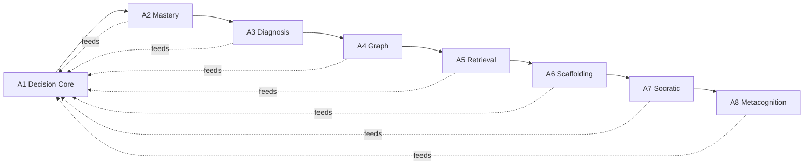

# 14 — أمر التنفيذ المرحلي الملزم للوكيل | A1–A8

## الحالة والتفويض

**نفّذ جميع A1–A8 في السورس الحالي** بعد baseline audit، مع عدم تشغيل نشر أو تفعيل طلاب حقيقيين أو AI خارجي أو Runner. هذه مواصفات مستقلة عن خطة V2.2 ومكملة لها، وليست إصدارًا مطبقًا. عند اختلاف HEAD عن الأرشيف المراجع، راجع الدلتا قبل التعديل واحتفظ بتوافق الوظائف القائمة.

## ترتيب التنفيذ والاعتماديات

A1 يبدأ بنواة سياسة وadapter للبيانات الموجودة في V2.2، ثم **يُوسّع تدريجيًا** بعد كل مرحلة. لا تشترط اكتمال A4 لبناء A1 الابتدائي، ولا تنفذ كل الميزات في controller واحد. كل مرحلة تُترك في حالة قابلة للبناء، وflag off لغير المختبر.

| رقم | مهمة عملية | مخرجات إلزامية |
|---|---|---|
| `TASK-A-00` | baseline + snapshot + alignment | `qa-reports/A-BASELINE.md` + جدول فجوات + قرارات تصادم؛ لا تعديل مصدر بعده قبل حسم ما يؤثر عليه |
| `TASK-A1-01…05` | policy + candidate eligibility + decision event + API + UI | `qa-reports/A1-PEDAGOGY-ENGINE.md`، اختبارات حتمية/ملكية/جِدة |
| `TASK-A2-01…05` | evidence adapters + multi-dimensional projection + UI + invalidation + API | `qa-reports/A2-MASTERY-MODEL.md` + حالات supported/independent/transfer/retention |
| `TASK-A3-01…05` | inventory diagnosis + candidates + probe orchestration + link A1 + tests | `qa-reports/A3-DEEP-DIAGNOSIS.md` مع unresolved/pending محتوى |
| `TASK-A4-01…05` | graph data + validator + runtime resolver + editor view + tests | `qa-reports/A4-KNOWLEDGE-GRAPH.md` بدورات وmapping ورؤوس علاقات |
| `TASK-A5-01…05` | schedule + due query + start/defer + novelty + UI/replay tests | `qa-reports/A5-RETRIEVAL-SPACING.md` مع fake-clock evidence |
| `TASK-A6-01…05` | content blocks + scaffold lifecycle + assistance + UI + independent final check | `qa-reports/A6-SCAFFOLDING.md` مع تاريخ الدعم |
| `TASK-A7-01…05` | reviewed templates + dialogue state + guardrails + fallback + UI/tests | `qa-reports/A7-SOCRATIC-TUTOR.md` لا اتصال حي مجاني/مدفوع |
| `TASK-A8-01…05` | goals + prediction + reflection + UI + integration + privacy | `qa-reports/A8-METACOGNITION.md` + رحلة كاملة |
| `TASK-A-FINAL` | contract audit + integrated synthetic path + migration review + docs + final report | `qa-reports/A-INTELLIGENT-LEARNING-FINAL-ACCEPTANCE.md` + مفاتيح وقائمة فحوص |

## خطوات مشتركة لكل TASK

1. اقرأ spec المرتبط ونطاقه والوثيقة المالكة من المشروع. سجل الملفات التي ستعدلها وسبب التغيير. استخدم branch مخصصًا أو commits مستقلة عن V2.2.
2. نفذ **API / data / rules / tests / UI** كمقطع رأسي متماسك عند الحاجة، لا تعتمد على Mock نهائي لمكوّن يدّعي صحة التعلم.
3. اختبر invariants: true judgment, no exposure leak, auth/consent, idempotency, revision, compatibility.
4. حدّث `docs/12-API-CONTRACT.yaml` وshared contracts وschema migrations إن تغيرت؛ اطبع diff مختصرًا ووثّق التغير في التقرير.
5. شغّل checks مستهدفة ثم lint/typecheck/contracts/build إن كانت البيئة جاهزة. لا تختلق PASS؛ إذا لم تعمل البيئة، سجّل NOT_RUN وسببًا واضحًا.
6. اكتب تقرير المرحلة قبل انتقاله، ثم أكمل التالية تلقائيًا **إذا لا يوجد تعارض مانع**. لا تطلب موافقة إضافية على أعمال داخل التفويض، ولا تختلق قبول محتوى بشري.

## حدود مهمة للوكيل

- لا تفتح `REAL_LEARNING_ENABLED` أو صلاحيات AI الخارجي، ولا تستخدم API مدفوع/مجاني للعرض الحي دون إذن. المسار offline مطلوب.
- لا تشغّل migrations على أي قاعدة إنتاج، ولا تحذف volumes أو محاولات أو exposures، ولا تنفذ `prisma migrate reset` على بيانات قائمة.
- لا تغير Golden الفعلي ولا تعطل اختبارات الخصوصية ولا تتجاهل مراجعات `GOLD-DIAG-015` و`ERR-ALG-05`.
- لا تبدأ B1–B3 أو C1–C7 أو V2.3 أخرى. تعديل المنهج/المحتوى الحقيقي يحتاج مراجعة المالك المختص.
- لا تستخدم نسب تقدم/إتقان أو فعالية علاج غير مستندة إلى حسابات وأدلة محددة.
- لا تعمل push/merge إلى الفرع الرئيسي ولا تنشر Beta/Production إلا بتكليف صريح. تسليم commits على فرع تطوير قابل للمراجعة.

## الاستثناءات وحل التعارض

عند غياب محتوى منشور كافٍ لا تقطع تنفيذ A5/A6؛ اختبر باستخدام **synthetic reviewed-for-test** موسوم داخل بيئة اختبار، مع بقاء الإطلاق الحقيقي BLOCKED. عند اختلاف سياسة جديدة عن `AGENTS.md`/`12-API-CONTRACT.yaml`، سجل `SPEC-CONFLICT` مع الملف والسطر والحل المقترح، وأوقف الجزء المتعارض فقط مع الاستمرار في بقية البرنامج.

## تقرير المرحلة الأدنى

القرار (PASS/PARTIAL/BLOCKED)، بداية/نهاية commit، ملفات معدلة، migrations المكتوبة/هل طُبقت على قاعدة اختبار، API/schema diff، feature flags، قائمة اختبار `command / observed result / evidence path`، مشكلات مفتوحة وتأثيرها، التراجع الآمن، التحقق من عدم النشر وأذونات صاحب القرار. القالب الكامل في `18-DELIVERY-REPORT-TEMPLATE.md`.
