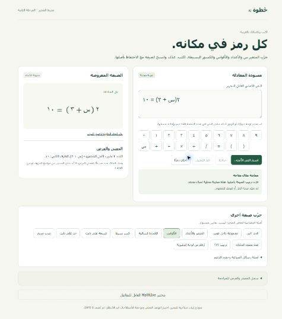
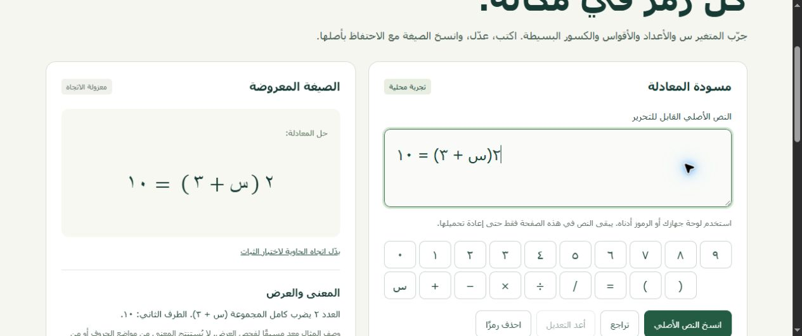

# تسليم PH-02 — إثبات محرر الرياضيات العربية

- التاريخ: 2026-11-04 / Asia/Riyadh.
- Task ID: TASK-021…025؛ الفرع `codex/ph02-arabic-editor`، أساس التنفيذ `70c946c`. التغييرات الحالية محلية في working tree؛ [جرد الملفات وبصماتها](ph02-files.json).
- الحالة: **مكتمل جزئيًا / بانتظار المراجعة واستكمال دليل الأجهزة**. لا اعتماد PH-02 أو DR-007 أو GATE-1، ولا بدء PH-03/04.
- الهدف: FR-011…017، MVP-02؛ AN-001…024 و028…032 و034، RTL-01…08، وأمثلة GOLD-PARSE المرتبطة **كفحوص عرض**.
- الوثائق المراجعة: AGENTS، 00/01/02/04/08/10/12/14/15، خطة 17 وسجل المالك وقرارات الاصطلاح/المحرر. لم تُعدل الوثائق المالكة أو API أو Golden.

## قبول PH-01 قبل التنفيذ

تحقق وجود ملفات جرد PH-01 الـ152 وتقارير TASK-011…017 على آخر commit `70c946c`، بلا نقص. أعيد `npm run verify`: 7 مجموعات ناجحة، بما فيها lint/typecheck/build و7 native smoke. نجح Compose config و14 حالة compose smoke مع DB/math الحقيقيين. سُجل قبول المالك المشروط بعد تحقق الشرط في [تقرير PH-01](ph01-delivery.md) و[الفحص النهائي](ph01-final-handoff.json). بقيت seed fixture غير منشورة، وغياب migrations وCI البعيد/قبول المحرك قيودًا معلنة. لا اختبار تحميل أو إعادة بناء حاويات غير لازمة.

## ما نُفذ وما بقي

| المهمة | المخرج | الحالة والحدود |
|---|---|---|
| TASK-021 | MathLive 0.111.4 مثبت ومختبر تفاعليًا أولًا، ومختبر قابل للفتح في الصفحة؛ بديل مصدر أصلي مع لوحة عربية وMathML | جزئي: فشل النسخ الافتراضي النصي موثق؛ لا حكم باستحالة تكييف المكتبة أو اختيار نهائي |
| TASK-022 | إدخال س والأرقام الشرقية/ASCII والأقواس والإشارات؛ وصفات أمثلة للكسر العددي والقسمة على ثابت | نجحت 13 حالة UI على الحاسوب؛ المعاينة محددة بالأمثلة، لا parser أو تصحيح رياضي |
| TASK-023 | صفحة RTL وصيغ MathML معزولة، صور حقيقية للأقواس وسياقها | جزئي: الهاتف والكسور/الأعداد بصريًا وتبديل الحاوية لم تكتمل |
| TASK-024 | raw مستقل، نسخ حرفي ولصق يعيد وصفة المثال نفسها، وتغيير النص يبطل الوصفة القديمة | 4 دورات حافظة فعلية ناجحة؛ لا إثبات إعادة تحليل دلالي بالمحرك أو اختبار هاتف |
| TASK-025 | رسائل عربية لـsyntax_error/unsupported، مواضع مصدر code points، حراس محارف/أقواس/طول، بقاء النص بعد الرفض | اختبارات وحدة ناجحة؛ التفاعل المرئي النهائي وتصحيح الرسالة لم يكتملا بسبب توقف أدوات التحكم |

الفرق بين الأصل والعرض والمعنى واضح في الواجهة: النص يبقى كما كُتب، حتى `2س` أو المحارف المرفوضة؛ وصفات MathML مستقلة. وصف المعنى **معد مسبقًا للمثال**، والتمثيل الدلالي الموثوق غير متاح حتى مرحلته. الإدخال الجديد يبقى draft ولا يُعتبر صحيحًا لمجرد مروره بحارس السطح. لا إرسال API أو تخزين خادمي/دائم أو أثر على تقدير الطالب. العينات ليست تمارين منشورة.

## نتيجة MathLive والبديل

على Chrome أمكن إدخال العربية. لكن تصدير ASCII Math أعاد تنسيق المسافات، والنسخ الفعلي للنص `٢(س + ٣ = ١٠` أعاد `$$ ٢(س + ٣ = ١٠ $$`. لذلك لم تُستخدم هذه التهيئة مصدرًا خامًا أو دلاليًا. اختبر بديل PoC يحفظ الأصل، وبقي MathLive مختبرًا منفصلًا قابلًا للتحرير. يمكن إصلاح مسار التصدير بمحول مختبر لاحقًا؛ **القرار النهائي pending**. [تفصيل DR-007](../planning/ph02-editor-decision.md).

## الملفات المتغيرة وسببها

| الملفات | الغرض |
|---|---|
| apps/web/src/ArabicEditor.tsx وmain.tsx وstyle.css | المحرر الأصلي، لوحة عربية، المصدر والحالات، تاريخ تعديل، معاينة RTL وتجربة المرشح |
| apps/web/src/FormulaPreview.tsx وeditor-fixtures.ts | عرض MathML ثابت للأمثلة فقط، بسط/مقام صريحان ووصف منفصل |
| apps/web/src/editor-model.ts وtests/editor-model.test.mjs | حراس سطحية وحفظ المصدر/المواضع وإبطال وصفة المثال واختبارات انحدار |
| apps/web/package.json وtsconfig.json وpackage.json وpackage-lock.json | MathLive مثبت، وتشغيل اختبارات TypeScript الأصلية وأوامر الفحص المستهدف |
| tools/verify-ph02.mjs و.github/workflows/ci.yml | تقرير فحوص قابل للتكرار، وإضافة اختبارات المحرر الخفيفة إلى CI؛ CI البعيد لم يشغل |
| planning/ph01-status.json وqa-reports/ph01-delivery.md وتقارير PH-01 المحدثة | قبول المالك وأدلة إعادة الفحص |
| planning/ph02-plan.md وph02-editor-decision.md وph02-status.json وtechnical-decisions.md | نطاق التفويض وحالة DR-007 وأسباب عدم إغلاق المرحلة |
| agent-reports/TASK-021.md…TASK-025.md وqa-reports/ph02-* وrtl-device-checklist.md وREADME.md وqa-reports/README.md | أدلة التسليم والفحوص والصور وطريقة التشغيل والمتابعة |

جرد المسارات الكامل في ph02-files.json. لم تمس حذوفات المستخدم الثلاثة القديمة. لا تعديل apps/api أو services/math-engine أو packages/contracts أو docs، ولا migrations أو نشر أو push/merge.

## الفحوص المنفذة فعليًا

- `npm run verify:ph02`: التنسيق، ESLint للواجهة وأداة الفحص، typecheck، build، و`npm run test:editor`. التفاصيل والأكواد ومخرجات التشغيل والبصمات في [ph02-checks.json](ph02-checks.json)؛ 12 اختبار وحدة مستهدفًا.
- حالات الوحدة تختبر raw مقابل العرض، بسط/مقام الكسر، مواضع Unicode، محارف التحكم، حد 256 دون حذف الأصل، إبطال المثال عند تعديل جديد، سطح الأقواس/المحارف، وحذف رمز supplementary كاملًا. لا تدعي هذه الاختبارات تشغيل Golden على المنتج.
- [ph02-browser-checks.json](ph02-browser-checks.json): 13 حالة إدخال وعرض recipe، و4 دورات Ctrl+V حقيقية بعد النسخ، على Chrome/Windows. قورن raw حرفيًا ووصف المثال قبل/بعد؛ لم يقارن AST من محرك غير موجود.
- الصور التقطت أثناء التطوير قبل إضافة الحراس السطحية الأخيرة؛ فحوص الكود النهائية تشمل تلك الإضافة، لكن لم يعاد فحص المتصفح النهائي بعدها.
- فحص `git diff --check` نظيف، والعقود والـGolden ومصادر الخادم/Python بلا تغيير. `npm audit --omit=dev --json` أعاد صفر ثغرات إنتاجية. أشار التثبيت إلى تحذير moderate ضمن اعتماديات التطوير؛ لم تُجر ترقية واسعة.
- البناء نجح مع تحذير حجم chunk يتجاوز 500KB بسبب MathLive؛ لم يُخفّض حد التحذير. لا قياس أداء هاتف أو اعتماد إنتاجي.

## الأدلة المرئية

لا صور هاتف: أكد المستخدم عدم توفر هاتف. [سجل الأجهزة وخطوات الاستكمال](rtl-device-checklist.md).

## BLOCKER والمتبقي والاعتماد

1. **BLOCKER لإغلاق PH-02:** اختبار متصفح هاتف حقيقي مع صور/تسجيل غير منفذ؛ لا إسقاط لهذا الشرط ولا استبداله بمحاكاة.
2. **HIGH / فحص غير مكتمل:** انقطع CDP أثناء محاولة لوحة الرموز؛ فشلت الاستعادة، ثم أوقفت Computer Use التفاعل لعدم إمكان تحديد URL الحالي بثقة. لم تنفذ فحوص المؤشر/التراجع/تغيير الاتجاه/التجاوب النهائية، ولا صور الكسر ورسائل الحالات. لا يُنسب هذا وحده لعيب مثبت في المنتج، وتبقى الحالات غير مجتازة حتى إعادة الاختبار.
3. **pending:** DR-007/AN-DEC-02…04، مراجعة اتجاه الصيغ والكسور والبديل من مختص الرياضيات والواجهة وQA. لا معيار قبول أو اصطلاح جديد اعتمده الوكيل.
4. parser/AST والتحقق وNestJS/DB خارج هذا التكليف؛ لا claims لصحة جبر أو تكافؤ حلول. المعاينات المحددة ليست دعمًا عامًا لكل التعبيرات.

لا مخاطر نشر أو بيانات طلاب أضيفت؛ التشغيل loopback والأمثلة اصطناعية. مخاطر العرض والحافظة غير المستكملة تبقى مانعة لإطلاق المحرر للمتعلمين.

المراجعة التالية: فتح `npm run dev --workspace @khotwa/web -- --port 5173`، إكمال قائمة الأجهزة، وإرفاق الدليل ثم حسم DR-007. للمراجعة البرمجية `npm run verify:ph02`. يمكن الرجوع لتأسيس PH-01 بإعادة ملفات الواجهة/اعتمادياتها من base في فرع مراجعة منفصل؛ لا بيانات DB أو migrations تحتاج رجوعًا.

حالة الاعتماد: **بانتظار مالك المنتج والواجهة/الرياضيات/QA**. قُبلت PH-01 فقط بموافقة المالك المشروطة وأدلتها؛ **لا اعتماد PH-02 أو GATE-1، وتوقف العمل هنا دون PH-03/04**.
